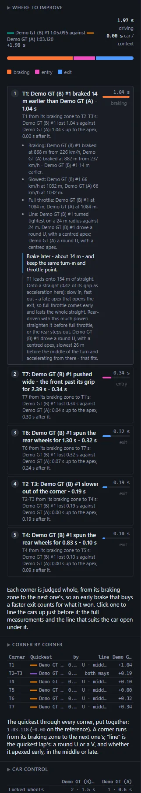

# Анализ завой по завой

Две обиколки от едно и също трасе се сравняват завой по завой. За всеки завой
визуализаторът казва кой е бил по-бърз, колко време е струвало и защо - спирал е
твърде рано, дал е газ късно, взел е по-широка линия - за да знаеш какво да тренираш
първо.

Пример: в завой 3 Driver A спира с 20 m по-рано от Driver B и губи 0,15 s, докато стигне
дотам, но дава газ по-рано и печели 0,15 s на излизане. Нетно 0,00 s: завоят е наравно и
никой не получава съвет да спира по-късно.

## Какво се вижда {#what-you-see}

### Къде да подобрите {#where-to-improve}

Секцията в страничната лента за фокусираната обиколка („Заредете поне две обиколки на
едно трасе.“ дотогава).

**Заглавието:** „<обиколка> <време> спрямо <референтна> <време>“ и разликата във времето
на обиколката - или, за референтната, „спрямо най-бързата друга обиколка във всеки завой
(…)“ и общото време, което е загубила. До него загубата, разделена на *каране* и
*кола / обстоятелства*.

**Лентата на разбивката:** загубеното време по група на причината (спиране, влизане,
излизане, права, кола, обстоятелства), в цветовете на причините, с легенда.

**Откритията**, три списъка:

1. Загуби от каране, най-скъпите първи, най-много **12** - или „Нищо, където различно
   каране би спечелило време, не изпъква.“
2. **Покажи какво струваха колата или ситуацията (X s)** - загубите от кола и
   обстоятелства, най-много 8 (включено по подразбиране).
3. **Къде <обиколка> печели време или е наравно по друг начин (N)** - печалбите и
   наравните завои, най-много 10 (включено по подразбиране).

Всяко откритие показва своя ред, заглавие (завоят и какво се е случило, с цената за
загуба), реда с присъдата, цената (печалбите с минус) с лента, и етикет: *спиране*,
*влизане*, *излизане*, *права* (загуби от каране, с „· кола X“, когато колата обяснява
0,02 s или повече), *кола*, *обстоятелства*, *по-бърза*, *наравно*. **Щракни върху
едно** - за да подредиш колите 40 m преди него, да го кадрираш и пуснеш отново, и да
отвориш измерванията му:

- **Спиране:** къде всяка кола е спряла (или отпуснала) и от каква скорост, и с колко
  метра по-рано или по-късно (от 5 m);
- **Най-бавна точка:** минималната скорост на всяка обиколка и къде е;
- **Пълна газ:** къде всяка е била плоско и колко по-рано или по-късно;
- **Линия:** разлика при влизане в завоя, най-тесни радиуси, колко далеч във вътрешността
  или навън, и формата на линията и върха на всяка обиколка;
- **Права до следващия завой:** дължината ѝ, двете скорости, където и двете са били
  плоско, какво е загубила или спечелила и от какво - началната скорост, по-силното
  тегло на другата, отпускане на газта, изтрита скорост, как е карана (части от 0,02 s);
- **Колата:** колко от загубата е колата и от какво (тяга, сцепление, спирачки; когато е
  0,02 s или повече);

после съвета **Колите:** (при различни коли, виж
[Профили на колите](race-car-profiles.md#what-the-cars-decide-in-a-corner)) и
съвета за линията.

### Завой по завой {#corner-by-corner}

Таблица (при две или повече обиколки), по един ред за всеки участък, за класа на
фокусираната обиколка, когато има няколко класа:

| Колона | Показва |
|---|---|
| Завой | `T3`, `T11-T12` |
| Най-бърза | обиколката, която е най-бърза през него (собственото ѝ време от началото до края на участъка) |
| преднина | предимството ѝ над втората най-бърза, s |
| траектория | формата и върха на линията на най-бързата обиколка („V · късен“, „U/V · в средата“); при задаване на курсора - най-тесният, входният и изходният радиус; „и по двата начина“ за смесен комплекс |
| (фокусираната обиколка) | колко назад е била от най-бързата, или ✓ когато е била най-бърза |

Щракването върху ред отваря откритието на фокусираната обиколка там (или подрежда колите
40 m преди участъка). Под таблицата, когато всеки завой има време: „Най-бързите във всеки
завой, събрани заедно: <време> (± спрямо референтната / спрямо най-добрата в клас X)“ -
най-добрите участъци плюс най-бързото изкарване до първия завой, когато то е собствен
участък.

## Как се изчислява {#how-it-is-worked-out}

Водещото правило: **завоят се оценява цял**, от зоната на спиране за него до зоната на
спиране за следващия. Обиколка, която спира по-рано, за да завие колата и да я вкара на
газ по-рано, се признава за излизането, което е купила, а не се кара да спира по-късно.

## Една ос на разстоянието {#one-distance-axis}

Обиколките се сравняват по разстояние, не по време - секунда по-назад, две обиколки са
на различни завои. Не и по собствения одометър на всяка обиколка (по-тясната линия
покрива по-малко метри). Изминатият път на **референтната** обиколка е оста:

- Всички проби на всяка друга обиколка се **проектират** върху пътя на референтната: на
  всяка проба се дава `s`, колко далеч по референтната е, и `d`, колко вляво (положително)
  или вдясно. Търсенето върви напред от предишното съвпадение (от 8 участъка назад до 40
  напред), така че обиколка, която пресича себе си, никога не скача на другото пресичане.
  Първата проба се търси в първата четвърт на пътя (на кръгово трасе старт и финал съвпадат);
  когато нищо не е в рамките на 30 m, взема се най-близката точка навсякъде, която не е зад
  последното съвпадение (след завъртане или излизане от трасето). `s` никога не намалява:
  проба, която се проектира зад предишната, се задържа.
- Всеки канал се **преизчислява** към една мрежа, **на всеки 2 m**, линейно; каналите със
  стъпки (предавка, флагове) - по най-близката проба. Извън собствения обхват на обиколка
  стойностите са празни.
- Първите и последните проби на обиколка се проектират малко във вътрешността на
  краищата на референтната, затова всяка обиколка се **носи до 15 m** след краищата си
  със скоростта, която е имала (времето расте с разстоянието през скоростта, останалото
  се запазва) - така че делтата ѝ на линията е разликата във времето на обиколката.
- `delta` = времето на обиколката във всяка точка от мрежата минус това на референтната:
  разликата. `lateral` = `d` на мрежата.

Времето, с което една обиколка е била по-дълга от друга между две точки от мрежата, е
разликата на техните делти: `rel(s)`. Всичко по-долу е изградено върху него.

## Завоите {#corners}

Намират се на **референтната** (`findCorners`), с нейната скорост, изгладена за ±6 m, и
нейната кривина (промяна на посоката за ±5 проби, изгладена за ±10 m):

1. **Минимуми на скоростта с изпъкналост.** Точка, която е най-ниската в рамките на
   ±40 m, чието спадане от най-високата скорост от всяка страна (преди по-нисък минимум)
   е поне `max(2,5 m/s, 6% от скоростта)`.
2. **Извивки.** Локален връх на кривината, по-стегнат от радиус **300 m**, без минимум на
   скоростта в рамките на 80 m: извивка, взета плоско, все още е завой, който трябва да се
   кара.
3. **Фази.** От всеки връх назад, докато референтната спира (> 0,1) или е без пълна газ
   (< 0,95): влизането; напред, докато е без пълна газ: излизането. Извивка, взета плоско,
   получава ±30 m. Припокриващите се завои се пазят отделно, но са наредени така, че да
   покриват обиколката.
4. Номерирани T1, T2 … по реда на обиколката; **ляво или дясно** според знака на кривината
   и дали светът е огледален (непознатото се брои за огледално).

**Прозорецът на завоя** (където референтната се извива): навън от най-тесната точка в
рамките на ±40 m от върха, докато кривината остава над една шеста от пика си, плюс 10 m
от всяка страна. Нейната страна дава знака на „вътре“.

## Участъците: от зона на спиране до зона на спиране {#segments-braking-zone-to-braking-zone}

Всеки завой притежава пътя до средата към върховете от двете страни. В него:

- **Най-бавната точка на всяка обиколка** е истинско падане на скоростта - нищо по-бавно
  в рамките на 6 m (3 точки от мрежата) от всяка страна, като се гледа отвъд краищата на
  участъка, така че излизането от предишния завой, което още ускорява към него, никога не
  се взима за нея - търсена от 15 m преди прозореца на завоя до 10 m след него. Обиколка,
  която там никога не е забавяла, се поставя на върха.
- **Къде една обиколка е започнала да забавя за него** (`entryOf`): назад от най-бавната
  си точка през спирането или отпускането, през къси пикове на пълна газ, докато не е
  държала крака натиснат (газ ≥ 0,95, спирачка ≤ 0,1) за **10 m**; газ, отново взета в
  последните **30 m** преди най-бавната точка, все още принадлежи на завоя; при пълна газ
  през цялото време - самата най-бавна точка. Обиколка без канал за газта или която никога
  не е държала крака натиснат след предишния завой, започва от най-бързата си точка между
  тях.
- **Участъкът започва** от първата от всички обиколки, която започва да забавя за него
  (4 m по-рано), и продължава до началото на следващия, така че спирането на всяка обиколка
  е вътре в него и участъците покриват обиколката.

**Комплекси.** Последователни завои, между които референтната никога не кара при пълна
газ - по-малко от **40 m** пълна газ - са един участък, „T11-T12“, каран като един; комплексът
има най-много **три** завоя (виещ се участък, карай без нито веднъж да е плоско, започва
нов). Комплекс, който завива и в двете посоки, е *смесен*: за него не се мери единна форма
на линията.

**На кръгово трасе** (референтната завършва в рамките на 50 m от мястото, където е
започнала), правата на последния участък продължава през линията до първата точка на
спиране:

ходът на летящата обиколка от линията се брои с последния завой. Обиколка, която е
започнала от покой или от старт на състезание (виж [Стартът](#the-start)), държи този
участък отделно.

### На какво води един завой {#what-a-corner-leads-onto}

Мери се на референтната: метри при пълна газ след завоя (от пълната му газ до края на
участъка, плюс участъкът през линията) и преди него (`after` на предишния участък, или
от старта).

| Вид | Правило |
|---|---|
| **между две прави** (`both`) | 200 m или повече преди **и** 120 m или повече след |
| **към права** | 200 m или повече след, или 120 m или повече след и поне толкова, колкото преди |
| **след права** | 200 m или повече преди |
| **връзка** | всичко останало |

## Какво е направила всяка обиколка в завоя {#what-each-lap-did-in-a-corner}

`cornerMetrics`, по обиколка и участък, на мрежата (стъпка 2 m). Педали: спиране се брои
над 0,1, пълна газ е 0,95 и повече.

| Мярка | Правило |
|---|---|
| **точка на спиране** | първото спиране, при което газта е отпусната (под 0,5), или което е продължило **15 m** - докосване с левия крак, когато мощността е включена, не е мястото, където е започнало спирането; при само докосвания - първото докосване |
| **отпусната** | без спиране - първата точка, в която газта е паднала под 0,8 |
| (без педали) | точката, в която обиколката е започнала да забавя (горе) |
| **отпускане на спирачката** | последното спиране до 30 m след най-бавната точка |
| **скорост в точката на спиране**, **метри на спиране** | до най-бавната точка |
| **пикова спирачка**, **пиково забавяне** | над зоната на спиране (ускорения над 45 m/s² се пренебрегват) |
| **спиране при завиване** | метри с спирачка > 0,05 и |волан| > 0,1 |
| **приплъзване при блокиране** | най-отрицателният коефициент на приплъзване на колелата в зоната (когато обиколката има приплъзване) |
| **най-бавна точка**, **минимална скорост** | както горе |
| **газта включена** | след отпускането (или най-бавната точка) - първата газ > 0,15 без спирачка |
| **пълна газ** | първата точка след това, държана при ≥ 0,95 за 10 m |
| **по инерция** | метри от отпускането до включената газ, с спирачка и газ под 0,05 |
| **спадове на газта** | пъти, в които газта е паднала с повече от 0,25 под текущия си връх между включената газ и пълната газ |
| **пик странично** | най-голямото странично ускорение от 20 m преди отпускането до по-късното от пълната газ и 20 m след най-бавната точка |
| **предавка на върха** | при най-бавната точка |
| **приплъзване при пробуксуване** | най-голямият коефициент на приплъзване на задвижваните колела между включената газ и пълната газ |
| **баланс** | предният минус задният ъгъл на приплъзване през средата (+ недовиране) |
| **права на пълна газ** | делът от участъка след пълната газ (и участъкът през линията) при ≥ 0,95; най-дългото отпускане по нея |
| **изтрита скорост** | най-голямата загубена скорост от връх при газ ≥ 0,9, без спирачка, на земята |
| **дрифт при влизане** | най-големият ъгъл на дрифта от точката на спиране до 5 m след най-бавната точка, на земята |
| **ръчна спирачка** | къде е включена (> 0,2), до 10 m след най-бавната точка |
| **във въздуха** | секунди във въздуха над участъка и най-дългият му полет |

## С кого се сравнява всяка обиколка {#who-each-lap-is-compared-with}

- Обиколката се сравнява с **най-бързата завършена обиколка в собствения си клас на
  представяне** (референтната, в класа на референтната).
- Самата най-добра обиколка на класа (и референтната) се сравнява, участък по участък, с
  **онази друга обиколка от класа, която е била най-бърза** през него - или с всички
  обиколки, когато е сама в класа си.

Картата на времето, разликите в списъка с обиколки, събитията за контрол на колата и
таблицата по завои следват същото сравнение.

## Сметката на времето за завоя {#the-time-account-of-a-corner}

`compareCorner`, за една обиколка спрямо другата през участък:

- **нетно** = `rel(end) - rel(start)` (плюс участъкът през линията при летяща обиколка):
  присъдата. По-близо от **0,03 s** е **наравно**.
- **Разделянето** - къде в завоя водачът е завил: в отсечката от първата точка на спиране
  или най-бавната точка на която и да е обиколка до по-късното от техните точки на пълна
  газ и най-бавна точка, най-голямото махало, което обиколката после е върнала или
  спечелила обратно, когато това махало е над **0,04 s**; иначе по-късната от двете
  най-бавни точки.
- **До върха** = `rel(split) - rel(start)`; **след него** = нетното минус това. Когато и
  двете са поне 0,04 s и с противоположни знаци, обиколката е **трейднала** едното за
  другото.
- **След него** се дели отново там, където и двете обиколки са на пълна газ: **излизането**
  (разделянето до по-късната пълна газ) и **правата** (от там до края).
- **Правата** се дели на три:
  - *скорост на излизане* (`byExit`) - измерена, не моделирана: по-бавната кола минава
    през началната скорост на по-бързата малко по правата, а оттам нататък собствената ѝ
    следа е това, което би направила от тази скорост, със собственото си предаване,
    съпротивление и наклон. Изместена назад до тази точка (и продължена с крайната си
    скорост за метрите, които печели), тя е времето ѝ от по-бързия старт; разликата е
    цената на скоростта на излизане. Когато по-бавната кола никога не достига тази скорост
    (или само в последните 2 проби), собственото ѝ ускорение по отсечката се връща като
    мощност (`a·v` се държи), никога по-силно от това, което обвивката ѝ показва при тази
    скорост (двойно измереното ускорение без обвивка).
  - *тягата на колите* (`byPower`) - само при различни коли: и двете коли от една и съща
    скорост през едни и същи метри, на пълна газ, интегрирайки ускорението при пълна газ,
    което всяка е показала при всяка скорост.
  - *как е карана* (`driven`) - останалото: отпускане, изтрита скорост при пълна газ.

  Скоростта на излизане никога не обяснява повече от цената на правата (и никога със
  противоположен знак), освен ако отпускане или изтрита скорост не са взели част от нея
  обратно. Обиколка **е отпуснала** на правата, когато делът ѝ при пълна газ е под и 0,9,
  и под дела на другата минус 0,05. Изтритата скорост се брои, когато двете се различават
  с повече от 1 m/s. Несъгласие под 0,02 s по знак се задава на 0.

Нетното на всеки участък се сумира до разликата във времето на обиколката, а до-върха и
след-него на всеки завой се сумират до нетното му (тестовете проверяват и двете).

### Делът на колата {#the-cars-share}

Само когато обиколките са с **различни коли** и обиколката е загубила време
(`carShare`):

- **тяга**: тягата на колите по правата (горе), до размера на загубата;
- **сцепление**: когато обиколката е била на границата на колата си (страничното ускорение
  в средата поне **90%** от това, което колата държи при тази скорост) и другата кола държи
  с повече от **5%**: от по-ниската минимална скорост, която не се обяснява с по-тесен
  радиус, делът `½ ln(grip_other / grip_mine) / ln(v_other / v_mine)` от останалата загуба;
- **спирачки**: когато обиколката е спирала (не е отпускала), другата кола спира със
  **5%** по-силно, а средното забавяне на обиколката през зоната е поне **80%** от това,
  което колата може: от `u` до `v` при `a1` срещу `a2`, завършващо на същата точка,
  `(1/a1 - 1/a2)(u - v)² / 2u`, до това, което е останало.

Цената на колата е сборът, но не повече от загубата.

## Присъдата и откритието {#the-verdict-and-the-finding}

`cornerFinding` записва най-много едно откритие на обиколка и завой, пробвано в този
ред:

| Случай | Откритие | Резултат |
|---|---|---|
| нетно в ±0,03 s, трейд, по-малката страна ≥ **0,1 s** | **наравно, два начина през** - кой е бил бавен на влизане и бърз на излизане, кой - обратното; когато след него има права (към права или между две), начинът бавно навътре, бързо навън е този, върху който се гради: запази ранната си газ, върни загубата на влизане с по-силно спиране, не по-късно | наравно |
| нетно в ±0,03 s иначе | нищо не се казва | - |
| спечелено, трейд, загубено до върха | **бавно навътре, бързо навън се е изплатило**: запази го, тук излизането струва повече | печалба |
| спечелено, трейд, спечелено до върха | **по-бърз при влизане**: влизането е вярно, по-ранна пълна газ би задържала повече | печалба |
| спечелено, а другата обиколка има загуба тук | **по-бърз - заради това, което направи другата**, нейната причина и съветът ѝ казват „За другата обиколка: …“ | печалба |
| спечелено иначе | **по-бърз при влизане / излизане**, според това коя половина е спечелила повече (спиране по-късно, повече скорост през средата; или по-рано плоско, по-силна тяга) | печалба |
| загубено, а **удар или катастрофа** струват поне `max(0,05 s, 40% от загубата)` | ударът е историята на завоя, преди колите | загуба |
| загубено, а **делът на колата** е 60% или повече | **колата**: тягата ѝ по правата, сцеплението ѝ през средата или спирачките ѝ - най-голямата част; с частта на шофьора (≥ 0,03 s), казана като „Другото X s: …“ | загуба |
| загубено, а една неподелена **грешка в управлението на колата** струва поне `max(0,05 s, 40%)` | тази грешка (виж по-долу), с това как се е движило времето около нея | загуба |
| загубено, а **по-дълъг полет** струва поне `max(0,05 s, 40%)` | полетът | загуба |
| загубено, трейд, спечелено до върха | **твърде бързо навътре, бавно навън**: причината за излизането; жертвай малко от влизането, за да се завърти и изправи по-рано, с точките на спиране и пълна газ на другата обиколка. Коренът ѝ (`cause`, който броят [статистиките](race-course-statistics.md)): спиране по-късно, когато е спирала с няколко метра по-късно от другата; иначе причината за излизането | загуба |
| загубено, трейд, загубено до върха | **даде повече при влизане, отколкото излизането върна**: причината за влизането, която е и коренът ѝ (`cause`); запази излизането, губи по-малко при влизане | загуба |
| загубено, отпуснато на правата, а караната част е над половината от загубата | **не е на пълна газ по правата**: делът ѝ при пълна газ спрямо този на другата, къде и колко дълго е било отпускането | загуба |
| загубено, тягата на колите над 60% от загубата, а правата - над половината | **тягата на колата по правата** (с тягата и на двете коли при 160 km/h) | загуба |
| загубено иначе | причината за половината, която е загубила повече (до върха ≥ след него: тази на влизането; иначе тази на излизането). По-бавна на излизане само защото е по-бавна през средата (с повече от 1 m/s): вместо това причината на средата | загуба |

Откритие за загуба може да завърши и с **Също така:** - изтрита скорост при пълна газ или
отпускане на правата - когато караната част от правата е струвала повече от 0,04 s и това
не е било вече причината.

Откритията се подреждат: първо загубите, най-скъпите първи; после печалбите и наравните
завои.

### Причините при влизане {#causes-on-the-way-in}

`entryCause`, първата, която важи (разликите в минималната скорост са в m/s; „5 m“ е
праговът, за да брои точка по-рано или по-късно):

| № | Причина (грешка) | Правило |
|---|---|---|
| 1 | удар или катастрофа при влизане | неподелен удар, започващ до 10 m след най-бавната точка |
| 2 | **почти спряла** (инцидент) | най-ниската скорост под **60%** от това, което сцеплението на тази кола позволява там, където другата е минала (`v_other · √(grip_mine / grip_other)`, когато другата кола държи повече, иначе скоростта на другата), другата обиколка над 8 m/s - завъртане, контакт или пропуснат завой |
| 3 | грешка в управлението на колата при влизане | неподелено блокиране, подтискане, завъртане или плъзгане без газ, започващо до 10 m след най-бавната точка, струвало ≥ 0,02 s |
| 4 | по-дълъг полет преди най-бавната точка | виж [рали](#rally-rotation-and-flights) |
| 5 | **отпусната**, когато другата е била на пълна газ или е отпуснала 5 m или повече по-късно | тази обиколка само е отпуснала |
| 6 | **спряна, когато другата само е отпуснала** или е била на пълна газ | и е била по-бавна през средата с повече от 0,5 m/s |
| 7 | **спряна леко** | спирала (не е отпускала), е имала място да спира по-силно - с данни за гумите, приплъзването ѝ при блокиране под **60%** от приплъзването, при което спирачките на колата дават най-доброто си; без тях, пиково забавяне под **85%** от това, което показва при тази скорост - педалът под 0,95, а пиковото забавяне на другата обиколка с повече от **15%** по-високо |
| 8 | **спряна рано** - или **спирачките на колата** | спряна с повече от 5 m преди другата. В друга кола, чиито спирачки са с над 5% по-силни, и с не повече от 10 m резерв спрямо разстоянието, което тази кола се нуждае при собственото си забавяне: спирачките на колата. Иначе спряна рано, с „Спирай по-късно - около N m“ (в друга кола - метрите отвъд това, което ѝ трябва) |
| 9 | **по инерция** | повече от 10 m без нито един педал и с 5 m повече от другата |
| 10 | **по-бавна през средата** | с повече от 0,5 m/s по-бавна при най-бавната точка; разделена по `v² = a·R` (по-долу) |
| 11 | **пристигнала по-бавно** | с над 1 m/s по-бавна при точката на спиране, без рано спиране: решено по-рано - от предишния завой и тягата на колата, или от полет в предишния завой, който е бил с 0,2 s по-дълъг. Колата е тази, когато колите се различават |
| 12 | по-бавна до върха | иначе: отпускай спирачката по-плавно и вкарвай повече скорост в средата |

**По-бавна през средата** (`middleSplit`): радиусът на всяка обиколка в нейния
радиус в най-бавната си точка се мери от собствения ѝ път (±8 m), страничното ѝ
ускорение като `v²/R`, и

`ln(v_other / v_mine) = ½ ln(a_other / a_mine) + ½ ln(R_other / R_mine)`.

- Радиусът обяснява **половината или повече**: **твърде стегната линия** - „използвай
  повече от пътя“, с двата радиуса и дела.
- На границата на колата (приплъзване над 10° дрифт на асфалт / 20° на рохкава, или
  страничното ускорение поне 90% от това, което държи при тази скорост) и другата кола
  държи с над 5% повече: **сцеплението на колата**; вместо това пази излизането.
- Плъзгане през него (дрифт над 10° / 20°), а другата обиколка не е (нейният дрифт при
  влизане е поне с 4° по-малък): **настрани** - отвъд сцеплението, не под него; влизай малко
  по-бавно. Казва се, че е на колата, когато тази кола хваща задницата си поне веднъж на
  обиколка повече от другата.
- В друга кола, която държи под **96%** от сцеплението на другата, а обиколката е карана
  в рамките на 1 m/s от `v_other · √(grip_mine / grip_other)`: **сцеплението на колата** -
  „спирането по-късно няма да затвори това“.
- Иначе **излишък от сцепление**: страничното ускорение спрямо това на другата на подобен
  радиус и това, което държи тази кола; носи повече скорост до върха.
  Когато задницата на тази кола се пуска, преди сцеплението ѝ да е изчерпано (плъзганията
  ѝ започват под 85% от сцеплението ѝ, а обиколката е била на 80% от него), остатъка
  намери на малки стъпки.

### Причините при излизане {#causes-on-the-way-out}

`exitCause`, първата, която важи:

| № | Причина (грешка) | Правило |
|---|---|---|
| 1 | грешка в управлението на колата при излизане | неподелено пробуксуване, завъртане, плъзгане или удар, който свършва на или след 10 m преди най-бавната точка |
| 2 | **изтрита скорост** | с повече от 1 m/s по-голяма загуба на скорост при пълна газ от другата; над **7 m/s (25 km/h)** „по-скоро контакт или завъртане, отколкото плъзгане“ |
| 3 | **завъртяла колата грешно** (рохкава настилка) | виж [рали](#rally-rotation-and-flights) |
| 4 | **на газ по-късно** | газта включена с повече от 5 m по-късно, броено и от собствената най-бавна точка на всяка обиколка (обиколка, чиято най-бавна точка е по-късна, не се обвинява за по-късна газ) |
| 5 | **колебала се с газта** | повече спадове на газта от другата |
| 6 | **мина широко и чака** | с повече от 1,5 m навън от другата, където и двете са били плоско, и пълна газ с повече от 5 m по-късно от собствената ѝ най-бавна точка |
| 7 | **пълна газ по-късно** | пълната газ с повече от 5 m по-късно, и от собствената ѝ най-бавна точка; с ускорението на колата там |
| 8 | **задвижването на колата** | в друга кола, която тегли под 95% от другата при тази скорост, и тягата е обяснила част от правата |
| 9 | **по-бавна след завоя** | иначе: по-късен връх, така че колата е права по-рано |

Когато двете обиколки са били на различни предавки при най-бавната точка, съветът
завършва с „Предавка N при върха; другата е ползвала M.“

### Грешки в управлението на колата и удари {#car-control-faults-and-impacts}

Грешка от [Събития на контрола на колата](race-control-events.md) като причина: блокиране
е *спирачна* причина, пробуксуване или плъзгане на газ - причина от *излизане*, останалото
е *влизане*; удар след най-бавната точка е *излизане*, преди нея - *влизане*. Съветът е
на самото събитие, после „Струвало е около X s до 40 m след него“ (или „до времето, в което
колата е върнала скоростта си“ при удар). Блокиране, при което точката на спиране е с повече
от 5 m по-рано от тази на другата, добавя, че обиколката е спирала и рано - с въртящи се
колела нямаше да ѝ трябва.

### Рали: завъртане и полети {#rally-rotation-and-flights}

На **рохкава настилка**, с ъгли на дрифта и при двете обиколки, и тази обиколка е на газ
(или плоско) с повече от 5 m по-късно:

- **Завъртяла колата по-малко**: другата е имала колата завъртяна на **12°** или повече до
  най-бавната си точка и с поне **8°** повече от тази обиколка. Съвет: отпусни или докосни
  с левия крак спирачката, докато колата влиза, с точката на ръчната спирачка на другата
  обиколка, когато само тя я е ползвала, или ръчната спирачка в завой по-бавен от 15 m/s
  (54 km/h).
- **Завъртяла я твърде много**: тази обиколка я е завъртяла на 12° или повече и с поне
  **12°** повече от другата: трябвало е да се изправи, преди мощността да може да се спусне.

**По-дълъг полет**: във въздуха с 0,2 s или повече по-дълго от другата, като струва поне
0,03 s от 10 m преди излитането до 40 m след приземяването (или края на участъка). Преди
най-бавната точка е причина от влизане; става история на завоя, когато обяснява 40% или
повече. Съветът: дръж газта при излитането, вземи билото малко по-бавно или с леко
докосване на спирачката.

### Стартът {#the-start}

Преди първия завой, при спринт или когато някоя от обиколките е започнала от покой (под
5 m/s, когато и двете са първи по оста) или при старт на състезание (под 60% от скоростта
на другата), изкарването до първата точка на спиране е собствено откритие (завой 0), когато
се различава с повече от 0,03 s: *Изстрелването*, *Стартът на състезанието* или *До първия
завой*. Загуба там се отдава на обстоятелствата (*обстоятелства*), когато една обиколка е
започнала от старт на състезание, а другата - с ход; на колата, когато обиколките са с
различни коли; иначе на шофьора. Съвети: в друга кола от покой - „предимно колата“; стартиране
от покой с същата кола - изстрелвай с по-малко пробуксуване и превключвай във върха на
мощностната крива; старт на състезание - сравни го с друга първа обиколка; летящ старт -
по-добро излизане от последния завой се пренася през линията.

## Изминатата линия {#the-driven-line}

`lineMetrics`, по обиколка и участък (не за смесени комплекси), само от позициите
(изгладени ±2 проби) над прозореца на завоя:

| Мярка | Правило |
|---|---|
| кривина | промяна на посоката за ±8 m от собствения път на обиколката |
| **най-тесен радиус** | 1 / пиковата кривина |
| **влизане в завоя** / **излизане от завоя** | където кривината за първи път / за последен път надмине една пета от пика си |
| **средата** | където обиколката е завила половината от промяната на посоката си |
| радиус вътре / вън | метри, карани над половината промяна на посоката, преди / след средата |
| **форма** | най-тесният радиус спрямо средния радиус при завиване: под **0,55** е **V**, над **0,75** е **U**, между - „U/V“ |
| **връх** | радиус на излизане спрямо радиус на влизане: над **1,25** късен, под **0,8** ранен, иначе в средата |
| **връх на скоростта** | най-бавната точка повече от **15 m** преди средата: бавно навътре, бързо навън; повече от 15 m след нея: още намалява скоростта след средата |

Спрямо другата обиколка: колко далеч във вътрешността (+) или навън е минала при влизане в
завоя, през най-тесната част и където и двете са били плоско (казва се от 1 m); къде
всяка е навлязла в завоя (казва се от 8 m).

### Коя линия подхожда на тази кола тук {#which-line-suits-this-car-here}

`lineFor`, според това, към което води завоят, и характера на колата при този завой:

- **мощност към сцепление** = ускорението на колата при пълна газ при скоростта на излизане
  спрямо сцеплението ѝ при минималната скорост (от обвивката ѝ). **Point and shoot** при
  **0,45** и повече; **momentum** при **0,25** и по-малко.
- **притискаща сила**: сцепление при 151-252 km/h спрямо сцепление при 54-108 km/h от **1,15**
  или повече, за завой, взет при **144 km/h** (40 m/s) или по-бързо - тогава е завой momentum,
  каквато и да е мощността. Не се съди на рохкава настилка.

| Вид завой | Кола | Линия |
|---|---|---|
| след права | point and shoot / друга | V / U, връх в средата: „зоната на спиране е наградата“ |
| между две прави | momentum / друга | U / V, късен връх |
| връзка | momentum / друга | U / V, връх в средата: „карай го за излизането на следващия“ |
| към права | momentum (или бърз завой с притискаща сила) | широка кръгла U, малко късен връх |
| към права | point and shoot | V: спирай право, завивай късно, завърти се в къса тясна среда, права рано |
| към права | между двете | U с късен връх: бавно навътре, бързо навън |

Там, където излизането има значение (към права, между две), задвижването добавя едно
изречение: **FWD** - завърти я със спирачките, добавяй мощност само когато колелото се
изправя; **RWD** с мощност към сцепление от 0,35 или повече - изправи я преди пълна газ;
**AWD** - може да поема мощност, докато още се завърта. На рохкава настилка всяка линия
добавя: завърти колата при влизане.

Изречението после казва какво е карала обиколката и дали пасва: *най-бавната късна
връзва излизането* или *ранен връх връзва излизането*, където е трябвал късен връх, а
обиколката нито е върхала късно, нито е била най-бавна рано; *по-закръглена, отколкото иска
тази кола*, където е трябвала V; *по-квадратна, отколкото иска тази кола*, където е трябвала
U; иначе *това пасва*.

## За разработчици {#for-developers}

Код: [`src/race/analysis.ts`](https://github.com/Holdi601/3DHeat/blob/main/src/race/analysis.ts),
[`align.ts`](https://github.com/Holdi601/3DHeat/blob/main/src/race/align.ts),
[`segments.ts`](https://github.com/Holdi601/3DHeat/blob/main/src/race/segments.ts),
[`line.ts`](https://github.com/Holdi601/3DHeat/blob/main/src/race/line.ts),
[`src/ui/race/RacePanel.tsx`](https://github.com/Holdi601/3DHeat/blob/main/src/ui/race/RacePanel.tsx).
Обосновката и нейните източници: [методът](race-analytics.md).
