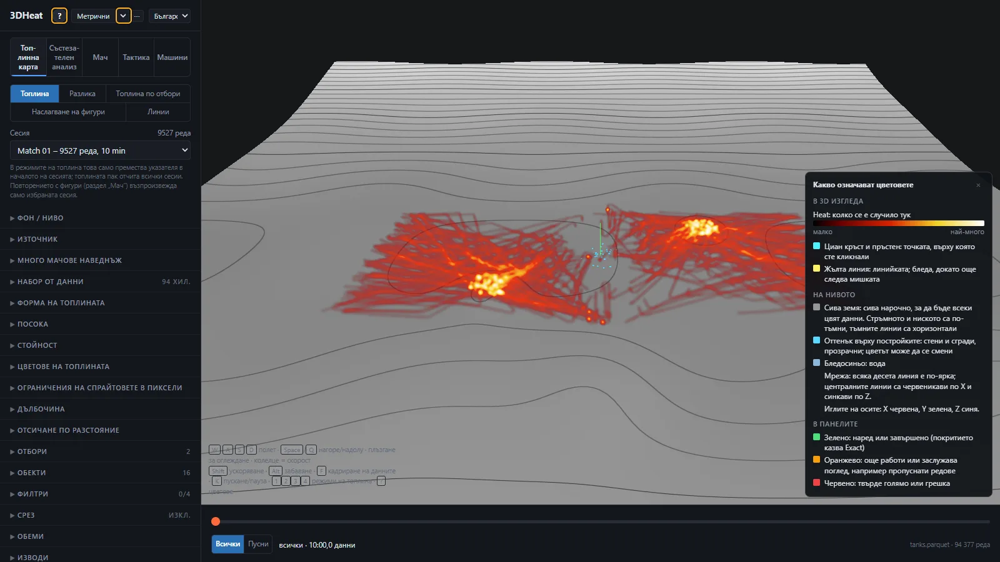
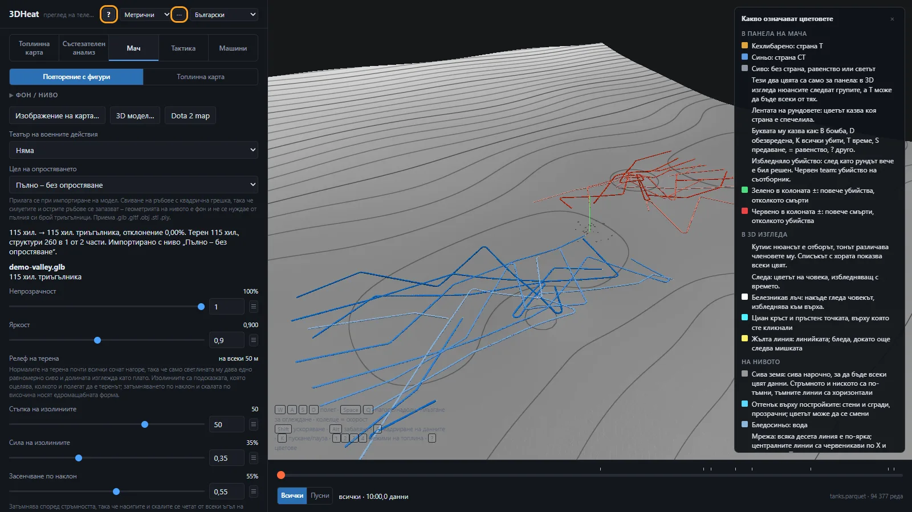

# Настройки, единици и клавиши

Малките контроли в горната част на страничната лента променят начина, по който визуализаторът говори с теб: езика, мерните единици (метри или футове, км/ч или възли) и режим на помощ, който обяснява цветовете. Избора ти се помни в браузъра.

## Горната част {#the-header}

В горната част на страничната лента:

| Контрол | Какво прави |
|---|---|
| **?** | Режим на помощ: какво означава всеки цвят (също `?` или `F1`) |
| Меню **Единици** | Метрични, Имперски, Авиационни или Морски |
| Бутонът **...** до **Единици** | Отваря "Избери единица за всяка величина": по едно падащо меню за величина |
| Меню **Език** | Езикът на визуализатора: [40 езика](languages.md), или този на браузъра |

Числата, които пишеш в поле, може да използват точка или запетая (`0.35` или `0,35`). Визуализаторът чете и двете и показва числата така, както ги пише езикът на визуализатора.

## Единици {#units}

1. Избери пресет от менюто **Единици**. Всички величини се сменят заедно.
2. За да смениш само една величина, кликни бутона **...** до нея и избери единица за нея. Менюто след това показва `*` след пресета.
3. Величина, която не си задал, следва пресета. Избери "Както в пресета", за да се върнеш.

| Величина | Метрични (по подразбиране) | Имперски | Авиационни | Морски |
|---|---|---|---|---|
| Разстояние | km | mi | NM | NM |
| Височина, дължина | m | ft | ft | m |
| Скорост | km/h | mph | kt | kt |
| Вертикална скорост | m/s | ft/min | ft/min | m/s |
| Температура | °C | °F | °C | °C |
| Налягане | hPa | inHg | hPa | hPa |
| Маса, гориво | kg, l | lb, gal | lb, gal | t, m³ |
| Ъгъл | градуси | градуси | градуси | градуси |

Други единици, които можеш да избереш за една величина: разстояние km, mi, NM; скорост km/h, m/s, kt, mph; вертикална скорост m/s, ft/min, m/min; температура °C, °F, K; налягане hPa, inHg, mmHg, psi; маса kg, lb, t; ъгъл градуси или NATO милрадиани (6400 на окръжност). Единиците са еднакви навсякъде във визуализатора: етикети, карти, графики, статистики.

## Режим на помощ {#help-mode}

Натисни `?` или `F1`, или кликни бутона **?**. Показва се *Какво означават цветовете*: легенди за 3D изгледа, скалите на топлината, цветовете на отборите, цветовете на нивото, цветовете на състоянието в панелите, панела на мача и изгледа на състезанието. Остава включен, докато не го изключиш. В раздела Мач обяснява и цветовете на панела на мача.

## Какво помни браузърът {#what-the-browser-remembers}

Тези настройки се пазят в браузъра ти между посещенията (нищо не се изпраща никъде):

- езикът, мерните единици и режимът на помощ;
- настройките на фигурата, символа, етикета, камерата и тактическия изглед при повторение;
- скоростта на възпроизвеждане и огледалното отразяване;
- отметките по запис, силата на звука по набор данни, слоевете на целите;
- външните настройки за ИИ (ключът - само ако отметнеш *Запомни*).

Настройките на топлината, филтрите и режимът започват отначало при всяко зареждане. Пълният, генериран списък: [Запазени настройки](ref-settings-storage.md).

## Клавишите, които визуализаторът задържа от браузъра {#keys-the-viewer-keeps-from-the-browser}

Сесията с големи данни отнема време за зареждане, затова визуализаторът пречи на браузъра да я изхвърли по погрешка:

- `Ctrl`/`Cmd` + букви, които биха отпечатали, запазили, отворили, презаредили, затворили или отворили нови прозорци, не правят нищо извън текстовите полета; `F1`, `F3`, `F5`, `F6` и `F7` не правят нищо.
- Затварянето или презареждането на раздела с данни или ниво, които са заредени, пита първо.
- На цял екран визуализаторът заключва клавишите, които ползва (W, T, N, S, R, P, Q, Esc), така че браузърът да не ги вземе.

Точният списък: [Клавиши в браузъра](ref-browser-keys.md). Всички клавиши на визуализатора: [Справка за клавиатурата и мишката](keyboard-reference.md).
