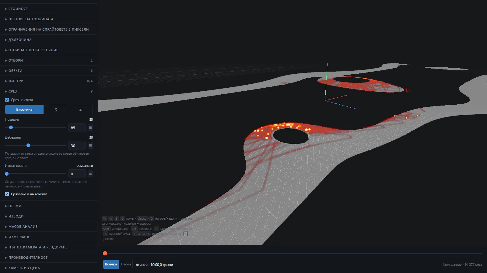

# Срез

**Срез** реже света като парче торта, така че да можеш да видиш вътре в сградите. Използвай го, когато стените скриват интересната топлина, например за да видиш един етаж от сграда.

## Опитай {#try-it}

1. Зареди ниво и малко данни и отвори **Срез**.
2. Отметни **Срез на света**. Осът е **Височина**.
3. Провлачи **Позиция** нагоре и надолу: пластът се движи през нивото.
4. Направи **Дебелината** тънка за план на етаж или широка за "всичко под това ниво".
5. Остави **Извън пласта** на 0, за да махнеш останалото, или го вдигни, за да запазиш слаба следа.



Пластът реже **геометрията на нивото и точките с данни заедно** - ако се срязва само нивото, топлината би висяла там, където е била сградата ѝ. Той е двойникът на [окултирането по дълбочина](depth-and-culling.md): щом нивото правилно скрива какво е зад него, вътрешността на сграда също е скрита. Панелът се показва, когато има какво да се срязва (набор данни или 3D ниво); заглавието му показва осата, когато е включен, *off* иначе.

```
изглед отстрани  Позиция = къде е пластът
 ----------      Дебелина = колко висок е пластът
 | етаж 3 |
 |=========|  <--- пласт (запазен)
 | етаж 2 |  <--- извън: махнат (или слаб)
 | етаж 1 |
 ----------
```

## Контроли {#controls}

| Контрол | По подразбиране | Значение |
|---|---|---|
| **Срез на света** | изкл. | Включва пласта. Докато позицията е още на първоначалната си 0 и дебелината на първоначалната си 500, включването я премества в средата на осата и на 15% от дължината ѝ. |
| Ос | **Височина** | *Височина* (Y), *X* или *Z*. Смяната на осата премества пласта в средата на новата ос. |
| **Позиция** | средата | Центърът на пласта, в световни единици, по дължината на оста (500 стъпки). |
| **Дебелина** | 15% от дължината | От 1/500 от дължината до два пъти дължината, в логаритмични стъпки. Показва *извън света*, когато е широк колкото дължината: едната страна тогава стига извън света и това е просто разрез, а не пласт. |
| **Извън пласта** | 0, *махнато* | Колко от това, което е извън пласта, остава видимо, 0-100%. Слаба следа от срязаното често е по-лесна за четене, отколкото махането му изцяло. |
| **Срязване и на точките** | вкл. | Изключено оставя топлината цяла, така че се вижда през разреза - полезно за виждане какво е над и под пласта. |

Дължината на една ос е тази на 3D нивото, когато има такова, иначе тази на набора данни.

Срезът е независим от [отрязването по разстояние](depth-and-culling.md#distance-culling), което реже по посока на гледане, а не по ос на света; двете се комбинират. Всяка промяна на настройка на среза рестартира натрупването на топлината.

## За разработчици {#for-developers}

Пластът се проверява за позицията в света на всеки ред в шейдъра на върховете: ред извън него има приноса си умножен по стойността *Извън*, така че при 0 се отхвърля, преди да се нарисува какъвто и да е фрагмент. Шейдърите на нивото прилагат същата проверка към всеки фрагмент на земята, конструкциите и водата.
