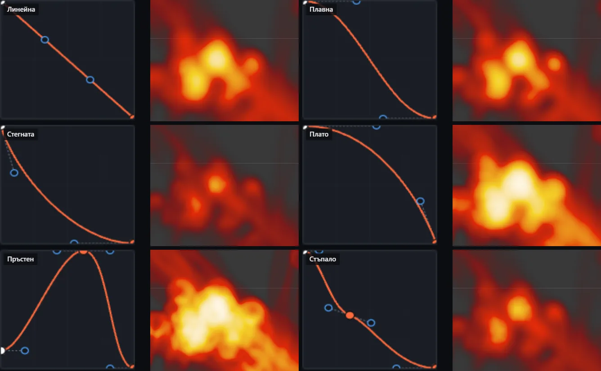

# Форма на спрайта

Всеки ред се рисува като кръгъл спрайт, който винаги е обърнат към камерата. Размерът му и профилът от центъра до ръба - **скалата** - решават дали горещ пункт се чете като плътна точка, мек облак, диск или пръстен. Тези контроли са в секциите **Форма на топлината** и **Ограничения на спрайтовете в пиксели** на страничната лента и важат за [Топлина](heat.md), [Разлика](difference.md), [Топлина по отбори](team-heat.md), а като half-width на линия - за [Линейна топлина](line-heat.md).

Промяната на която и да е от тях рестартира натрупването (полето трябва да се нарисува отново с новата форма).

Мислете за всяка точка като за мека светлинна капка. Малката капка показва единични места; голямата слива съседите в облак. Формата решава колко мек е ръбът.



## Радиус на спрайта {#sprite-radius}

Радиусът на спрайта в **единици на света** (означени като метри). По подразбиране 6; при всяко зареждане се взема хоризонталният обхват на данните / 120 - достатъчно голям, за да се слеят съседните отчитания по пътя в лента, а не да се четат като косъм. Логаритмичен плъзгач 0,05-2000, дръжката може да се плъзне до 50 000.


Далечните неща изглеждат по-малки, така че спрайтът се смалява на екрана с разстоянието. При паралелната проекция той е еднакъв навсякъде, което е част от причината паралелният изглед да е подходящият за сравняване на горещи места ([Камера](camera.md#projection)).

## Ограничения в пиксели {#pixel-clamps}

**Ограничения на спрайтовете в пиксели** (по подразбиране затворено) ограничават радиуса на екрана след преобразуването по-горе.

| Контрол | По подразбиране | Обхват (плъзгане) | Защо |
|---|---|---|---|
| **Мин. радиус в пиксели** | 1 px | 0-16 (512) | Не оставя далечните данни да изчезнат под един пиксел. |
| **Макс. радиус в пиксели** | 96 px | 2-1024, логаритмичен (8192) | Пазачът срещу презаписване. Спрайт, покриващ N пиксела, струва N смесвания, затова неограничен радиус близо до камерата прави бързия кадър бавен. Над височината на видимата област вече не ограничава нищо. |

**Еднаква плътност при всяко мащабиране** (в секцията Форма на топлината, по подразбиране включено) работи заедно с ограниченията. Спрайт, който ограничение прави по-голям (далеч) или по-малък (отблизо), запазва топлината, която би добавил при истинския си размер, така че един цвят означава един и същ брой редове на единица площ от земята при всяко мащабиране. Когато е изключено, ограничен спрайт добавя цялата си тежест при ограничения си размер и картината се променя, докато летите навътре.

## Интензитет в центъра и на ръба {#centre-and-edge-intensity}

Топлината, която спрайтът добавя в точния си център (**Интензитет в центъра**, по подразбиране 1, 0-10, плъзгане 1000) и по ръба си (**Интензитет на ръба**, по подразбиране 0, от -2 до 10, плъзгане 1000). Стойността на скалата *t* (1 в центъра, 0 на ръба, оформена от затихването или кривата по-долу) смесва двете (формулата е в [За разработчици](#for-developers)).

**Отрицателен интензитет на ръба** прави ръба да изважда, което издълбава хладен ореол около всяко горещо място и изостря групите една спрямо друга. Видимостта включва [окклузията](depth-and-culling.md) и [среза](slice.md); изчезването е [изчезването по Време на живот](timeline.md#history); знакът е ±1 в [Разлика](difference.md).

## Форма на профила: Затихване или Крива {#ramp-shape-falloff-or-curve}

**Форма на профила** превключва между два начина на оформяне на *t* върху спрайта. Като *d* е разстоянието от центъра (0) до ръба (1):

### Затихване {#falloff}

Показва се, когато е избрано *Затихване* (по подразбиране).

- **Затихване** (по подразбиране 1,6, 0,1-8, плъзгане 64): `t = (1 - d) ^ falloff`. 1 е права линейна скала; по-високите стойности придърпват топлината към центъра и стягат горещото място; под 1 я сплесква в диск.
- **Плавен профил** (по подразбиране включено): прилага S-крива smoothstep към *t*, така че спрайтът избледнява към ръба си, вместо да завършва с видим ръб.

### Редакторът на криви {#the-curve-editor}

Показва се, когато е избрано *Крива*. Буквално напречно сечение на спрайта: разстояние от центъра през него (*център* вляво, *ръб* вдясно), топлина нагоре. Кривата е парче по парче кубичен Безие през контролни точки, всяка с две манипулатора.

| Действие | Ефект |
|---|---|
| Двойно щракване върху графиката | Добавя точка на това разстояние (пази се между 0,02 и 0,98), върху кривата и с нейния наклон там, така че добавянето не променя нищо, докато не я плъзнете. |
| Плъзгане на точка | Премества я. Височините се пазят между 0 и 1. |
| Плъзгане на малък кръг | Огъва съседния сегмент (мести този манипулатор). |
| Alt-щракване или десен бутон върху точка | Премахва я. Двете крайни точки не могат да се премахнат. |
| Бутон с готов профил | Заменя кривата с готовия профил. |

Крайните точки са фиксирани в центъра и на ръба; височината им все още е ваша.

**Готови профили** ([`curve.ts`](https://github.com/Holdi601/3DHeat/blob/main/src/state/curve.ts)):

| Профил | Форма | Употреба |
|---|---|---|
| **Линейна** | Права от 1 до 0 | Същото като *Затихване* 1 при изключен *Плавен профил*. |
| **Плавна** | S-крива | Стандартната крива; това дава *Плавен профил* при затихване 1. |
| **Стегната** | Стръмно ядро, дълга бледа периферия | Оскъдни данни. |
| **Плато** | Равно, после бързо спадане | Изглежда като диск, а не като капка. |
| **Пръстен** | 0,15 в центъра, 1 при 62% от радиуса, 0 на ръба | Празен спрайт: показва къде минават пътищата, а не къде спират. |
| **Стъпало** | Затихване на два етапа, 0,45 при 35% | Отделя плътното ядро от околността. |

## Сплескване върху равнината на земята {#flatten-onto-ground-plane}

**Сплескване върху равнината на земята** (по подразбиране изключено) пренебрегва височината на всеки ред и рисува цялата топлина на една височина - най-ниската Y на набора данни - класическата 2D топлинна карта. Когато е включено, окклузията по дълбочина и *Скриване зад терена* са изключени (всяка точка би стояла точно върху повърхността, спрямо която се проверява), и секцията Дълбочина го казва.

## За разработчици {#for-developers}

### Формули {#formulas}

Радиус на екрана в пиксели: `radius × P[1][1] / w × viewport height / 2`, където `P` е матрицата на проекцията, а `w` е дълбочината на точката във видимата област.

Топлината, която спрайтът добавя:

```
heat added = mix(edge, centre, t) × sample weight × sign × fade × visibility
```

### Кривата {#the-curve}

Манипулаторите са ограничени хоризонтално до собствения си сегмент, така че кривата винаги е функция на разстоянието: ако плъзнете манипулатор далеч след следващата точка, той се изравнява към нея, вместо да сгъне кривата назад, което би направило резултата зависим от корена, който решителят е намерил.

### Как се рисува кривата {#how-the-curve-is-drawn}

Кривата се запечатва в таблица от 256 записа при всяка промяна, качва се като текстура с 16-битови плаваща запетая и се семплира за всеки фрагмент с линейно филтриране и полутексел отстъп, така че двата края остават точни. Решаването на Безие за x изисква итерация, която няма място в най-горещия шейдър на програмата, а извличането от таблица е и по-евтино от `pow()`, който ползва затихването. 16 бита, а не 8, защото 8 бита дават ивици, щом хиляди спрайтове са се сумирали; половин плаваща запетая от 16 бита се филтрира в базовия WebGL2, а 32-битовата изисква разширение.
