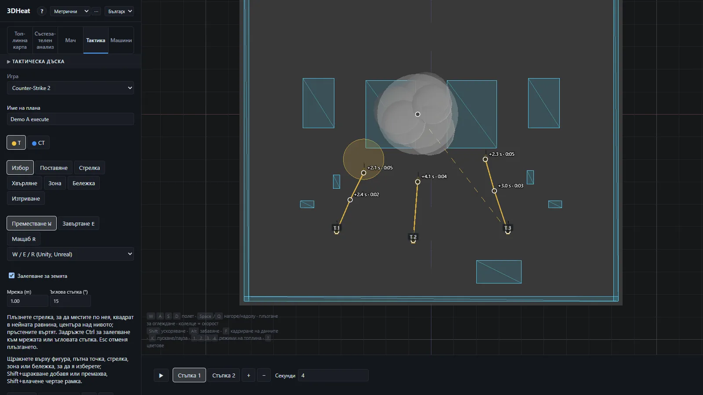

# Тактична дъска

Разделът **Тактика** е дъска за рисуване на отборен план: поставяте малки фигури на карта,
рисувате стрелки за това къде отиват и натискате пусни, за да видите как се случва.
Използвайте го, за да планирате рунд или атака, преди да играете. Споделя платното, камерата
и [нивото](levels.md) с другите раздели и нищо друго; планът не са данни и не рисува топлина.

## Първият ви план {#your-first-plan}

1. Отворете раздела **Тактика**. Изберете **Игра** (например Counter-Strike 2) и, за Valorant,
   натиснете **Зареди картите на Valorant** и изберете **Карта**. Или първо заредете [ниво](levels.md).
2. Изберете **Страна** (тя задава цвета) и натиснете **Изглед отгоре**.
3. Изберете **Място**, изберете фигура в **Фигури** (ползвайте **Търсене на фигури**, за да я намерите)
   и щракнете върху картата. Поставете две или три.
4. Изберете **Стрелка**, щракнете върху фигура, щракнете по пътя, по който трябва да върви,
   и натиснете **Enter**, за да завършите стрелката.
5. Натиснете **+** под изгледа, за да добавите стъпка 2. Всяка фигура започва там, където е
   свършила стрелката ѝ. Нарисувайте там още стрелки.
6. Натиснете **▶** (или `K`), за да пуснете плана от показаната стъпка до края.
7. Именувайте плана в **Име на плана** и натиснете **Запазване**.

## Започване на план {#starting-a-plan}

| Контрола | Какво прави |
|---|---|
| **Игра** | Избира страните и фигурите, които палитрата предлага: Counter-Strike 2 (T, CT; играчи и помощни средства), Valorant (Attack, Defense; играчи и общи способности), Battlefield, Squad, Arma (пехота, наземни машини, самолети, лодки), DCS / War Thunder / IL-2 (реактивни, витлови самолети, хеликоптери, противовъздушна отбрана, наземни, кораби, оръжия) и Друго. План, който вече има фигури, запазва страните си, когато играта се смени. |
| **Име на плана** | Името, под което планът се запазва. |
| **Карта**, **Зареди картите на Valorant** | Когато е избран Valorant: **Зареди картите на Valorant** взима списъка с карти от [valorant-api.com](https://valorant-api.com); **Карта** после поставя миникартата на избраната карта като ниво, кадрирана отгоре. Изображението се взима при избора и никога не се изпраща с приложението. Известието на Riot се показва, докато е на екрана (вижте по-долу). |
| **Страна** | Страната, на която принадлежи следващата фигура, стрелка или област; взема цвета на страната. |

Без ниво дъската е плоската земна равнина. Заредете ниво под **Ниво**, за да планирате
върху истинска карта: карта на CS2, експортирана с инструмента за CS2, ниво от библиотеката
или картинка на карта.

## Инструменти {#tools}

| Инструмент | Щрак | Бележки |
|---|---|---|
| **Избор** | Фигура, точка от маршрута, стрелка, област или бележка я избира. | Shift+щракване добавя или премахва; Shift+влачене рисува кутия около това, което да се добави. Избраното получава гизмо за преобразуване (вижте по-долу); `Delete` или `Backspace` го премахва. `M` премества избраната фигура до следващия щрак. |
| **Място** | Поставя избраната фигура. | Фигурата се избира в палитрата **Фигури** (с **Търсене на фигури**). Когато нищо не е избрано, `R` завърта следващата фигура с 15° преди да бъде поставена (`Shift+R` - в другата посока). |
| **Стрелка** | Всеки щрак добавя точка; Enter, двоен щрак или десен щрак я завършва, Esc я отхвърля. | **Движение**, **Атака** (по-широк връх) или **Наблюдение** (тънка линия на височина на очите). Стрелка, започната върху фигура, е маршрутът на тази фигура в тази стъпка: при възпроизвеждане фигурата го изминава, а следващата стъпка започва там, където е свършил. |
| **Хвърляне** | Хвърлящият, после мястото, където пада. | Пунктирана дъга от единия до другия, а избраното помощно средство (дим, светкавица, коктейл Молотов, ...) се появява там, където пада, и остава от тази стъпка нататък. |
| **Област** | Центърът, после ръбът. | Диск в цвета на страната. |
| **Бележка** | Къде отива бележката; пита за текста ѝ. | Показва се като карфица, а текстът ѝ - над нея. |
| **Изтриване** | Фигура, стрелка, област или бележка. | Премахва я от тази стъпка нататък; на първата си стъпка - я премахва. |

**Отмяна** и **Повторение** (`Ctrl+Z`; `Ctrl+Y` или `Ctrl+Shift+Z`) преминават през всяка промяна.
Линия под плана показва колко фигури, стрелки и стъпки има. **Изглед отгоре** гледа право
надолу (ортографски), **3D изглед** се връща към перспектива, **Кадър** побира плана, или нивото,
когато планът е празен.

**Размер на фигурите** мащабира всяка фигура на дъската; 1× е истински размер, което отгоре е
няколко пиксела за човек.

## Преместване, завъртане и мащабиране {#moving-turning-and-scaling}

Всичко на дъската може да се премества като в 3D редактор: фигури, помощни средства, маркери,
отделни точки от маршрута и цели стрелки, области и бележки. Избраното получава гизмо в средата си:

| Режим | Клавиши | Манипулатори |
|---|---|---|
| **Движение** | W (или G) | Стрелка за всяка ос (X червена, Y зелена и нагоре, Z синя) се движи по нея; квадрат се движи в своята равнина; центърът се движи по нивото под показалеца. |
| **Завъртане** | E (или R) | Пръстен за всяка ос се върти около нея. Пръстените на единична фигура са нейният яв, наклон и ролка; група се върти около осите на света, около средата си. |
| **Мащаб** | R (или S) | Разпръсва или събира избраното от средата си по ос или във всички посоки; радиусът на областта расте с него. |

**Клавишите** превключват между W / E / R (Unity, Unreal) и G / R / S (Blender); клавишите избират
режима само когато нещо е избрано, а иначе движат камерата. Така `R` означава **Мащаб** с клавишите
W / E / R и **Завъртане** с клавишите G / R / S, когато нещо е избрано, а когато нищо не е, завърта
следващата фигура за поставяне. Всички клавиши на дъската са изброени в
[справката за клавиатурата](keyboard-reference.md#tactics-board). Дръжте **Ctrl**, докато влачите,
за да привържете движението към **Мрежа** (метри) или завъртането към **Стъпка на ъгъла**.
**Залепване за земята** (включено по подразбиране) поставя преместените хора, машини, маркери,
точки от маршрута и области на повърхността на нивото; самолетите и хеликоптерите запазват височината
си, а влачене по стрелката Y никога не се залепва. Влачене на манипулатор никога не мести камерата.
**Esc** отменя влаченето, а всяка промяна е една стъпка от Отмяната.

Точките от маршрута се показват като точки по стрелките на показаната стъпка: щракнете една, за да
я изберете, влачете я, за да я преместите, Delete - за да я извадите. Секцията **Избрани** показва
мястото на избраното в метри, яв, наклон и ролка на фигура в градуси и радиуса на област, всяко за
писане с клавиатура.

## Време {#timing}

Маршрутът на фигура има време: всеки участък отнема дължината си върху нивото - мерена по повърхността
на всеки няколко метра, така че хълм или стълбище между две точки се брои - със скоростта на нейния
**режим** на движение за тази фигура в тази игра, плюс всяко **изчакване** в точка от маршрута. Пехотата
пълзи, клекне, ходи (тихо), тича или спринтира; машините и лодките пълзят, движат се предпазливо,
нормално или бързо; самолетите и хеликоптерите летят бавно, на крейсерска, на бойна или на максимална
скорост. Режим, който играта няма (CS2 няма спринт), взима най-близкия, който има. Как наклонът забавя
зависи от играта: в CS2 и Valorant се брои само хоризонталното разстояние, както в игрите; военните
симулатори забавят пехотата при изкачване (функцията на Тоблер за пешеходен преход), а машините - по
наклон.

Скоростите идват от таблици за всяка игра с техните източници (вижте [Скорости на движение](tactics-speeds.md)):
CS2 - според държаното оръжие, от определенията на оръжията в играта; Valorant - по оръжие; Battlefield,
Squad, Arma и въздушните игри - по вид и клас машина. **Движи се като** избира профила на фигурата
(оръжие, вид машина); **Собствена (m/s)** заменя всеки режим за тази фигура. Режимите се наричат така,
както ги показва дъската: *Пълзене*, *Клек*, *Ход (тихо)*, *Тичане*, *Спринт*; *Предпазливо*, *Нормално*,
*Бързо*; *Бавно*, *Крейсерска*, *Бойна*, *Максимална*.

Всяка точка от маршрута показва времето от последната и времето от началото на плана ("+3.9 s · 0:12").
Маршрутът на избраната фигура изброява всеки участък с режима си, дължината, времето, изчакването и
пристигането. **Пристигания** под **Време** поставя всяка фигура с маршрут на една времева линия, първото
пристигане горе. С **Пусни в реално време** (включено по подразбиране) стъпката трае, докато най-бавният
ѝ маршрут пристигне, а всяка фигура се движи със собствената си скорост; **Секунди** е тогава най-малката
дължина на стъпката. **Единици на нивото на метър** казва в какво е нивото: 39.37 за карти на CS2
(единици на играта), 1 за карти в метри.

## Сравнение с данни от мачове {#compare-with-match-data}

**Зареждане на файлове с мачове…** чете таблици на мачове на CS2 за картата (Parquet файловете на
инструмента за CS2, колкото искате; само нужните колони, във фонов режим); **Ползвай заредените данни**
взима данните, заредени във визуализатора. След това:

- **Най-ранно пристигане на картата** оцветява картата според времето от началото на рунда, на което
  играч за първи път е стигнал всяко място - бутонът **Най-бързо** показва най-бързото през всички рундове,
  **Типично (медиана)** - средния рунд - зелено рано, червено късно, за една страна или за двете. Показва
  какво е възможно кога.
- Избраният маршрут се сравнява с това, което играчите са постигнали от началото му (или от началото на
  рунда) до края му, всеки край - диск с зададения радиус: "Най-бързо наблюдавано 14.2 s, p10 15.0 s,
  медиана 18.3 s от 41 опита; вашият план 15.1 s".
- Скоростите, с които играчите наистина са се движили - тичане, ходене, клек, от колоните за ходене и
  клек на таблиците - в m/s.

## Стъпки {#steps}

Лентата под изгледа държи стъпките. Планът започва с една; **+** добавя една, а всяка фигура започва
в нея там, където е завършил маршрутът ѝ в последната стъпка; **−** премахва показаната. **Секунди** е
колко отнема показаната стъпка при пускане. **▶** (K) пуска от показаната стъпка до края: фигурите с
маршрут го изминават, фигурите, преместени на ново място в следващата стъпка, се плъзгат там, останалите
стоят. Докато една стъпка е показана, мястото на всяка фигура в следващата се рисува като бледо привидение,
а стрелките на последната стъпка - слабо под тези на текущата.

## Запазване {#saving}

Секцията **Файл** държи **Запазване**, **Отвори** и **Изчисти**. **Запазване** записва плана като
`<name>.h3dplan.json` (обикновен JSON: страни, стъпки, фигури с място за всяка стъпка, стрелки, области,
бележки); **Отвори** го прочита обратно. Файл от друга версия или който не е план, се отказва с причината.
**Изчисти** изпразва плана; Отмяната го връща.

## Фигури {#figures}

Всяка фигура се изгражда от самия визуализатор: прости форми с публикувания размер на вида, с
отличителните белези, които я отличават от съседите ѝ - пътните колела и кулата на танк, оръдията,
ракетите и радарите на машина за противовъздушна отбрана, очертанието на крилото, опашката и моторите
на самолет, роторите и късите крила на хеликоптер. Нищо не е взето от игра. Дизайн, измислен от игра, се
показва като общата фигура на своя клас. Вижте [Фигури](figures.md#which-figure-a-unit-gets) за това как
данните намират фигурата си.

## Известието на Riot {#riots-notice}

Картите на Valorant се показват според политиката "Legal Jibber Jabber" на Riot Games, която позволява
на безплатни общностни проекти да ги ползват и иска това известие, където и да се появят: *3DHeat е
създаден по политиката "Legal Jibber Jabber" на Riot Games, като използва активи, притежавани от Riot Games.
Riot Games не одобрява и не спонсорира този проект.* Способностите на дъската са общи форми, а не
изкуството на Riot.
