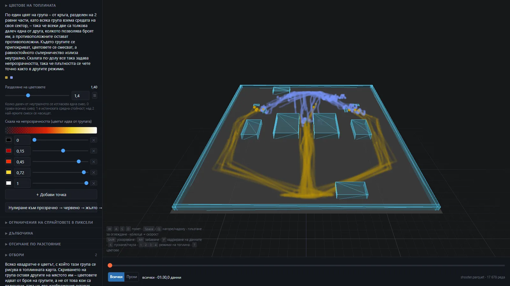

# Топлина по отбори

Топлината по отбори показва къде е бил всеки отбор, всеки в собствен цвят. Където отборите се припокриват, цветовете се смесват.

**Топлина по отбори** (клавиш 3) е полето на плътността от [Топлина](heat.md) с всяка [група](glossary.md) в собствен нюанс. Където групите се припокриват, нюансите се смесват; равен двубой излиза неутрален. Непрозрачността все още носи плътността точно както в другите режими, така че картината отговаря едновременно на *колко* и *чий*. Нужна е колона с групи.

Това не е [наслагването на фигури](box-replay.md): то рисува по една фигура за всеки човек; това е поле на топлината, оцветено по същата колона.

## Как да го ползваш {#how-to-use-it}

1. Натисни `3` (или избери **Топлина по отбори** в лентата с режимите).
2. Отвори **Цветове на топлината**. Мострите показват цвета на всяка група; задръж курсора върху мостра за името на отбора.
3. Ако всичко изглежда сиво, увеличи **Разделяне на цветовете**.
4. Махни отметката на група в [Списъка с отбори](teams-list.md), за да я извадиш; останалите цветове остават където са били.

## Контроли {#controls}

В секцията **Цветове на топлината**:

| Контрол | По подразбиране | Значение |
|---|---|---|
| Мостри | | Цветът на всяка група, за първите 12 групи, после *+N още*. Задръж курсора за името на групата и цвета. |
| **Разделяне на цветовете** | 1.4 | Колко далеч се изтласква една смес от неутралното, 0-4. 0 прави всичко сиво; 1 е истинското средно; над около 2 най-ярките смеси излизат извън показваемия обхват и се ограничават по канал, което измества нюанса им. |
| **Скала на непрозрачността (цветът идва от групата)** | стандартната скала на топлината | Тук се използва само **алфата** на скалата: прозрачна там, където няма нищо, непрозрачна на върха. Нейните цветове се игнорират. |

Група, чийто етикет означава "без група" (`0`, празен, `none`, `unknown`, `null` или `-1`), се рисува сива.

Всички останали контроли за топлината - форма, наситеност, отговор, минимална топлина, дълбочина, отрязване - работят както в [Топлина](heat.md).

[Списъкът с отбори](teams-list.md) показва цвета на топлината по отбори на всяка група като мостра в този режим. Скриването на група оставя цветовете на всички други групи където са били: нюансите идват от общия брой групи, не от това какво е включено, така че две картини остават сравними.

## За разработчици {#for-developers}

### Палитрата {#the-palette}

От [`colors.ts`](https://github.com/Holdi601/3DHeat/blob/main/src/render/colors.ts):

- Цветовете живеят в равнината на цветовете **Oklab** при фиксирана светлина (0.7) и наситеност (0.115), така че всяка група е еднакво ярка и червената група не изглежда по-гореща от синята.
- При *n* групи кръгът на нюансите се дели на *n* равни части и група *i* взима **центъра** на частта си, `(i + 0.5) / n` от оборот. Всеки две групи са колкото може по-далеч една от друга при този брой, а противоположните остават противоположни, каквито и да са броят.
- Използват се най-много **16** различни нюанса. При повече групи идентификаторите се разполагат с повтарящо се делене (обърнати по бит идентификатори: 0, ½, ¼, ¾, ⅛, …), така че съседните идентификатори не споделят нюанс; групите над 16 задължително споделят.
- Група, чийто етикет означава "без група" - `0`, празен, `none`, `unknown`, `null` или `-1`, без значение от главни/малки букви - се рисува **неутрално сива**, вместо да взима част от кръга. Само първият такъв етикет в списъка с групи се третира така.

Разделянето по подразбиране е 1.4, а не 1, защото при 1 смес от пет равномерно разпределени нюанса *е* сива: вярно и нечетимо. Малко над 1 държи равенствата честни, като същевременно прави разделение 60/40 видимо.

### Как работи {#how-it-works}

Целта за топлина има четири канала в този режим. Всеки спрайт добавя плътността си *v* към първия канал и *v* × координатите Oklab *a* и *b* на групата към втория и третия. При композиране сместа на пиксела е средното, претеглено по плътност: *a* = G / R, *b* = B / R, мащабирано с разделянето на цветовете и превърнато в sRGB при светлината на палитрата. Делението на натрупаната плътност държи нюанса независим от това колко данни има и затова всеки контрол за плътност продължава да действа само върху непрозрачността.

Целта с четири канала струва четири пъти повече памет на GPU от целта на топлината с един канал при същата резолюция.
