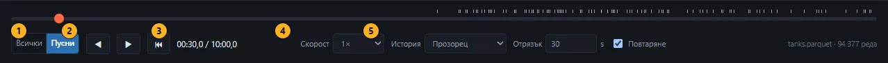

# Времева линия и възпроизвеждане

Лентата под картината е като видеоплейър: можете да пуснете данните като филм, да ги спрете, да прескачате и да смените скоростта.

Лентата под изгледа е времевата линия ([`Timeline.tsx`](https://github.com/Holdi601/3DHeat/blob/main/src/ui/Timeline.tsx)). Тя решава кои редове са видими във всеки момент. Нужна е колона с време; без нея цялата лента е изключена, изгледът остава на **Всички**, а страничната лента казва *Няма колона с време в тези данни - времевата линия е изключена и всяка точка от данни се показва наведнъж.*

## Всички и Пусни {#all-and-play}

Два режима от най-горно ниво, защото отговарят на различни въпроси.

- **Всички** (стандартният при всяко зареждане) изобщо не взема предвид главата за четене и показва всеки ред, който минава филтрите. Това е изгледът „къде се случва това“, и не е същото като превъртане до края. Плъзгачът е изключен, а часовникът показва `all ·  of data`.
- **Пусни** пуска данните като ускорен филм. Появяват се плъзгачът, управлението и настройките на историята.

Изборът на **Всички** спира и възпроизвеждането.

## Контролите {#the-controls}

| Контрол | Стойност по подразбиране | Значение |
|---|---|---|
| Плъзгач | началото | Главата за четене. Влачете, за да превъртите; 20,000 стъпки през диапазона. |
| **Всички** / **Пусни** | Всички | Вижте по-горе. |
| ▶ / ❚❚ | на пауза | Пуска или паузира; също и `K`. |
| ◀ **Пусни назад (J)** | | Пуска данните в обратна посока. Показва се само в режима **Наслагване на фигури**; същият клавиш `J` работи и там (вж. [Клавиатура](#keyboard)). |
| ⏮ | | Назад към началото на диапазона. |
| Часовник | | `изминало / общо` като `mm:ss.s` (или `h:mm:ss`), а когато колоната с време е абсолютна отметка, и часът на деня на главата за четене като `HH:MM:SSZ` (UTC). |
| **Скорост** | 1× | Секунди от данните за реална секунда. Менюто има 17 стъпки от 0.01× до 1800× (0.01, 0.02, 0.05, 0.1, 0.25, 0.5, 1, 2, 4, 8, 16, 32, 64, 128, 256, 600, 1800), плюс **Друга…**: напишете всяка скорост от 0.001× до 3600× (например 0.3 или 12) и натиснете Enter; Esc запазва текущата скорост. Последната скорост се помни за следващото посещение (вж. [Запазени настройки](ref-settings-storage.md)). |
| **История** | Натрупване | Какво се брои като видимо при главата за четене: *Натрупване*, *Прозорец* или *Време на живот* (по-долу). |
| **Отрязък** (Прозорец; в режим Линии и Време на живот) | 30 s | Дължина на прозореца, завършващ при главата за четене; поне 0.01 s. В [Линейна топлина](line-heat.md#playback) това е дължината на опашката. |
| **Резервно време** (само Време на живот, не в режим Линии) | 10 s | Колко време остава видима точка от данни, която няма следваща проба на своя човек. |
| **Избледняване** (само Време на живот, не в режим Линии) | 0.4 | Част от живота на всяка точка от данни, прекарана в избледняване, 0-1. |
| **Повтаряне** | включено | В края започва отначало; изключено спира в края. |
| Дясна страна | | Името на набора от данни. |

**Диапазонът** е времевият обхват на набора от данни - или, в [наслагването на фигури](box-replay.md) с избрана сесия, обхватът на тази сесия.

## История {#history}

В режим Пусни:

- **Натрупване** - всичко от началото на диапазона до главата за четене. Топлината нараства, докато се пуска.
- **Прозорец** - фиксиран отрязък от историята, завършващ при главата за четене (*Отрязък*).
- **Време на живот** - всяка точка от данни живее до **следващата проба на същия човек** (в същата сесия), така че точно една позиция на човек е актуална във всеки момент. Точка от данни, чийто човек никога не се появява отново - смърт, прекъсване на връзката, краят на записа - няма следваща проба и живее *Резервното време*, вместо да изчезне веднага или да остане завинаги. Точките от данни **избледняват** през последната част *Избледняване* от живота си, вместо да изскачат: при една жива проба на човек точка, която изчезва между два кадъра, кара цялото поле да мига с честотата на пробите. *Избледняване* 0 връща рязкото прекъсване.

Времето на живот изисква и колона с човек, освен колоната с време; без нея историята се връща към Натрупване при зареждане. В [Линейна топлина](line-heat.md#playback) историята определя колко дълго остава видима опашката на маршрута; в [наслагването на фигури](box-replay.md) *Резервното време* е колко дълго се държи човек без други проби.

## Поведение при възпроизвеждане {#playback-behaviour}

От цикъла на кадрите ([`engine.ts`](https://github.com/Holdi601/3DHeat/blob/main/src/render/engine.ts)):

- Главата за четене се движи с *времето на кадъра × скоростта*. Времето на кадъра е ограничено до 0.1 s, така че смяната на раздели не прескача главата за четене.
- Натискането на пусни точно в края на диапазона започва от началото, както прави всеки медиен плейър. При всяко зареждане главата за четене е паркирана в началото, така че първото натискане на пусни пуска.
- В края на диапазона главата за четене скача обратно към началото (Повтаряне включено) или спира там и възпроизвеждането приключва (Повтаряне изключено).
- Плъзгачът чете главата за четене на двигателя директно при всеки кадър; състоянието на приложението се обновява при превъртания, стартиране, спиране и повторения.
- Избирането на сесия в избора на сесия превърта до началото на тази сесия.

## Защо възпроизвеждането е плавно и евтино {#why-playback-is-smooth-and-cheap}

Редовете се съхраняват подредени по време, така че времеви прозорец е два двоични търсения по колоната с време: придвижването на главата за четене премества две цели числа и не докосва никой ред, а цената на възпроизвеждането следва броя на редовете в прозореца, не размера на набора от данни.

Как топлината се запазва стабилна, докато прозорецът се движи, зависи от историята ([Натрупване](accumulation.md)):

- **Натрупване** само расте, така че всеки кадър добавя само редовете, които са станали видими от предишния, с пълна тежест. Полето се натрупва монотонно и паузата нищо не променя, защото няма какво повече да пристигне. (Повторното оценяване би накарало всеки кадър да осветява различно случайно подмножество и после да го избледнява, което изглежда като изригвания, които пламват и изчезват.)
- **Прозорец** и **Време на живот** наистина се променят във всеки кадър и се оценяват отново, смесени като експоненциална подвижна средна (тегло 0.34 за новия кадър), която е безпристрастна в стационарно състояние и много по-спокойна от започване отначало.
- В режим Време на живот кандидат-редовете са тези от *главата за четене - max(най-дългата празнина в данните, Резервното време)* до главата за четене; шейдърът после отхвърля всеки ред, чийто собствен живот е свършил, и прилага избледняването.

Превключването между Всички и Пусни или смяната на историята рестартира натрупването.

## Клавиатура {#keyboard}

| Клавиш | Ефект |
|---|---|
| `K` | Пусни / пауза |
| `J` | Пуска назад; натискането отново паузира (само наслагване на фигури) |
| `L` | Пуска напред; натискането отново паузира (само наслагване на фигури) |

`J` и `L` също превключват времевата линия на **Пусни**. Клавишите се игнорират, докато полето за текст или менюто има фокус. В раздела Състезателен анализ `K` управлява собствения разбор на този раздел.
