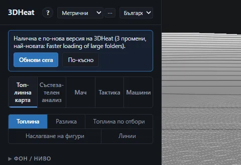

# Обновления

Визуализаторът ви казва, когато има по-нова версия, и се обновява сам само ако кажете да. Нищо не се
променя на вашия компютър без вашия отговор.

## Обновяване на визуализатора {#update-the-viewer}

1. **В страницата.** Когато има по-нова версия, под името горе в страничния панел се появява кутия:
   "Налична е по-нова версия на 3DHeat". Щракнете **Обнови сега**. Страницата се презарежда сама, когато
   приключи. **По-късно** скрива кутията, докато не презаредите страницата.
2. **Ако пише да стартирате restart.bat**, затворете прозореца на сървъра (черният прозорец, който отвори
   `start.bat`) и щракнете два пъти върху `restart.bat`.
3. **Когато стартирате визуализатора.** `start.bat` също проверява. Ако има по-нова версия, пита
   **Update now? [Y/N]**. Натиснете `Y`, за да обновите. Натиснете `N` или изчакайте 60 секунди без отговор, за да
   стартира версията, която имате.



Копие с ваши собствени промени никога не се обновява вместо вас; кутията само казва, че има чакащо обновяване,
и казва да направите commit или stash на промените си и да изпълните `git pull`. Копие, което не е инсталирано
с git (например zip файл), не показва нищо.

Как работи проверката, стъпка по стъпка:

```
page ---(after 4 s, then every 6 h)---> dev server ---> git fetch
   behind?  no  -> nothing is shown
            yes -> your own changes or commits?  yes -> tell you only
                                                 no  -> [Update now] -> git pull
                                                        -> reload, or "run restart.bat"
```

## Правилата за безопасност {#the-safety-rules}

- **Само напред (fast-forward)** (`git pull --ff-only`): обновяването никога не слива,
  не преподрежда и не пренаписва нищо.
- **Без локални промени**: копие с непотвърдени промени в проследяваните файлове
  (`git status --porcelain --untracked-files=no` не е празно) никога не се обновява
  автоматично - чужда работа не е задача на обновяване да я презапише. На него само се
  казва, че има чакащо обновяване. Непроследяваните файлове (данни, експорти) не се броят
  за промени.
- **Без локални commit-и**: копие с commit-и, които горният клон няма ("diverged"), не се
  обновява - fast-forward не може да го вдигне, а сливането е за `git pull` ръчно. Страницата
  и `start.bat` казват това с едни и същи думи, а `start.bat` стартира версията, която там има.
- **Само от самата страница**: заявката за обновяване към dev сървъра трябва да носи
  собствен заглавен ред и, когато браузърът изпрати `Origin`, да идва от собствения хост на
  сървъра (по-долу).
- Обновява се само git копие с горен клон; всичко друго (копие без `.git`, без инсталиран git,
  статичен билд) се оставя на мира и не казва нищо.

## Какво прави start.bat {#what-startbat-does}

`start.bat` (щракнете два пъти върху него; прозорецът е сървърът) прави, по ред:

1. Намира Node.js - в `PATH`, иначе в `%ProgramFiles%\nodejs`,
   `%ProgramFiles(x86)%\nodejs` или `%LOCALAPPDATA%\Programs\nodejs` - и предлага да го инсталира
   с `winget install -e --id OpenJS.NodeJS.LTS`, когато липсва (пита се, Y/N; после прозорецът трябва
   да се отвори отново, за да вземе Windows новия `PATH`).
2. **Обновяване**, когато git е инсталиран и папката има `.git`:
   - `git fetch --quiet` (без мрежа или без горен клон: пропуска се тихо);
   - брои `git rev-list --count HEAD..@{u}`; нищо не е зад нея: нищо не се казва;
   - локални промени: "A newer version of 3DHeat is available (N changes), but
     this copy has local changes, so it is not updated. Commit or stash them,
     then run git pull." - и стартира версията, която има;
   - собствени commit-и (`git rev-list --count @{u}..HEAD` не е 0): "A newer
     version of 3DHeat is available (N changes), but this copy has commits of
     its own that the newest version does not, so it is not updated. Update it
     with git pull." - и стартира версията, която има;
   - иначе "A newer version of 3DHeat is available (N changes)." и въпросът **Update now? [Y/N]**. `N` или липсващ отговор за 60 секунди печата "Not updated; starting the version you have." и стартира версията, която има. При `Y`: "Updating...", казва дали `package.json` или `package-lock.json` се променят,
     изпълнява `git pull --ff-only` (ако и това все още не успее - например мрежата:
     "The update did not go through; starting the version you have."), после `git submodule update --init`
     (закачените инструменти, вижте [Поддръжка на документацията](maintaining.md#the-tools-under-exporters)), после `npm install`, когато файловете на пакета са се променили и
     `node_modules` съществува, и "Updated."
3. Отказва да стартира втори сървър: когато нещо вече слуша порт **5273**, казва това и сочи
   `restart.bat` / `stop.bat`.
4. При първото стартиране (няма `node_modules`) пита, преди да изтегли зависимостите (около 300 MB в
   `node_modules\`, нищо системно).
5. Стартира dev сървъра на `127.0.0.1:5273` (`--strictPort`) и отваря браузъра, когато е готов.

`restart.bat` спира сървъра (по порт) и пуска `start.bat` отново, така че пита същия въпрос. `stop.bat` само спира.


## За разработчици {#for-developers}

### Докато работи: маршрутът за обновяване {#while-it-runs-the-update-route}

Dev сървърът (Vite приставката `heat3d-self-update` в `vite.config.ts`) обслужва `/__heat3d/update`. Той съществува
само в dev сървъра - не в статичен билд и не във `vite preview`.

**`GET /__heat3d/update`** отговаря дали копието е зад нея:

```json
{ "checkout": true, "upstream": "origin/main", "behind": 3, "ahead": 0, "dirty": false, "latest": "the newest commit's subject" }
```

- `checkout: false`, когато папката не е git копие;
- изпълнява `git fetch --quiet` **най-много на всеки 30 минути** (заявките между тях отговарят според последното извличане);
- `behind` / `ahead` от `git rev-list --count HEAD..@{u}` / `@{u}..HEAD`, `dirty` от
  `git status --porcelain --untracked-files=no`, `latest` - темата на най-новия commit на горния клон;
- без горен клон: `upstream: null` и `behind: 0`.

**`POST /__heat3d/update/apply`** довежда копието до актуално:

1. Отказва се с `403 { ok: false, reason: "forbidden" }`, освен ако заявката няма заглавния ред
   `X-Heat3d-Update: 1` и, когато носи `Origin`, хостът на този origin не е `Host` на заявката. Форма от друг сайт не може да изпрати
   собствен заглавен ред без CORS предварителна проверка, която този сървър никога не дава.
2. Нищо за правене (не е копие, няма горен клон, не е зад нея):
   `{ ok: true, updated: false }`.
3. Локални промени: `{ ok: false, reason: "dirty" }`; локални commit-и: `{ ok: false, reason: "diverged" }`.
4. Иначе: отбелязва файловете, които се променят (`git diff --name-only HEAD @{u}`),
   `git pull --ff-only` (тайм-аут 2 min), `git submodule update --init` (грешката се пренебрегва),
   `npm install`, когато `package.json` или `package-lock.json` са се променили (тайм-аут 15 min), и отговаря
   `{ ok: true, updated: true, restart }` - `restart` казва защо работещият сървър не може да вземе обновлението: `"dependencies"`, когато зависимостите са инсталирани отново, `"config"`, когато се е променил само файл `vite.config`, `false`, когато нищо не изисква рестарт.
5. Неуспешна команда на git или npm отговаря `{ ok: false, reason: "<грешката, до 300 знака>" }`.

Отговорите са JSON с `Cache-Control: no-store`. Сървърът слуша само на `127.0.0.1`, така че маршрутът не е
достъпен от мрежата.

### Известието в страницата {#the-notice-in-the-page}

`UpdateBanner`, под името горе в страничния панел:

- Пита маршрута **4 секунди** след зареждането на страницата (не в първите секунди: страницата има набор от данни за зареждане и GPU за стартиране) и отново
  **на всеки 6 часа**, докато страницата е отворена.
- Не показва **нищо**, когато няма такъв маршрут (статичен билд), папката не е git копие или нищо не е по-ново -
  известие при всяко стартиране е нещо, на което хората се научават да не обръщат внимание.
- Зад нея, без локални промени: "Налична е по-нова версия на 3DHeat (N промени, най-новата: <тема>)." с **Обнови сега** и **По-късно**
  (*По-късно* го скрива, докато страницата не се презареди).
- Зад нея, с локални промени: същото изречение и "Това копие има локални промени, затова не се обновява автоматично; направете commit или stash и след това изпълнете git pull." - без бутон.
- **Обнови сега** изпраща заявка към `/apply` ("Обновяване…"). После:
  - "Обновено. Страницата се презарежда." - и се презарежда 1.5 s по-късно (сървърът вече обслужва новите файлове);
  - когато зависимостите са инсталирани отново: "Обновено. Зависимостите му се промениха: затворете прозореца на сървъра и стартирайте restart.bat, за да завършите.";
  - когато са се променили само настройките на сървъра: "Обновено. Настройките на сървъра му се промениха: затворете прозореца на сървъра и стартирайте restart.bat, за да завършите.";
  - нищо за довеждане след всичко (`updated: false` - копието е било доведено междувременно, например от `start.bat`): "Няма нищо за обновяване: това копие вече е най-новата версия." - и без презареждане;
  - отказ: изречението за *dirty*, или "Това копие има собствени commit-и, които най-новата версия няма; обновете го с git pull.", или "Обновяването не успя: <причина>".
