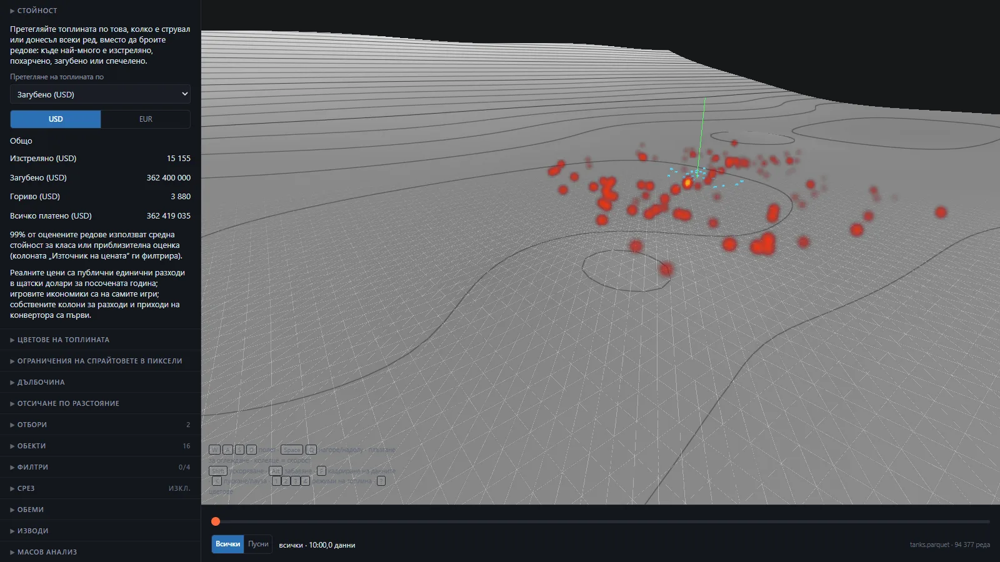

# Претегляне на стойностите

Всеки изстрел, боеприпас, загубено превозно средство и литър гориво имат цена. Визуализаторът изчислява колко е струвал или спечелил всеки ред и може да претегли топлината по нея, така че картата показва **къде са отишли парите**, а не къде са редовете.

## Как да го ползваш {#how-to-use-it}

1. Зареди данни със събития (изстрели, убийства, смърти) и имена на превозни средства или оръжия.
2. Отвори **Стойност** в страничната лента на топлината.
3. Избери **Претегляне на топлината по**, например *Загубено (USD)*. Сега топлината добавя цената на всеки ред вместо 1.
4. Прочети **Общо**: сумата на всяка колона със стойност за показаното (важат филтрите и времевият прозорец).
5. Когато цените са реални пари, се появява превключвател **USD / EUR**.

Избери празния първи запис в менюто, за да броиш редовете отново.

## Какво може да се претегли {#what-can-be-weighed}

Колоните със стойност се добавят при зареждането, по една за вид и валута:

| Вид | Редове, към които се отнася | Как се оценява |
|---|---|---|
| **Изстреляно** | изстрели и изстрелвания | оръжието, иначе средна стойност за вида боеприпас |
| **Похарчено** | покупки, появявания | парични колони на играта (например менюто за покупки на стрелец) |
| **Загубено** | смърти, унищожавания | собственото превозно средство, иначе средното за класа му |
| **Унищожен** | убийства | превозното средство на целта |
| **Нанесени щети** | попадения | дял от стойността на целта |
| **Гориво** | позиции | изразходваното гориво, от колона за гориво или оценено по класа и времето |
| **Всичко платено** | | изстреляно + похарчено + загубено + гориво |
| **Спечелено** | награди | собствените колони за награди на играта (`earn_…`) |
| **Нетно** | | спечелено минус платено; изобразява се като топлина със знак (положителна скала там, където е спечелено повече, отрицателна там, където е платено повече) |

Имената на колоните са `cost_<kind>_<currency>`, `earn_<currency>` и `net_<currency>`. Конверторът, който познава собствената валута на играта (например конвертор на разбор, който пише в игровите кредити), има предимство пред вградените ценови таблици.

## Ценовите таблици {#the-price-tables}

| Таблица | Валута |
|---|---|
| Реална военна техника: ракети, бомби, патрони, средства за противодействие, самолети, хеликоптери, наземна техника, кораби, гориво | USD (EUR = USD × 0,92, фиксираният `EUR_PER_USD` в [`cost.ts`](https://github.com/Holdi601/3DHeat/blob/main/src/data/cost.ts); не е жив курс) |
| Менюта за покупки в стрелби и награди за убийства | кредитите на играта |
| Танкови и корабни игри | кредитите на играта |
| Стратегически игри (няколко ресурса) | по една колона за ресурс плюс една обща |
| Военни игри | точки |

Играта се разпознава по имената в данните. Цените на реална техника идват от публични източници (бюджетни документи, енциклопедии) или са отбелязани като оценки; не са коригирани за инфлация. Генерираният списък на таблиците е в [Таблици със стойности](ref-value-tables.md).

## Оценки {#estimates}

Допълнителната колона на категория **Източник на цената** казва как е оценен всеки ред: `table`, `class average`, `estimate` или `none`. Секцията Стойност показва какъв дял от оценените редове са средни стойности или оценки. За да останат само точно оценените редове, махни отметката на *estimate* и *class average* под **Източник на цената** във [Филтри](filters.md).

## Къде другаде се показва стойността {#where-else-value-shows}

- [Изводи](insights.md): находките *Скъпа земя* и *Печеливша земя*.
- [Разбивка](breakdown.md): Спечелено, Загубено и Нетни пари по отбор, играч или оръжие.
- [Обеми](volumes.md): колони със стойност в статистиките и сравнението.
