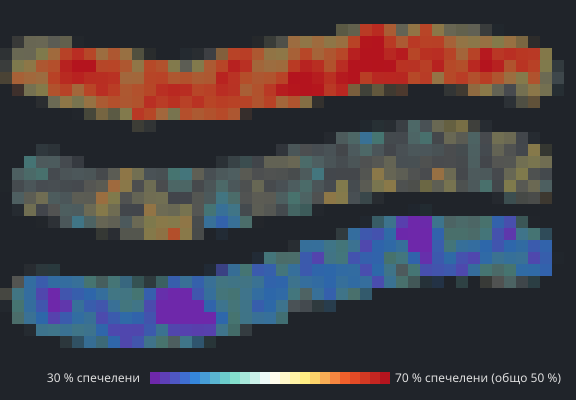

# Дял на победите: колко често печели място, маршрут или ход

Къде стои играчът, накъде върви, къде хвърля гранати и други помощни средства - и колко често след това неговата страна печели рунда. **Картата на дела на победите** оцветява всяко място по дела на редовете там, които принадлежат на рундове, спечелени от страната на реда, спрямо дела във всичко показано: топло, където е по-висок, студено, където е по-нисък, нищо, където е същият.

*Картината показва измислени данни: три маршрута на празно ниво, 68 %, 50 % и 33 % от редовете им в спечелени рундове.*

Нужни са данни, които казват кой е спечелил: [колоните за изход](data-formats.md#outcome-columns) (`won`, `matchWon`, `roundEndReason`). Пишат ги конверторите за CS2 и War Thunder; може да ги има всеки файл.

## Опитайте {#try-it}

1. Заредете мачове с колона за изход и натиснете `2` (**Разлика**).
2. В **Разделяне за разлика** натиснете **Дял на спечелените рундове** (или **Дял на спечелените мачове**). Слага спечелените рундове на **+**, загубените на **−** и превключва панела на **Дял на +**.
3. Четете цветовете. Панелът казва общия дял: *Общо 52,0 % от 1 200 000 реда са на +.*
4. Стеснете с [филтрите](filters.md): една страна (T или CT), един тип събитие (*Позиция* за това къде са стояли хората, *Изстрел* или *Изстрелване (ракета, снаряд, бомба)* за това откъде са стреляли или хвърляли), една покупка, една карта.

Място, което е топло с редове *Позиция*, е място, чиито държатели обикновено са печелели рундата. С редове *Унищожаване* това е място, където убийствата там са водели до спечелени рундове.

## Настройките {#the-settings}

| Настройка | Какво прави | По подразбиране |
|---|---|---|
| **Разлика** / **Дял на +** | самата разлика или делът на страната + сред редовете на двете страни | Разлика |
| **Пълен цвят при** | колко над или под общия дял мястото се показва в пълен цвят, в процентни пунктове | ± 20 пункта |
| **Най-малко редове за оцветяване на място** | място с по-малко редове не се оцветява; появява се постепенно от половината от тази стойност | 12 |
| **Привличане към общия дял (редове)** | всяко място започва с толкова редове на общия дял, така че място с 3 реда, всички спечелени, не се показва като 100 % | 12 |

И трите действат върху готовата картина: местенето им никога не рестартира натрупването.

Делът може да е на всяко разделяне, не само на победите: *Дял на +* с разделяне по страна показва къде Ts са били по-голямата част от присъствието, а с разделяне по файловете на две карти - къде редовете на единия файл надвишават тези на другия.

## Редове, не рундове {#rows-not-rounds}

Картата брои редове. Играч, който стои на едно място двадесет секунди, добавя ред при всяка проба, всичките от един рунд, така че доказателството на едно място са редовете близо до него, не рундовете. Затова минимумът и привличането са в редове и затова са по-големи от това, което дава един рунд.

За самите рундове:

- **[Разбивка](breakdown.md)** на място, изглед или обем: *Победи %* брои рунда на всеки играч веднъж, със същото привличане към общия дял на мястото (4 рунда).
- Статистиката на **[Обеми](volumes.md)**: *Дял на победите* - рундовете с играч вътре в обема, всеки веднъж, с привличане към дела във всичко показано, заедно с броевете.

## Филтри за изход {#outcome-filters}

Панелът [Филтри](filters.md) изброява колоните за изход веднага след собствените колони на визуализатора: **Резултат от рунда** и **Резултат от мача** (*Всеки*, *Спечелен*, *Загубен*) и **Как завърши рундът** (Елиминиране, Бомбата избухна, Бомбата обезвредена, Времето изтече, Предаване, Равенство, Цел, Задържани зони, Загубени точки, Загубена цялата техника), на езика на визуализатора.

## За разработчици {#for-developers}

Преминаването на топлината записва три суми в четириканалната цел, която използва топлината на отборите: топлината `R = Σ|v|`, топлината на страната + `P` и `S = Σ v²/w`, където `w` е теглото на преминаването (тегло на извадката по усилване на кадъра). Композицията чете дела `P/R` (средно, претеглено с ядрото) и броя редове, на които той стои, `n = R²/S` (ефективният размер на извадката на Киш), привлича дела към общия, `p = (n·P/R + m·r0)/(n + m)`, и оцветява `p - r0` през обхвата върху рампите за разлика.

`n` съкращава всеки множител, общ за редовете в даден пиксел - усилването на кадъра, теглото на извадката, теглото по площ на изрязан спрайт - така че картината е еднаква при всяко мащабиране и гъстота на извадката, а кадрите от всеки k-ти ред се сливат в цялото без скокове в цветовете. Общият дял идва от броенето на страните в CPU, с точност до десети от процента; нищо не се чете обратно от GPU. Изчислението и проверките му: [`render/rateMap.ts`](https://github.com/Holdi601/3DHeat/blob/main/src/render/rateMap.ts) и тестът му.

Струва колкото топлината на отборите: четириканалната цел учетворява честотната лента за смесване при преминаването на топлината, само докато е включен *Дял на +*.
