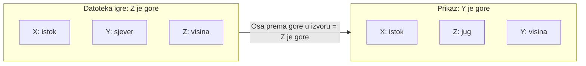

# Ose, jedinice i vrijeme

Igre i karte se ne slažu oko toga koji je smjer gore, koliko je duga jedinica i kako se piše vrijeme. Ova stranica opisuje tri postavke koje čine da tvoji podaci stoje, imaju pravu razmjeru i idu kako treba.

Ako tvoja karta stoji kao zid umjesto da leži kao pod, prebaci **Osa prema gore u izvoru**.

S pogrešnom **Osom prema gore u izvoru** karta stoji kao zid; s pravom leži kao pod.

## Svijet u kojem prikaz crta {#the-world-the-viewer-draws-in}

Svijet prikaza je **Y-gore**: X i Z su ravan tla, Y je visina. Većina igračkih motora je **Z-gore**: za njih su X i Y tlo, a Z visina. Neki motori su također zrcaljeni (lijevoruki). Preslikavanje kaže kako pretvoriti ose datoteke u ose prikaza. (Tehnički, prikaz je desnoruki, konvencija three.js.)

### Osa prema gore {#up-axis}

**Osa prema gore u izvoru** u [Mapiranju kolona](column-mapping.md):

| Postavka | Datoteka (x, y, z) postaje svijet (X, Y, Z) |
|---|---|
| *Z je gore (većina igračkih motora)* - zadano | (x, **z**, **y**): Z iz datoteke postaje visina, a Y iz datoteke postaje Z svijeta |
| *Y je gore (grafička konvencija)* | (x, y, z) nepromijenjeno |

Za podatke s Z-gore, tri niza se preimenuju umjesto kopiraju ([`remapAxesInPlace`](https://github.com/Holdi601/3DHeat/blob/main/src/data/ingest.ts)), što štedi stotine megabajta pri velikim učitavanjima. Pogađa se iz uzorka: koja od kolona Y i Z ima manji raspon, ta je gore.

### Okreti {#flips}

**Okreni X**, **Okreni Y**, **Okreni Z** poništavaju *osu datoteke* s tim imenom, prije preimenovanja - pa uz Z-gore, *Okreni Y* poništava ono što na kraju postaje Z svijeta. Okret mijenja učitane podatke: koordinate koje prikazuju [ravnalo](measure.md), presjek i položaj kamere su okrenute.

Da nacrtaš zrcaljeni svijet na pravi način **bez promjene podataka**, koristi **Kamera i scena → Obrni osu svijeta** ([Kamera](camera.md#invert-world-axis)). To je bolji izbor za igre čiji je svijet lijevoruk, jer svaka koordinata koju alati prikazuju ostaje igrina vlastita.

### Razmjera jedinica {#unit-scale}

**Razmjera jedinica** množi svaku poziciju. *1 (m)* postavlja 1, *0,01 (cm→m)* postavlja 0,01 (jedinice Unreal Enginea su centimetri, pa koristi 0,01; jedinice Source motora su inči, pa koristi 0,0254; nijedno nije metar), a okvir prihvata bilo koju vrijednost. Upisana 0 ili vrijednost koja nije broj zamjenjuje se s 1.

Prikaz označava daljine u metrima (poluprečnik sprajta, granice odsijecanja, ravnalo, brzina letenja), što je tačno samo kada je razmjerna jedinica svijeta metar. Ništa ne puca kad nije; oznake samo kažu „m" za koju god jedinicu.

## Vrijeme {#time}

### Jedinice vremena {#time-units}

Pravilo: vrijednosti poput 17000000000 (deset ili više cifara) su Unix vremenska oznaka; vrijednosti poput 0, 0,25, 0,5 su sekunde od početka.

| Jedinica vremena (oznaka u meniju) | Čita se kao | Prikazuje stenski sat |
|---|---|---|
| *Sekunde (relativno)* | vrijednost × 1 s | ne |
| *Milisekunde (relativno)* | vrijednost × 0,001 s | ne |
| *Mikrosekunde (relativno)* | vrijednost × 10^-6 s | ne |
| *Nanosekunde (relativno)* | vrijednost × 10^-9 s | ne |
| *Unix vremenska oznaka (s)* | sekunde od 1970-01-01 UTC | da |
| *Unix vremenska oznaka (ms)* | milisekunde od 1970-01-01 UTC | da |
| *ISO-8601 tekst datuma* | tekst kao `2026-03-14T18:02:11.250Z`, parsiran browserovim `Date.parse` | da |

Uz apsolutnu jedinicu (posljednje tri), skup podataka čuva trenutak stenskog sata najranijeg reda, a vremenska linija pokazuje trenutno UTC vrijeme dana (`HH:MM:SSZ`) pored pokazivača reprodukcije.

**Parquet kolone `TIMESTAMP` i `DATE`** se dekodiraju u prave trenutke, pa se njihova postavka jedinice zanemaruje i panel to kaže. Kolona `DATE` je cijeli dan: svi redovi jednog dana dijele jedan trenutak i reprodukcija skače po dan, na šta panel upozorava.

**ISO-8601 stringovi rade i u CSV-u i u Parquetu.** Tekstualna kolona vremena s ISO jedinicom parsira se jednom po različitom stringu; ako nijedan ne prođe, učitavanje pada uz *Nema parsiranih ISO-8601 vremenskih oznaka u mapiranoj koloni vremena.* - a mapiranje već odbija da počne kada nijedna uzorkovana vrijednost ne prolazi parsiranje. Kolona `TIMESTAMP` u Parquetu se čita kao vremenska oznaka bez obzira na postavljenu jedinicu, a numerička Parquet kolona s ISO jedinicom čita se kao Unix milisekunde. Tekstualna kolona vremena s numeričkom jedinicom se odbija prije učitavanja: svaka vrijednost bi se čitala kao NaN.

### Kako se vrijeme čuva {#how-time-is-stored}

Dok se datoteke spajaju, vremena su 64-bitne sekunde, pa apsolutna epoha zadržava svoj pod-sekundni detalj. Kada su sve datoteke unutra, najraniji trenutak cijelog izbora postaje 0, a svaki red čuva 32-bitne sekunde od njega. 32-bitni float ima 24 bita mantise: rasponi do otprilike dan i po razlučuju se bolje od 1/100 s, rasponi od pola godine do otprilike sekunde. Red čije je vrijeme nedostajuće ili nije broj stavlja se na 0, na početak.

Redovi se zatim sortiraju po vremenu, što čini vremensku liniju jeftinom: prozor vremena se nalazi s dvije binarne pretrage (vidi [Uzorkovanje i budžeti](sampling-and-budgets.md)).

### Proteklo vrijeme naspram stenskog sata {#elapsed-time-versus-wall-clock}

Kolona vremena kao `match_time` ili `round_time` broji od početka svakog meča. Njeno biranje stavlja svaki meč na jednu zajedničku osu - dobro za poređenje onoga što se dešava u 3. minuti svakog meča - a panel na to ukazuje. Kolona stenskog sata prikazuje mečeve redom kojim su se stvarno odigrali, preklapajući se tamo gdje su se preklapali.

## Smjer pogleda {#look-direction}

Smjer pogleda koristi samo [reprodukcija kutije](box-replay.md) (zraci iz svake kutije). Čuva se kao dva ugla, zakret (yaw) i nagib (pitch), u radijanima.

- **Kolone zakretanja / nagiba** čitaju se kakve jesu, pretvorene iz stepeni kada je izabrano *Stepeni*. Ne podešavaju se za osu gore ni za okrete.
- **Kolone vektora smjera** prolaze kroz isto preimenovanje i okrete kao pozicije, pa postaju zakret = atan2(x, -z) i nagib = atan2(y, √(x² + z²)) u osama svijeta, pa zrak pokazuje kamo kutija gleda i u svijetu sa zrcaljenim izvorom.

Ako kolone zakretanja/nagiba poslije okreta, vektora smjera ili podešenih uglova pokazuju na krivu stranu, rješenje je u tome.
