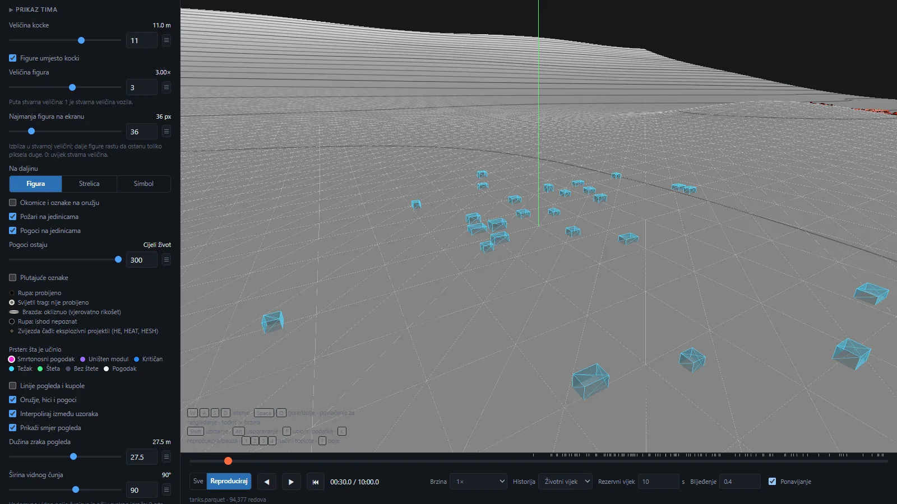

# Preklapanje figura (reprodukcija kutija)

Mali film: jedna figura za svaku osobu, koja se kreće kako vrijeme teče, s tragom iza sebe.

Režim se zove **Preklapanje figura** u traci režima. Ova stranica se nekada zvala „reprodukcija kutija", jer prije figura je svaka osoba bila kutija; „reprodukcija figura" i „reprodukcija kutija" znače isto. **Preklapanje figura** nema tipku s brojem: izaberi ga u traci režima. Crta jednu figuru (ili kutiju) po [osobi](glossary.md), koja se kreće duž [vremenske linije](timeline.md), uz opcione zrake pogleda i tragove. To je reprodukcija, a ne gustina: *ko je gdje, kada*. Treba kolona osobe; bez kolone vremena svaki uzorak se crta odjednom.

## Kako se koristi {#how-to-use-it}

1. Učitaj podatke s kolonom osobe i kolonom vremena.
2. Izaberi **Preklapanje figura** u traci režima.
3. Prebaci vremensku liniju na **Reproduciraj** i pritisni reprodukciju (`K`).
4. Otvori **Prikaz tima** da promijeniš **Dužinu traga**, veličinu figura ili zrake pogleda.

U ovom režimu se ne crta toplota, a prilagodljivi budžet sprajtova miruje.

Podrazumijevano se svaka osoba crta kao figura onoga što jeste, a ne kao kutija - vidi [Figure](figures.md) za to koju figuru jedinica dobija, a [Reprodukciju meča](match-replay.md) za oznake, kameru koja prati, mjerenje između dvije jedinice i spisak događaja.

## Panel Prikaz tima {#the-team-viewer-panel}

Prikazuje se umjesto panela toplote u ovom režimu.

| Kontrola | Zadano | Opseg (klizač) | Značenje |
|---|---|---|---|
| **Figure umjesto kocki** | uključeno | | Svaka osoba kao figura onoga što jeste: vojnik pješice, tenk ili avion koje podaci navode. Ono što podaci ne kažu ostaje kutija. |
| **Veličina figura** | 1× | | 1× je prava veličina. |
| **Najmanja figura na ekranu** | 36 px | 0 = uvijek prava veličina | Prava veličina izbliza; dalje figure rastu da ostanu ovoliko piksela dugačke. |
| **Oružje, hici i pogoci** | uključeno | | Oružje u letu s dimom, trasirajući meci, udari, pogoci i ubistva. Trasirajući meci zaključeni iz pogotka su isprekidani. |
| **Veličina kocke** | veličina entiteta, ili opseg / 500, pri učitavanju | 0,05-200 m, logaritamski (5000) | Dužina ivice svake kutije. Vidi [veličinu entiteta](sessions-persons-groups.md#entity-size). |
| **Interpoliraj između uzoraka** | uključeno | | Između dva uzorka iste osobe u istoj sesiji, kutija se postavlja proporcionalno između njih. Nikad preko granice sesije. |
| **Prikaži smjer pogleda** | uključeno | | Zrak od svake kutije u smjeru pogleda osobe (treba [kolone pogleda](axes-units-and-time.md#look-direction)). |
| **Dužina zraka pogleda** | veličina entiteta × 4, ili opseg / 200, pri učitavanju | 0,5-500 m, logaritamski (20.000) | Prikazuje se dok je smjer pogleda uključen. |
| **Dužina traga** | 8 s | 0-300 s (86.400); 0 = isključeno | Sekunde historije iscrtane iza svake osobe. |
| **Crtaj svaki sirovi uzorak** | isključeno | | Kutija po sačuvanom uzorku u prozoru umjesto jedne interpolirane kutije po osobi. Poduzorkovano da ostane interaktivno. |

Napomene u panelu objašnjavaju da interpolacija i tragovi spajaju uzorke samo unutar jedne sesije i, kada učitavanje ima [zajednička imena](sessions-persons-groups.md#names-worn-by-several-things-at-once), koliko imena je nacrtano kao pojedinačni uzorci.

## Sesija koja se reprodukuje {#the-session-being-played}

Uz kolonu sesije, birač **Sesija** na vrhu bočne trake ([Sesije](sessions-persons-groups.md#the-session-picker)) određuje koji se meč reprodukuje. Najzauzetija se bira pri učitavanju. Samo redovi te sesije postaju kutije i tragovi, a vremenska linija ide preko raspona te sesije umjesto cijelog skupa podataka. *Sve sesije* reprodukuje sve sesije odjednom, i dalje nikad ne spajajući uzorke preko sesija.

## Šta se crta kada {#what-is-drawn-when}

Iz [`TrackCursor`](https://github.com/Holdi601/3DHeat/blob/main/src/data/tracks.ts):

**Žive kutije** (režim Reprodukcija, sirovi uzorci isključeni). Za svaku vidljivu osobu, njen najnoviji uzorak na pokazivaču reprodukcije ili prije njega:

- Ako osoba ima sljedeći uzorak, on je u istoj sesiji, a ime nije zajedničko, kutija se postavlja između dva uzorka proporcionalno vremenu, sa zakretom interpoliranim kraćim putem i nagibom linearno (kada je *Interpoliraj* uključeno).
- Inače kutija ostaje na posljednjem uzorku za **Rezervni vijek** vremenske linije (zadano 10 s), pa se odbacuje, tako da eliminisani igrači ne ostaju.

**Režim Sve** zanemaruje pokazivač reprodukcije i crta svaki uzorak u opsegu kao kutiju.

**Sirovi uzorci** crtaju kutiju po sačuvanom uzorku u prozoru: *Raspon* uz historiju *Prozor*, inače sve do pokazivača reprodukcije. Najviše 65.536 kutija; sa više uzoraka crta se svaki *k*-ti.

**Tragovi** (kada je dužina traga iznad 0 i sirovi uzorci se ne crtaju): linija između svakog para uzastopnih uzoraka jedne osobe u posljednjih *dužina traga* sekundi do pokazivača reprodukcije, s blijeđenjem od 80% neprozirnosti do prozirnog sa starošću. Trag staje na promjeni sesije i ne crta se za zajednička imena. Najviše 131.072 vrha; sa više, redovi se ravnomjerno preskaču.

**Ko je vidljiv:** osoba je sakrivena kada je njena grupa nečekirana u [spisku timova](teams-list.md) (njena grupa je ona od njenog prvog reda), kada filter grupe je isključuje, ili kada panel [Entiteti](entities.md) ima izbor koji je ne uključuje. [Filteri](filters.md) kolona ne važe za kutije.

## Boje {#colours}

Jedna porodica nijansi po grupi i jedna tonalnost po članu, pa jedan pogled kaže na kojoj je strani ko ([`teamMemberColor`](https://github.com/Holdi601/3DHeat/blob/main/src/render/colors.ts)). Nijanse grupa se ciklično smjenjuju kroz fiksni spisak od deset - plava, crvena, zelena, jantarna, ljubičasta, cijan, magenta, limun, narandžasta, indigo - a članovi grupe su raspoređeni po svjetlini 42-76% i zasićenju 90-65%.

## Napomene {#notes}

- Preklapanje figura ponovo gradi svoje figure samo kada se nešto promijeni; besposlena sličica ponovo iscrtava posljednje.
- Red *Kocke* u [pregledu statistike](performance-and-stats.md) broji kutije na ekranu.
- Preklapanje figura crta u istoj sceni kao nivo, pa [dubina polja](camera.md#depth-of-field) zamućuje kutije, ali nikad toplotu.
