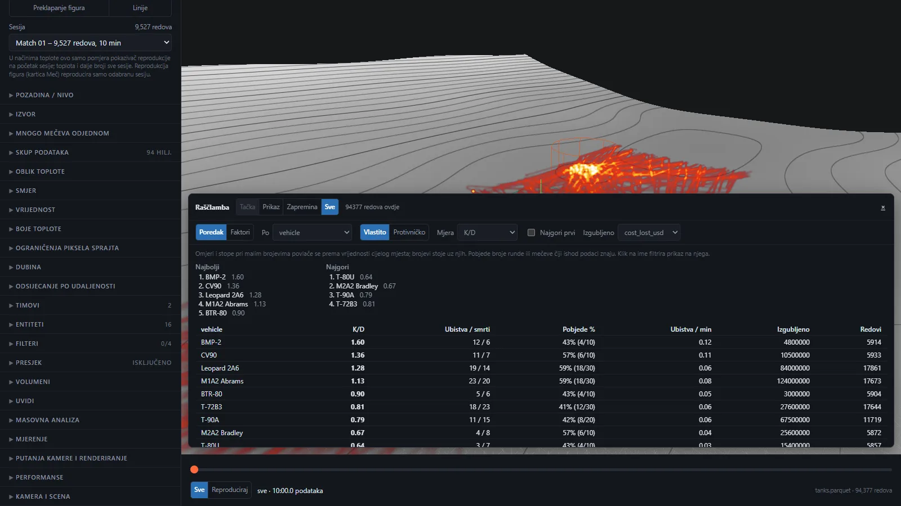
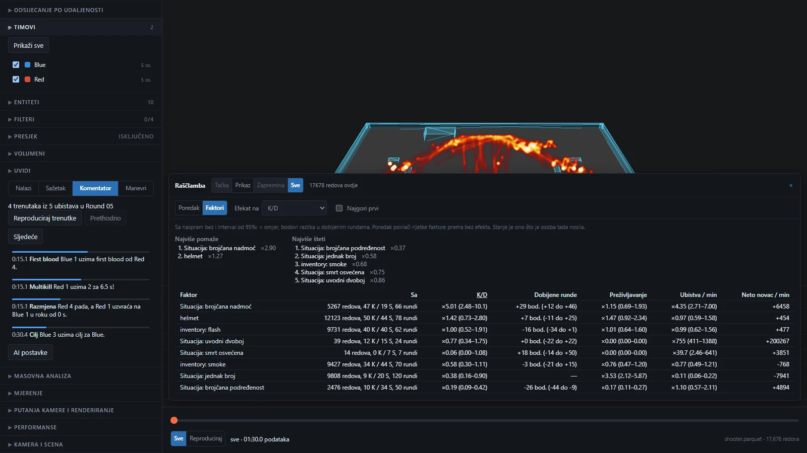

# Raščlamba: ko i šta je najbolje gdje

**Raščlamba** odgovara na jedno pitanje: na ovom mjestu, koje vozilo, igrač ili oružje je najbolje? Koristi je da nađeš tenk koji pobjeđuje na mostu, ili da vidiš da li nošenje kacige stvarno pomaže.

Rangira ono što se dešava na jednom mjestu (izabrana tačka, prikaz, zapremina ili sve što je prikazano) po bilo kojoj kategoriji, i mjeri svaki faktor stanja s pa bez njega.

## Isprobaj {#try-it}

1. Učitaj meč s ubistvima i smrtima, i otvori **Zapremine**.
2. Nacrtaj zapreminu oko mjesta koje te zanima i izaberi je.
3. Pritisni **Raščlamba...** pod Statistikom.
4. Pod **Po** izaberi *Vozilo*, i izaberi mjeru *K/D* (ubistva po smrti).
5. Čitaj spisak, najbolji prvi. Pritisni **Najgori prvi** da ga okreneš. Klikni na ime da filtriraš prikaz na njega; klikni ponovo da ga pustiš.

## Otvori je {#open-it}

| Odakle | Region s kojim počinje |
| --- | --- |
| **Raščlamba...** u [Zapreminama](volumes.md) (Statistika) | izabrana zapremina |
| **Raščlamba ovdje** na kartici izbora, nakon klika na tačku | sfera oko te tačke (**Radijus**, zadano 3% veličine podataka) |
| panel podijeljene **Razlike** | prikaz |

Zaglavlje mijenja region: **Tačka**, **Prikaz** (ono što je kamera vidjela pri posljednjem brojanju; **Prebroji ponovo** poslije pomjeranja), **Zapremina** (izaberi jednu) ili **Sve**. Broji u pozadini; linija statusa kaže koliko je redova u regionu.

## Rangiranje {#ranking}

Izaberi po čemu rangiraš i mjeru:

| Mjera | Šta je |
| --- | --- |
| A, B | redovi s obje strane mape razlike, podijeljeni kao što ih toplota dijeli |
| A / B, A - B, A / (A + B) | dva sloja jedan prema drugom |
| K/D | ubistva naspram smrti |
| Pobjeda % | runde (ili mečevi) dobijeni, tamo gdje podaci kažu ko je pobijedio |
| Ubistva / min | ubistva po prisutnoj minuti (praznine između uzoraka kretanja) |
| Zarađeno, Izgubljeno, Neto novac | zbiri kolona `earn_*` i `cost_*`; birač bira valutu |

Ubistva, smrti, prisustvo, pobjede i novac broje svaki red koji prikaz pokazuje na tom mjestu, na bilo kojoj strani podjele ili nijednoj.

Odnosi i stope se privlače ka vrijednosti cijelog mjesta gdje su brojevi mali, pa 2 ubistva u 1 životu ne izbijaju na vrh spiska. Brojevi se prikazuju pored njih.

Možeš rangirati po grupama, igračima i mečevima, po bilo kojoj koloni kategorije (vozilo, oružje, strana, vrsta kupovine, agent ili komplet), po bilo kojoj numeričkoj koloni u opsezima (oklop, vrijednost opreme), po **klasi** kolone oružja (puška, snajper, mitraljez, pištolj...) i po tome koliko komada **pomagala** lista kolona kao `inventory` sadrži.

**Vlastito** rangira po vrijednosti samog reda. **Protivničko** rangira po vrijednosti druge strane: oružje žrtve kod ubistva, oružje ubice kod smrti (treba kolona `other` / `victim` koja ih imenuje).

## Stanje u tom trenutku {#state-at-the-time}

Vrijednost reda je njegova sopstvena, osim ako red ne bilježi ništa (red događaja bez opreme) ili je smrt (čija kolona oružja može imenovati oružje ubice); tada je to ono što je ista osoba posljednje nosila ranije u meču.

## Faktori: s naspram bez {#factors-with-against-without}

Prebaci sa **Poretka** na **Faktore**, izaberi **Efekat na**, i čitaj *Najviše pomaže* i *Najviše šteti*:

Efekat svakog faktora na K/D, osvojene runde, preživljavanje (minuta po smrti), ubistva po minuti i neto novac po minuti, uz 95% interval: odnosi kao x, osvojene runde kao razlika u poenima. Poredak privlači svaku procjenu ka nultom efektu prema sopstvenoj nesigurnosti, pa rijedak faktor treba jasan efekat da bi se visoko rangirao; prikazani interval je nepovučen.

Podaci s rundama dodaju **situacije** iz bliske borbe ([Bliska borba i runde](close-quarters.md)), izračunate jednom za skup podataka: *zaslijepljen* (`state_flashed` reda, ili protivnički bljesak unutar 15 m u posljednje 3 s), *smrt zamijenjena*, *početni dvoboj*, i *više nas*, *jednako* ili *manje nas* (igrači živi na strani reda naspram neprijatelja). Smrt se broji u situaciji u kojoj je žrtva bila neposredno prije nje.

Najviše 256 faktora se mjeri u jednom prolazu.

## Za programere {#for-developers}

### Povlačenje malih uzoraka {#pulling-small-samples}

Vrijednost rangiranja je `(n + m*r0) / (d + m)`: `n` i `d` su brojevi, `r0` odnos cijelog mjesta, a `m` težina te prethodne vrijednosti.

### Za autore konvertera: imenovanje kolona faktora {#for-converter-authors-naming-factor-columns}

Konverter dodaje faktor imenujući njegovu kolonu:

| Kolona | Faktor |
| --- | --- |
| `state_<ime>` broj | uključeno dok nije nula (`state_scoped`, `state_suppressor`) |
| `state_<ime>` kategorija | jedan faktor po vrijednosti (`state_ammo` = AP, HE...) |
| `active_<ime>` | isto, za nešto što je uključeno ili nedavno korišteno: sposobnost, ultimativna, gadget, bafovanje (`active_ult`, `active_stim`) |
| lista kolona (`inventory`, `loadout`, `perks`, `abilities`, `attachments`, `modules`, `buffs`, `debuffs`, `upgrades`, ili ime `state_`/`active_` koje se završava na `s`) | jedan faktor po stavci vrijednosti `a\|b\|c` |
| zastavice opreme koje su već uobičajene (`helmet`, `defuser`, `armor`, `scoped`, `airborne`, `duck`, `flashed`...) | uključeno dok nije nula |
| `ammoType`, `shellType`, `ammoName` | metak posljednje ispaljen |

Rezultati: kolona `won` sa 0/1 (strana reda je dobila rundu ili meč) i kolona `round` - [kolone ishoda](data-formats.md#outcome-columns); gdje datoteka ima i `won` i `matchWon`, *Pobjede %* broji runde. Novac: `earn_<valuta>` i `cost_<vrsta>_<valuta>`; prihod po samoj vrsti (`earn_round_cs2`, tačne nagrade za rundu konvertera) zamjenjuje samo prihod modela troška te vrste (`round` obuhvata i postavljanje i deaktiviranje), a model i dalje cijeni ostalo.

Mapiranje učitava ove kolone samo: svaku kolonu `state_*`, `active_*`, `won`, `round` i listu, osim onih koje statistika Parquet datoteke pokazuje da drže jednu vrijednost kroz cijeli skup (svaka učitana kolona je 4 bajta po redu).
