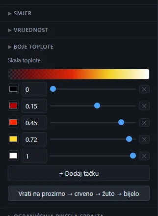

# Boja i ekspozicija

Ove kontrole određuju koja količina toplote dobija koju boju. **Tačka zasićenja** je koliko toplote se računa kao bijelo usijano.

## Brza rješenja {#quick-fixes}

- Sve je bijelo: povećaj **Tačku zasićenja** ili pritisni **Automatska ekspozicija iz polja**.
- Ništa se ne vidi: smanji **Tačku zasićenja** ili pritisni **Automatska ekspozicija iz polja**.
- Vidi se samo nekoliko pojedinačnih tačkica: pojačaj **Najmanju toplotu**.

Svaka kontrola na ovoj stranici djeluje kada se toplota pretvara u boju, pa se pri prevlačenju bilo koje od njih slika odmah ponovo iscrta i **nikad ne pokreće ponovo akumulaciju**.

## Tačka zasićenja {#saturation-point}

**Tačka zasićenja** (odjeljak Oblik toplote): akumulisana toplota koja se preslikava na vrh rampe boja (uz *Linearni* odziv; za ostale vidi dolje). Logaritamski klizač 0,1-4000, ručica se može prevući do 10.000.000, jer akumulisana toplota raste s brojem redova. Zadano je 24; pri svakom učitavanju prvo se uzima **analitička procjena**, zatim se **mjeri** iz slike.

Pogrešna vrijednost razlikuje toplinsku kartu od prazne (ili bijele) slike, a ne može se pouzdano izvesti: telemetrija se toliko grupiše - start, vrata, usko grlo - da se odnos vršne i prosječne gustine razlikuje za red veličine između skupova podataka i između uglova kamere.

## Automatska ekspozicija {#auto-exposure}

**Automatska ekspozicija iz polja** mjeri polje koje je shader zaista proizveo. Zanemaruje prazne piksele, uzima 98. percentil osvijetljenih i stavlja ga na 85% puta do tačke zasićenja, tako da vrh rampe ostaje rezervisan za prave vrhove.

Panel tada prikazuje *izmjereno X% kadra; 98. percentil R postavljen blizu vrha rampe*. Uz odziv *Zasićenje*, vrijednost na 85% tačke zasićenja pada na oko 69% rampe umjesto na 85%.

Pokreće se i **automatski**:

- 8 iscrtanih sličica nakon učitavanja skupa podataka;
- 8 sličica nakon promjene [filtera](filters.md) (filtriranje svake pozicije na stotinu događaja mijenja gustinu za red veličine ili više);
- 8 sličica nakon prebacivanja između tačkaste toplote i [toplote linija](line-heat.md), ili promjene ruta koje toplota linija crta, jer linija ostavlja mnogo manje toplote po uzorku nego sprajt.

Kada ništa nije osvijetljeno, automatsko mjerenje ostavlja zasićenje kakvo jeste; dugme se vraća na analitičku procjenu i prikazuje *ništa osvijetljeno za mjerenje - korištena analitička procjena*.

### Prati prikaz {#follow-the-view}

**Prati prikaz** (odjeljak Oblik toplote, zadano uključeno) ponovo mjeri svaki put kada kamera miruje, pa područje u koje uletiš koristi cijelu rampu boja umjesto skale izmjerene za cijelu mapu. Male promjene se ignorišu, a skala klizne umjesto da skoči. Radi u sva četiri načina toplote, ne u prikazu preko figura.

Isključi ga da zaključaš skalu i uporediš mjesta na jednoj skali. Ručno prevlačenje **Tačke zasićenja** je također zaključava.

## Odziv na gustinu {#density-response}

**Odziv na gustinu** - kako se *k* (toplota / zasićenje) preslikava na rampu:

| Odziv | Formula | Upotreba |
|---|---|---|
| **Zasićenje** (zadano) | t = 1 - e^(-k) | Asimptotski se približava vrhu rampe, kao što to rade slojeviti prozirni sprajtovi. Ništa se nikad ne odseče do ravne bijele, pa je to sigurna zadana vrijednost za nepoznate podatke. |
| **Linearno** | t = k | Jedino preslikavanje gdje ista boja znači isti broj. Koristi ga za poređenje dva skupa podataka ili dva vremenska prozora. |
| **Log** | t = log₂(1 + 7k) / 3 | Sažima dugi rep, tako da jedna ekstremna žarišna tačka prestaje spljoštiti sve ostalo na dno rampe. Podiže rijetka područja. |

## Najmanja toplota {#minimum-heat}

**Najmanja toplota** (zadano isključeno, 0-100%): svaki piksel koji nosi ikakvu toplotu podiže se na najmanje ovaj dio rampe. Pojačaj je, a poluprečnik sprajta smanji, da vidiš *gdje se ikada nešto desilo* - pojedinačne tačke postaju jasno vidljive umjesto da sjede tek iznad prozirnog. Ostavi je isključenu kada procjenjuješ gustinu, jer namjerno spljošti dno rampe. Prag (k > 0,0001) održava stvarno prazne piksele praznim.

## Uređivač rampe {#the-ramp-editor}

U odjeljku **Boje toplote**. Njegova oznaka kaže čemu rampa služi: *Rampa toplote* u Toploti i Linijama, *Pozitivna (aditivni timovi)* u Razlici, *Rampa neprozirnosti (boja dolazi iz grupe)* u [Toploti tima](team-heat.md), gdje se koristi samo njena alfa vrijednost.



Traka na vrhu prikazuje pregled rampe. Ispod nje, jedan red po tački:

| Dio | Značenje |
|---|---|
| Uzorak boje | Boja tačke (birač boja preglednika). |
| Broj | Položaj tačke duž rampe, od 0 do 1 (0 = bez toplote). |
| Klizač | Neprozirnost tačke, 0-100%. |
| ✕ | Uklanja tačku; onemogućeno kada ostanu samo dvije. |

**+ Dodaj tačku** dodaje tačku na pola puta između posljednje dvije tačke, s bojom i neprozirnošću posljednje tačke. **Vrati na prozirno → crveno → žuto → bijelo** vraća zadano.

Tačke se mogu zadati bilo kojim redom; sortiraju se kada se rampa gradi. **Alfa** je ono što miješa toplotu sa scenom, zato je nulti kraj zadane rampe potpuno proziran.

### Zadane rampe {#the-default-ramps}

| Položaj | Pozitivna (Toplota, Linije, Razlika +) | Negativna (Razlika −) |
|---|---|---|
| 0,00 | crna, alfa 0 | crna, alfa 0 |
| 0,15 | rgb(180, 0, 0), alfa 0,55 | rgb(0, 170, 60), alfa 0,55 |
| 0,45 | rgb(255, 40, 0), alfa 0,85 | rgb(0, 190, 200), alfa 0,85 |
| 0,72 | rgb(255, 220, 40), alfa 0,95 | rgb(40, 80, 255), alfa 0,95 |
| 1,00 | bijela, alfa 1 | rgb(170, 60, 255), alfa 1 |

## Dok se kamera kreće {#while-the-camera-moves}

Kada se kamera kreće, akumulacija se restartuje svake sličice. Uz uključeno **Crtaj svaki red u svakoj sličici** (zadano), svaka sličica u pokretu je i dalje tačna; kada je isključeno, sličica u pokretu prikazuje jednu uzorkovanu procjenu - svjetlije, grudaste mrlje ponderisane težinom - koja se, kada staneš, približava glatkijoj pravoj slici. To je očekivano; vidi [Akumulaciju](accumulation.md).

## Za programere {#for-developers}

### Prolaz kompozicije {#the-composite-pass}

Nakon što je toplota akumulisana, vrijednost svakog piksela se u jednom prolazu kompozicije pretvara u boju ([`COMPOSITE_FS`](https://github.com/Holdi601/3DHeat/blob/main/src/render/webgl2/shaders.ts)). Koraci su:

```
k = |toplota| / tačka zasićenja
t = odziv(k)                            ograničeno na 0..1
ako je najmanja toplota > 0 i k > 0.0001:  t = najmanja + (1 - najmanja) × t
boja, alfa = rampa(t)                   (negativna rampa kad je toplota < 0, samo Razlika)
piksel = mix(scena, boja, alfa)
```

### Analitička procjena {#the-analytic-estimate}

**Analitička procjena** ([`estimateSaturation`](https://github.com/Holdi601/3DHeat/blob/main/src/data/calibrate.ts)) pretpostavlja da su redovi raspoređeni po X-Z otisku podataka: prosječna toplota = redovi × (π r² / površina otiska) × 1/3 × intenzitet u centru (1/3 je prosjek diska linearne rampe), pomnoženo pretpostavljenim odnosom vršne i prosječne vrijednosti 25, ograničeno na 0,1-1.000.000. Mora biti tek unutar reda veličine tačna.

### Mjerenje {#metering}

[`exposure.ts`](https://github.com/Holdi601/3DHeat/blob/main/src/render/exposure.ts):

1. ciljna toplota se čita nazad iz GPU-a, poduzorkovana na najviše 40.000 vrijednosti;
2. prazni pikseli (toplota ≤ 0,0001) se odbacuju - većina toplinskog polja je prazna, a uprosječavanje njih bi sve potamnilo, kao što bi kamera usmjerena na crnu pozadinu pogrešno mjerila;
3. 98. percentil osvijetljenih piksela je referenca;
4. tačka zasićenja postaje referenca / 0,85, pa referenca sjedi na 85% puta do tačke zasićenja, a vrh rampe ostaje rezervisan za prave vrhove.

### Tabela boja {#the-colour-table}

Rampa se pretvara u tabelu 256 × 2 RGBA (pozitivna rampa u prvom redu, negativna u drugom) ([`buildColorLut`](https://github.com/Holdi601/3DHeat/blob/main/src/render/colors.ts)). Boje se interpoliraju u linearnom svjetlu i čuvaju kao sRGB; neprozirnost se interpolira linearno.
