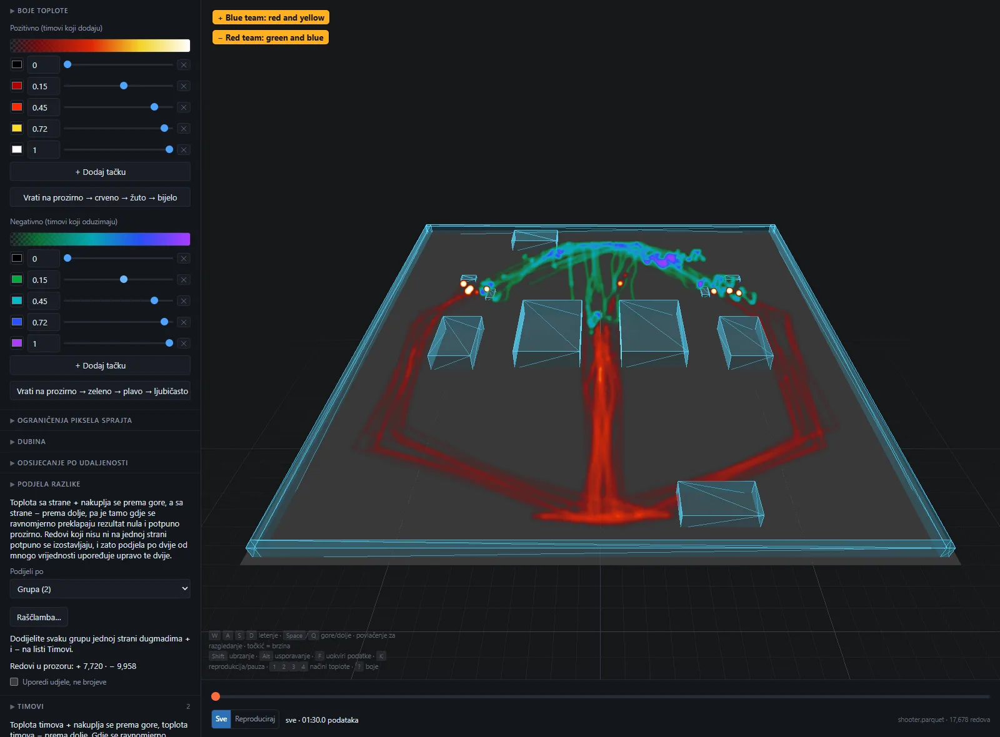

# Razlika

Crveno tamo gdje je tim A bio više, zeleno-plavo tamo gdje je bio tim B, ništa tamo gdje su bili jednaki.

**Razlika** (tipka 2) je toplota s predznakom. Redovi jedne populacije dodaju toplotu; redovi druge je oduzimaju. Tamo gdje se njih dvoje ravnomjerno preklapaju rezultat je nula i potpuno proziran; tamo gdje jedna strana preovladava prikazuje se bojama te strane - podrazumijevano toplim (prozirno → crveno → žuto → bijelo) za stranu **+** i hladnim (prozirno → zeleno → plavo → ljubičasto) za stranu **−**.

## Kako se koristi {#how-to-use-it}

1. Pritisnite `2` (ili izaberite **Razlika** na traci načina).
2. Otvorite **Podjela razlike** u bočnoj traci.
3. Izaberite po čemu se **Podijeli po**: obično *Grupama*.
4. Stavite jednu grupu (ili vrijednost) na **+**, a drugu na **−**.
5. Čitajte boje: toplo znači stranu +, hladno znači stranu −. Panel upozorava ako jedna strana nema redova (vidi [Poruke koje možete vidjeti](#messages-you-may-see)).

*Koje* dvije populacije je cijelo pitanje, pa podjela može biti bilo koja zadržana kolona, ne samo grupe. Redovi koji ne padaju ni na jednu stranu **ostaju van**, ne računaju se kao nula: upravo zato podjela preko dvije od mnogo vrijednosti poredi tačno te dvije, i ona se slaže s [filterima](filters.md) - filtrirajte na jednu mapu, pa to podijelite po verziji.

Način treba dvije strane: kolonu grupe s najmanje dvije grupe, ili podjelu preko kolone zadržane za filtriranje. Na podacima s manje od dvije grupe učitavanje počinje podjelom po koloni - prvo kolonom *Izvorna datoteka* kod učitavanja više datoteka, inače prvom kategorijskom kolonom s dvije vrijednosti, inače prvom numeričkom kolonom s rasponom - pa *uporedi dva učitavanja* radi i na podacima bez ijedne grupe. Samo podaci bez ičega od toga čine način nedostupnim; tako je i kada podjela po koloni ostavi prazno s jedne strane.

## Panel Podjela razlike {#the-difference-split-panel}

Prikazuje se u načinu Razlika, ispod panela toplote.

**Podijeli po** nudi:

| Opcija | Prikazuje se kao | Pravilo podjele |
|---|---|---|
| Grupe | *Grupa (N)* (kada postoji kolona grupe) | Svaka grupa na +, − ili nijednoj, postavljeno u [Spisku timova](teams-list.md) |
| Kategorijska kolona | *kolona (N vrijednosti)* | Vrijednosti na +, − ili nijednoj |
| Numerička kolona | *kolona (numerička)* | Raspon vrijednosti za svaku stranu |
| Izvorna datoteka | *Izvorna datoteka - uporedi dva učitavanja* (kada je učitano više datoteka) | Datoteke na +, − ili nijednoj |

Nude se samo kolone zadržane pod *Zadrži za filtriranje* pri učitavanju.

### Uporedi udjele, ne brojeve {#compare-shares-not-counts}

**Uporedi udjele, ne brojeve** (podrazumijevano isključeno) važe svaku stranu jednom kroz broj njenih redova, pa strana s pet puta više redova ne pobjeđuje samo brojem. Boja tada pokazuje gdje je svaka strana srazmjerno češća od druge. Koristite to kada dvije strane imaju jako različite količine podataka, na primjer dvije sesije različitog trajanja.

### Poruke koje možete vidjeti {#messages-you-may-see}

Panel upozorava kada slika nije prava razlika:

| Poruka | Značenje |
|---|---|
| *N + / M −* (ili *N + / M − / K nekorišteno*) | Koliko vrijednosti je na kojoj strani (i na nijednoj). |
| Nijedan red u prozoru nije na strani **+** | Crta se samo strana **−**. Pomjerite prozor vremenske linije ili promijenite podjelu. |
| Nijedan red u prozoru nije na strani **−** | Crta se samo strana **+**. |
| Nijedna vrijednost nije ni na jednoj strani | Razlika ne crta ništa. Stavite barem jednu vrijednost na **+** ili **−**. |
| *kolona* ne može se podijeliti na ovaj način | Izabrana kolona ne odgovara podjeli. Ponovo izaberite kolonu. |
| Kolona podjele nije stala u GPU memoriju za N od M dijelova | Ti redovi se ne crtaju. Povećajte GPU budžet pod Performanse → Budžeti resursa, ili učitajte manje redova. |

### Po grupi {#by-group}

Panel samo upućuje na [Spisak timova](teams-list.md), gdje svaka grupa ima dugme **+** i **−**. Pri svakom učitavanju prva polovina grupa (zaokružena nagore) stavlja se na +, ostale na −; **Podijeli ravnomjerno** u Spisku timova to ponovo radi. Grupa koja nije ni na jednoj strani, ili je sakrivena svojim poljem za označavanje, ne doprinosi ništa.

### Po vrijednostima kategorije {#by-category-values}

| Dio | Značenje |
|---|---|
| `a + / b − / c nekorišteno` | Koliko vrijednosti je na kojoj strani i na nijednoj. |
| **Očisti** | Stavlja svaku vrijednost na nijednu stranu. |
| Spisak vrijednosti | Svaka vrijednost s dugmetom **+** i **−** (kliknite aktivno ponovo da je skinete s te strane). Prazna vrijednost je navedena kao *(nedostaje)*. |
| Napomena o ograničenju | Navedeno je samo prvih 200 vrijednosti: *Prikazano je prvih 200 od N vrijednosti. Kolonu ovako široku bolje je prvo suziti filterom, ili podijeliti po rasponu ako su njene vrijednosti poredane.* |

Izbor kolone stavlja njenu prvu vrijednost na + a drugu na −. Kada nijedna strana nema vrijednost, podjela se vraća na grupe umjesto da prikaže prazan okvir. *Izvorna datoteka* radi isto, po jednu vrijednost za svaku datoteku - tako se upoređuju dva izvoza, dva testna prolaza ili dvije verzije.

### Po rasponu {#by-range}

| Dio | Značenje |
|---|---|
| Nagovještaj | Minimum i maksimum kolone. |
| **Pozitivni raspon (+)**, **od** / **do** | Redovi s vrijednošću u ovom rasponu, uključujući oba kraja, dodaju. |
| **Negativni raspon (−)**, **od** / **do** | Redovi u ovom rasponu oduzimaju. |
| **Podijeli na sredini** | Postavlja + na [minimum, sredina] i − na [sredina, maksimum] - to radi i izbor kolone. |

Vrijednost u oba raspona računa se kao +. Rasponi ne moraju pokrivati cijelu kolonu; vrijednosti izvan oba se izostavljaju. *Prve dvije minute naspram zadnje dvije* je podjela po rasponu na koloni sličnoj vremenu.

## Boje {#colours}

Odjeljak **Boje toplote** u ovom načinu prikazuje dva uređivača skale: **Pozitivno (timovi koji dodaju)** i **Negativno (timovi koji oduzimaju)**, svaki s vlastitim dugmetom za vraćanje (*Vrati na prozirno → crveno → žuto → bijelo*, *Vrati na prozirno → zeleno → plavo → ljubičasto*). Kompozicija uzima apsolutnu vrijednost neto toplote kroz [tačku zasićenja i odziv](colour-and-exposure.md), i bira negativnu skalu tamo gdje je neto ispod nule. Vidi [Boja i ekspozicija](colour-and-exposure.md#the-ramp-editor).

Koristite odziv *Linearno* kada je veličina razlike važna: to je jedini odziv u kojem ista boja znači isti broj.

## Kako radi {#how-it-works}

Svaki red dobija predznak +1, -1 ili 0 u vertex shaderu ([`POINT_HEAT_VS`](https://github.com/Holdi601/3DHeat/blob/main/src/render/webgl2/shaders.ts)); 0 odbacuje red prije nego što se ijedan fragment nacrta.

- Po grupi, predznak dolazi iz tabele grupa s 4.096 unosa indeksirane id-om grupe reda (id grupe putuje u četvrtom kanalu teksela pozicije reda).
- Po kategoriji, predznak dolazi iz druge tabele s 4.096 unosa, popunjene za svaku vrijednost kategorije, a vrijednost reda čita se iz teksture filtera kolone; vrijednost iza kraja tabele odbacuje se na oba backenda.
- Po rasponu, vrijednost reda poredi se s dva raspona.

Promjena podjele ponovo pokreće akumulaciju.

**Sakrivene grupe ostaju sakrivene uz svaku podjelu.** Pod podjelom po koloni tabela grupa više ne nosi predznake; drži 1 za prikazanu grupu i 0 za sakrivenu ([`frameSignTables`](https://github.com/Holdi601/3DHeat/blob/main/src/render/filterTables.ts)), a obje tabele dolaze do shadera zajedno - dva reda jedne teksture predznaka na WebGL2, dvije polovine jednog storage bafera na WebGPU-u. Red se crta samo kada je njegova grupa prikazana *i* njegova vrijednost kolone je na nekoj strani. Tako grupa odznačena u [Spisku timova](teams-list.md), ili isključena fokusom strane s kartice Meč, ne doprinosi ništa, kako god da je razlika podijeljena.
