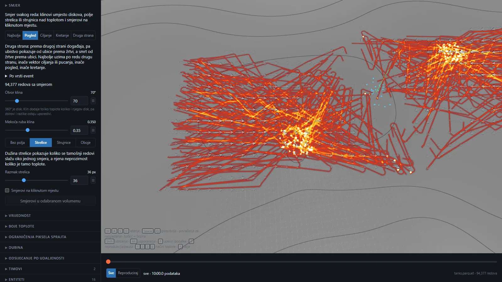

# Usmjerena toplota

Obična toplota kaže **gdje** se stvari dešavaju. Usmjerena toplota kaže i **u kom smjeru**: u kom pravcu su ljudi gledali, nišanili, kretali se, ili gdje je bila druga strana borbe.

Običan sprajt je cijeli disk (360 stepeni). Uz **Otvor klina** od 70 stepeni, isti sprajt postaje uzak klin koji pokazuje smjer u kojem je red bio okrenut, i dodaje istu ukupnu toplotu.

## Kako se koristi {#how-to-use-it}

1. Učitaj podatke s smjerom u njima (vidi [Šta redu daje smjer](#what-gives-a-row-a-direction)).
2. Izaberi **Toplota**, **Razlika** ili **Toplota timova** u traci režima.
3. Otvori odjeljak **Smjer** na bočnoj traci.
4. Izaberi **izvor** (koji smjer koristiti), zatim uključi crtanje:
   - spusti **Otvor klina** ispod 360° da svaki red nacrtaš kao klin koji pokazuje svoj smjer umjesto diska;
   - izaberi **Polje** da nacrtaš strelice ili strujnice preko toplote;
   - označi **Smjerovi na kliknutom mjestu** i klikni na toplotu da dobiješ polarni grafikon tog mjesta.

Linija statusa kaže koliko redova ima smjer iz izabranog izvora.

## Postavke {#settings}

| Postavka | Zadano | Šta radi |
|---|---|---|
| Izvor: **Najbolji**, **Prikaz**, **Ciljanje**, **Kretanje**, **Druga strana** | Najbolji | Koji smjer dobija svaki red. *Najbolji* uzima, za svaki red, drugu stranu, inače ciljanje, inače prikaz, inače kretanje. |
| **Po vrsti događaja** | kao gore | Drugi izvor za svaku vrstu događaja, na primjer *Druga strana* za ubistva i *Prikaz* za pozicije. Prikazuje se kada podaci imaju kolonu događaja s najviše 40 vrijednosti. |
| **Otvor klina** | 360° | 360° je običan disk (isključeno). Manje je uži klin. Klin dodaje onoliko toplote koliko njegov disk, pa zbirovi i razlike ostaju uporedivi. |
| **Mekoća ivice klina** | 0,35 | 0 je klin s oštrom ivicom, 1 je mekani vjetar. |
| **Polje**: Bez polja, Strelice, Strujnice, Oboje | Bez polja | Strelice: dužina strelice je koliko se redovi tu slažu u jednom smjeru, neprozirnost koliko je toplote tu. Strelice se pokazuju samo gdje ima toplote. |
| **Razmak strelica** | 28 px | Razmak između strelica na ekranu. |
| **Animiraj strujnice** | uključeno | Strujnice teku dok je uključeno. |
| **Smjerovi na kliknutom mjestu** | isključeno | Klikni na toplotu da vidiš smjerove tamo (dolje). |
| **Smjerovi u odabranoj zapremini** | | Isti grafikon za sve unutar izabrane [zapremine](volumes.md). |

## Polarni grafikon na mjestu {#the-polar-chart-at-a-spot}

Uz uključeno **Smjerovi na kliknutom mjestu**, klikni na toplotu. Redovi blizu te tačke (unutar 1,5 poluprečnika sprajta) skupljaju se u ružu od 24 isječka po 15°:

- **narandžasti** latice: odlazni smjerovi (kamo redovi pokazuju);
- **plave** latice: dolazni smjerovi (odakle su došli);
- **površina** latice raste s brojem; strelica pokazuje glavni smjer;
- linije ispod grafikona daju glavni pravac, koliko se redovi slažu (R, od 0 do 1), raspršenje u stepenima i broj redova.

0° je gore na grafikonu, što je svjetski −Z (sjever za Tacview snimke). Mjesto je također označeno u 3D prikazu strelicom i prstenom.

## Šta redu daje smjer {#what-gives-a-row-a-direction}

| Izvor | Treba u podacima |
|---|---|
| Prikaz | kolona zakretanja (mapirana kao smjer pogleda): `yaw`, `heading`, `azimuth`, `view_yaw`, `rot_z` |
| Ciljanje | parovi brojeva kao `aim_x`/`aim_y`, `shot_x`/`shot_y`, `fire_x`/`fire_y`, `hit_dir_x`/`hit_dir_y` (opcionalno `…_z`) |
| Kretanje | ništa dodatno: korak od prethodnog uzorka iste osobe (najviše 10 s ranije, ista sesija) |
| Druga strana | kolona koja imenuje drugu stranu događaja (`other`, `victim`, `target`, `killer`, `attacker`, `shooter`, `other_player` ...) čije vrijednosti su imena osoba; ubistvo pokazuje od ubice ka žrtvi, smrt od žrtve ka ubici |

## Savjeti {#tips}

- Klinovi trebaju neku veličinu na ekranu; ispod nekoliko piksela ponovo se crtaju kao diskovi.
- Koristi *Druga strana* na redovima ubistava da vidiš **odakle** su borbe dobijene, a *Prikaz* na redovima pozicija da vidiš **gdje ljudi gledaju**.
- Uz **Razliku**, klinovi dviju strana pokazuju u svoje smjerove, pa se sporne linije vatre ističu.
