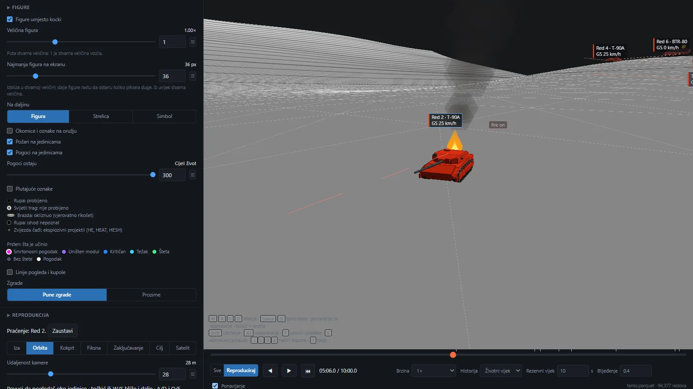

# Figure

**Figura** je mali 3D model onoga što jedinica zaista jeste: tenk, mlaz, brod, vojnik. [Replay](match-replay.md) crta svaku jedinicu kao njenu figuru u pravoj veličini, umjesto kao običnu kutiju.

Ima oko 2.000 imenovanih vozila, aviona, brodova, oružja i vojnika, sve ih pravi sam preglednik.

## Šta je u katalogu {#what-is-in-the-catalogue}

| Oblast | Primjeri |
|---|---|
| Ljudi | vojnik stoji, čuči, leži ničice; snajperista, protivtenkovski, medicinar, posada |
| Kopno | tenkovi, borbena vozila pješaštva, protivvazduhoplovna odbrana, artiljerija, kamioni i automobili, vozovi i tramvaji |
| Vazduh | lovci, jurišni avioni, bombarderi, transporti, helikopteri, od dvokrilaca do modernih mlaznjaka |
| More | ratni brodovi po klasi, nosači aviona, podmornice, čamci, trgovački brodovi |
| Oružje | rakete, raketni projektili, bombe, torpeda, baklje i reflektujuće trake |
| Oznake | dimne, bljeskalice i zapaljive granate, postavljene bombe, zastave, mjesta pojavljivanja, putne tačke |
| Bliska borba | vojnici u nosačima ploča s jurišnom puškom, automatom, sačmaricom, DMR-om, LMG-om, pištoljem ili štitom; dronovi, kamere, bodljikava žica, štitovi, ojačanje zidova, barikade, punjenja za proboj, zamke, prozori, granate, defuser |

## Kako se figure prave {#how-the-figures-are-made}

- **Prave se od objavljenih dimenzija.** Većina figura je napravljena pomoću sopstvenog graditelja figura u pregledniku, od javnih brojeva: dužina, širina, visina, točkovi na stazi, kupola i top, krila i rep. Njihov oblik se zatim podešava prema javnim fotografijama, crtežima i objavljenim dimenzijama. Nijedan model iz igara se ne koristi.
- **Besplatni modeli.** Nekoliko figura koristi besplatne 3D modele (CC0 ili CC BY) tamo gdje su vjernije, ponekad kombinovane sa izgrađenim trupom. Autori djela pod CC BY navedeni su na [Zasluge za figure](figure-credits.md); djela pod CC0 ne traže navođenje i nisu tamo navedena.
- Svaka figura ima punu, grubu i daleku verziju (nivoi detalja, LOD), pa se hiljade mogu nacrtati odjednom.

## Koju figuru jedinica dobija {#which-figure-a-unit-gets}

Preglednik gleda sopstvene kolone podataka:

1. **Imena**: kolone zvane *Name*, *Vehicle*, *Unit*, *Unit type*, *Model*, *Aircraft*, *Plane*, *Tank*, *Ship*, *Craft*, *Loadout*, *Kit* ili *Figure* upoređuju se sa katalogom: tačno, kroz oko 4.000 aliasa (id-ovi jedinica iz nekoliko igara), po najdužem poznatom početku (`F-16C_50` je F-16C), ili po najkraćem imenu figure koje počinje tako.
2. Ime čija figura ne odgovara **tipu** jedinice se ne koristi (kamion zvan *Typhoon* nije lovac).
3. **Tipovi**: kolone zvane *Type*, *Class*, *Kind*, *Category*, *Icon*, *Role* ili *Domain* daju figuru klase: Tacview oznake (`Air+FixedWing`, `Ground+Heavy+Armor+Vehicle+Tank`, `Sea+Watercraft+Warship`, `Weapon+Missile`), ikone na karti, ili obične riječi (tank, helikopter, pješaštvo).
4. Podaci bez nijednog od njih su podaci o ljudima: svi su vojnici.

Zato je najlakši način da dobijete prave figure kolona `vehicle` sa pravim imenima, ili kolona `type` sa Tacview oznakama.

**Moja jedinica se prikazuje kao kutija ili vojnik.** Dodajte kolonu `vehicle` sa pravim imenom, ili kolonu `type` sa Tacview oznakom. Zadržite miš na jedinici da vidite koje je ime upareno. Podaci koji imaju takve kolone, ali ništa ne govore o jedinici, ostavljaju je kao kutiju; podaci bez ijedne od njih crtaju se kao vojnici.

## Figure za blisku borbu (Rainbow Six Siege) {#close-quarters-figures-rainbow-six-siege}

Tabele zapisane kao one iz čitača snimaka Rainbow Six Siege (kolone `operator`, `pawn`, `primaryClass`, `side`) dobijaju sopstvene figure:

- **Igrači** su svoj operater: svaki od 78 operatera ima sopstvenu figuru, visoku oko 1,8 m, u sopstvenoj odjeći - dvije ili tri boje za jaknu, pantalone i opremu prema njihovom uobičajenom javnom izgledu (crna, maslinasta, pješčana, gradska siva, bijela, mornarsko plava, s crvenom, narandžastom ili tirkiznom opremom) - i sa sopstvenim oblicima, za trećinu većim od stvarnih tamo gdje se moraju vidjeti odozgo: pokrivalo za glavu (kacige, vizir ili teška kaciga, kape sa šiltom, pletene kape, beretke, široki šešir boonie ili krznena kapa, kapuljače, šalovi, kosa), lice (zaštitne naočale, gas-maska, naočale, maska, brada, naočale s tri sočiva), laka, srednja ili teška građa (teški su široki, s velikim pločama na ramenima i kragnom), dugi kaput ili odijelo, maskirno odijelo ghillie, ono što nose na leđima (čekić, punjenja, dronove, kanistere, rezervoar za gorivo, cijev lansera, samostrel, ploče, ometač, štit) ili na ruci (lanser, metalnu ruku), sopstveni štit (visoki štit, policijski štit, štit sa svjetlima) i naglasna boja na ramenima. Drže klasu svog glavnog oružja. Operater kojeg preglednik ne poznaje je običan vojnik u nosaču ploča u boji tima.
- **Strana** se vidi odvojeno od odjeće: prsten na tlu ispod svakog operatera, **ćilibarni za napad, blijedo cijan za odbranu**, s bojom tima unutra, i trake na ruci i glavi u istoj boji. Kolona `stance` (stand, crouch, prone) postavlja ih u položaj; bez nje stoje.
- **Razlikuju se na udaljenosti snimka:** iscrtani 48 piksela visoko odozgo i iz tri četvrtine, svaka dva operatera na istoj strani razlikuju se jasnom razlikom u boji ili drugačijim oblikom (provjereno testovima preglednika).
- **Oznake** navode igrača i operatera kojeg u tom trenutku igra, s ulogom operatera kao simbolom: ✸ tvrdi proboj, ⚒ meki proboj, ➤ ulaz, ✦ fragger, ✚ podrška, ⬟ štit, ◉ izviđanje, ◇ fleks, ↺ čuvanje boka, ⚓ sidro, ✕ postavljač zamki, ⇄ roamer, ↯ protiv uređaja, ▣ protiv proboja.
- **Dronovi** su dron na dva točka koji se baca, širok oko 30 cm, svaki svoj sopstveni trag nazvan po vlasniku („Ash · drone 2“).
- **Postavljeni uređaji** stoje tamo gdje su postavljeni, od tada do kraja runde, svaki kao figura onoga što radi: kamera, bodljikava žica, postavljivi štit, punjenje za proboj, punjenje za tvrdi proboj, malo ljepljivo punjenje, podna zamka, claymore s laserskim okidačem, jednosmjerni prozor, oklopna ploča, granata, kanister s gasom, ometač, senzor, laserska kapija, kutija sa zalihama. Jedna figura služi svakom uređaju koji obavlja isti posao. Uređaj čiju vrstu podaci ne navode je mala naprava sa svjetlom.
- **Defuser** stoji tamo gdje je postavljen, svojih 45 sekundi.

Svaki dron i uređaj pri učitavanju datoteke postaje sopstveni trag, pa igračeva sopstvena figura ostaje na njegovom tijelu. Operateri su pojednostavljeni oblici prema njihovim javnim opisima i ilustracijama (šta nose, uređaj koji je njihova sposobnost), a uređaji su oblikovani prema onome što rade. Sve su to sopstveni dizajni preglednika u stvarnoj veličini stvari (claymore širok oko 22 cm, ploča veličine vrata 1 m × 2,1 m), a ne modeli iz igre.

## Postavke {#settings}

Odjeljak **Figure** u bočnoj traci replaya podešava veličinu, najmanju veličinu na ekranu, u šta se pretvaraju daleke jedinice (figura, strelica, simbol), i efekte koji se crtaju na njima. Vidi [Replay meča](match-replay.md#figures). Dim, vatra i drugi vremenski efekti: [Figure u sloju figura](figure-replay.md).

## Opcioni lokalni paket figura {#an-optional-local-figure-pack}

Na sopstvenom računaru možete držati opcioni paket sopstvenih figura. Njegove figure zamjenjuju figure iz kataloga istih imena. Nikad nije dio repozitorijuma ni objavljene verzije; bez njega se ništa ne mijenja.
