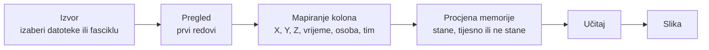

# Unos podataka

Prije nego što 3DHeat išta može nacrtati, treba mu tabela: svaki red kaže gdje je nešto bilo i, ako to imate, kada i ko. Ovaj odjeljak objašnjava kako datoteka postaje slika. Još nemate podatke? Isprobajte [demo podatke](demo-data.md).

**Uradite ovo sada:**

1. U bočnoj traci Toplotne mape otvorite **Izvor** i pritisnite **Datoteke…** (ili prevucite datoteku ili fasciklu na zonu za ispuštanje).
2. Pogledajte **Mapiranje kolona**: polja su obično već popunjena.
3. Provjerite da **Procjena memorije** kaže *stane*.
4. Pritisnite **Učitaj**.

Sve što prikazuje kartica Toplotna mapa dolazi iz jednog **skupa podataka**: tabele redova, gdje svaki ima poziciju i, po želji, vrijeme, osobu, grupu, sesiju, smjer gledanja i bilo koji broj dodatnih kolona zadržanih za filtriranje. Ovaj odjeljak objašnjava kako se skup podataka pravi.

## Put od datoteka do slike {#the-path-from-files-to-picture}

1. **Izaberite datoteke** u panelu **Izvor** - jednu, nekoliko, stablo fascikli ili prevlačenjem. Prihvataju se Parquet, CSV, Tacview, GPS tragovi i još; kompletan spisak je u [Formatima podataka](data-formats.md#files). Vidi [Učitavanje datoteka](loading-files.md).
2. **Pregled.** Otvara se prva datoteka izbora: njeni nazivi kolona, prvih 50 redova, koje kolone izgledaju numeričke i (Parquet) logički tip svake kolone i sopstvena uputstva za čitanje datoteke, unos `heat3d` u podnožju.
3. **Automatsko mapiranje.** Kolone se dodjeljuju ulogama - X, Y, Z, vrijeme, osoba, sesija, grupa, smjer gledanja - i nekoliko se zadržava za filtriranje. Svaka pretpostavka prikazana je u panelu **Mapiranje kolona** i može se promijeniti. Vidi [Mapiranje kolona](column-mapping.md) i [Ose, jedinice i vrijeme](axes-units-and-time.md).
4. **Brojanje.** Broj redova svake datoteke se čita (tačno iz Parquet podnožja, procijenjeno za CSV), pa panel može prije učitavanja reći koliko memorije treba učitavanje i da li stane. Ako ne stane, predlaže učitavanje svakog *N*-tog reda. Vidi [Memorija i budžeti](memory-and-budgets.md).
5. **Učitaj.** Pozadinski radnik parsira samo mapirane kolone svake datoteke - nekoliko datoteka odjednom, do budžeta [niti parsera](memory-and-budgets.md#parser-threads) - i spaja ih, redom izbora, u jedan skup podataka: jedan zajednički rječnik osoba, grupa i sesija kroz sve datoteke, jedno zajedničko početno vrijeme, svi redovi sortirani po vremenu. Vidi [Sesije, osobe i grupe](sessions-persons-groups.md).
6. **Otpremanje.** Glavna nit najavljuje „Otpremanje N redova na GPU” za jedan frejm, pa pakuje redove u GPU memoriju unutar GPU budžeta. Vidi [Boravak u GPU memoriji](gpu-memory.md).
7. **Prva slika.** Kamera uokviruje podatke, radijus sprajta i zasićenje se postavljaju iz opsega podataka i broja redova, a nakon 8 iscrtanih frejmova zasićenje se mjeri iz same slike ([Boja i ekspozicija](colour-and-exposure.md)).

## Zahtjevi, provjereni prije učitavanja {#requirements-checked-before-a-load}

| Potreba | Šta se dešava bez nje |
|---|---|
| **Najmanje dvije od X / Y / Z** | Učitavanje se odbija. Uz tačno dvije, treća osa je 0 i podaci se crtaju kao ravna površ u 3D sceni - što želi mapa toplote gledana odozgo. |
| Kolona vremena | Opciono. Bez nje vremenska linija je onemogućena, prikaz ostaje u režimu **Sve**, a bočna traka to kaže. |
| Kolona osobe | Opciono. Potrebna za [preklapanje figura](box-replay.md) (figura za svaku osobu), [toplotu linija](line-heat.md) (put koji je svaka osoba prešla), interpolaciju, tragove i istoriju **Životni vijek**. |
| Kolona grupe | Opciono. Potrebna za [toplotu timova](team-heat.md) i za režim [razlike](difference.md) (najmanje dvije grupe). |

Režim koji učitani podaci ne mogu podržati zasivljen je na traci načina; zadržavanje pokazivača iznad njega kaže zašto.

## Bez vlastitih podataka {#without-your-own-data}

Panel **Skup podataka** (ispod **Izvor**) ima [sintetički generator](synthetic-generator.md) koji pravi skup podataka kakav imaju igre battle royale, bilo koje veličine, koristan za isprobavanje prikazivača i za testiranje šta mašina može da podnese.

## Stranice u ovom odjeljku {#pages-in-this-section}

- [Učitavanje datoteka](loading-files.md) - birači, fascikle, prevlačenje i ispuštanje, spajanje više datoteka, pravilo datoteke za kretanje, napredak i otkazivanje
- [Mapiranje kolona](column-mapping.md) - svako polje panela za mapiranje, kako automatsko mapiranje pogađa, `heat3d` nagovještaji
- [Ose, jedinice i vrijeme](axes-units-and-time.md) - gornja osa, okretanja, skala jedinica, jedinice vremena, smjer gledanja
- [Sesije, osobe i grupe](sessions-persons-groups.md) - šta svaka radi, ograničenja, zajednički nazivi, veličina entiteta, panel Skup podataka
- [Sintetički generator](synthetic-generator.md)
- [Memorija i budžeti](memory-and-budgets.md) - model zauzeća, provjera stanja, prorjeđivanje, granica sortiranja, budžeti resursa
