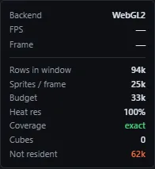

# Boravak u GPU memoriji

Grafička kartica ima samo toliko memorije. Ako vaši podaci ne stanu, preglednik prikazuje ono što stane i to kaže: prikaz statistike dobija žuti red **Nije u memoriji** sa brojem redova koji su ispušteni. Skraćen skup podataka koji izgleda kompletan bio bi najgora greška koju alat za analizu može napraviti, zato se ovaj red nikad ne skriva.

Da stane više, povećajte GPU budžet pod **Budžeti resursa** i ponovo učitajte ([Memorija i budžeti](memory-and-budgets.md#raising-the-gpu-budget)), najprije suzite podatke, ili koristite karticu sa više memorije.

## Za programere {#for-developers}

### Kako se redovi čuvaju na GPU-u {#how-rows-are-stored-on-the-gpu}

Redovi se učitavaju jednom, kad stigne skup podataka, u **dijelovima** od 8.388.608 redova (2²³) ([`CHUNK_ROWS`](https://github.com/Holdi601/3DHeat/blob/main/src/render/types.ts)). Svaki dio se kvantizuje u odnosu na sopstveni ograničavajući okvir i vremenski raspon:

| Podaci | Format | Bajtova po redu |
|---|---|---|
| Pozicija X, Y, Z i id grupe | četiri 16-bitna neoznačena cijela broja (RGBA16UI na WebGL2); X, Y, Z unutar ograničavajućeg okvira dijela | 8 |
| Vrijeme i životni vijek (kad skup podataka ima i vrijeme i osobu) | dva 16-bitna neoznačena cijela broja (RG16UI): vrijeme unutar vremenskog raspona dijela; životni vijek, gdje 65.535 znači "nema sljedećeg uzorka" | 4 |

Ograničavajući okviri po dijelu su ono što čini da 16 bita bude dovoljno: dio obično pokriva djelić karte, pa je korak kvantizacije daleko ispod centimetra na karti širokoj kilometrima, mnogo ispod šuma u pravoj telemetriji. Id grupe u četvrtom kanalu je besplatan, i zato može biti najviše 4.096 grupa ([Grupe](sessions-persons-groups.md#limits)).

Na WebGL2 je svaki dio tekstura široka 8.192 texela, dopunjena do cijelih redova teksture; do redova se dolazi preko `gl_VertexID` kroz blok-indeks teksturu po sličici. Na WebGPU-u su to storage baferi.

Dodatna GPU memorija po redu, alocira se po upotrebi:

- svaki aktivni [filter](filters.md) kolone: 4 bajta po redu (vrijednosti kao 32-bitni float ili id kategorije), učitava se po dijelu prvi put kad se filter upotrijebi;
- [toplota linija](line-heat.md): 8 bajtova po redu (početak svakog segmenta, kvantizovan unutar ograničavajućeg okvira podataka, i njegove oznake) dok je režim Linije uključen.

Zatim ciljevi renderovanja: boja i dubina scene, cilj toplote i njegov pomoćni dvojnik (četiri kanala u [Toplota tima](team-heat.md)), i slojevi depth-peelinga za [okluziju](depth-and-culling.md); i geometrija nivoa.

### Budžet se nameće pri učitavanju {#the-budget-is-enforced-at-upload}

WebGL prihvata alokacije koje ne može da posluži, pa ili izgubi kontekst ili pada na sistemsku memoriju uz pogubne troškove. Zato se GPU budžet nameće kad se skup podataka učitava ([`setDataset`](https://github.com/Holdi601/3DHeat/blob/main/src/render/webgl2/renderer.ts)):

- dijelovi se učitavaju redom (to jest, po vremenu) dok stanu;
- prvi dio koji ne stane učitava se **djelimično**, koliko cijelih redova teksture preostali budžet drži, a ne uopšte, pa budžet koji ne može držati cijeli dio ipak pokazuje što više može; a pošto su redovi poredani po vremenu, prikazani dio je povezan vremenski niz;
- sve poslije je **nije u memoriji**.

Manjak se ne skriva: prikaz statistike pokazuje žuti red **Nije u memoriji** sa brojem redova koji nisu stali, kad god je iznad nule. Skraćen skup podataka koji izgleda kompletan je najgora greška koju alat za analizu može imati. [Provjera stajanja](memory-and-budgets.md#the-fit-check) prije učitavanja treba to spriječiti.

Budžet koji renderer koristi je GPU budžet iz **Budžeti resursa**, ista vrijednost koju koristi provjera stajanja, iznad otkrivene vrijednosti također, do gornje granice klizača (vidi [Povećavanje GPU budžeta](memory-and-budgets.md#raising-the-gpu-budget)). Primjenjuje se pri učitavanju skupa podataka; promjena nakon toga stupa na snagu pri sljedećem učitavanju.
