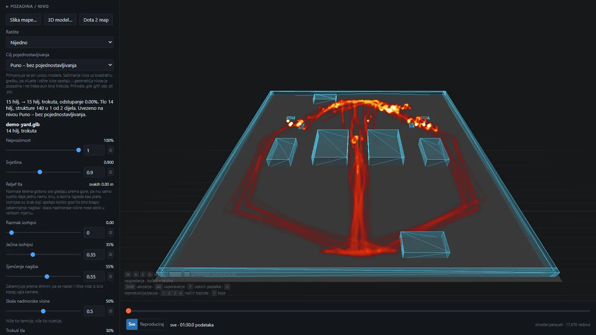
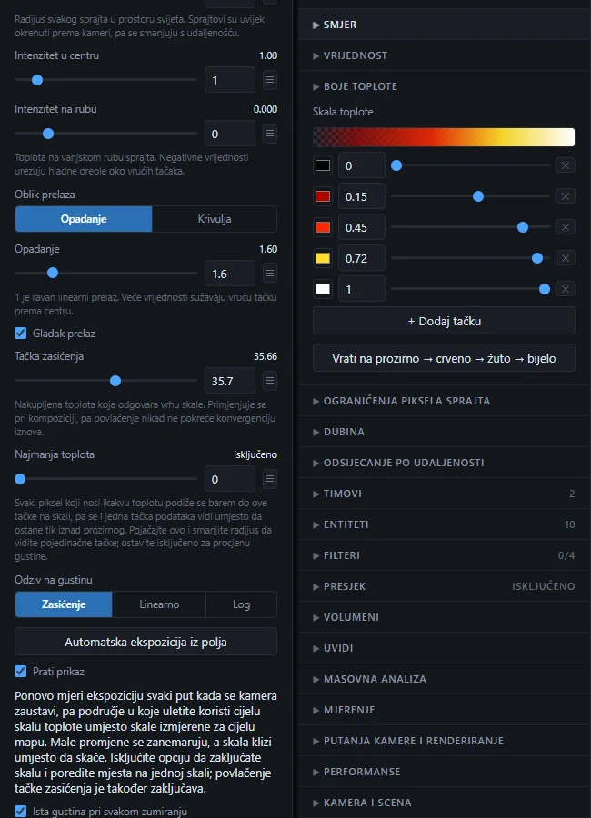

# Toplota

Toplota oboji mjesta gdje se dešavalo mnogo stvari: crveno gdje se dešavalo malo, bijelo-usijano gdje se dešavalo mnogo. Odgovara na pitanje „gdje se ovo dešava i koliko često".

**Toplota** (tipka 1) je zadani režim. Svaki vidljivi [red](glossary.md) doprinosi kružnim [sprajtom](glossary.md) okrenutim prema kameri; preklapajući sprajtovi se zbrajaju u baferu s pomičnim zarezom; zbir se preslikava kroz rampu boja - zadano prozirno → crveno → žuto → bijelo - i crta preko scene.

Slika prikazuje toplotu runde pucačine na nivou sa zgradama: žarišne tačke sjede u sobama i na stepenicama, a ne samo na tlu.

## Kako se koristi {#how-to-use-it}

1. Učitaj podatke i pritisni `1` (ili izaberi **Toplota** u traci režima).
2. Ako je sve bijelo ili prazno, pritisni **Automatska ekspozicija iz polja** u odjeljku **Oblik toplote**.
3. Mijenjaj **Radijus sprajta** dok se susjedne tačke ne spoje u pojaseve: manje pokazuje pojedinačna mjesta, veće pokazuje područja.
4. Otvori **Boje toplote** da promijeniš boje, ili **Dubinu** da brda i zidovi sakrivaju toplotu iza sebe.

Isti paneli oblikuju [Razliku](difference.md), [Toplotu timova](team-heat.md) i [Toplotu linija](line-heat.md); razlikuju se u tome šta se dodaje (sa predznakom, obojeno ili duž linija), a ne u tome kako.

## Paneli i njihove zadane vrijednosti {#the-panels-and-their-defaults}

Svaka kontrola je objašnjena na svojoj stranici; kolona Detalji vodi do nje. Klizači imaju upisano polje pored sebe i ručicu za prevlačenje (mali hvatač s desne strane: prevuci gore ili dolje, dalje je brže, Shift za fino); gdje staza klizača završava prije stvarne granice, ručica može gurnuti dalje do *gornje granice klizača* navedene ovdje. Vrijednosti označene *pri učitavanju* se ponovo računaju za svaki novi skup podataka.

### Oblik toplote (otvoreno) {#heat-shape-open}

| Kontrola | Zadano | Opseg (gornja granica klizača) | Detalji |
|---|---|---|---|
| **Radijus sprajta** | 6 m; pri učitavanju opseg / 120 | 0,05-2000 m, logaritamski (50.000) | [Oblik sprajta](sprite-shape.md#sprite-radius) |
| **Intenzitet u centru** | 1 | 0-10 (1000) | [Oblik sprajta](sprite-shape.md#centre-and-edge-intensity) |
| **Intenzitet na rubu** | 0 | -2-10 (1000) | [Oblik sprajta](sprite-shape.md#centre-and-edge-intensity) |
| **Oblik prelaza** | *Opadanje* | *Opadanje* / *Kriva* | [Oblik sprajta](sprite-shape.md#ramp-shape-falloff-or-curve) |
| **Opadanje** (samo Opadanje) | 1,6 | 0,1-8 (64) | [Oblik sprajta](sprite-shape.md#falloff) |
| **Glatki prelaz** (samo Opadanje) | uključeno | | [Oblik sprajta](sprite-shape.md#falloff) |
| Uređivač krive (samo Kriva) | pretkonfiguracija *Glatko* | | [Oblik sprajta](sprite-shape.md#the-curve-editor) |
| **Tačka zasićenja** | 24; pri učitavanju procjena, zatim izmjerena | 0,1-4000, logaritamski (10.000.000) | [Boja i ekspozicija](colour-and-exposure.md#saturation-point) |
| **Najmanja toplota** | isključeno (0) | 0-100% | [Boja i ekspozicija](colour-and-exposure.md#minimum-heat) |
| **Odziv na gustinu** | *Zasićenje* | *Zasićenje* / *Linearno* / *Log* | [Boja i ekspozicija](colour-and-exposure.md#density-response) |
| **Automatska ekspozicija iz polja** | | dugme | [Boja i ekspozicija](colour-and-exposure.md#auto-exposure) |
| **Prati prikaz** | uključeno | | Ponovo mjeri ekspoziciju svaki put kada kamera miruje, pa područje u koje uletiš koristi cijelu rampu boja. Male promjene se ignorišu, a skala klizne. Isključi je, ili prevuci **Tačku zasićenja**, da zaključaš skalu i uporediš mjesta na jednoj skali. [Boja i ekspozicija](colour-and-exposure.md#follow-the-view) |
| **Ista gustina pri svakom zumiranju** | uključeno | | Boja znači isti broj redova po površini tla, koliko god si blizu. Sprajt koji ograničenja piksela povećaju (daleko) ili smanje (izbliza) zadržava toplotu koju bi dodala njegova prava veličina, pa slika eksponirana izdaleka ne blijedi kad uletiš u nju. Isključeno, ograničeni sprajt dodaje punu težinu pri ograničenoj veličini. [Oblik sprajta](sprite-shape.md#pixel-clamps) |
| **Spljošti na ravan tla** | isključeno | | [Oblik sprajta](sprite-shape.md#flatten-onto-ground-plane) |

### Boje toplote (zatvoreno) {#heat-colours-closed}

| Kontrola | Zadano | Detalji |
|---|---|---|
| Uzorci grupa i **Razdvajanje boja** (samo Toplota timova) | 1,4 | [Toplota timova](team-heat.md) |
| Uređivač **Skale toplote** (*Pozitivno (timovi koji sabiraju)* u Razlici, *Rampa neprozirnosti* u Toplotu timova) | prozirno → crveno → žuto → bijelo | [Boja i ekspozicija](colour-and-exposure.md#the-ramp-editor) |
| **Vrati na prozirno → crveno → žuto → bijelo** | | |
| Rampa **Negativno (timovi koji oduzimaju)** (samo Razlika) | prozirno → zeleno → plavo → ljubičasto | [Razlika](difference.md#colours) |

### Ograničenja piksela sprajta (zatvoreno) {#sprite-pixel-clamps-closed}

| Kontrola | Zadano | Opseg (gornja granica klizača) | Detalji |
|---|---|---|---|
| **Najmanji radijus u pikselima** | 1 px | 0-16 (512) | [Oblik sprajta](sprite-shape.md#pixel-clamps) |
| **Najveći radijus u pikselima** | 96 px | 2-1024, logaritamski (8192) | [Oblik sprajta](sprite-shape.md#pixel-clamps) |

### Dubina (otvoreno) {#depth-open}

| Kontrola | Zadano | Detalji |
|---|---|---|
| **Sakrij iza terena** | uključeno | [Dubina i odsijecanje](depth-and-culling.md#hide-behind-terrain) |
| **Skriveno iza geometrije** | 0,8 (*80% tamnije*) | [Dubina i odsijecanje](depth-and-culling.md#hidden-behind-geometry) |

### Odsijecanje po udaljenosti (zatvoreno) {#distance-culling-closed}

| Kontrola | Zadano | Opseg (gornja granica klizača) | Detalji |
|---|---|---|---|
| **Blizu** | isključeno (0) | 0,5-5000 m, logaritamski, donji kraj staze = isključeno (200.000) | [Dubina i odsijecanje](depth-and-culling.md#distance-culling) |
| **Daleko** | isključeno (0) | 1-200.000 m, logaritamski, dno = isključeno (10.000.000) | [Dubina i odsijecanje](depth-and-culling.md#distance-culling) |
| **Sijeci ravninom** | uključeno | | [Dubina i odsijecanje](depth-and-culling.md#distance-culling) |
| **Sijeci i nivo** | uključeno | | [Dubina i odsijecanje](depth-and-culling.md#distance-culling) |

Tipke: `[` i `]` guraju daleku granicu unutra i van, `\` je uključuje i isključuje ([Dubina i odsijecanje](depth-and-culling.md#keyboard)).

### Smjer i Vrijednost {#direction-and-value}

Dva odjeljka su ispod Oblika toplote. **Smjer** crta svaki red kao klin i dodaje strelice: vidi [Usmjerenu toplotu](directional-heat.md). **Vrijednost** važe toplotu prema tome koliko je svaki red koštao ili donio: vidi [Ponderisanje vrijednosti](value-weighting.md).

## Šta se čuva {#what-is-saved}

Gornje postavke toplote se ne čuvaju između sesija: ponovno učitavanje stranice vraća zadane vrijednosti. Dvije stvari se čuvaju u browseru: posljednja brzina reprodukcije (`heat3d.speed`, vidi [Vremensku liniju](timeline.md)) i postavke daleko udaljenih figura [preklapanja figura](box-replay.md) (stil simbola, veličina, oznake pogodaka i tako dalje). Tako su i jezik, [obrnute ose svijeta](camera.md#invert-world-axis), zapamćena imena automobila u kartici trke i [biblioteka nivoa](level-library.md). Potpuni spisak je na [Sačuvane postavke](ref-settings-storage.md).
