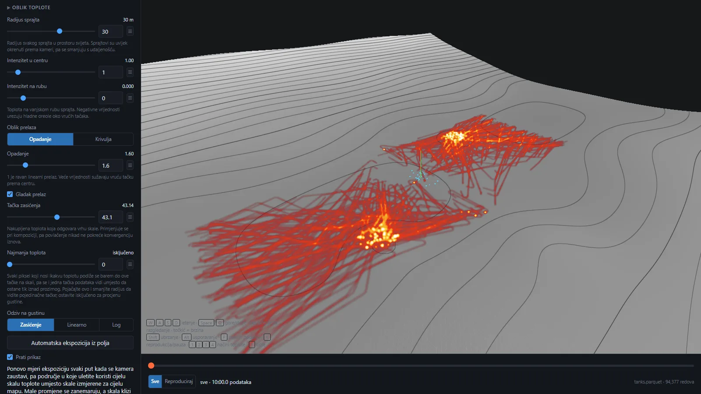
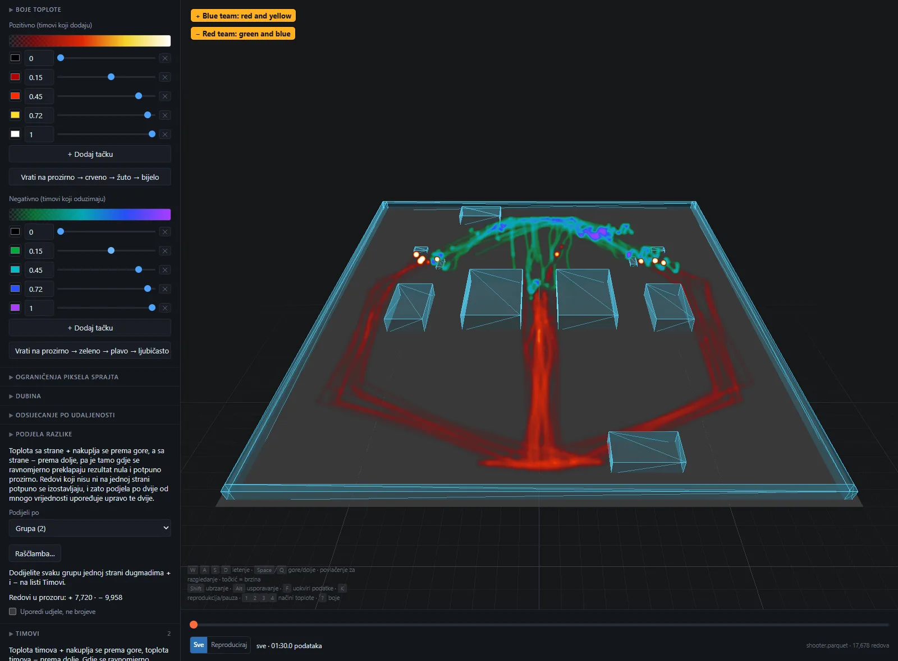
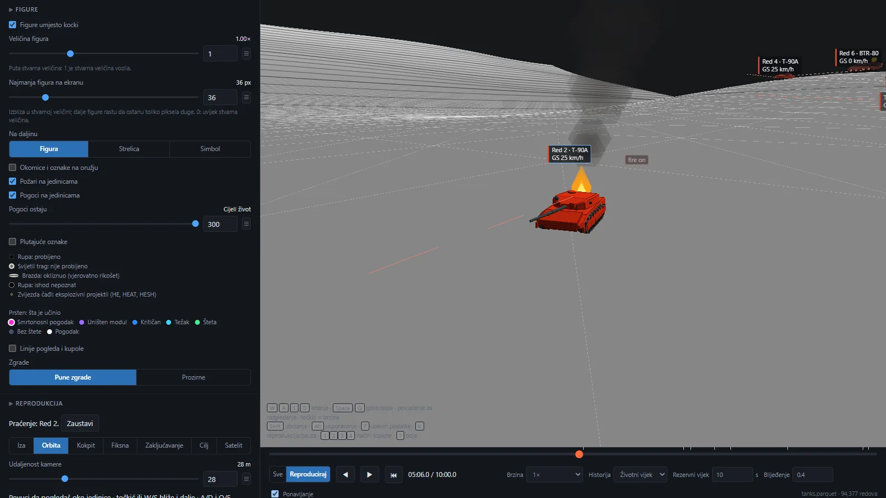
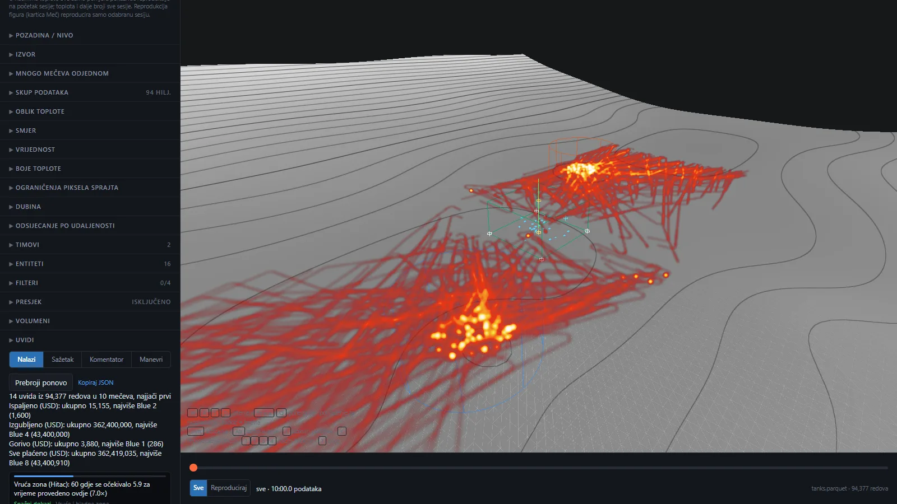
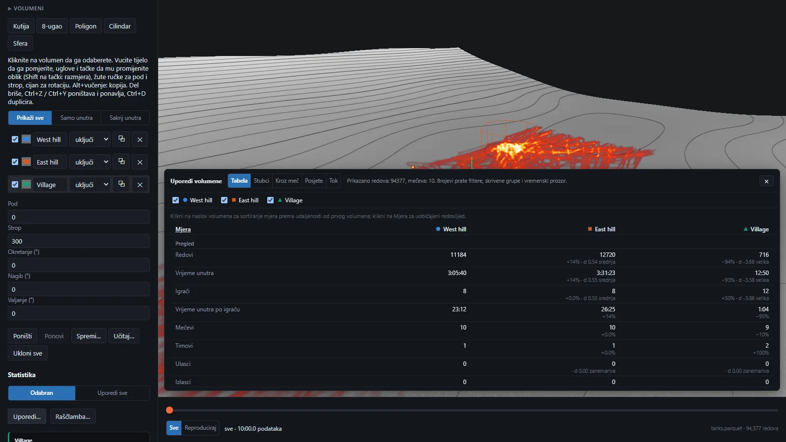
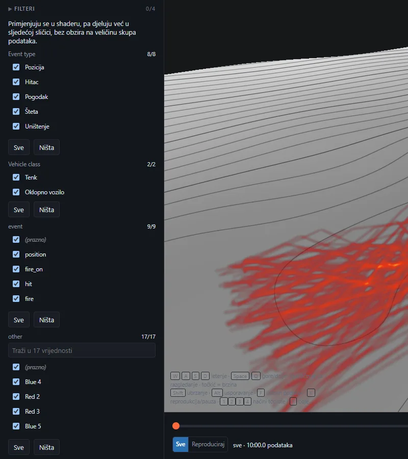
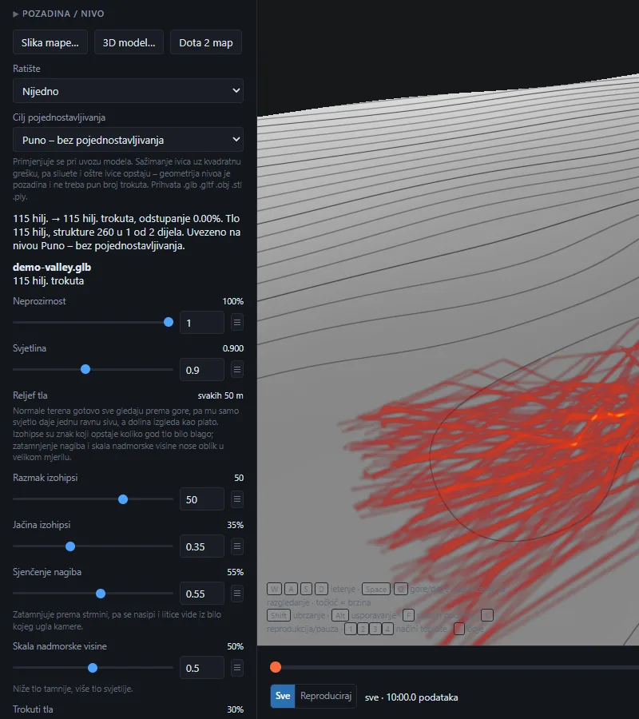

# 3DHeat

3DHeat pokazuje gdje su se stvari dešavale u igri - gdje su igrači išli, borili se i padali - kao svijetle boje kroz koje možete letjeti, ili kao male 3D figure koje ponavljaju meč.

Učitajte pozicije - CSV, Parquet, Tacview snimke, konvertovane reprize, jednu datoteku, folder ili hiljade mečeva - i pogledajte ih kao **toplotnu mapu kroz koju možete letjeti**, kao **figure koje ponavljaju meč**, kao linije duž ruta kojima su ljudi išli, ili kao jednu populaciju naspram druge. Program sam pronalazi ono što se ističe i radi potpuno u vašem pregledniku: ništa se nigdje ne otprema. 3DHeat i svi njegovi alati besplatni su i otvorenog koda pod [MIT licencom](https://github.com/Holdi601/3DHeat/blob/main/LICENSE).



**Prvi put ovdje?** Napravite [demo podatke](demo-data.md) i pratite njihovih sedam koraka. Svaka slika na ovom sajtu snimljena je pomoću njih.

## Šta radi {#what-it-does}

| | |
|---|---|
|  | **[Načini toplote](heat-modes.md)** - toplota, [razlika](difference.md) (crveno tamo gdje je jedna strana bila više, zeleno-plavo tamo gdje je bila druga), [toplota timova](team-heat.md), [toplota linija](line-heat.md); [usmjerena toplota](directional-heat.md) s klinovima, poljima strelica i polarnim grafikonima; toplota [ponderisana vrijednošću](value-weighting.md): koliko koštaju oružja, vozila i gorivo. |
|  | **[Reprodukcija meča](match-replay.md)** - svaka jedinica kao [figura](figures.md) onoga što jeste, NATO ili ruski simboli na daljinu, rakete i tragovi, oznake pogodaka, olupine, požari, tornjevi, ciljevi, kamere u stilu Tacviewa i taktički prikaz; [mnogo mečeva odjednom](many-matches.md). |
|  | **[Uvidi](insights.md)** - jake pozicije, smrtonosno tlo, zamke na mjestima pojavljivanja, uska grla i istaknuti igrači, pronađeni i rangirani uz dokaze; pisani izvještaj, opcionalno od AI-ja po vašem izboru; caster za jedan meč; [sočivo znanja](knowledge.md). |
|  | **[Zapremine](volumes.md)** - crtajte kutije, prizme, cilindre i sfere, filtrirajte do njih, brojite šta se dešava unutra, izvezite to i uporedite mjesta jedno uz drugo; [raščlamba](breakdown.md) ko i šta najbolje radi na nekom mjestu. |
|  | **[Filteri](filters.md)** - po vrsti događaja, igraču ili AI-ju, klasi vozila, vrijednosti, bilo kojoj koloni, u grafičkoj kartici pri bilo kojoj veličini podataka. |
|  | **[Nivoi](levels.md)** - slike mapa, 3D nivoi napravljeni [alatima za podatke](#related-repositories), pojednostavljenje, [pozadina svijeta](world-backdrop.md) sa stvarnim terenom za podatke o letu. |

Također: kartica [Analiza utrke](race-analysis.md) za krugove trkaćih igara, kartica [Meč](match-analysis.md) za sažetke Counter-Strike 2, [tabla taktika](tactics-board.md) za planove na nivou, [analiza pogodaka](hit-analysis.md) po vozilu, [masovna analiza](mass-analysis.md) hiljada mečeva, [putanje kamere i video](camera-path-and-video.md), [40 jezika](languages.md), [metričke ili imperijalne jedinice](settings.md).

## Kartice {#the-tabs}

Kartice se nalaze na vrhu bočne trake, ispod imena, jedinica i izbornika za jezik.

| Kartica | Čemu služi |
|---|---|
| **Toplotna mapa** | Svaka tabela pozicija: načini toplote, preklapanje figura, filteri, zapremine, uvidi, nivoi, mjerenje i video. |
| **Analiza utrke** | Dva ili više krugova jedne staze: gdje se gubi vrijeme, zašto i šta promijeniti. |
| **Meč** | Reprodukcija meča figurama i sažeci mečeva Counter-Strike 2. |
| **Taktika** | Planovi na nivou: figure, rute, bačene granate, oblasti i bilješke u koracima koji se puštaju kao film. |
| **Vozila** | Gdje je svaka jedinica pogođena, od koga i čime. |

## Instalacija i pokretanje {#install-and-run}

3DHeat je besplatan za korištenje, mijenjanje i dijeljenje (MIT licenca), a besplatan je i svaki alat naveden pod [Povezani repozitorijumi](#related-repositories).

### Windows, lakim putem {#windows-the-easy-way}

Korijen repozitorijuma sadrži tri batch datoteke.

| Datoteka | Šta radi |
|---|---|
| `start.bat` | Pokreće prikazivač. Pronalazi Node.js čak i kada nije u `PATH` (traži u `%ProgramFiles%\nodejs`, `%ProgramFiles(x86)%\nodejs` i `%LOCALAPPDATA%\Programs\nodejs`), a kada Node.js nedostaje, nudi da instalira LTS izdanje komandom `winget install -e --id OpenJS.NodeJS.LTS`. Pri prvom pokretanju pita prije preuzimanja zavisnosti (oko 300 MB u `node_modules\` unutar fascikle, ništa na nivou sistema). Odbija da se pokrene kada nešto već sluša port 5273 i upućuje na `restart.bat`. Kada je fascikla git checkout bez lokalnih promjena i postoji novija verzija, pita da li da ažurira (Y/N; bez odgovora za 60 s zadržava ovu verziju; vidi [Ažuriranja](updates.md)). Zatim pokreće dev server na `http://127.0.0.1:5273/` i otvara preglednik. **Prozor je server**: ostavite ga otvorenim; zatvorite ga ili pritisnite Ctrl+C da zaustavite. |
| `restart.bat` | Pokreće `stop.bat quiet`, pa zatim `start.bat`. Potrebno samo nakon promjene `vite.config.ts`, dodavanja zavisnosti ili kada se server zaglavi - izmjene izvornog koda učitavaju se u hodu. |
| `stop.bat` | Zaustavlja šta god sluša port 5273, po ID-u procesa pronađenom preko `netstat`, nikada po imenu slike, pa drugi Node.js procesi na računaru ostaju netaknuti. Čeka otprilike dvije sekunde da se utičnica oslobodi. Uz argument `quiet` ne pauzira na kraju. |

### Ručno (bilo koji OS) {#by-hand-any-os}


```bash
git clone --recursive https://github.com/Holdi601/3DHeat.git
cd 3DHeat
npm install
npm run dev      # http://127.0.0.1:5273
```

Fascikla `exporters/` sadrži zasebne alate za podatke kao git submodule, svaki je svoj repozitorijum; nakon običnog kloniranja pokrenite `git submodule update --init`. Sam prikazivač ne treba ih da bi radio. `exporters/ext/` sadrži opcionalne konvertere (War Thunder, World of Tanks, World of Warships, Squad reprize; DCS i IL-2 mape), svaki kao zaseban projekat.

Ništa od igara ne dolazi uz ovo: nivoi, mape i snimci se prave na vašem računaru alatima, iz igara koje posjedujete.

### npm skripte {#npm-scripts}

| Skripta | Šta pokreće |
|---|---|
| `npm run dev` | Vite dev server na portu 5273, vezan za `127.0.0.1`. |
| `npm run build` | Provjera tipova (`tsc --noEmit`) i produkcijski paket u `dist/`. |
| `npm run preview` | Služi produkcijski paket. |
| `npm run typecheck` | Sama provjera tipova. |
| `npm test` / `npm run test:watch` | Jedinični i integracioni testovi (vitest). |
| `npm run smoke` | Pokreće pravu aplikaciju u headless Chromiumu i provjerava da platno ima obojene piksele; snimci idu u `tools/.smoke/`. Očekuje da dev server radi. |
| `npm run smoke:f16` | Isti paket s `?heat=f16`, što forsira put half-float akumulacije (vidi [Akumulacija half-float](half-float-accumulation.md)). |
| `npm run bench` | Benchmark unosa, piše `tools/.smoke/ingest-bench.json`. |
| `npm run test:heavy` | Testovi kojima trebaju velike stvarne datoteke podataka; sami se preskaču kada datoteka nema. |
| `npm run inspect -- <file.parquet>` | Ispisuje šemu Parquet datoteke i nekoliko redova (`tools/inspect-parquet.mjs`). |

### Šta dodaje dev server {#what-the-dev-server-adds}

Prikazivač je statička web stranica, ali dev server (vidi `vite.config.ts`) dodaje dvije lokalne rute koje statička objava `dist/` nema:

- `/__host/memory` javlja instalirani i slobodni RAM računara i, gdje to može pročitati, memoriju grafičke kartice (iz `nvidia-smi`, ili na Windowsu iz registarskog unosa display adaptera). Zato [budžeti memorije](memory-and-budgets.md) koriste stvarne brojke umjesto ograničenih pretpostavki preglednika.
- `/__heat3d/update` provjerava da li je checkout iza i može ga brzo ažurirati ([Ažuriranja](updates.md)).

Server se veže samo za `127.0.0.1`, pa nijedna od ruta nije dostupna s mreže. Otvorite ga kao `http://127.0.0.1:5273`: `localhost` se može razriješiti u IPv6 loopback `::1`, gdje ništa ne sluša. Ne šalje zaglavlja cross-origin izolacije (COOP/COEP): ništa u prikazivaču ne koristi `SharedArrayBuffer`, a radnici podatke predaju prijenosom, što ne treba ništa posebno.

## Zahtjevi za preglednik i GPU {#browser-and-gpu-requirements}

- **Preglednik s WebGPU ili WebGL2.** WebGPU se proba prvi (Chrome i Edge ga imaju); bez njega koristi se WebGL2 backend. WebGL2 mora ponuditi `EXT_color_buffer_float` (renderovanje u float teksture), inače prikazivač pokazuje „Nije moguće inicijalizirati renderer.“ Vidi [Dva backenda](backends.md). Prikazivač se razvija i testira u Chromiumu; ostali preglednici nisu provjereni.
- **Uključeno hardversko ubrzanje.** Kada preglednik crta na procesoru (SwiftShader, llvmpipe, Microsoft Basic Render Driver i slični), crveni banner na vrhu bočne trake to kaže i pokazuje kako to popraviti. Vidi [Otkrivanje softverskog renderovanja](software-rendering.md).
- **Namjenska GPU pomaže, ali nije obavezna.** Oba backenda traže adapter visokih performansi. Količina podataka koja može stati u GPU je budžet koji možete vidjeti i mijenjati ([Memorija i budžeti](memory-and-budgets.md)).
- **Opcionalne mogućnosti** koriste dodatne API-je preglednika: renderovanje videa treba WebCodecs `VideoEncoder` s VP9 ili VP8 ([Putanja kamere i video](camera-path-and-video.md)); simplifikacija mreže nivoa treba WebAssembly; prevlačenje fascikli koristi File and Directory Entries API; biblioteka nivoa koristi IndexedDB; gamepad-ovi koriste Gamepad API.

## Mapa dokumentacije {#documentation-map}

**Početak**: [Demo podaci](demo-data.md) · [Unos podataka](getting-data-in.md) ([učitavanje datoteka](loading-files.md), [mapiranje kolona](column-mapping.md), [ose, jedinice i vrijeme](axes-units-and-time.md), [sesije, osobe i grupe](sessions-persons-groups.md), [Tacview](tacview-acmi.md), [konverteri](converters.md), [.3dheat](container.md), [memorija i budžeti](memory-and-budgets.md))

**Pogledajte**: [Načini toplote](heat-modes.md) ([toplota](heat.md), [oblik sprajta](sprite-shape.md), [boja i ekspozicija](colour-and-exposure.md), [dubina i culling](depth-and-culling.md), [razlika](difference.md), [toplota timova](team-heat.md), [toplota linija](line-heat.md), [box reprodukcija](box-replay.md), [usmjerena toplota](directional-heat.md), [ponderisanje vrijednosti](value-weighting.md)) · [Vremenska linija](timeline.md) · [Nivoi](levels.md) ([slike mapa](map-images.md), [3D nivoi](model-levels.md), [izgled](level-appearance.md), [biblioteka](level-library.md), [pozadina svijeta](world-backdrop.md), [njeni izvori](world-backdrop-sources.md)) · [Kamera](camera.md) ([gamepad](gamepad.md), [tipke](keyboard-reference.md)) · [Putanja kamere i video](camera-path-and-video.md)

**Analiziraj**: [Filteri i alati](filters-and-tools.md) ([filteri](filters.md), [timovi](teams-list.md), [entiteti](entities.md), [presjek](slice.md), [mjerenje](measure.md), [zapremine](volumes.md), [raščlamba](breakdown.md)) · [Uvidi](insights.md) ([sočivo znanja](knowledge.md)) · [Masovna analiza](mass-analysis.md)

**Reprodukcija**: [Reprodukcija meča](match-replay.md) · [Mnogo mečeva odjednom](many-matches.md) · [Figure](figures.md) ([u preklapanju figura](figure-replay.md), [zasluge](figure-credits.md)) · [Paritet s Tacviewom](tacview-parity.md) · [Analiza pogodaka](hit-analysis.md)

**Ostale kartice**: [Analiza utrke](race-analysis.md) ([metoda](race-analytics.md), [ostale igre](other-games.md)) · [Analiza meča](match-analysis.md) · [Tabla taktika](tactics-board.md) ([brzine](tactics-speeds.md))

**Prikazivač**: [Rječnik pojmova](glossary.md) · [Postavke, jedinice i tipke](settings.md) · [Jezici](languages.md) · [Ažuriranja](updates.md) · [Interno renderovanje](rendering-internals.md) ([backendi](backends.md), [akumulacija](accumulation.md), [uzorkovanje i budžeti](sampling-and-budgets.md), [half-float](half-float-accumulation.md), [boravak u GPU memoriji](gpu-memory.md), [softversko renderovanje](software-rendering.md), [performanse i statistika](performance-and-stats.md)) · [Formati podataka](data-formats.md) · [Referenca](reference.md) · [Održavanje dokumentacije](maintaining.md)

## Povezani repozitorijumi {#related-repositories}

Prikazivač čita podatke; ovi alati ih prave. Svaki je zaseban javni repozitorijum (MIT) sa sopstvenom dokumentacijom. Nijedan od njih ne dolazi s podacima iz igara: nivoi, mape i snimci se prave na vašem računaru, iz igara koje posjedujete. Svaki čitač igre je zaseban mali projekat s vlastitom datotekom licence, izdanjima i evidencijom problema, pa se može instalirati, ažurirati, održavati – ili povući na zahtjev nosioca prava – zasebno, bez uticaja na prikazivač i ostale alate.

| Repozitorijum | Šta radi | Korisno za | Dokumentacija |
|---|---|---|---|
| [3DHeat-GameFiles](https://github.com/Holdi601/3DHeat-GameFiles) | Čita staze i nivoe iz arhiva koje igre isporučuju (Forza Horizon, BeamNG, Assetto Corsa Rally; čitači za Unreal, Unity, Frostbite i Source 2) kao glTF | 3D nivo ispod vaše toplote ili reprodukcije | [stranica](https://holdi601.github.io/3DHeat-GameFiles/) |
| [3DHeat-GameCapture](https://github.com/Holdi601/3DHeat-GameCapture) | Snima telemetriju krugova iz interfejsa koje trkaće igre objavljuju, i rekonstruiše nivoe iz video snimaka igre | krugovi za Analizu utrke; nivo tamo gdje se datoteke ne mogu čitati | [stranica](https://holdi601.github.io/3DHeat-GameCapture/) |
| [3DHeat-UnrealExporter](https://github.com/Holdi601/3DHeat-UnrealExporter) | Dodatak za Unreal Editor koji izvozi nivo kao jednu glTF datoteku | nivoi vaših Unreal projekata | [stranica](https://holdi601.github.io/3DHeat-UnrealExporter/) |
| [3DHeat-CS2](https://github.com/Holdi601/3DHeat-CS2) | Counter-Strike 2 demo snimci u tabele toplotne mape i sažetke mečeva; CS2 mape u geometriju | CS2 toplota, reprodukcije i kartica Meč | [stranica](https://holdi601.github.io/3DHeat-CS2/) |
| [3DHeat-Watcher](https://github.com/Holdi601/3DHeat-Watcher) | Snima vašu igru u pozadini iz onoga što igre objavljuju: telemetriju, integracije stanja igre, zapisnike, reprodukcije | vaša sopstvena statistika bez ručnog rada | [stranica](https://holdi601.github.io/3DHeat-Watcher/) |
| [3DHeat-Ext-WarThunder](https://github.com/Holdi601/3DHeat-Ext-WarThunder) | War Thunder reprize (`.wrpl`) u tabele: zračne i kopnene putanje, pucnji, pogoci, ubistva, tornjevi, ciljevi | War Thunder reprize, oznake pogodaka i uvidi | [stranica](https://holdi601.github.io/3DHeat-Ext-WarThunder/) |
| [3DHeat-Ext-WoT](https://github.com/Holdi601/3DHeat-Ext-WoT) | World of Tanks reprize u tabele: pozicija svakog vozila, smrti i ubistva | World of Tanks toplota i reprodukcije | [stranica](https://holdi601.github.io/3DHeat-Ext-WoT/) |
| [3DHeat-Ext-WoWs](https://github.com/Holdi601/3DHeat-Ext-WoWs) | World of Warships reprize u tabele: pozicija svakog broda i potonuća | World of Warships toplota i reprodukcije | [stranica](https://holdi601.github.io/3DHeat-Ext-WoWs/) |
| [3DHeat-Ext-Squad](https://github.com/Holdi601/3DHeat-Ext-Squad) | Demo snimci Squad servera u tabele: pozicija, tim i odred svakog igrača | Squad toplota i reprodukcije | [stranica](https://holdi601.github.io/3DHeat-Ext-Squad/) |
| [3DHeat-Ext-DCS](https://github.com/Holdi601/3DHeat-Ext-DCS) | Tereni DCS World iz vaše instalacije u nivoe: tlo, putevi, gradovi, aerodromi, polja, voda | DCS i Tacview snimci na njihovom stvarnom terenu | [stranica](https://holdi601.github.io/3DHeat-Ext-DCS/) |
| [3DHeat-Ext-IL2](https://github.com/Holdi601/3DHeat-Ext-IL2) | Mape IL-2 Great Battles u nivoe | IL-2 snimci na njihovoj mapi | [stranica](https://holdi601.github.io/3DHeat-Ext-IL2/) |

## Izvorna struktura, ukratko {#source-layout-briefly}

| Fascikla | Sadržaj |
|---|---|
| [`src/data/`](https://github.com/Holdi601/3DHeat/tree/main/src/data) | Odabir datoteka, unos CSV-a i Parquet-a, automatsko mapiranje, validacija, model memorije, graditelj skupa podataka, parsiranje modela, klasifikacija, simplifikacija, biblioteka nivoa |
| [`src/render/`](https://github.com/Holdi601/3DHeat/tree/main/src/render) | Petlja frejmova (`engine.ts`), uzorkovanje, oba backenda, kamera, gamepad, mjerenje, putanja kamere, snimanje videa |
| [`src/state/`](https://github.com/Holdi601/3DHeat/tree/main/src/state) | Stanje aplikacije (`store.ts`) sa svim podrazumijevanim vrijednostima, domenski tipovi (`types.ts`), kriva sprajta |
| [`src/ui/`](https://github.com/Holdi601/3DHeat/tree/main/src/ui) | Paneli bočne trake, vremenska linija, preklapanja |
| [`src/race/`](https://github.com/Holdi601/3DHeat/tree/main/src/race), [`src/match/`](https://github.com/Holdi601/3DHeat/tree/main/src/match) | Kartice Analiza utrke i Meč |
| [`src/i18n/`](https://github.com/Holdi601/3DHeat/tree/main/src/i18n) | Prijevodi |
| [`src/insights/`](https://github.com/Holdi601/3DHeat/tree/main/src/insights) | Uvidi: detektori, izvještaj, caster, AI provajderi, sočivo znanja |
| [`src/mass/`](https://github.com/Holdi601/3DHeat/tree/main/src/mass) | Masovna analiza mnogih mečeva |
| [`src/volumes/`](https://github.com/Holdi601/3DHeat/tree/main/src/volumes) | Zapremine, njihova statistika, izvoz i poređenje |
| [`src/breakdown/`](https://github.com/Holdi601/3DHeat/tree/main/src/breakdown) | Raščlamba i faktori |
| [`src/overlay/`](https://github.com/Holdi601/3DHeat/tree/main/src/overlay) | Preklapanje za mnogo mečeva |
| [`src/figures/`](https://github.com/Holdi601/3DHeat/tree/main/src/figures) | Katalog figura i njegov graditelj |
| [`src/vehicle/`](https://github.com/Holdi601/3DHeat/tree/main/src/vehicle) | Analiza pogodaka (kartica Vozila) |
| [`src/tactics/`](https://github.com/Holdi601/3DHeat/tree/main/src/tactics) | Tabla taktika |
| [`src/world/`](https://github.com/Holdi601/3DHeat/tree/main/src/world) | Pozadina svijeta |
| [`src/units/`](https://github.com/Holdi601/3DHeat/tree/main/src/units) | Jedinice mjere |
