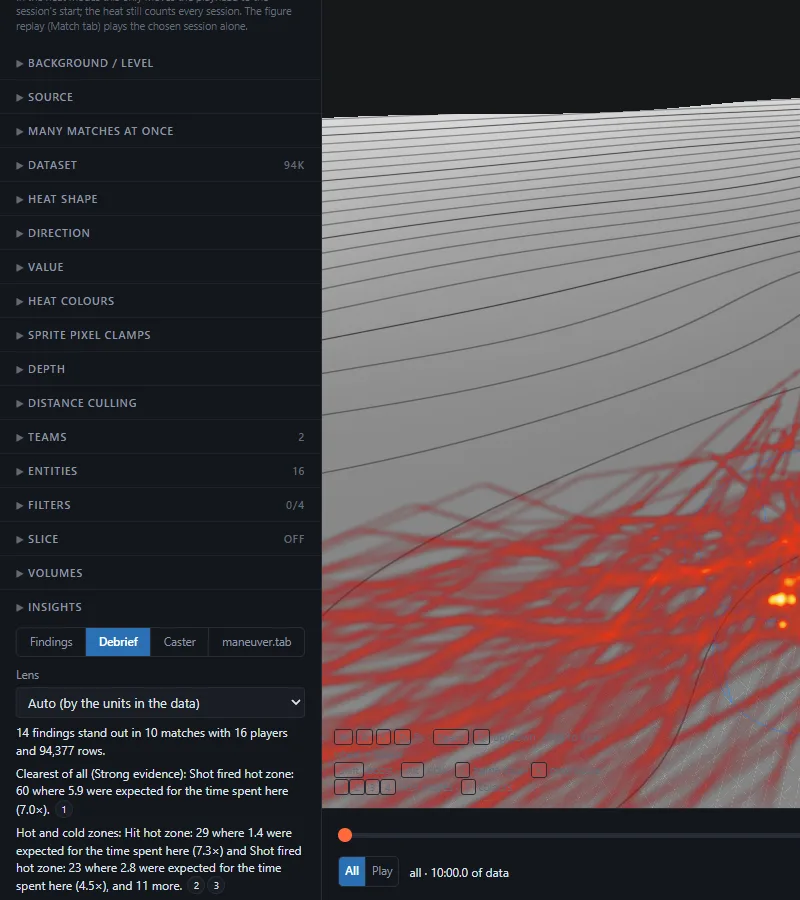

# Uvidi

**Uvidi** pretražuju učitane podatke za ono što se ističe - jake pozicije, smrtonosno tlo, zamke na mjestima pojavljivanja, uska grla, igrače daleko iznad vršnjaka - i kažu vam, od najjačeg, uz dokaze. Koristite ih da za minut saznate gdje je meč dobijen ili izgubljen. Zatim mogu napisati sažetak, a u jednoj reprodukciji mogu djelovati kao komentator koji skače na velike trenutke.

Sve se računa u vašem pregledniku. Ništa ne napušta vaš računar, osim ako ne uključite vanjski AI (vidi [Vanjski AI](#external-ai)).

Odjeljak **Uvidi** nalazi se u bočnoj traci kartica Toplotna mapa i Meč. Ima tri kartice: **Nalazi**, **Sažetak** i **Komentator**.

## Nalazi {#findings}

1. Učitajte podatke i otvorite **Uvidi**. Pritisnite **Pronađi uvide** (`Brojanje… n%` pokazuje napredak).
2. Pročitajte spisak. Svaki nalaz ima traku snage, rečenicu, koliko su dokazi dobri (*Jaki dokazi*, *Dobri dokazi* ili *Neki dokazi*), koji detektor ga je našao i klasu vozila tamo gdje je to bitno.
3. **Kliknite nalaz**: prikazivač primjenjuje njegove filtere, kamera leti do mjesta i skače na vrijeme, a otvaraju se detalji: efekat s 95 % intervalom, vrijednosti p i q, prebrojani dokazi i **Volumen ovdje**, koji crta [zapreminu](volumes.md) oko mjesta.
4. **Vrati filtere** vraća vaše filtere. **Kopiraj JSON** kopira cijeli izvještaj.

Brojanje koristi trenutne filtere, sakrivene grupe i izabrani meč kroz cijeli vremenski opseg. Kada kasnije promijenite filtere, pojavi se napomena; pritisnite **Prebroji ponovo**.

Redovi na vrhu spiska (na primjer ukupni iznosi novca) sažimaju cijele podatke prije nalaza.

### Detektori {#the-detectors}

| Detektor | Šta nalazi | Treba u podacima |
|---|---|---|
| **Jake pozicije** | Mjesta s mnogo boljim odnosom ubistava i smrti od ostatka mape, i *siguran teren* gdje malo ljudi umire u vremenu provedenom ondje | događaji ubistva i smrti |
| **Vruće i hladne zone** | Mjesta gdje se vrsta događaja (hici, pogoci, zauzimanja ...) dešava mnogo češće ili rjeđe nego što vrijeme provedeno ondje predviđa | kolona događaja |
| **Otvoreni teren i zaklon** | Smrti na otvorenom uz blisku geometriju nivoa, i sporo uz brzo kretanje | smrti; 3D nivo za dio s geometrijom |
| **Spawnovi** | Jaki spawnovi, zamke na spawnovima, sigurni spawnovi, vrijeme do prvog kontakta | vrijeme i osobe |
| **Klasa po mjestu** | Klasa vozila, ili igrači naspram AI-ja, koji rade mnogo bolje ili gore u nekoj oblasti | ubistva plus kolona klase vozila ili igrač/AI |
| **Igrači** | Igrači koji ubijaju ili umiru mnogo češće ili rjeđe od drugih u istoj klasi | osobe i ubistva |
| **Uska grla i bokovi** | Uska grla (mnogo više prelazaka nego okolnog tla) i bočne rute (rijetko korištene, ali vode do ubistava) | osobe |
| **Vrijednost** | *Skupo tlo* i *Tlo koje donosi* | [kolone vrijednosti](value-weighting.md) |

Detektori koji ne mogu raditi na podacima navedeni su na dnu, s razlogom.

### Kako se nalazi rangiraju {#how-findings-are-ranked}

Svako mjesto ili grupa poredi se s ostatkom mape (tačni binomni testovi ili testovi stope). Stopa lažnih otkrića drži se na 5 % (Benjamini-Hochberg). Slučajnost može izgledati kao obrazac; ovo drži lažne uzbune niskim: među prikazanim nalazima očekuje se najviše otprilike jedan od dvadeset slučajnih. Efekti iz malo događaja povlače se prema „nema efekta” prije rangiranja. Najviše 60 nalaza se navodi, a svaki detektor dobija nekoliko mjesta pri vrhu.

## Sažetak {#debrief}

Kartica **Sažetak** piše nalaze kao kratak tekst: uvod, najjasniji nalaz, jedan za taktiku, jedan za balansiranje, ostali grupisani po detektoru, i koliko ih se oslanja na slabije dokaze. Svaki pasus ima numerisana dugmad koja pokazuju njegove nalaze. **Kopiraj tekst** ga kopira.

Ugrađeni pripovjedač radi offline, na vašem jeziku. Birač **Leća** iznad njega (vidi [Sočivo znanja](knowledge.md)) odlučuje koju literaturu pasusi citiraju.

### Vanjski AI {#external-ai}

**AI postavke** omogućavaju da sažetak umjesto toga napiše model AI-ja po vašem izboru:

| Postavka | Značenje |
|---|---|
| **Pružalac** | Anthropic (Claude), OpenAI (ChatGPT), OpenRouter, Ollama (lokalno), LM Studio (lokalno), llama.cpp server (lokalno) ili bilo koja krajnja tačka kompatibilna s OpenAI-jem |
| **Osnovni URL**, **Model** | Popunjava pružalac; **Prikaži modele** pita server |
| **API ključ** | Šalje se samo na osnovni URL. Nikada se ne bilježi, nikada se ne čuva u prikazima, izvozima ili `.3dheat` datotekama. Većini lokalnih servera nije potreban. |
| **Zapamti ključ u ovom pregledniku** | Podrazumijevano isključeno: ključ se zaboravlja kada se stranica zatvori |
| **Koristi vanjski AI** | Podrazumijevano isključeno |
| **Šalji imena igrača** | Podrazumijevano isključeno: igrači se šalju kao P1, P2 ... |

Zatim unesite opcionalno pitanje i pritisnite **Napiši uz AI**. Šalju se samo nalazi i njihovi brojevi - nikada redovi vaših podataka. Odgovor se ispisuje postepeno; citirani nalazi postaju dugmad.

## Komentator {#caster}

Za **jedan meč** (izaberite jedan ako ih je učitano više), **Komentator** pronalazi trenutke vrijedne gledanja: prvu krv, višestruka ubistva, razmjene, zaokrete, promjene ciljeva, povratke, istaknute igrače, dugačke hitce.

- Kliknite trenutak: prikaz prelazi na reprodukciju, skače na trenutak prije njega, leti tamo i prati igrača.
- **Reproduciraj trenutke** pušta svaki do kraja i prelazi dalje; **Prethodno** / **Sljedeće** se kreću kroz njih.
- Uz uključen vanjski AI, **Komentar AI-ja** piše komentar iz spiska trenutaka (vrste, vremena, imena ili pseudonimi, timovi, klase, udaljenosti).

Treba mu osobe i događaji ubistva/smrti (ili zauzimanja); kolona `other`/`victim` omogućava razmjene i dugačke hitce.

## Sočivo znanja {#knowledge-lens}

Nalaz se može čitati kroz **leću** utvrđenog znanja: vojna doktrina, zračna i pomorska borba, urbane operacije, dizajn igara i e-sport (ili *Auto*, koje biraju jedinice u podacima). Otvoren nalaz tada prikazuje najbliži unos **doktrine i literature** i **istorijsku paralelu**, s referencama, a **Mjere leće** računa mjere iz te literature na podacima (Lanchesterova prilagođavanja, odnosi razmjena, odnosi snaga, polja vatre, ključni teren, razmjene, inicijativa). Sažetak i upit za AI ih uključuju. Sve o tome: [Sočivo znanja](knowledge.md).

Mjere leće takođe mjere kako se igrači ponašaju kao gomila i kao grupa - poravnanje i kružno kretanje, navođenje rutama, trake i tragovi, zgusnutost, vođe i pratioci, zaostali, tačka loma pod gubicima, rizik nakon izgubljenog života, nizovi, slaganje pri kupovini i odgovor na dolazeću vatru - svaku prema sopstvenom nultom modelu: [Kolektivno ponašanje](collective-behaviour.md).

## Podaci koji čine da uvidi rade {#data-that-makes-insights-work}

- pozicije s kolonom **vremena**, **osobe** i **tima**;
- kolona **događaja** s ubistvima i smrtima (`kill`, `death`), i drugim (`hit`, `fire`, `capture` ...);
- kolona **druge strane** (`other`, `victim`) za razmjene i smjerove;
- kolona **vozila** ili **tipa** za klase; kolona `ai` za igrače naspram AI-ja;
- kolona **sesije** / **meča** / **runde** kada ima više mečeva.

[Demo podaci](demo-data.md) imaju sve njih.
