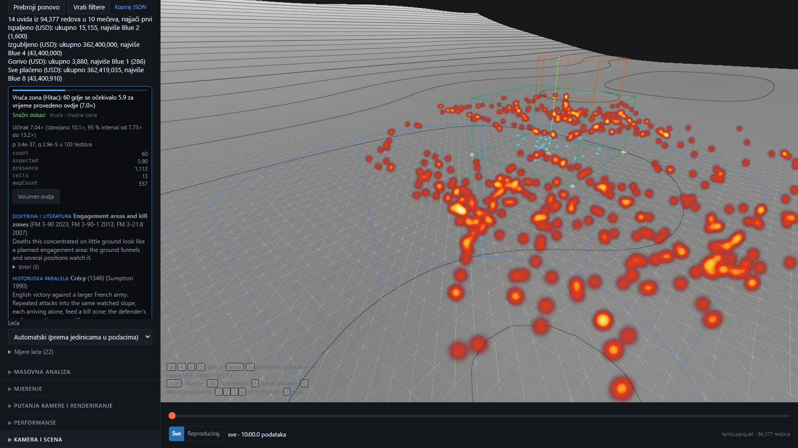

# Sočivo znanja

Kada [Uvidi](insights.md) nađu nešto, ovaj dio to objašnjava idejama iz vojne historije, dizajna igara i analize sporta, i navodi knjigu ili rad iz kojeg dolaze. Koristite ga da naučite *zašto* obrazac vrijedi, a ne samo da postoji.

## Probajte {#try-it}

1. Učitajte podatke i otvorite **Uvidi**, zatim pritisnite **Pronađi uvide**.
2. Kliknite nalaz da ga otvorite.
3. Pročitajte **Doktrina i literatura** i **Historijska paralela**; puni izvori su sklopljeni ispod.
4. Promijenite **Leću** (na primjer na *Vojna doktrina*) da pročitate isti nalaz kroz drugo tijelo literature.

## Kako radi {#how-it-works}

Panel Uvidi ocjenjuje svoje nalaze kako bi to radio profesionalni analitičar: kroz vojnu doktrinu i operaciona istraživanja, historijske sukobe, i literaturu o dizajnu igara, dizajnu nivoa i analitici. To radi van mreže, iz kurirane baze znanja u pregledaču, i daje isti materijal spoljnom modelu kada on piše sažetak.

## Šta panel prikazuje {#what-the-panel-shows}

- **Leća** bira tijelo literature kroz koje se nalazi čitaju: *Automatski* (izabrano prema vrstama jedinica u podacima: vazduhoplovi, brodovi, kopnena vozila, pješadija), *Vojna doktrina*, *Zračna borba*, *Pomorski*, *Urbana borba*, *Dizajn igre i balans*, *E-sport*. Unosi van izabrane leće se izostavljaju.
- Svaki otvoreni nalaz prikazuje svoj najbliži unos **doktrine i literature** i svoju najbližu **historijsku paralelu**, s punim izvorima sklopljenim ispod.
- **Mjere leće** navodi mjere analize operacija izračunate nad istim redovima (dolje), svaka sa značenjem i svojom literaturom.
- **Sažetak** dodaje redove za vodeće nalaze i mjere leće: "Doktrina i literatura: ..." i "Historijska paralela: ...", svaki s citatima autor-godina i izvorima sklopljenim ispod.
- **Napiši uz AI** šalje najrelevantnije unose (sažetak, pouka, nalazi s kojima su povezani, puni izvori) uz izvještaj, i traži od modela da ih citira po identifikatoru - `{concept.lanchester-square}` - i da ne koristi druge izvore.

Oznake su prevedene; znanje samo je na engleskom.

## Mjere leće {#lens-metrics}

Računaju se u radniku uvida, u istom prolazu kroz redove kao detektori (`src/insights/lensMetrics.ts`). Svaka se izostavlja kada podaci ne mogu da je nose.

| Mjera | Šta mjeri | Treba |
|---|---|---|
| Lanchesterovo uklapanje | Gubici svake strane po 20 s regresovani na žive snage obje strane (Poisson, greške kvazi-vjerodostojnosti); eksponenti na snagu neprijatelja i sopstvenu, provjereni prema kvadratnom zakonu (ciljana vatra) i linearnom zakonu (vatra po površini) | vrijeme, timovi, ubistva i smrti |
| Odnos razmjene | Ubistva po smrti po strani i po mjestu; udio smrti na najsmrtonosnijem terenu koji drži 5% vremena, naspram udjela koji sama slučajnost daje s tolikim brojem smrti; Gini smrti prema vremenu; Moranovo I stopa smrti | ubistva i smrti |
| Lokalni odnos snaga | Prijateljske i neprijateljske jedinice žive unutar dometa angažovanja svakog ubistva (domet postavljen iz podataka: dvostruka medijana udaljenosti do najbližeg neprijatelja); udio ubistava strane koja lokalno vlada, i njen višak iznad onoga što same brojke predviđaju | vrijeme, timovi, osobe |
| Polja vatre | Vidni prostori najzaposlenijih mjesta ubistava na površini prepreka 2,5D (geometrija nivoa do visine zida, ili tlo po kojem se hodalo) naspram prosječnog mjesta, i rang-korelacija vida i udjela ubistava | pozicije; učitani nivo ga čini oštrijim; ne za vazduh |
| Energetsko stanje | Specifična energija (visina plus visina koju brzina može kupiti) zračnih ubica i zračnih žrtava, upoređena Mann-Whitney statistikom | klase vazduhoplova, vrijeme, visina |
| Ključni teren | Koliko često je koje mjesto među tri najzaposlenija mjesta ubistava meča | više mečeva |
| Međusobna podrška (razmjene) | Smrti na koje je odgovorio ubistvom saigrača unutar dometa angažovanja i 5 s | vrijeme, timovi |
| Prvi udar | Angažmani - ubistva grupisana po meču, po 20 s tišine i po tri domet angažovanja udaljenosti - koje dobija strana koja je prva postigla | vrijeme, timovi |
| Model salve | Hughesova jednačina salve uklopljena u periode od 20 s brodova u kontaktu: brodovi onesposobljeni po napadačkom brodu, i spašeni po braniočkom brodu; Lanchesterovo uklapanje samo na brodovima | klase brodova, vrijeme, timovi |
| Borbena efikasnost | Ubistva po jedinici-satu u akciji svake strane i odnos dvije najveće (vrijednost borbene efikasnosti u Dupuyjevom smislu) s 95% intervalom, i udio ubistava svake strane pri jednakom lokalnom broju | vrijeme, timovi |
| Dometi angažovanja | Udaljenost do najbližeg neprijatelja pri ubistvima, pri lansiranjima i pri prvom hicu svakog života (otkrivanje do angažovanja), po vrsti jedinice | vrijeme, timovi; lansiranja gdje ih podaci imaju |
| Lanac ubistva | Sekunde od posljednjeg lansiranja ubice do ubistva, i od njenog prvog hica u borbi do ubistva | vrijeme; lansiranja ili događaji vatre |
| Koncentracija ili rasipanje | U svakom periodu od 20 s, rasprostranjenost dvije najveće strane i udio ubistava koji je uzela zbijenija | vrijeme, timovi |
| Izleti | Po strani: izleti (polijetanja, ili pojave vazduhoplova), sletanja, izgubljeni vazduhoplovi i ubistva vazduhoplovima; stopa gubitka i ubistva po izletu | klase vazduhoplova; polijetanja ili pojave |

Podaci s rundama dodaju mjere borbe iz bliza i e-sporta - vjerovatnoću pobjede runde, vrijednost akcija, otvarajuće dueleve, razmjene, napadač protiv držača, nišanjenje, unakrsnu vatru, pomoćna sredstva, prednost čovjeka, klečeve, postavke, stanje poslije postavljanja bombe, fatalne lijevke i uticaj igrača: vidi [Bliski boj i rundovi](close-quarters.md).

Staze i timovi dodaju mjere kolektivnog ponašanja iz nauke o gomili, kolektivnog kretanja, bihevioralne ekonomije i vojne psihologije - poravnanje i kružanje, stado po ruti, trake i tragove, zgusnutost, vođe i sljedbenici, zaostali, tačka loma, rizik poslije gubitaka, nizove, dogovor o kupovini i potiskivanje, svaka uz svoj nulti model: vidi [Kolektivno ponašanje](collective-behaviour.md).

Oružje, mamci i zgrade se ne broje kao jedinice. Kada redovi oružja navode jedinicu koja ga lansira (kolona `Shooter` ili `Launcher`, kao u podacima izvedenim iz Tacview-a), lansiranje se pripisuje toj jedinici, upareno po njenom nazivu ili identifikatoru objekta.

## Kako se nalazi susreću s literaturom {#how-findings-meet-the-literature}

Unosi i nalazi se susreću kroz **taksonomiju obrazaca** (`src/insights/knowledge/patterns.ts`): koncentracija, lokalna nadmoćnost, ciljana i površinska vatra, uska grla, zone ubijanja, polja vatre, suprotna padina, bokovi, međusobna podrška, energetska prednost, pritisak pri pojavljivanju, balans i tako dalje. Svaka vrsta detektora i svaka mjera leće kaže koje obrasce njeni brojevi pokazuju (`src/insights/lens.ts`); svaki unos znanja kaže kojim obrascima se obraća, s težinom. Relevantnost unosa za nalaz je ponderisano preklapanje, skalirano prema tome koliko se domen unosa (kopno, vazduh, more, urbano) uklapa u podatke i prema vlastitoj snazi nalaza. Prikazani razlog je brojka nalaza u jednoj rečenici, iza koje slijedi pouka unosa.

## Katalog {#catalogue}

Svaki obrazac, pojam, metoda, historijski slučaj, princip dizajna i studija, s bibliografijom: vidi [Katalog znanja](knowledge-catalogue.md).

## Za programere {#for-developers}

### Dodavanje unosa {#adding-entries}

1. Izaberite datoteku prema vrsti: `concepts.ts` i `concepts-more.ts`, `methods.ts`, `cases.ts`, `cases-land.ts`, `cases-air-sea.ts`, `cases-esports.ts`, `design.ts` (principi dizajna) ili `studies.ts` u `src/insights/knowledge/`.
2. Dajte mu novi identifikator `<type>.<slug>` (nikada ne ponovo koristiti), njegove leće, domene, i obrasce kojima se obraća s težinama 0..1. Dodajte obrazac u `patterns.ts` samo kada ga nalaz može pokazati, i mapirajte ga iz nalaza ili mjere u `lens.ts`.
3. Napišite sažetak i pouku **svojim riječima**. Citati samo iz radova u javnom domenu (`pd: true` u izvoru), i kratki.
4. Citirajte: dodajte svaki novi rad u `refs.ts` s autorima, godinom, naslovom i izdavačem (časopis s volumenom i stranicama); URL ili DOI tamo gdje postoji javni zapis.
5. Pokrenite `npx vitest run src/insights/lens.test.ts` (jedinstveni identifikatori, poznati obrasci, rješivi izvori, citati iz javnog domena, slučajevi s datumom i ishodom) i `node tools/knowledge-doc.mjs` da osvježite [katalog](knowledge-catalogue.md).
