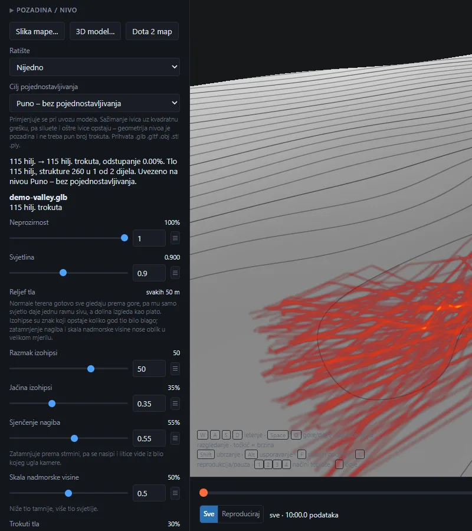

# Nivoi i pozadinska geometrija

Nivo je 3D mjesto na kojem se igra odigrala - mapa, grad, staza. Stavi ga iza svojih podataka i možeš vidjeti *gdje* je toplota. Panel **Pozadina / nivo** (vidi [Rječnik](glossary.md) za „nivo") daje tri vrste konteksta:

- **sliku karte**, georeferenciranu s dva sidra - vidi [Slike karte](map-images.md);
- **3D nivo** - `.glb`, `.gltf`, `.obj`, `.stl` ili `.ply` - podijeljen na tlo, strukture i vodu i pojednostavljen pri uvozu - vidi [3D nivoi](model-levels.md) i [Izgled nivoa](level-appearance.md);
- **pozadinu svijeta** - za snimak koji kaže gdje na Zemlji je (Tacview ACMI datoteka): pravi teren, putevi, voda, aerodromi i zgrade, preuzeti iz otvorenih podataka - vidi [Pozadina svijeta](world-backdrop.md).

Kada ništa nije učitano, scena je tamna s mrežom i obojenim osama (**Mreža** i **Ose** u [Kamera i scena](camera.md)), a panel kaže *Ništa nije učitano - scena prikazuje mrežu i ose. Dodaj sliku karte ili mrežu nivoa da toplota dobije kontekst.*

Nivo dijele sva tri taba: trka učitana u kartici Analiza utrke je isti nivo koji prikazuje toplotna karta.

## Stavi nivo iza svojih podataka {#put-a-level-behind-your-data}

1. Prvo učitaj podatke ([Unos podataka](getting-data-in.md)), da se nivo prilagodi njima.
2. Otvori **Pozadina / nivo** na bočnoj traci.
3. Pritisni **Slika karte…** za sliku ili **3D model…** za 3D nivo, i izaberi datoteku. Za snimak iz stvarnog svijeta koristi **Pozadina svijeta** ili **Pozorište**.
4. Sačekaj da red napretka završi. Veliki model se prvo pojednostavljuje (vidi **Cilj pojednostavljivanja** ispod).
5. Pritisni **F** u prikazu da uokviriš sve. Koristi **Neprozirnost** i **Svjetlinu** dok toplota ne bude istaknuta u odnosu na nivo.
6. Pritisni **Spremi u biblioteku** ako ćeš koristiti nivo ponovo ([Biblioteka nivoa](level-library.md)).

## Šta nivo radi za toplotu {#what-a-level-does-for-the-heat}

- **Zaklanja**: tačke podataka iza njega se zatamnjuju po površini, a tačke iza terena se sakrivaju ([Dubina i odsijecanje](depth-and-culling.md)). Bez nivoa nema zaklanjanja.
- **Presijeca** ga [Presjek](slice.md) i, uz *Sijeci i nivo*, [odsijecanje po udaljenosti](depth-and-culling.md#distance-culling), zajedno s toplotom.
- To je jedina stvar koju [dubina polja](camera.md#depth-of-field) zamućuje, osim mreže i kutija.
- 3D nivo **proširuje daleku ravan kamere** kada je veći od podataka: bliska i daleka ravan se kalibrišu iz skupa podataka, a izvezena karta široka nekoliko kilometara bi inače cijela sjedila iza daleke ravni i ostavila prazan pogled. Daleka ravan postaje 3 × horizontalni opseg nivoa kada je to veće, bliska ravan se pomjera s njom (najmanje daleka / 100.000) da sačuva preciznost dubine od koje zavisi zaklanjanje, a brzina letenja se podiže na najmanje opseg / 12. Ravan se nikad ne sužava, samo proširuje.

## Panel, odozgo prema dolje {#the-panel-top-to-bottom}

| Dio | Detalji |
|---|---|
| **Slika karte…**, **3D model…** | Učitava jedan; zamjenjuje trenutni nivo. |
| **Pozadina svijeta**, **Zaboravi pločice mape** | Samo za skup podataka s geografskom referencom: gradi pravo mjesto ispod kao nivo, ili briše preuzete pločice. [Pozadina svijeta](world-backdrop.md) |
| **Cilj pojednostavljivanja** | Budžet trouglova za sljedeći uvoz modela: *Puno - bez pojednostavljivanja* (zadano), *Visoko - 8M*, *Srednje - 3M*, *Nisko - 800k*, *Silueta - 100k*. [3D nivoi](model-levels.md#simplification) |
| Napredak i **Otkaži** | Dok se dekodira ili uvozi. |
| Napomena o uvozu | Trouglovi prije i poslije, podjela tlo / strukture / voda, korišteni nivo detalja. |
| Naziv i veličina | `širina×visina px · x × z m/px` za sliku, `N trouglova (od M)` za model. |
| **Neprozirnost**, **Svjetlina** | Oba tipa. |
| Kontrole slike | **Smanji zasićenost**, **Obrni sjever/jug**, **Postavljanje** (dva sidra), **Prilagodi granicama podataka**, **Visina**. [Slike karte](map-images.md) |
| Kontrole modela | Reljef tla, voda, trouglovi tla, žičani model, tekstura, snimljena boja, strukture, klasifikacija dijelova. [Izgled nivoa](level-appearance.md) |
| **Spremi u biblioteku**, **Ukloni** | [Biblioteka nivoa](level-library.md); Ukloni skida nivo. |
| **Biblioteka** | Nivoi sačuvani u ovom browseru. [Biblioteka nivoa](level-library.md) |

## Stranice u ovom odjeljku {#pages-in-this-section}

- [Slike karte](map-images.md)
- [3D nivoi](model-levels.md) - formati, dijelovi, klasifikacija, pojednostavljivanje, teksture
- [Izgled nivoa](level-appearance.md) - svaka kontrola za 3D nivo
- [Biblioteka nivoa](level-library.md)
- [Pozadina svijeta](world-backdrop.md) - pravi svijet ispod snimka, iz otvorenih podataka

Kako dobiti nivoe iz igara i motora je posao zasebnih alata za izvoz (vidi [README](https://github.com/Holdi601/3DHeat/blob/main/README.md) repozitorijuma); ugovor u koji oni pišu sažet je u [3D nivoi](model-levels.md#the-exporter-contract).
