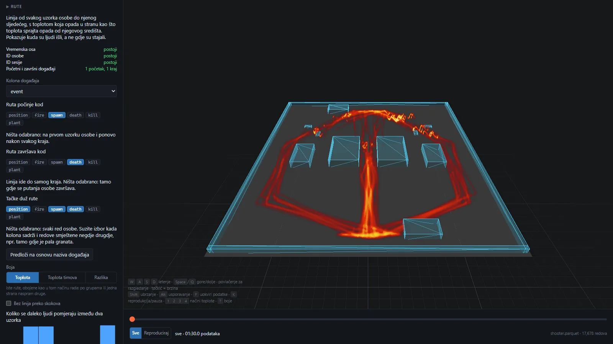

# Toplota linija

Toplota prikazuje gdje su ljudi stajali. Linije prikazuju putanje kojima su išli.

**Linije** (taster 4) je toplota linija: linija od svakog uzorka [osobe](glossary.md) do njenog sljedećeg, raspršena istim opadanjem kakvo ima [sprajt](glossary.md) - preko linije umjesto oko tačke. Ona pokazuje gdje su ljudi *išli*, a ne gdje su stajali: hodnik prijeđen jednom je jednako vidljiv kao soba u kojoj se kampovalo, a rijetki uzorci brzog igrača spajaju se u neprekidnu rutu umjesto isprekidane staze. Treba joj kolona osobe i kolona vremena.

## Kako se koristi {#how-to-use-it}

1. Pritisnite `4` (ili izaberite **Linije** u traci načina).
2. Otvorite **Rute** i provjerite zeleni spisak: vremenska osa i ID osobe moraju biti prisutni.
3. Pritisnite **Predloži na osnovu naziva događaja** da popunite gdje rute počinju i završavaju.
4. Pročitajte red statistike: "N ruta, M od njih dostiže kraj".
5. Ako linije skaču preko mape, podesite **Najduži korak** (vidi [Ograničenje skoka](#the-jump-limit)).

Linija ima smisla samo između početka i kraja, pa panel **Rute** kaže šta ograničava rutu. Sve od [Pravila rute](#the-rules-of-a-route) nadalje su detalji koje možete preskočiti.

## Panel Rute {#the-routes-panel}

Prikazuje se iznad panela toplote u režimu Linija.

### Šta podaci imaju {#what-the-data-has}

Spisak za provjeru, zelen kada je prisutno, žut kada nije:

| Stavka | Stanja |
|---|---|
| **Vremenska osa** | *prisutna* / *nedostaje - potrebna* |
| **ID osobe** | *prisutan* / *nedostaje - potreban* |
| **ID sesije** | *prisutan* / *nema - svi redovi su jedna sesija* |
| **Početni i završni događaji** | *N početaka, M završetaka* / *nijedan izabran - cijele staze* (zeleno samo s kolonom događaja i najmanje jednim početkom i jednim završetkom) |

### Kontrole {#controls}

| Kontrola | Značenje |
|---|---|
| **Kolona događaja** | Kolona kategorije čije vrijednosti su događaji (pojava, smrt, pozicija, ...). *Nijedna - cijele staze*: staza svake osobe u svakoj sesiji je jedna ruta, prekinuta tamo gdje staza ima prazninu. Nude se samo kolone zadržane za filtriranje pri učitavanju. |
| **Ruta počinje kod** | Vrijednosti događaja koje započinju rutu (pojava, ponovno pojavljivanje, raspoređivanje). Nijedna izabrana: ruta počinje kod prvog uzorka osobe, i ponovo nakon svakog kraja. |
| **Ruta završava kod** | Vrijednosti događaja koje završavaju rutu (smrt, izvlačenje, teleportacija). Linija ide do samog završnog reda. Nijedna izabrana: ruta završava tamo gdje staza osobe završava. |
| **Tačke duž rute** | Vrijednosti događaja čiji redovi leže duž rute. Nijedna izabrana: svaki red osobe. Suzite kada kolona sadrži i redove postavljene negdje drugo, kao mjesto gdje je pala granata. |
| **Predloži na osnovu naziva događaja** | Popunjava tri spiska iz naziva vrijednosti (dolje). |
| **Boja** | *Toplota*, *Toplota tima* ili *Razlika*. Iste rute u bojenju tog načina: svaka grupa u svojoj nijansi, ili jedna strana protiv druge, sa spiskom grupa, podjelom i skalama koje rade kao u tim načinima. Zadano *Toplota*. Toplota tima i razlika trebaju kolonu grupe. |
| **Bez linija preko skokova** / **Najduži korak** | Sljedeći uzorak osobe udaljeniji od ovoga je ponovno pojavljivanje, teleportacija ili pad, a ne mjesto gdje su išli, pa se ta dva ne spajaju linijom. Popunjava se pri učitavanju kada podaci pokazuju jasnu prazninu (dolje), i isključeno je kada ne pokazuju. Radi s kolonom događaja ili bez nje. |
| Red statistike | `N ruta, M od njih dostiže kraj, K segmenata`, ažurira se nekoliko puta u sekundi. |

Svaki spisak je red prekidača, jedan po vrijednosti, najčešće prvo; prelazak mišem preko čipa prikazuje broj njegovih redova. Nudi se najviše 120 vrijednosti (*još N vrijednosti nije prikazano*).

Izbor druge kolone događaja primjenjuje prijedlog kada prijedlog bira istu kolonu, a inače počinje s praznim spiskovima.

### Prijedlog {#the-suggestion}

Pri svakom učitavanju, i na **Predloži na osnovu naziva događaja** ([`suggestLineSettings`](https://github.com/Holdi601/3DHeat/blob/main/src/data/lines.ts)):

- **Kolona događaja:** prva zadržana kolona kategorije po nazivu `event`, `eventname` ili `eventtype`; inače `kind`, `type` ili `action`; inače bilo koja koja sadrži *event*, *kind*, *action* ili *type*.
- **Počeci:** vrijednosti koje sadrže *spawn, deploy, join, enter, start, begin, respawn, revive, land/landed/landing, drop* - osim ako se ne podudaraju i s nekom riječi kraja.
- **Završeci:** vrijednosti koje sadrže *death, died, dead, kill/killed, eliminat…, extract, evac, teleport, leave, left, disconnect, quit, exit, end, finish, downed* - osim vrijednosti `kill` i `kills` (ubistvo je nešto što ubica radi, a ne kraj njegove rute).
- **Tačke:** vrijednosti koje su tačno *position, location, player location, move, movement, tick, sample* ili *pos*; kada se bilo koja nađe, počeci i završeci se dodaju i tačkama. Kada se nijedna ne nađe, tačke ostaju prazne (svaki red).

### Ograničenje skoka {#the-jump-limit}

Tamo gdje ljudi skaču, dužine koraka padaju u dvije grupe bez gotovo ničega između: koliko osoba pređe između dva uzorka, i širina mape. Pri učitavanju ([`suggestMaxJump`](https://github.com/Holdi601/3DHeat/blob/main/src/data/lines.ts)) koraci se broje po udvostručenju njihove kvadratne dužine, do 16 miliona njih, a granica ide u sredinu prvog opsega iznad medijane koji je širok najmanje jedno udvostručenje dužine, sadrži manje od 0,02% koraka po intervalu, i ima koraka iza sebe. Bez takvog opsega ništa se ne reže, jer se skok ne bi mogao razlikovati od brzog automobila; uključivanje granice ručno tada počinje od desetine dijagonale podataka.

Grafikon iznad granice pokazuje koliko su koraci zaista dugi, s linijom na granici: stupci desno od nje se ne crtaju. Obje ose su logaritamske, jer skokovi mogu biti stotinka koraka i hiljadu puta duži. Prelazak mišem preko stupca daje njegov opseg i udio; klik na grafikon postavlja granicu tamo. Ispod, udio koraka iznad granice.

## Pravila rute {#the-rules-of-a-route}

Redovi se prolaze po vremenskom redu, po osobi ([`buildLines`](https://github.com/Holdi601/3DHeat/blob/main/src/data/lines.ts)):

1. Redovi [zajedničkog naziva](sessions-persons-groups.md#names-worn-by-several-things-at-once) se potpuno preskaču.
2. Kada su tačke izabrane, red koji nije ni početak, ni kraj, ni tačka se preskače.
3. Redovi se prate po osobi po sesiji, pa osoba čije se sesije isprepliću po vremenskom redu ima po jednu rutu u svakoj. Ruta se zatvara kada prethodni red nema nasljednika (njegov [životni vijek](sessions-persons-groups.md#person) je "nema") - ruta nikada ne prelazi granicu sesije ili prazninu za koju učitavanje odluči da nema sljedeći uzorak. Na kojoj ruti je red utvrđuje se jednom i čuva, 4 bajta po redu, pa promjena najdužeg koraka ne ponavlja taj dio.
4. Red **početka** zatvara svaku otvorenu rutu i tamo otvara novu.
5. Kada su počeci izabrani, red izvan rute se ignoriše. Bez početaka, svaki red koji nije kraj, a nalazi se izvan rute, otvara jednu.
6. Svaki drugi red unutar rute dodaje **segment** od prethodnog reda rute do ovog.
7. Red **kraja** koji produžava rutu zatvara je poslije njenog segmenta; ta ruta se broji kao *dostigla kraj*.
8. Korak duži od **Najdužeg koraka** zatvara rutu tamo gdje je bila, a nova ruta počinje na udaljenom kraju, osim ako taj red nije kraj. Preko njega se ne crta linija, a red statistike ga broji.

Svaki segment se čuva na svom *završnom* redu, pa segmenti ostaju u vremenskom redu, a [vremenska linija](timeline.md), uzorkivač, [filteri](filters.md), vidljivost grupa i predznak razlike rade s njima kao s tačkama. Filter se stoga primjenjuje na red na kojem segment završava.

## Reprodukcija {#playback}

U režimu **Sve** svaka ruta se crta cijela. U režimu **Reproduciraj** svaka osoba je tačka koja se kreće između svojih uzoraka, crtajući svoju rutu iza sebe:

- segment koji počinje poslije glave za reprodukciju se ne crta;
- segment u kome je osoba u sredini crta se do njene interpolirane pozicije, sa krajnjom kapom na vrhu;
- toplota se gasi preko **repa**: uz historiju *Kumulativno* rep je neograničen i cijela ruta do sada ostaje; uz *Prozor* gasi se tokom *Raspona* (podrazumijevano 30 s). Uz *Životni vijek* rep je također *Raspon*, a u režimu Linija vremenska linija prikazuje okvir *Raspon* i za tu historiju (umjesto *Rezervni vijek* i *Blijeđenje*, koje toplota linija ne koristi).

Dok se reprodukuje, svaki kadar se crta cijeli umjesto da se akumulira, jer se vrhovi pomjeraju svakim kadrom, a pokretni prosjek bi svaki razmazao u trag.

## Za programere {#for-developers}

### Memorija {#memory}

Rute se grade na glavnoj niti kada se uđe u režim Linija (ili se promijene postavke ruta), a oslobađaju se kada se iz njega izađe: 5 bajtova po redu u memoriji i 8 bajtova po redu na GPU-u (početna pozicija svakog segmenta, kvantizovana na 16 bita po osi unutar graničnog okvira podataka, i njegove zastavice).

### Kako se linija crta {#how-a-line-is-drawn}

Oba backend-a crtaju svaki segment od svog završnog reda kao **18 vrhova** ([`lineHeatVs`](https://github.com/Holdi601/3DHeat/blob/main/src/render/webgl2/shaders.ts) i njegov WGSL dvojnik):

- Polovina širine na svakom kraju je [poluprečnik sprajta](sprite-shape.md#sprite-radius) na udaljenosti tog kraja, s primijenjenim ograničenjima piksela. Linija uža od 2,5 px crta se širine 2,5 px, a njena toplota se srazmjerno smanjuje, pa tanke linije ni ne nestaju ni ne postaju svjetlije.
- Toplota opada **preko** linije istom skalom kao kod sprajta - opadanje ili kriva, intenzitet u središtu i na ivici.
- Okrugle kape se crtaju **samo** tamo gdje ruta počinje ili završava, pa se spojevi između uzastopnih segmenata ne pretvaraju u niz bisera.
- Geometrija se gradi u prostoru ekrana i tamo se linearno interpolira, pa opadanje ostaje centrirano na liniji bez obzira kako ona ulazi u dubinu. Segment koji siječe blisku ravan se tu siječe umjesto da se odbaci.

Toplota tačaka i toplota linija unose vrlo različite količine toplote po redu, pa se zasićenje ponovo mjeri kada prelazite s jedne na drugu ([Boja i ekspozicija](colour-and-exposure.md#auto-exposure)).
