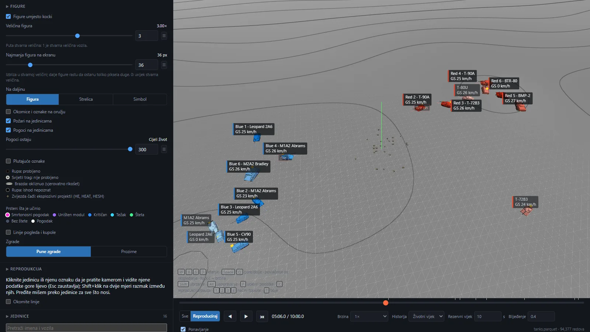
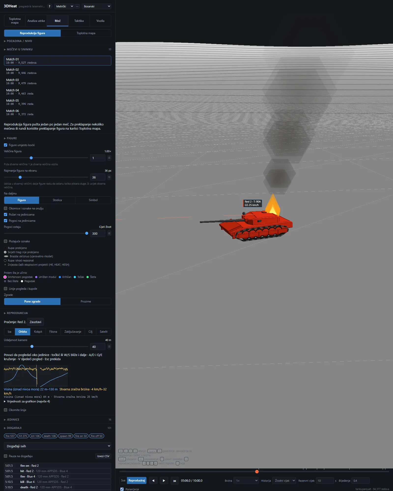
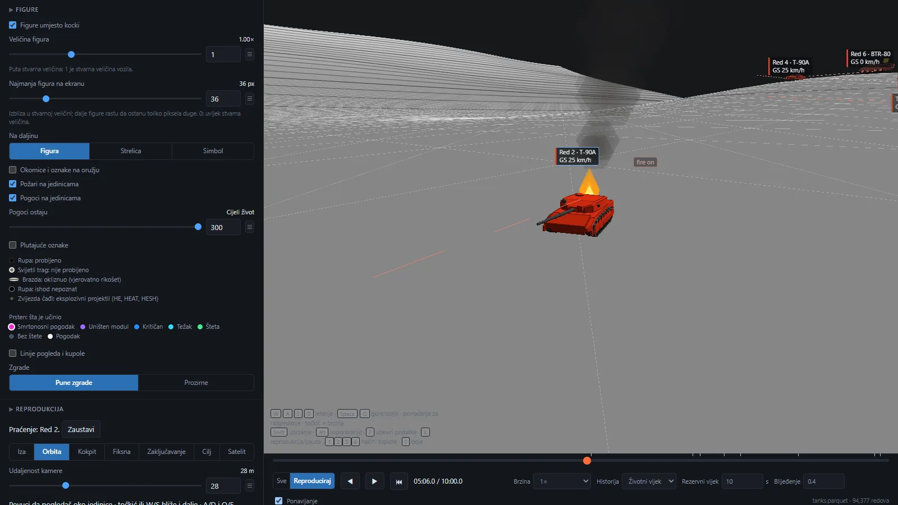
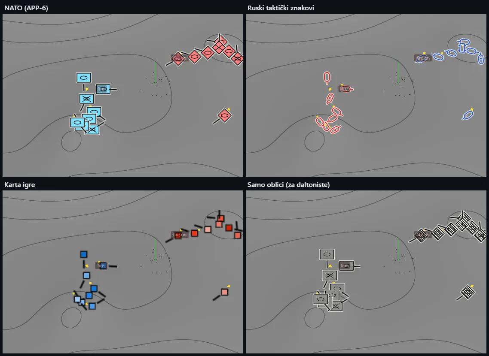
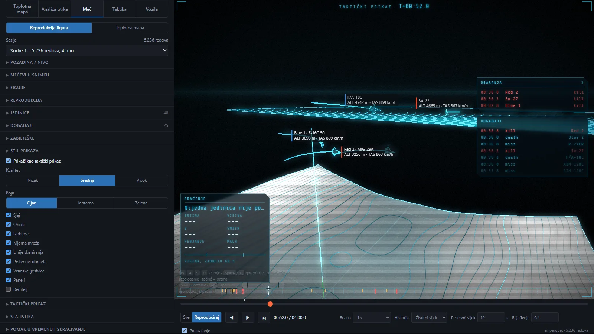
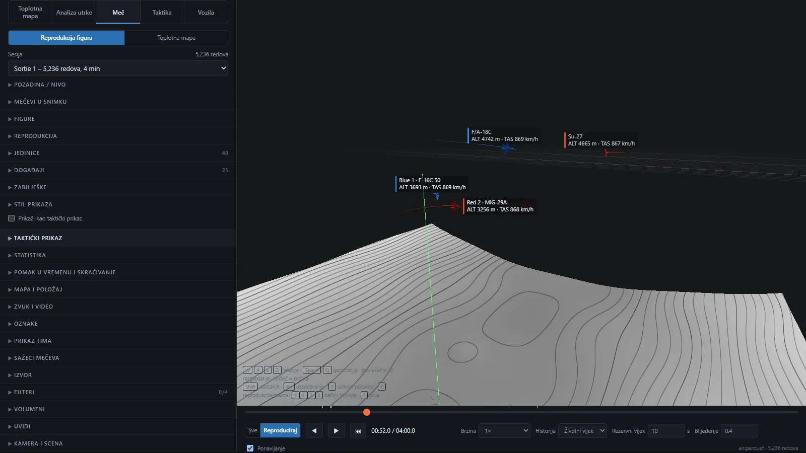

# Reprodukcija meča

Reprodukcija je film meča u kojem je svaki igrač nacrtan kao stvar koju je vozio. Koristi je da ponovo pogledaš borbu, pratiš jednu jedinicu i vidiš ko je koga pogodio.

Pucnji, pogoci, paljenja i olupine crtaju se na jedinicama i ciljevima na nivou. Kamere, oznake i taktički prikaz pomažu da čitaš borbu. Poznaješ Tacview? [Tacview paritet](tacview-parity.md) pokazuje gdje je svaki njegov alat.

## Pokreni reprodukciju {#start-a-replay}

1. Učitaj snimak preko **Izvor → Datoteke…** ili prevlačenjem na panel Izvor (bilo koja tabela s kolonom **osoba** i kolonom **vrijeme**, Tacview datoteka, konvertovana reprodukcija, [`.3dheat`](container.md) meč). Vidi [Unos podataka](getting-data-in.md).
2. Otvori karticu **Meč** i izaberi **Reprodukcija figura**, ili izaberi **Preklapanje figura** u traci režima kartice Toplota.
3. Pod **Mečevi u snimku** izaberi jedan meč, sve odjednom, ili nekoliko.
4. Pritisni **Reproduciraj** na vremenskoj liniji (ili `K`). Prevlači vremensku liniju da skočiš.

Figure zamjenjuju kutije za svaku jedinicu čije je ime ili vrsta poznata (vidi [Figure](figures.md)). Podaci bez kolone imena ili vrste crtaju se kao vojnici.

## Figure {#figures}

| Postavka (odjeljak **Figure**) | Zadano | Šta radi |
|---|---|---|
| **Figure umjesto kocki** | uključeno | Isključeno crta obične kutije. |
| **Veličina figura** (puta prava veličina) | 1 | 1 je prava veličina; 0,25 do 20 puta (logaritamska skala). Veće pomaže izdaleka. |
| **Najmanja figura na ekranu** | 36 px | Udaljene figure rastu da ostanu ovoliko dugačke, 0 do 200 px; 0 zadržava pravu veličinu. |
| **Na daljinu**: Figura, Strelica, Simbol | Figura | U šta postaje daleka jedinica. |
| **Simboli** | NATO (APP-6) | NATO (APP-6), ruski taktički znakovi, ikone **Karte igre**, ili **Samo oblik (bezbjedno za daltoniste)**. |
| **Veličina simbola**, **Moja strana**, **Neprijateljski / Neutralni**, **Oznake kursa** | 28 px (12 do 64), automatski, neprijateljski, uključeno | Kako simboli izgledaju i koja strana je prijateljska. |
| **Okomite linije** | uključeno | Linija od svake jedinice pravo dolje do tla, pa se visine čitaju u 3D. |
| **Okomice i oznake na oružju** | isključeno | Linije do tla i oznake na raketama i bombama. |
| **Požari na jedinicama** | uključeno | Plamen od trenutka kada jedinica zapali dok se ne ugasi. |
| **Pogoci na jedinicama** | uključeno | Oznake gdje su pucnji pogodili (dolje). **Pogoci ostaju**: 1 do 300 sekundi, ili **Cijeli život**. **Plutajuće oznake**: oznake nacrtane iznad površine. |
| **Linije pogleda i kupole** | isključeno | Isprekidano: gdje igrač gleda; puno: gdje cijev pokazuje. |
| **Zgrade** | čvrsto | Čvrste ili prozirne zgrade, kada nivo ih tako oboji. |

### Simboli na daljinu {#symbols-at-a-distance}

Kada bi jedinica bila manja od **Najmanje figure na ekranu**, može postati simbol koji ostaje čitljiv. Oblik kaže vrstu (na primjer zaobljena kutija s oznakom gusjenica za oklopna vozila); boja kaže stranu. Otvori meni **Simboli** da promijeniš stil.

### Oznake pogodaka, olupine i požari {#hit-marks-wrecks-and-fires}

- **Oznake pogodaka** sjede na površini na koju je pucanj naišao, u razmjeri figure. Njihov izgled kaže šta se desilo: rupa (prošao kroz), svijetla prskotina (nije prošao), zarez (odbio se), zvjezdica od čađi (eksplozivni metak). Obojeni prsten kaže šta je učinio: smrtonosni pogodak, modul uništen, kritičan, težak, šteta, bez štete, pogodak. Pređi mišem preko oznake za ime metka.
- Uništena jedinica se crta **zgorena** kao olupina od svoje smrti do ponovnog pojavljivanja ili uklanjanja; njen simbol je precrtan.
- **Požari** gore na jedinici od trenutka kada se zapali dok se ne ugasi.
- **Kupole** se okreću tamo gdje podaci kažu da cijev pokazuje (ili, bez toga, gdje igrač gleda).

### Oružje, mamci i trasirajući meci {#weapons-decoys-and-tracers}

Uz **Oružje, hici i pogoci** uključeno (odjeljak Prikaz tima): rakete, projektili, bombe i torpeda lete kao vlastite figure s tragom dima; meci i granate su trasirajući meci; udari i eksplozije bljesnu. Trasirajući meci nacrtan **isprekidano** je izveden iz pogotka, jer podaci nisu imali pucanj. Bljeskalice i čaff se crtaju kao mamci; sakriveni su s spiska jedinica osim ako je označeno *Mamci i granate*.

## Kamere {#cameras}

Klikni na jedinicu ili njenu oznaku da je **pratiš**; odjeljak **Reprodukcija** nudi **Iza**, **Orbita**, **Kokpit** (s prikazom na čeonom staklu, `H`), **Fiksna**, **Zaključavanje**, **Cilj** i **Satelit**. `V` prolazi kroz njih, a **Udaljenost kamere** postavlja koliko daleko. Esc zaustavlja.

- **Prikaz dvije jedinice**: izaberi **Cilj** (ili Ctrl/Alt-klik na jedinicu) da je gledaš iz praćene; **Zamijeni** ih mijenja.
- **Mjera**: Shift-klik na dvije jedinice za smjer, daljinu i razliku visine između njih.
- **2D karta** (`M`): ugao ili cijeli prikaz, s tragovima i imenima.
- **Zabilješke** (`B`): čuvaju trenutak i kameru; navode se i sopstvena ubistva, smrti i oznake snimka.
- **Događaji**: svaki događaj po vremenu; klik skače do njega. `Page Up` / `Page Down` skaču između događaja; **Pauza na događaju** staje na svakom.

## Taktički prikaz {#tactical-display}

Odjeljak **Taktički prikaz** crta, za nijednu jedinicu, izabrane, sve, ili jednu vrstu (avioni, kopno, brodovi, oružje): vektore brzine i put ispred, linije nosa i uzgona, radarske konuse, zaključavanja, podatkovne veze, zone i linije angažovanja, linije vidljivosti, gdje igrači gledaju (konusi pogleda), nišanjenje kupole i snimljenu kameru.

### Stil prikaza {#display-style}

`T` (ili prekidač **Prikaži kao taktički prikaz**) prebacuje izgled na stil radarskog ekrana: sjaj, obrisi, konturne linije, mreža mjerenja, linije skeniranja, prstenovi dometa, lestvice visine, paneli s ubistvima i događajima, i **Reditelj** koji sam pomjera kameru do događaja.

## Ciljevi {#objectives}

Kada meč dolazi sa svojim ciljevima, odjeljak **Ciljevi** ih crta na nivou: zone zauzimanja (s vlasnikom i napretkom zauzimanja), mjesta pojavljivanja, aerodromi, područja i mete za bombardovanje, svaki sloj se može uključiti ili isključiti, sa oznakama. Vide se kroz tlo. Kada je učitano više režima igre, **Režim** filtrira mečeve po režimu. Ciljevi dolaze iz datoteke meča konvertera pored snimka ili unutar [`.3dheat`](container.md) kontejnera.

Mečevi Rainbow Six Siege donose svoja mjesta za bombu: dvije prostorije svakog mjesta crtaju se na njihovom podu kao obrisi s imenima, izvedeni iz toga gdje su igrači stajali dok je igra imenovala prostoriju; mjesto mape koje se u meču nije igralo dolazi iz konverterove tabele mjesta kao krug. U snimku mjesto runde na poziciji reprodukcije svijetli ćilibarno, ostala ostaju siva. Dio su sloja zona zauzimanja.

## Oznake i statistika {#labels-and-statistics}

- **Oznake**: pravila po vrsti (**Izabrane**, **Zrakoplovi**, **Kopno**, **Brodovi**, **Oružje**, **AI**): prikazuju se ili ne, koje vrijednosti, i **Prioritet** za to ko dobija prostor kada se oznake preklapaju. **Razmakni oznake** pomjera oznaku pored jedinice kada bi pokrila drugu, a izostavlja je gdje nema mjesta. **Veličina oznaka** je 60 do 250 %. **Nazad na ime, vozilo, visinu i brzinu** vraća pravila na zadano.
  - Kopnene jedinice počinju s imenom, vozilom i brzinom.
  - Avioni počinju s imenom, vozilom, visinom i brzinom.
  - Brodovi počinju s imenom, vozilom, brzinom i kursom.
  - Pređi mišem preko jedinice da vidiš svaku vrijednost koju ima.
- **Statistika**: po timu i jedinici: ubistva, smrti, pucnji, pogoci, odnos pogodaka, polijetanja, sletanja, vrijeme u vazduhu, najveća brzina, visina i G, daljina. Izvoz CSV.
- **Grafikoni**: vrijednosti jedne jedinice kroz vrijeme, dvije jedinice upoređene, ili jedna vrijednost naspram druge.

## Mnogo mečeva odjednom {#many-matches-at-once}

Da preklopiš stotine ili hiljade mečeva jedan preko drugog, vidi [Mnogo mečeva odjednom](many-matches.md). Detalji o figurama (dim, vatra, drugi vremenski efekti): [Figure u preklapanju figura](figure-replay.md). Spisak mogućnosti Tacviewa: [Tacview paritet](tacview-parity.md), podstranica ove stranice.
