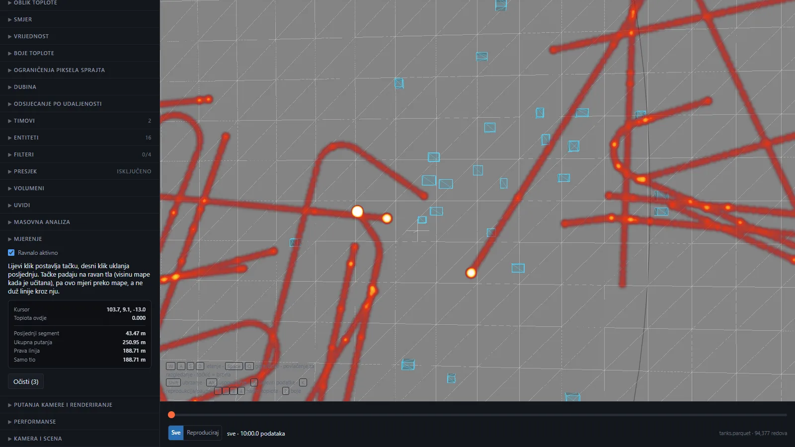

# Mjerenje

**Mjera** pretvara miš u ravnalo i kaže vam koliko je zauzeto mjesto ispod kursora. Koristite je da saznate koliko su dva mjesta udaljena ili koliki je promet na jednom mjestu.

## Probajte {#try-it}

1. Otvorite **Mjera** u bočnoj traci i označite **Ravnalo aktivno**.
2. Lijevim klikom kliknite tri mjesta na karti. Svaki klik postavlja tačku.
3. Pročitajte **Ukupna putanja** (dužinu cijele putanje) i **Posljednji segment** (zadnji dio).
4. Desnim klikom uklonite zadnju tačku, ili pritisnite **Očisti (3)** da uklonite sve.

| Radnja | Učinak |
|---|---|
| Lijevi klik | Postavlja tačku tamo gdje kursor dodiruje ravan tla. Klik koji se pomjerio za više od 4 piksela između pritiska i otpuštanja je prevlačenje kamere, a ne tačka. |
| Desni klik | Uklanja zadnju tačku. |
| Pomjeranje | Pozicija kursora i toplota ispod njega se mijenjaju uživo. |

Kamera radi dok je ravnalo uključeno: prevlačenje i dalje gleda oko sebe, tastere i dalje letjeti. Dok je ravnalo uključeno, ono preuzima svaki klik, pa [izbor klikom](camera.md#click-to-pick) čeka dok se ono ne isključi.

**Ravan tla** je visina [slike karte](map-images.md) kad je slika karte učitana, inače najniži Y skupa podataka (0 bez njega). Tačke padaju na nju, pa ravnalo mjeri preko karte, a ne po liniji kroz nju. Sa 3D nivoom ravan je i dalje najniži Y skupa podataka, a ne površina nivoa. Za tačku na stvarnoj površini isključite ravnalo i kliknite je ([izbor klikom](camera.md#click-to-pick)), što čita koordinate iz sopstvenih trouglova nivoa.

## Očitavanja {#readouts}

| Red | Značenje |
|---|---|
| **Kursor** | Svjetske X, Y, Z tačke ispod kursora, na ravni. |
| **Toplota ovdje** | Koliko je toplote na pikselu kursora. Veći broj znači više prometa na tom mjestu. To je vrijednost koja ulazi u rampu boja prije nego je tačka zasićenja podijeli, pa je možete uporediti sa [Tačkom zasićenja](colour-and-exposure.md#saturation-point). |
| **Posljednji segment** | Udaljenost od zadnje tačke do kursora (ili između zadnje dvije tačke). |
| **Ukupna putanja** | Dužina izlomljene linije kroz svaku tačku i kursor. |
| **Prava linija** | 3D udaljenost od prve tačke do kursora (ili zadnje tačke). |
| **Samo tlo** | Isto, samo na X i Z. |
| **Očisti (N)** | Uklanja sve tačke. |

Udaljenosti se prikazuju u centimetrima ispod 1 jedinice, u metrima ispod 1.000, u kilometrima iznad toga, uz pretpostavku da je jedna svjetska jedinica metar ([Osi, jedinice i vrijeme](axes-units-and-time.md#unit-scale)). Koordinate su svjetske koordinate, i kad je osa [obrnuta za prikaz](camera.md#invert-world-axis).

Tačke i linija između njih crtaju se kao sloj u pogledu, a veličina im se određuje iz razmaka mreže. Tačke ravnala se ne čuvaju u pogledima; ostaju kad učitate druge podatke.

## Za programere {#for-developers}

**Toplota ovdje** čita se sa GPU-a najviše na svakih 120 ms, jer čitanje jednog piksela zaustavlja cjevovod. Koristi isti put kao `engine.readHeatProbe()`: dijeli se pojačanjem kojim je sličica upisana, pa je na putu akumulacije half-float (`?heat=f16`) u istim jedinicama kao na 32-bitnom cilju ([Akumulacija half-float](half-float-accumulation.md)).
