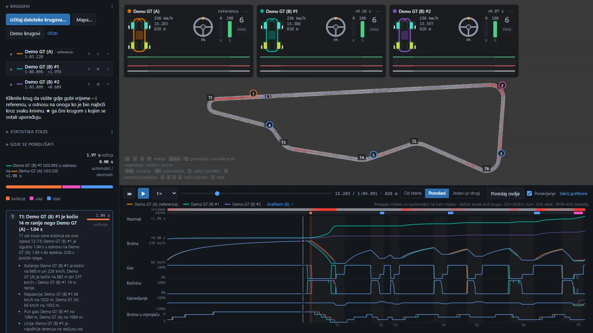

# Analiza utrke

Vozili ste istu stazu dva puta. Kartica **Analiza utrke** pušta obje vožnje zajedno u 3D, pokazuje gdje je jedan krug bio sporiji i kaže vam zašto. Još nemate krugove? Pritisnite **Demo krugovi**.

Kartica poredi dva ili više krugova jedne staze. S Toplotnom mapom dijeli platno, kameru i učitani model staze (**Pozadina / nivo**); sve ostalo je njeno: sopstvena bočna traka i sopstvena traka ispod prikaza. Riječi kao što su *krug*, *referenca* i *vrh krivine* nalaze se u [rječniku pojmova](glossary.md).

Ova stranica je mapa kartice. Svaki dio ima svoju stranicu:

| Stranica | Šta obuhvata |
|---|---|
| [Učitavanje krugova](race-loading-laps.md) | svaki format datoteke, fascikle i staze, nazivi automobila, demo krugovi, spisak krugova, referenca i fokus |
| [Reprodukcija i 3D scena](race-replay-and-scene.md) | traka za upravljanje, tri načina reprodukcije, poravnavanje automobila, kamera iza, linije, mape, automobili, oznake, ogledani svjetovi |
| [Grafikoni i HUD](race-charts-and-hud.md) | grafikoni po udaljenosti, birač grafikona, pokazivač i zumiranje, kartice automobila, tabela kanala |
| [Događaji upravljanja automobilom](race-control-events.md) | blokiranja, proklizavanje točkova, preupravljanje, rotiranje, nedovoljno upravljanje, udarci, sudari, ABS/TC, ručna kočnica, vazduh - kako se svaki otkriva, sa svakim pragom |
| [Analiza krivina](race-corner-analysis.md) | poravnanje po udaljenosti, krivine i segmenti, vremenski obračun krivine, svaki uzrok i redoslijed u kojem se provjeravaju, oblik linije i savjet |
| [Profili automobila i poređenje](race-car-profiles.md) | šta svaki automobil može, mjereno iz njegovih krugova; *Poređenje automobila*; šta automobil odlučuje u svakoj krivini |
| [Statistika staze](race-course-statistics.md) | mnogo krugova jedne staze: greške po krivini i po vrsti, mapa grešaka, izvoz toplotne mape, granice performansi |
| [Analitika utrka: metoda](race-analytics.md) | istraživanje iza pravila, s izvorima |
| [Ostale trkaće igre](other-games.md) | šta prikazivač radi s krugovima iz svake igre: klizanje i drift izvedeni tamo gdje igra ne šalje podatke, ogledani svjetovi, dodatni kanali |

## Ekran {#the-screen}

**Bočna traka**, od vrha prema dnu (odjeljci se mogu sklopiti):

1. **Krugovi** - učitavanje, spisak, prikaz/sakrivanje, referenca, fokus, jurenje.
   Vidi [Učitavanje krugova](race-loading-laps.md).
2. **Statistika staze** - tek od tri učitana kruga.
   Vidi [Statistika staze](race-course-statistics.md).
3. **Gdje se poboljšati** - nalazi za fokusirani krug, krivina po krivini.
   Vidi [Analiza krivina](race-corner-analysis.md).
4. **Krivina po krivina** (ili *Krivina po krivina - klasa X* uz nekoliko klasa) - najbrži krug kroz svaku krivinu i njenu liniju. Prikazuje se uz dva ili više krugova.
5. **Kontrola automobila** - blokiranja, klizanja, guranja i udarci fokusiranog kruga.
   Vidi [Događaji upravljanja automobilom](race-control-events.md).
6. **Poređenje automobila** (ili **Automobil** s jednim automobilom) - vidi [Profili automobila i poređenje](race-car-profiles.md).
7. **Prikaz** - koja mapa je naslikana na stazi i šta se crta.
   Vidi [Reprodukcija i 3D scena](race-replay-and-scene.md).
8. Zajednički paneli **Nivo** i **Kamera i scena** (model staze, obrtanje osa, kamera) - dokumentovani uz Toplotnu mapu i [Kameru](camera.md).

**Prikaz** pokazuje stazu, nacrtane vožnje, mapu, automobile, oznake zakačene za stazu i do šest kartica automobila gore lijevo (vidi [Grafikoni i HUD](race-charts-and-hud.md)). Bez učitanih krugova piše „Nema učitanih krugova - prevucite ovdje dvije ili više datoteka krugova, ili učitajte demo krugove iz bočne trake.”

**Traka ispod prikaza** sadrži upravljanje reprodukcijom i, osim ako nije sakrivena, grafikone po udaljenosti.

## Brzi početak {#quick-start}

1. Otvorite karticu **Analiza utrke** (pored **Toplotna mapa** na vrhu bočne trake).
2. Unesite krugove. Pritisnite **Demo krugovi** da vidite šta kartica radi s tri izmišljena kruga. Za svoje krugove, prvo ih snimite ([formati datoteka i snimači](race-loading-laps.md#file-formats)), zatim pritisnite **Učitaj datoteke krugova…** ili **Mapa…**, ili prevucite datoteke ili fascikle na prikaz.
3. Najbrži kompletan krug postaje referenca; najsporiji drugi krug je fokusiran. Kliknite bilo koji krug na spisku da ga fokusirate; ★ čini krug referencom.
4. Pročitajte **Gdje se poboljšati**. Kliknite nalaz: automobili se poravnavaju 40 m prije njega, kamera ga uokviruje, reprodukcija prolazi kroz njega i otvaraju se mjerenja.
5. Zadržite pokazivač iznad grafikona da pomjerite svaki automobil na taj metar; Shift+klik ih poravnava tu.

## Tastatura {#keyboard}

Dok je kartica Analiza utrke otvorena:

| Tipka | Radi |
|---|---|
| **K** | pusti / pauziraj reprodukciju |
| **Home** | nazad na početak reprodukcije |
| tipke s brojevima | ništa (u toplotnoj mapi mijenjaju načine) |

Tipke otkucane u tekstualnom polju ili padajućem meniju se ignorišu. Tipke kamere rade kao u toplotnoj mapi (**W A S D**, **Razmak** gore, **Q** dolje, **Shift** brže, **Alt** sporije, miš za gledanje; sve u [Kameri](camera.md)); **F** uokviruje učitane krugove (kao što to radi učitavanje krugova).

## Mnogo krugova {#many-laps}

- Svi učitani krugovi se analiziraju i broje; desetine traju sekund ili dva.
- Preko **8** krugova (`SHOW_ALL_UP_TO`), dodani krugovi se crtaju samo kada su referenca, fokusirani krug, ili najbolji krug klase fokusiranog kruga. Dugmad *Prikaži sve* / *Samo oni koji se gledaju* to mijenjaju.
- Preko **10** vidljivih automobila (`PLAIN_PAST`), krugovi koji se ne gledaju (ne fokus, ne jureni automobil ni referenca) crtaju se s linijama prorijeđenim na tačku na svakih 6 m umjesto 1,5 m, i kao obični automobili.
- Grafikoni crtaju najviše **8** krugova; HUD prikazuje najviše **6** kartica.
- Statistika staze pojavljuje se od **3** kruga.

Detalji: [Statistika staze](race-course-statistics.md#performance-with-many-laps).

## Podrazumijevane postavke prikaza {#default-view-settings}

| Postavka | Podrazumijevano |
|---|---|
| Mapa | Vremenska mapa |
| Vožene linije, Automobili, Gume i ovjes, Oznake, Staza iz krugova | uključeno |
| Sve vrijednosti na karticama | isključeno |
| Veličina automobila | 1× |
| Grafikoni | prikazani |
| Način reprodukcije | Od linije |
| Brzina reprodukcije | 1× |
| Ponavljanje | uključeno |

Ništa od ovoga se ne čuva; ponovno učitavanje kreće od podrazumijevanih vrijednosti. Što se pamti u pregledniku: jezik i nazivi automobila naučeni iz datoteka krugova (vidi [Učitavanje krugova](race-loading-laps.md#car-names)).

## Za programere {#for-developers}

### Šta se dešava kad se učitaju krugovi {#what-happens-when-laps-are-loaded}

Svaki put kad se promijeni skup krugova, referenca ili jezik, cijela analiza se ponovo radi (`analyse` u [`src/race/analysis.ts`](https://github.com/Holdi601/3DHeat/blob/main/src/race/analysis.ts)):

1. Izvedeni kanali dodaju se svakom krugu tamo gdje ih igra ne šalje: ugao drifta, proklizavanje točkova iz brzina točkova, u vazduhu, rastresito tlo, brzina skretanja oko ose ([`derive.ts`](https://github.com/Holdi601/3DHeat/blob/main/src/race/derive.ts)).
2. Bira se referenca, i svaki krug se projicira na njenu putanju i ponovo uzorkuje svaka 2 m ([`align.ts`](https://github.com/Holdi601/3DHeat/blob/main/src/race/align.ts)).
3. Iz krugova se računa da li je svijet igre ogledan ([`handedness.ts`](https://github.com/Holdi601/3DHeat/blob/main/src/race/handedness.ts)).
4. Krivine se nalaze na referenci i grupišu u segmente od jedne zone kočenja do sljedeće ([`segments.ts`](https://github.com/Holdi601/3DHeat/blob/main/src/race/segments.ts)).
5. Po automobilu: njegova ovojnica (prianjanje, kočenje, vuča po brzini), njegov profil i krive njegovih guma ([`envelope.ts`](https://github.com/Holdi601/3DHeat/blob/main/src/race/envelope.ts), [`profile.ts`](https://github.com/Holdi601/3DHeat/blob/main/src/race/profile.ts), [`control.ts`](https://github.com/Holdi601/3DHeat/blob/main/src/race/control.ts)).
6. Po krugu i segmentu: šta je uradio (tačka kočenja, najsporija tačka, puni gas, ...) i linija kojom je vozio ([`line.ts`](https://github.com/Holdi601/3DHeat/blob/main/src/race/line.ts)).
7. Po krugu: njegovi događaji upravljanja automobilom, svaki postavljen uz krug s kojim se tamo poredi.
8. Po krugu i segmentu: vremenski obračun u odnosu na krug za poređenje i nalaz riječima.
9. Mapa vremena i mapa uzroka po krugu.

Tekstovi se pišu na trenutnom jeziku; promjena jezika ponovo pokreće analizu (i preimenuje demo krugove). Greška u analizi prikazuje se ispod dugmadi **Krugovi** kao greška, a krugovi ostaju učitani.

### Izvorne datoteke {#source-files}

| Datoteka | Uloga |
|---|---|
| `src/race/adapters.ts`, `ibt.ts` | čitanje datoteka krugova |
| `src/race/lap.ts`, `carNames.ts`, `synthetic.ts` | tip kruga, imenovanje, demo krugovi |
| `src/race/derive.ts`, `handedness.ts` | izvedeni kanali, ogledani svjetovi |
| `src/race/align.ts`, `segments.ts`, `line.ts` | osa udaljenosti, krivine, linije |
| `src/race/analysis.ts` | poređenje krivina, uzroci, nalazi |
| `src/race/envelope.ts`, `profile.ts` | šta automobil može |
| `src/race/control.ts`, `impacts.ts` | upravljanje automobilom, udarci i sudari |
| `src/race/stats.ts` | mnogo krugova |
| `src/race/replay.ts`, `scene.ts`, `glyph.ts`, `geometry.ts` | reprodukcija i crtanje |
| `src/race/schema.ts`, `graphs.ts` | tabela kanala, redovi grafikona |
| `src/ui/race/*` | bočna traka, grafikoni, HUD, oznake |
| `src/state/raceStore.ts` | stanje kartice i sat reprodukcije |
