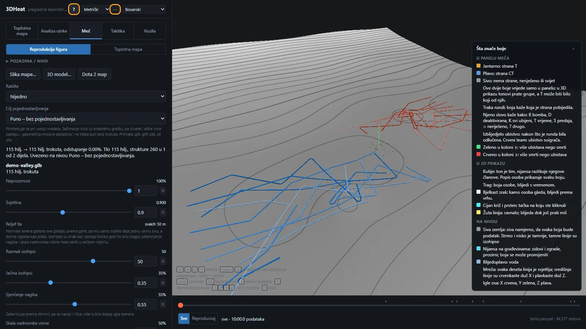

# Postavke, jedinice i tipke

Male kontrole na vrhu bočne trake mijenjaju način na koji vam preglednik govori: jezik, jedinice (metri ili stope, km/h ili čvorovi) i režim pomoći koji objašnjava boje. Vaši izbori se pamte u vašem pregledaču.

## Zaglavlje {#the-header}

Na vrhu bočne trake:

| Kontrola | Šta radi |
|---|---|
| **?** | Režim pomoći: šta znači svaka boja (također `?` ili `F1`) |
| Meni **Jedinice** | Metrički, Imperijalni, Avijacijski ili Nautički |
| Dugme **...** pored **Jedinice** | Otvara "Izaberite jedinicu za svaku veličinu": jedan padajući meni po veličini |
| Meni **Jezik** | Jezik preglednika: [40 jezika](languages.md), ili jezik pregledača |

Brojevi koje upišete u polje mogu koristiti ili tačku ili zarez (`0.35` ili `0,35`). Preglednik čita oba i prikazuje brojeve onako kako ih piše jezik preglednika.

## Jedinice {#units}

1. Izaberite unaprijed postavljenu vrijednost u meniju **Jedinice**. Sve veličine se mijenjaju zajedno.
2. Da promijenite samo jednu veličinu, kliknite dugme **...** pored nje i izaberite jedinicu za tu veličinu. Meni tada prikazuje `*` iza unaprijed postavljene vrijednosti.
3. Veličina koju niste postavili prati unaprijed postavljenu vrijednost. Izaberite "Kao unaprijed postavljeno" da se vratite.

| Veličina | Metrički (zadano) | Imperijalni | Avijacijski | Nautički |
|---|---|---|---|---|
| Udaljenost | km | mi | NM | NM |
| Visina, dužina | m | ft | ft | m |
| Brzina | km/h | mph | kt | kt |
| Vertikalna brzina | m/s | ft/min | ft/min | m/s |
| Temperatura | °C | °F | °C | °C |
| Pritisak | hPa | inHg | hPa | hPa |
| Masa, gorivo | kg, l | lb, gal | lb, gal | t, m³ |
| Ugao | stepeni | stepeni | stepeni | stepeni |

Druge jedinice koje možete izabrati za jednu veličinu: udaljenost km, mi, NM; brzina km/h, m/s, kt, mph; vertikalna brzina m/s, ft/min, m/min; temperatura °C, °F, K; pritisak hPa, inHg, mmHg, psi; masa kg, lb, t; ugao stepeni ili NATO mili (6400 na krugu). Jedinice su iste svuda u pregledniku: oznake, kartice, grafikoni, statistika.

## Režim pomoći {#help-mode}

Pritisnite `?` ili `F1`, ili kliknite dugme **?**. Prikazuje se *Šta znače boje*: legende za 3D prikaz, rampe toplote, boje timova, boje nivoa, boje statusa panela, panel meča i prikaz utrke. Ostaje uključen dok ga ne isključite. Na kartici Meč objašnjava i boje panela meča.

## Šta pregledač pamti {#what-the-browser-remembers}

Ove postavke se čuvaju u vašem pregledaču između posjeta (ništa se nigdje ne šalje):

- jezik, jedinice i režim pomoći;
- postavke figure, simbola, oznaka, kamere i taktičkog prikaza replaya;
- brzina reprodukcije i ogledanje;
- oznake po snimku, zapremine po skupu podataka, slojevi ciljeva;
- postavke spoljne AI (ključ samo ako označite *Zapamti*).

Postavke toplote, filteri i režim počinju ispočetka pri svakom učitavanju. Potpun, generisan spisak: [Sačuvane postavke](ref-settings-storage.md).

## Tipke koje preglednik zadržava iz pregledača {#keys-the-viewer-keeps-from-the-browser}

Sesija sa velikim podacima traje da se učita, pa preglednik sprječava da pregledač to slučajno odbaci:

- `Ctrl`/`Cmd` + slova koja bi štampala, sačuvala, otvorila, ponovo učitala, zatvorila ili otvorila nove prozore ne rade van tekstualnih polja; `F1`, `F3`, `F5`, `F6` i `F7` ne rade ništa.
- Zatvaranje ili ponovno učitavanje kartice sa učitanim podacima ili nivoom prvo pita.
- U punom ekranu preglednik zaključava tipke koje koristi (W, T, N, S, R, P, Q, Esc), pa ih pregledač ne preuzima.

Tačan spisak: [Tipke pregledača](ref-browser-keys.md). Sve tipke samog preglednika: [Referenca tastature i miša](keyboard-reference.md).
