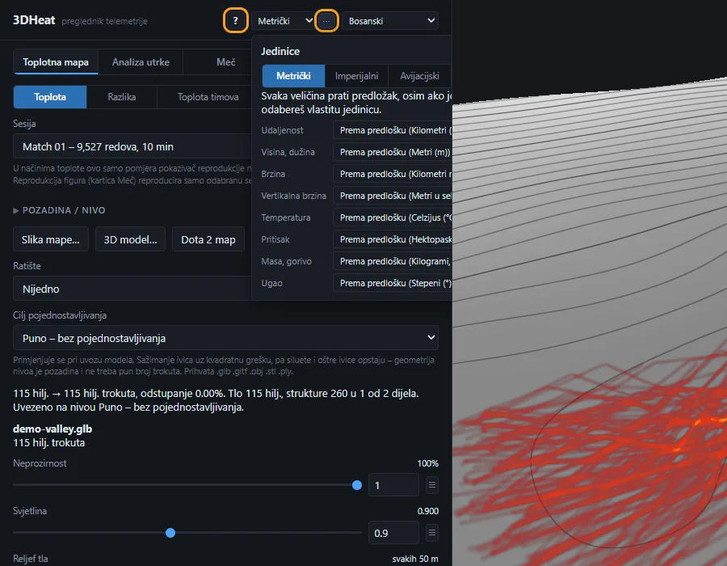
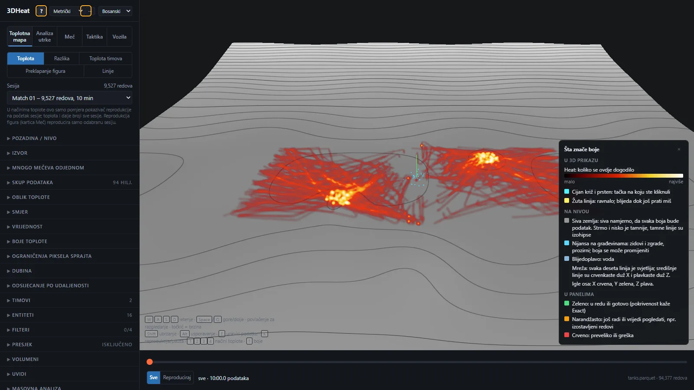

# Postavke, jedinice i tipke

Male kontrole na vrhu bočne trake mijenjaju način na koji vam prikazivač govori: jezik, jedinice (metri ili stope, km/h ili čvorovi) i režim pomoći koji objašnjava boje. Vaši izbori se pamte u pregledniku.

## Zaglavlje {#the-header}

Na vrhu bočne trake:

| Kontrola | Šta radi |
|---|---|
| **?** | Režim pomoći: šta znači svaka boja (također `?` ili `F1`) |
| Meni **Jedinice** | Metrički, Imperijalni, Avijacijski ili Nautički |
| Dugme **...** pored **Jedinica** | Otvara „Izaberite jedinicu za svaku veličinu”: jedan padajući meni po veličini |
| Meni **Jezik** | Jezik prikazivača: [40 jezika](languages.md), ili jezik preglednika |

Brojevi koje upisujete u polje mogu koristiti tačku ili zarez (`0.35` ili `0,35`). Prikazivač prihvata oba i prikazuje brojeve onako kako ih piše jezik prikazivača.

## Jedinice {#units}

1. Izaberite unaprijed postavljenu vrijednost u meniju **Jedinice**. Sve veličine se prebacuju zajedno.
2. Da promijenite samo jednu veličinu, kliknite dugme **...** pored nje i izaberite jedinicu za tu veličinu. Meni tada prikazuje `*` iza unaprijed postavljene vrijednosti.
3. Veličina koju niste postavili prati unaprijed postavljenu vrijednost. Izaberite „Kao unaprijed postavljeno” da se vratite.

| Veličina | Metrički (podrazumijevano) | Imperijalni | Avijacijski | Nautički |
|---|---|---|---|---|
| Udaljenost | km | mi | NM | NM |
| Visina, dužina | m | ft | ft | m |
| Brzina | km/h | mph | kt | kt |
| Vertikalna brzina | m/s | ft/min | ft/min | m/s |
| Temperatura | °C | °F | °C | °C |
| Pritisak | hPa | inHg | hPa | hPa |
| Masa, gorivo | kg, l | lb, gal | lb, gal | t, m³ |
| Ugao | stepeni | stepeni | stepeni | stepeni |

Druge jedinice koje možete izabrati za jednu veličinu: udaljenost km, mi, NM; brzina km/h, m/s, kt, mph; vertikalna brzina m/s, ft/min, m/min; temperatura °C, °F, K; pritisak hPa, inHg, mmHg, psi; masa kg, lb, t; ugao stepeni ili NATO mili (6400 na krug). Jedinice su iste svuda u prikazivaču: oznake, kartice, grafikoni, statistika.

## Režim pomoći {#help-mode}

Pritisnite `?` ili `F1`, ili kliknite dugme **?**. Prikazuje *Šta znače boje*: legende za 3D prikaz, skale toplote, boje timova, boje nivoa, statusne boje panela, panel meča i prikaz trke. Ostaje uključen dok ga ne isključite. Na kartici Meč objašnjava i boje panela meča.

## Šta pregledač pamti {#what-the-browser-remembers}

Ove postavke se čuvaju u vašem pregledniku između posjeta (ništa se nigdje ne šalje):

- jezik, jedinice i režim pomoći;
- postavke reprodukcije za figure, simbole, oznake, kameru i taktički prikaz;
- brzinu reprodukcije i ogledanje;
- oznake po snimku, zapremine po skupu podataka, slojeve ciljeva;
- postavke vanjskog AI-ja (ključ samo ako označite *Zapamti*).

Postavke toplote, filteri i način počinju iznova pri svakom učitavanju. Potpun, generisan spisak: [Sačuvane postavke](ref-settings-storage.md).

## Tipke koje prikazivač štiti od web-preglednika {#keys-the-viewer-keeps-from-the-browser}

Sesija s velikim podacima dugo se učitava, pa prikazivač sprečava da je web-preglednik slučajno odbaci:

- `Ctrl`/`Cmd` + slova koja bi štampala, sačuvala, otvorila, ponovo učitala, zatvorila ili otvorila nove prozore ne rade van tekstualnih polja; `F1`, `F3`, `F5`, `F6` i `F7` ne rade ništa.
- Zatvaranje ili ponovno učitavanje kartice s učitanim podacima ili nivoom prvo pita.
- U punom ekranu prikazivač zaključava tipke koje koristi (W, T, N, S, R, P, Q, Esc), pa ih web-preglednik ne preuzima.

Tačan spisak: [Tipke preglednika](ref-browser-keys.md). Sve tipke prikazivača: [Referenca tastature i miša](keyboard-reference.md).
