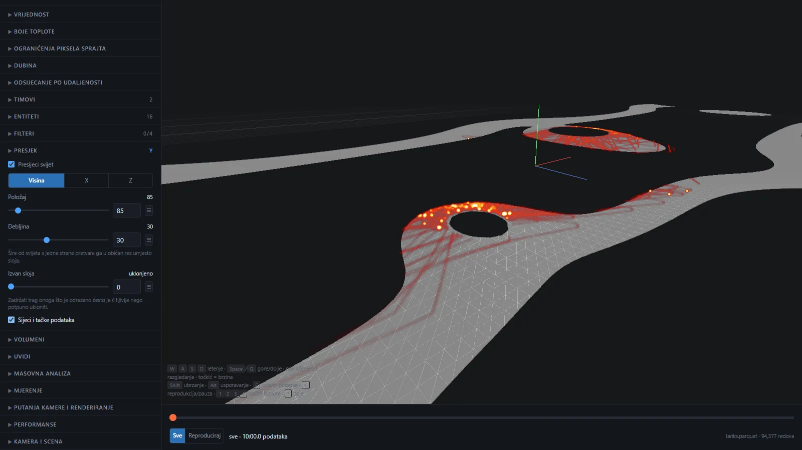

# Presjek

**Presjek** siječe svijet kao kriška torte, pa možete da pogledate unutar zgrada. Koristite ga kad zidovi kriju zanimljivu toplotu, na primjer da vidite jedan sprat zgrade.

## Probajte {#try-it}

1. Učitajte nivo i neke podatke, pa otvorite **Presjek**.
2. Označite **Presijeci svijet**. Osa je **Visina**.
3. Prevucite **Pozicija** gore i dolje: sloj se pomjera kroz nivo.
4. Postavite **Debljina** tanko za tlocrt sprata, ili široko za "sve ispod ovdje".
5. Ostavite **Izvan sloja** na 0 da uklonite ostalo, ili ga podignite da zadržite slab trag.



Sloj siječe **geometriju nivoa i tačke podataka zajedno**. Samo sječenje nivoa ostavilo bi toplotu da lebdi tamo gdje je nekad bila zgrada. Ovo je suprotnost [okluziji dubine](depth-and-culling.md): kad nivo tačno sakrije ono što je iza njega, unutrašnjost zgrade je također sakrivena. Panel se prikazuje kad ima šta da se siječe (skup podataka ili 3D nivo); njegovo zaglavlje pokazuje osu dok je uključeno, inače *isključeno*.

```
pogled sa strane  Pozicija = gdje je sloj
 ----------       Debljina = koliko je sloj visok
 | sprat 3 |
 |=========|  <--- sloj (zadržan)
 | sprat 2 |  <--- izvan: uklonjeno (ili slabo)
 | sprat 1 |
 ----------
```

## Kontrole {#controls}

| Kontrola | Zadano | Značenje |
|---|---|---|
| **Presijeci svijet** | isključeno | Uključuje sloj. Dok je pozicija još na početnoj vrijednosti 0 a debljina na početnoj 500, uključivanje ih pomjera na sredinu ose i na 15% njenog raspona. |
| Osa | **Visina** | *Visina* (Y), *X* ili *Z*. Promjena ose pomjera sloj na sredinu nove ose. |
| **Pozicija** | sredina | Centar sloja, u svjetskim jedinicama, kroz raspon ose (500 koraka). |
| **Debljina** | 15% raspona | Od 1/500 raspona do dvostrukog raspona, u logaritamskim koracima. Čita *preko svijeta* kad je široka koliko raspon: jedna strana tada seže preko svijeta i to je obično sječenje, a ne sloj. |
| **Izvan sloja** | 0, *uklonjeno* | Koliko onoga što je izvan ostaje vidljivo, 0-100%. Slab trag onoga što je odsječeno često je lakše čitati nego potpuno uklanjanje. |
| **Sijeci i tačke podataka** | uključeno | Isključeno ostavlja toplotu cijelom, pa se vidi kroz presjek, korisno za gledanje šta je iznad i ispod sloja. |

Raspon ose je raspon 3D nivoa kad je učitan, inače raspon skupa podataka.

Presjek je nezavisan od [ograničavanja po udaljenosti](depth-and-culling.md#distance-culling), koje sječe duž pravca gledanja, a ne duž ose svijeta; njih dvoje se kombinuju. Svaka promjena postavke presjeka ponovo pokreće akumulaciju toplote.

## Za programere {#for-developers}

Sloj se provjerava za svaku poziciju reda u svijetu u vertex shaderu: red izvan njega ima svoj doprinos pomnožen vrijednošću *Izvan*, pa se na 0 odbacuje prije nego se nacrta ijedan fragment. Shaderi nivoa primjenjuju isti test na svaki fragment tla, struktura i vode.
