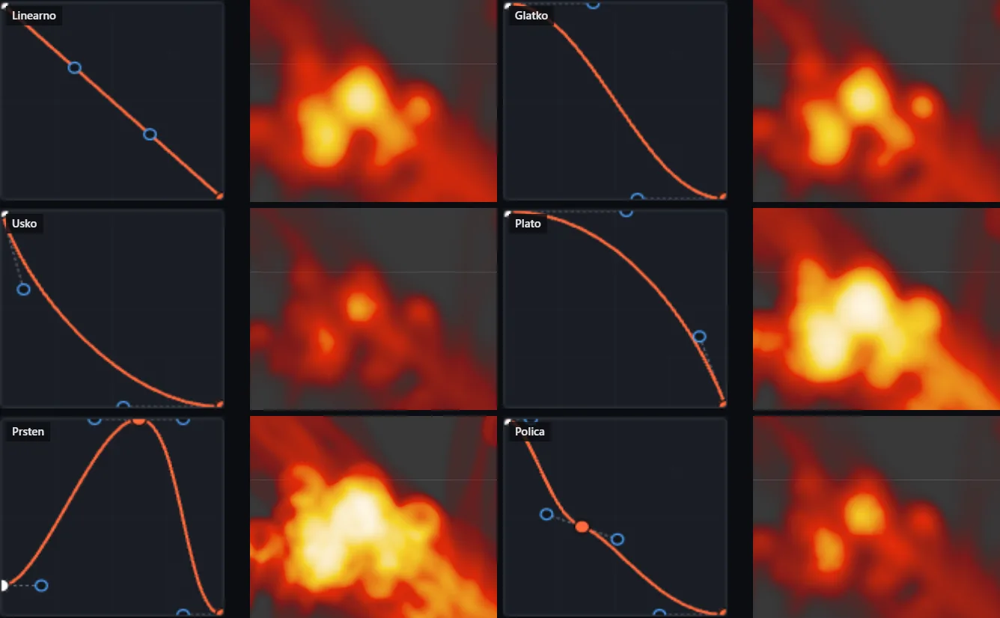

# Oblik sprajta

Svaki red se crta kao okrugli sprajt koji uvijek gleda prema kameri. Njegova veličina i profil od centra do ruba - **prelaz** - odlučuju hoće li žarišna tačka izgledati kao uska tačka, mekani oblak, disk ili prsten. Ove kontrole su u odjeljcima **Oblik toplote** i **Ograničenja piksela sprajta** na bočnoj traci, i važe za [Toplotu](heat.md), [Razliku](difference.md), [Toplotu timova](team-heat.md) i, kao polovina širine linije, za [Toplotu linija](line-heat.md).

Promjena bilo koje od njih ponovo pokreće akumulaciju (polje se mora ponovo iscrtati novim oblikom).

Zamisli svaku tačku kao mekanu mrlju svjetla. Mala mrlja pokazuje pojedinačna mjesta; velika spaja susjede u oblak. Oblik određuje koliko je ivica meka.



## Poluprečnik sprajta {#sprite-radius}

Poluprečnik sprajta u **jedinicama svijeta** (označen kao metri). Zadano 6, a pri svakom učitavanju horizontalni opseg podataka / 120 - dovoljno veliko da se susjedni uzorci duž putanje spoje u pojas umjesto da izgledaju kao tanka linija. Logaritamski klizač 0,05-2000, ručica se može prevući do 50.000.


Stvari koje su daleko izgledaju manje, pa se sprajt na ekranu smanjuje s daljinom. Pod paralelnom projekcijom je isti svuda, što je dio razloga zašto je paralelni prikaz pravi za poređenje žarišnih tačaka ([Kamera](camera.md#projection)).

## Ograničenja piksela {#pixel-clamps}

**Ograničenja piksela sprajta** (zadano zatvoreno) ograničavaju poluprečnik na ekranu nakon gore navedene pretvorbe.

| Kontrola | Zadano | Opseg (klizač) | Zašto |
|---|---|---|---|
| **Najmanji poluprečnik u pikselima** | 1 px | 0-16 (512) | Čuva udaljene podatke da ne nestanu ispod jednog piksela. |
| **Najveći poluprečnik u pikselima** | 96 px | 2-1024, logaritamski (8192) | Čuvar prekomjernog crtanja. Sprajt koji pokriva N piksela košta N operacija miješanja, pa je neograničen poluprečnik blizu kamere ono što brz kadar pretvara u spor. Iznad visine prikaza prestaje išta ograničavati. |

**Ista gustina pri svakom zumiranju** (u odjeljku Oblik toplote, zadano uključeno) radi zajedno s ograničenjima. Sprajt koji ograničenje učini većim (daleko) ili manjim (izbliza) zadržava toplotu koju bi dodala njegova prava veličina, pa boja znači isti broj redova po površini tla pri svakom zumu. Kada je isključeno, ograničeni sprajt dodaje svoju punu težinu pri ograničenoj veličini, i slika se mijenja dok ulaziš.

## Intenzitet u centru i na rubu {#centre-and-edge-intensity}

Toplota koju sprajt dodaje u svom tačnom centru (**Intenzitet u centru**, zadano 1, 0-10, klizač 1000) i na rubu (**Intenzitet na rubu**, zadano 0, od -2 do 10, klizač 1000). Vrijednost prelaza *t* (1 u centru, 0 na rubu, oblikovana opadanjem ili krivom ispod) miješa ih (formula je pod [Za programere](#for-developers)).

**Negativan intenzitet na rubu** čini da ivica oduzima, što izrezuje hladnu auru oko svake žarišne tačke i oštri grupe jednu prema drugoj. Vidljivost uključuje [zaklanjanje](depth-and-culling.md) i [presjek](slice.md); izblijedjelost je [Trajanje](timeline.md#history) izblijedjelosti; predznak je ±1 u [Razlici](difference.md).

## Oblik prelaza: Opadanje ili Kriva {#ramp-shape-falloff-or-curve}

**Oblik prelaza** prebacuje između dva načina oblikovanja *t* preko sprajta. Uz *d* kao udaljenost od centra (0) do ruba (1):

### Opadanje {#falloff}

Prikazano kada je izabrano *Opadanje* (zadano).

- **Opadanje** (zadano 1,6, 0,1-8, klizač 64): `t = (1 - d) ^ opadanje`. 1 je ravan linearni prelaz; više vuče toplotu prema centru i sužava žarišnu tačku; ispod 1 je spljošti u disk.
- **Glatki prelaz** (zadano uključeno): primjenjuje S-krivu smoothstep na *t*, pa sprajt blijedi prema svom rubu umjesto da se završi na vidljivoj ivici.

### Uređivač krive {#the-curve-editor}

Prikazano kada je izabrano *Kriva*. Doslovni presjek sprajta: udaljenost od centra preko (*centar* lijevo, *rub* desno), toplota gore. Kriva je komadno-kubni Bezijeov spoj kroz kontrolne tačke, svaka s dvije ručice.

| Radnja | Efekat |
|---|---|
| Dupli klik na grafikon | Dodaje tačku na toj udaljenosti (zadržana između 0,02 i 0,98), na krivoj i s njenim nagibom tamo, pa dodavanje ništa ne mijenja dok je ne prevučeš. |
| Prevuci tačku | Pomjera je. Visine se drže između 0 i 1. |
| Prevuci mali krug | Savija segment pored njega (pomjera tu ručicu). |
| Alt-klik ili desni klik na tačku | Uklanja je. Dvije krajnje tačke se ne mogu ukloniti. |
| Dugme s pretkonfiguracijom | Zamjenjuje krivu pretkonfiguracijom. |

Krajnje tačke su fiksne u centru i na rubu; njihovu visinu i dalje ti određuješ.

**Pretkonfiguracije** ([`curve.ts`](https://github.com/Holdi601/3DHeat/blob/main/src/state/curve.ts)):

| Pretkonfiguracija | Oblik | Upotreba |
|---|---|---|
| **Linearno** | Ravno od 1 do 0 | Isto kao *Opadanje* 1 s isključenim *Glatkim prelazom*. |
| **Glatko** | S-kriva | Zadana kriva; ono što *Glatki prelaz* daje pri opadanju 1. |
| **Usko** | Strmo jezgro, dugačak blijed rub | Rijetki podaci. |
| **Plato** | Ravno, pa brzo opadanje | Čita se kao disk, a ne kao mrlja. |
| **Prsten** | 0,15 u centru, 1 na 62% poluprečnika, 0 na rubu | Šuplji sprajt: pokazuje gdje putanje prolaze, a ne gdje staju. |
| **Polica** | Dvostepeno opadanje, 0,45 na 35% | Odvaja gusto jezgro od okoline. |

## Spljošti na ravan tla {#flatten-onto-ground-plane}

**Spljošti na ravan tla** (zadano isključeno) zanemaruje visinu svakog reda i crta svu toplotu na jednoj visini - najnižem Y skupa podataka - klasična 2D toplotna karta. Kada je uključeno, zaklanjanje dubine i *Sakrij iza terena* su isključeni (svaka tačka bi sjedila tačno na površini na kojoj se provjerava), a odjeljak Dubina to kaže.

## Za programere {#for-developers}

### Formule {#formulas}

Poluprečnik na ekranu u pikselima: `poluprečnik × P[1][1] / w × visina prikaza / 2`, gdje je `P` matrica projekcije, a `w` dubina pogleda tačke.

Toplota koju sprajt dodaje:

```
dodata toplota = mix(rub, centar, t) × težina uzorka × predznak × izblijedjelost × vidljivost
```

### Kriva {#the-curve}

Ručice su horizontalno ograničene na svoj segment, pa je kriva uvijek funkcija udaljenosti: prevlačenje ručice daleko preko sljedeće tačke ravna je o nju umjesto da savije krivu nazad, što bi učinilo rezultat zavisnim od toga koji korijen je rješavač slučajno našao.

### Kako se kriva crta {#how-the-curve-is-drawn}

Kriva se pretvara u tabelu od 256 unosa kad god se promijeni, učitava kao tekstura float s 16 bita, i uzorkuje po fragmentu s linearnim filtriranjem i pola-teksela uvlačenjem da oba kraja ostanu tačna. Rješavanje Bezijea za x traži iteraciju, što nema mjesta u najvrućem shaderu programa, a čitanje tabele je i jeftinije od `pow()` koji koristi opadanje. 16 bita a ne 8 jer 8 bita pokazuje pojasiće kad se zbroje hiljade sprajtova; 16-bitni half float se može filtrirati u osnovnom WebGL2 gdje 32 bita traži ekstenziju.
