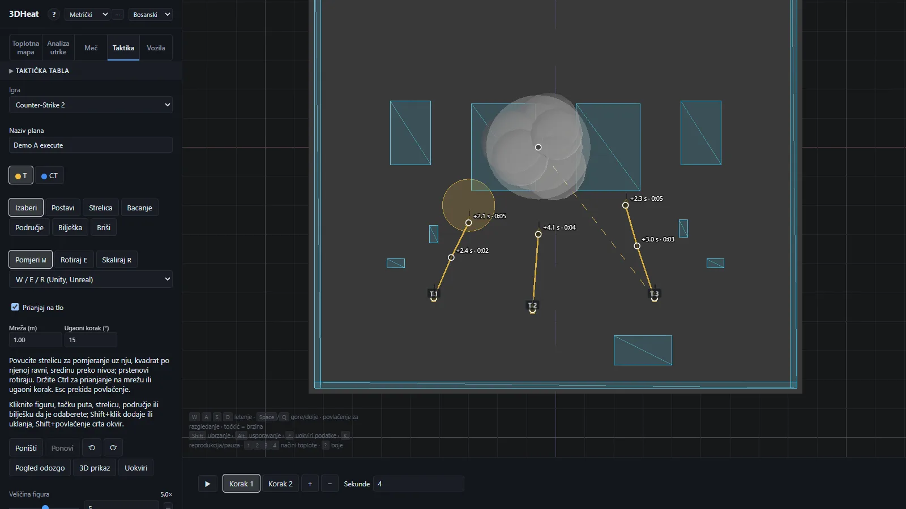

# Tabla taktika

Kartica **Taktika** je tabla za crtanje timskog plana: stavljate male figure na mapu, crtate strelice za to kuda idu, i pritisnete reprodukciju da vidite kako se to odvija. Koristite je da isplanirate rundu ili napad prije igranja. Dijeli platno, kameru i [nivo](levels.md) s ostalim karticama i ništa više; plan nije podatak i ne crta toplotu.

## Vaš prvi plan {#your-first-plan}

1. Otvorite karticu **Taktika**. Izaberite **Igra** (na primjer Counter-Strike 2) i, za Valorant, pritisnite **Učitaj Valorant mape** i izaberite **Mapu**. Ili prvo učitajte [nivo](levels.md).
2. Izaberite **Stranu** (ona postavlja boju) i pritisnite **Pogled odozgo**.
3. Izaberite **Mjesto**, izaberite figuru u **Figure** (koristite **Traži figure** da je nađete) i kliknite na mapu. Postavite dvije ili tri.
4. Izaberite **Strelicu**, kliknite na figuru, kliknite duž puta kojim treba da ide, i pritisnite **Enter** da završite strelicu.
5. Pritisnite **+** ispod prikaza da dodate korak 2. Svaka figura počinje tamo gdje se završila njena strelica. Nacrtajte tamo još strelica.
6. Pritisnite **▶** (ili `K`) da pustite plan od prikazanog koraka do kraja.
7. Imenujte plan u **Naziv plana** i pritisnite **Sačuvaj**.

## Početak plana {#starting-a-plan}

| Kontrola | Šta radi |
|---|---|
| **Igra** | Bira strane i figure koje paleta nudi: Counter-Strike 2 (T, CT; igrači i pomoćna oprema), Valorant (Napad, Odbrana; igrači i generičke sposobnosti), Battlefield, Squad, Arma (pješadija, kopnena vozila, avioni, čamci), DCS / War Thunder / IL-2 (mlaznjaci, avioni s propelerom, helikopteri, protivvazdušna odbrana, kopno, brodovi, oružje) i Ostalo. Plan koji već ima figure zadržava svoje strane kada se igra promijeni. |
| **Naziv plana** | Ime pod kojim se plan čuva. |
| **Mapa**, **Učitaj Valorant mape** | Kada je izabran Valorant: **Učitaj Valorant mape** preuzima spisak mapa sa [valorant-api.com](https://valorant-api.com); **Mapa** zatim postavlja minimapu izabrane mape kao nivo, uokvirenu odozgo. Slika se preuzima pri izboru i nikada se ne isporučuje. Riotova obavijest prikazuje se dok je na ekranu (vidi dolje). |
| **Strana** | Strana kojoj pripada sljedeća figura, strelica ili područje; uzima boju strane. |

Bez nivoa tabla je ravna površ tla. Učitajte nivo pod **Nivo** da planirate na pravoj mapi: CS2 mapu izvezenu alatom za CS2, nivo iz biblioteke, ili sliku mape.

## Alati {#tools}

| Alat | Klik | Napomene |
|---|---|---|
| **Izaberi** | Figura, tačka puta, strelica, područje ili bilješka se bira. | Shift+klik dodaje ili uklanja; Shift+prevlačenje crta okvir oko onoga što se dodaje. Izbor dobija gizmo za transformaciju (vidi dolje); `Delete` ili `Backspace` ga uklanja. `M` pomjera izabranu figuru na sljedeći klik. |
| **Mjesto** | Postavlja izabranu figuru. | Figura se bira u paleti **Figure** (s **Traži figure**). Kada ništa nije izabrano, `R` okreće sljedeću figuru za 15° prije nego što se postavi (`Shift+R` u drugom smjeru). |
| **Strelica** | Svaki klik dodaje tačku; Enter, dvostruki klik ili desni klik završava, Esc odbacuje. | **Pomjeri**, **Napad** (šire vrh) ili **Posmatranje** (tanka linija na visini očiju). Strelica započeta na figuri je njen put u ovom koraku: pušteno, figura ga prolazi, a sljedeći korak počinje tamo gdje se završio. |
| **Bacanje** | Bacač, pa gdje sleti. | Isprekidani luk od jednog do drugog, a izabrana pomoćna sredstva (dim, bljeskalica, molotov, ...) pojavljuju se tamo gdje sleti i ostaju od ovog koraka nadalje. |
| **Područje** | Sredina, pa ivica. | Disk u boji strane. |
| **Bilješka** | Gdje ide bilješka; traži njen tekst. | Prikazuje se kao pribadača, a njen tekst iznad nje. |
| **Briši** | Figura, strelica, područje ili bilješka. | Uklanja je od ovog koraka nadalje; na njenom prvom koraku, uklanja je potpuno. |

**Poništi** i **Ponovi** (`Ctrl+Z`; `Ctrl+Y` ili `Ctrl+Shift+Z`) prolaze kroz svaku promjenu. Linija ispod plana pokazuje koliko figura, strelica i koraka ima. **Pogled odozgo** gleda pravo dolje (ortografski), **3D prikaz** vraća perspektivu, **Uokviri** uklapa plan, ili nivo kada je plan prazan.

**Veličina figura** skalira svaku figuru na tabli; 1× je prava veličina, koja je izdaleka nekoliko piksela za osobu.

## Pomjeranje, okretanje i skaliranje {#moving-turning-and-scaling}

Sve na tabli može se pomjerati kao u 3D uređivaču: figure, pomoćna sredstva, oznake, pojedinačne tačke puta i cijele strelice, područja i bilješke. Ono što je izabrano dobija gizmo na sredini:

| Režim | Tipke | Ručice |
|---|---|---|
| **Pomjeri** | W (ili G) | Strelica po osi (X crveno, Y zeleno i gore, Z plavo) pomjera duž nje; kvadrat pomjera preko svoje ravni; centar pomjera preko nivoa ispod pokazivača. |
| **Rotiraj** | E (ili R) | Prsten po osi okreće oko nje. Prstenovi jedne figure su njen sopstveni yaw, pitch i roll; grupa se okreće oko osa svijeta oko svoje sredine. |
| **Skaliraj** | R (ili S) | Širi ili skuplja izbor iz njegove sredine duž ose ili na sve strane; poluprečnik područja raste s tim. |

**Tipke** prebacuju između W / E / R (Unity, Unreal) i G / R / S (Blender); tipke biraju režim samo dok je nešto izabrano, a inače lete kamerom. Tako `R` znači **Skaliraj** uz tipke W / E / R i **Rotiraj** uz tipke G / R / S kada je nešto izabrano, a okreće sljedeću figuru za postavljanje kada ništa nije. Sve tipke table navedene su u [referenci tastature](keyboard-reference.md#tactics-board). Držite **Ctrl** dok prevlačite da pomjeranje prikvači na **Mrežu** (metri) ili okretanje na **Korak ugla**. **Prianjaj na tlo** (podrazumijevano uključeno) stavlja pomjerene ljude, vozila, oznake, tačke puta i područja na površinu nivoa; avioni i helikopteri zadržavaju svoju visinu, a prevlačenje duž strelice Y nikada ne prianja. Prevlačenje ručice nikada ne pomjera kameru. **Esc** otkazuje prevlačenje, a svaka promjena je jedan korak Poništi.

Tačke puta prikazuju se kao tačkice na strelicama prikazanog koraka: kliknite jednu da je izaberete, prevucite da je pomjerite, Delete da je izbacite. Odjeljak **Izabrano** prikazuje mjesto izbora u metrima, yaw, pitch i roll figure u stepenima, i poluprečnik područja, svaki za unos.

## Mjerenje vremena {#timing}

Put figure je vremenski određen: svaki segment traje koliko je dug preko nivoa - uzorkovan na površini svakih nekoliko metara, pa se brdo ili stepenice između dvije tačke računaju - pri brzini **režima** kretanja te figure u toj igri, plus eventualno **čekanje** na tački puta. Pješadija puzi, čuči, hoda (tiho), trči ili sprinta; vozila i čamci puze, idu oprezno, normalno ili jure; avioni i helikopteri lete sporo, krstare, idu borbenom brzinom ili maksimalno. Režim koji igra nema (CS2 nema sprint) uzima najbliži koji ima. Kako nagib usporava zavisi od igre: u CS2 i Valorantu računa se samo horizontalna udaljenost, kao u igrama; mil-sim igre usporavaju pješadiju uzbrdo (Toblerova funkcija hodanja) a vozila prema nagibu.

Brzine dolaze iz tabela po igri s njihovim izvorima (vidi [Brzine kretanja](tactics-speeds.md)): CS2 po držanom oružju, iz definicija oružja igre; Valorant po oružju; Battlefield, Squad, Arma i zračne igre po tipu i klasi vozila. **Kreće se kao** bira profil figure (oružje, tip vozila); **Vlastita (m/s)** poništava bilo koji režim za tu figuru. Režimi su nazvani kako ih tabla prikazuje: *Puzanje*, *Čučanje*, *Hodanje (tiho)*, *Trčanje*, *Sprint*; *Oprezno*, *Normalno*, *Juriš*; *Sporo*, *Krstarenje*, *Borba*, *Maksimalno*.

Svaka tačka puta prikazuje vrijeme od posljednje i vrijeme od početka plana („+3,9 s · 0:12”). Put izabrane figure navodi svaki segment s njegovim režimom, dužinom i vremenom, čekanjem i dolaskom. **Dolasci** pod **Mjerenje vremena** stavlja svaku figuru s putem na jednu vremensku liniju, prvi dolazak na vrhu. Uz uključeno **Reproduciraj u stvarnom vremenu** (podrazumijevano uključeno), korak traje dok ne stigne njegov najsporiji put, a svaka figura se kreće svojom brzinom; **Sekunde** su tada najmanja dužina koraka. **Jedinica nivoa po metru** kaže u čemu je nivo: 39,37 za CS2 mape (jedinice igre), 1 za mape u metrima.

## Poređenje s podacima meča {#compare-with-match-data}

**Učitaj datoteke mečeva…** čita CS2 tabele mečeva za mapu (Parquet datoteke alata za CS2, koliko god ih ima; samo potrebne kolone, u pozadini); **Koristi učitane podatke** uzima podatke učitane u prikazivač. Zatim:

- **Najraniji dolazak na mapi** boji mapu prema vremenu od početka runde kada je svaki igrač prvi put stigao na svako mjesto - dugme **Najbrži** pokazuje najbrže preko svih rundi, **Tipično (medijan)** srednju rundu - od zelene (rano) do crvene (kasno), za jednu stranu ili obje. Pokazuje šta je moguće kada.
- Izabrani put se poredi s onim što su igrači postigli od njegovog početka (ili od početka runde) do kraja, svaki kraj kao disk zadatog poluprečnika: „Najbrže viđeno 14,2 s, p10 15,0 s, medijan 18,3 s u 41 pokušaju; vaš plan 15,1 s”.
- Brzine kojima su igrači stvarno išli - trčanje, hodanje, čučanje, iz kolona hodanja i čučanja u tabelama - u m/s.

## Koraci {#steps}

Traka ispod prikaza sadrži korake. Plan počinje s jednim; **+** dodaje jedan, i svaka figura počinje u njemu tamo gdje se završio njen put u posljednjem koraku; **−** uklanja prikazani. **Sekunde** je koliko prikazani korak traje kada se pusti. **▶** (K) pušta od prikazanog koraka do kraja: figure s putem idu njime, figure pomjerene na novo mjesto u sljedećem koraku kliznu tamo, ostale stoje. Dok je korak prikazan, mjesto svake figure u sljedećem koraku crta se kao blijeda sjenka, a strelice posljednjeg koraka slabo se vide ispod ovoga.

## Čuvanje {#saving}

Odjeljak **Datoteka** sadrži **Sačuvaj**, **Otvori** i **Očisti**. **Sačuvaj** piše plan kao `<naziv>.h3dplan.json` (običan JSON: strane, koraci, figure s mjestom po koraku, strelice, područja, bilješke); **Otvori** ga čita nazad. Datoteka druge verzije, ili ona koja nije plan, odbija se uz razlog. **Očisti** prazni plan; Poništi ga vraća.

## Figure {#figures}

Svaku figuru pravi sam prikazivač: jednostavni oblici objavljene veličine tipa, s osobinama koje je razlikuju od susjeda - gusjenice i kupola tenka, topovi, rakete i radari vozila protivvazdušne odbrane, tlocrt krila, rep i motori aviona, rotori i kratka krila helikoptera. Ništa nije uzeto iz igre. Dizajn koji je igra izmislila prikazuje se kao generička figura svoje klase. Vidi [Figure](figures.md#which-figure-a-unit-gets) za to kako podaci nalaze svoju figuru.

## Riotova obavijest {#riots-notice}

Valorant mape se prikazuju prema Riot Games-ovoj politici „Legal Jibber Jabber”, koja dozvoljava besplatnim projektima zajednice da ih koriste i traži ovu obavijest gdje god se pojave: *3DHeat was created under Riot Games' "Legal Jibber Jabber" policy using assets owned by Riot Games. Riot Games does not endorse or sponsor this project.* Sposobnosti na tabli su generički oblici, a ne Riotova umjetnost.
