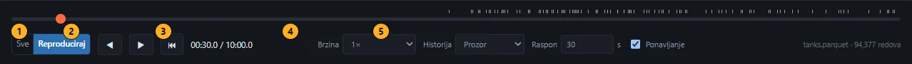

# Vremenska linija i reprodukcija

Traka ispod slike je kao video plejer: podatke možete puštati kao film, pauzirati, skakati po njima i mijenjati brzinu.

Traka ispod prikaza je vremenska linija ([`Timeline.tsx`](https://github.com/Holdi601/3DHeat/blob/main/src/ui/Timeline.tsx)). Ona odlučuje koji su redovi vidljivi u svakom trenutku. Potrebna joj je kolona vremena; bez nje je cijela traka onemogućena, prikaz ostaje u režimu **Sve**, a bočna traka kaže *Nema kolone vremena u ovim podacima - vremenska linija je onemogućena i svaka tačka podataka prikazuje se odjednom.*

## Sve i Reproduciraj {#all-and-play}

Dva glavna režima, jer odgovaraju na različita pitanja.

- **Sve** (podrazumijevano pri svakom učitavanju) potpuno ignoriše glavu za reprodukciju i prikazuje svaki red koji prolazi filtere. To je prikaz „gdje se ovo dešava”, i nije isto što i pomjeranje do kraja. Klizač je onemogućen, a sat pokazuje `sve · <raspon> podataka`.
- **Reproduciraj** pušta podatke kao timelapse. Pojavljuju se klizač, upravljanje i postavke historije.

Izbor **Sve** takođe zaustavlja reprodukciju.

## Kontrole {#the-controls}

| Kontrola | Podrazumijevano | Značenje |
|---|---|---|
| Klizač | početak | Glava za reprodukciju. Prevucite za pomjeranje; 20.000 koraka kroz opseg. |
| **Sve** / **Reproduciraj** | Sve | Vidi gore. |
| ▶ / ❚❚ | pauzirano | Pusti ili pauziraj; također `K`. |
| ◀ **Reproduciraj unazad (J)** | | Pušta podatke unazad. Prikazuje se samo u režimu **Preklapanje figura**; isti taster `J` radi i tamo (vidi [Tastaturu](#keyboard)). |
| ⏮ | | Nazad na početak opsega. |
| Sat | | `proteklo / ukupno` kao `mm:ss.s` (ili `h:mm:ss`), a kada je kolona vremena apsolutna vremenska oznaka, i stvarno doba dana glave kao `HH:MM:SSZ` (UTC). |
| **Brzina** | 1× | Sekunde podataka po stvarnoj sekundi. Meni ima 17 koraka od 0,01× do 1800× (0,01, 0,02, 0,05, 0,1, 0,25, 0,5, 1, 2, 4, 8, 16, 32, 64, 128, 256, 600, 1800), plus **Prilagođeno…**: upišite bilo koju brzinu od 0,001× do 3600× (na primjer 0,3 ili 12) i pritisnite Enter; Esc zadržava trenutnu brzinu. Posljednja brzina se pamti za sljedeći posjet (vidi [Sačuvane postavke](ref-settings-storage.md)). |
| **Historija** | Kumulativno | Šta se smatra vidljivim na glavi za reprodukciju: *Kumulativno*, *Prozor* ili *Životni vijek* (dolje). |
| **Raspon** (Prozor; u režimu Linije i Životni vijek) | 30 s | Dužina prozora koji se završava na glavi; najmanje 0,01 s. U [Toploti linija](line-heat.md#playback) to je dužina repa. |
| **Rezervni vijek** (samo Životni vijek, ne u režimu Linije) | 10 s | Koliko dugo tačka podataka bez sljedećeg uzorka svoje osobe ostaje vidljiva. |
| **Blijeđenje** (samo Životni vijek, ne u režimu Linije) | 0,4 | Dio života svake tačke podataka u kojem nestaje, 0-1. |
| **Ponavljanje** | uključeno | Na kraju počinje ispočetka; isključeno zaustavlja na kraju. |
| Desna strana | | Naziv skupa podataka. |

**Opseg** je vremenski raspon skupa podataka - ili, u [preklapanju figura](box-replay.md) s izabranom sesijom, raspon te sesije.

## Historija {#history}

U režimu Reproduciraj:

- **Kumulativno** - sve od početka opsega do glave. Toplota se gradi dok se pušta.
- **Prozor** - fiksni raspon historije koji se završava na glavi (*Raspon*).
- **Životni vijek** - svaka tačka podataka živi do **sljedećeg uzorka iste osobe** (u istoj sesiji), pa je tačno jedna pozicija po osobi aktuelna u svakom trenutku. Tačka podataka čija se osoba više nikada ne pojavi - smrt, prekid veze, kraj zapisnika - nema sljedeći uzorak i živi *Rezervni vijek*, umjesto da odmah nestane ili traje zauvijek. Tačke podataka **blijede** tokom posljednjeg dijela *Blijeđenja* svog života, umjesto da iskoče: uz jedan živ uzorak po osobi, tačka koja nestane između jednog frejma i sljedećeg učini cijelo polje treperavim brzinom uzorkovanja. *Blijeđenje* 0 vraća oštar prekid.

Životni vijek treba i kolonu osobe i kolonu vremena; bez nje se historija pri učitavanju vraća na Kumulativno. U [Toploti linija](line-heat.md#playback) historija određuje koliko dugo rep rute ostaje vidljiv; u [preklapanju figura](box-replay.md) *Rezervni vijek* je koliko dugo se čuva osoba bez daljnjih uzoraka.

## Ponašanje reprodukcije {#playback-behaviour}

Iz petlje frejmova ([`engine.ts`](https://github.com/Holdi601/3DHeat/blob/main/src/render/engine.ts)):

- Glava napreduje za *vrijeme frejma × brzina*. Vrijeme frejma ograničeno je na 0,1 s, pa promjena kartica ne teleportuje glavu.
- Pritisak na reprodukciju na samom kraju opsega kreće od početka, kao u medijskom plejeru. Pri svakom učitavanju glava se parkira na početku, pa prvi pritisak na reprodukciju pušta.
- Na kraju opsega glava skače nazad na početak (Ponavljanje uključeno) ili se tu zaustavlja i reprodukcija završava (Ponavljanje isključeno).
- Klizač čita glavu motora direktno svaki frejm; stanje aplikacije se ažurira pri pomjeranju, pokretanju, zaustavljanju i ponavljanju.
- Izbor sesije u biraču sesija pomjera na početak te sesije.

## Zašto je reprodukcija glatka i jeftina {#why-playback-is-smooth-and-cheap}

Redovi su sačuvani sortirani po vremenu, pa je vremenski prozor dva binarna pretraživanja kroz kolonu vremena: pomjeranje glave pomjera dva cijela broja i ne dira nijedan red, a cijena reprodukcije prati broj redova u prozoru, a ne veličinu skupa podataka.

Kako se toplota drži stabilnom dok se prozor pomjera, zavisi od historije ([Akumulacija](accumulation.md)):

- **Kumulativno** samo raste, pa svaki frejm dodaje samo redove koji su postali vidljivi od prethodnog, punom težinom. Polje se gradi monotono i pauziranje ništa ne mijenja, jer više ništa ne stiže. (Ponovno procjenjivanje bi učinilo da svaki frejm osvjetli drugi slučajni podskup, a zatim ga utiša, što izgleda kao rafali koji plamte i nestaju.)
- **Prozor** i **Životni vijek** zaista se mijenjaju svaki frejm i ponovo se procjenjuju, miješani kao eksponencijalni pokretni prosjek (težina 0,34 za novi frejm), što je u stabilnom stanju nepristrasno i mnogo mirnije nego kad se počne ispočetka.
- U režimu Životni vijek kandidati su redovi od *glava - max(najduži razmak u podacima, Rezervni vijek)* do glave; shader zatim odbacuje svaki red čiji je sopstveni život završen i primjenjuje blijeđenje.

Prebacivanje između Sve i Reproduciraj, ili promjena historije, ponovo pokreće akumulaciju.

## Tastatura {#keyboard}

| Tipka | Efekat |
|---|---|
| `K` | Pusti / pauziraj |
| `J` | Reproduciraj unazad; ponovni pritisak pauzira (samo Preklapanje figura) |
| `L` | Reproduciraj unaprijed; ponovni pritisak pauzira (samo Preklapanje figura) |

`J` i `L` takođe prebacuju vremensku liniju na **Reproduciraj**. Tipke se ignorišu dok je fokus na tekstualnom polju ili meniju. Na kartici Analiza utrke `K` umjesto toga pokreće sopstvenu reprodukciju te kartice.
