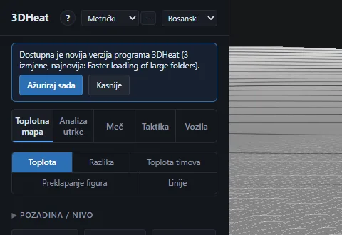

# Ažuriranja

Pregledač vas obavještava kada postoji novija verzija, i ažurira se sam samo kada kažete da. Ništa se ne mijenja na vašem računaru bez vašeg odgovora.

## Ažuriranje pregledača {#update-the-viewer}

1. **Na stranici.** Kada postoji novija verzija, pojavljuje se okvir ispod naziva na vrhu bočne trake: "Dostupna je novija verzija 3DHeat-a". Kliknite **Ažuriraj sada**. Stranica se sama ponovo učitava kada završi. **Kasnije** sakriva okvir dok ponovo ne učitate stranicu.
2. **Ako piše da pokrenete restart.bat**, zatvorite prozor servera (crni prozor koji je otvorio `start.bat`) i dvaput kliknite `restart.bat`.
3. **Pri pokretanju pregledača.** `start.bat` također provjerava. Ako postoji novija verzija, pita **Update now? [Y/N]**. Pritisnite `Y` za ažuriranje. Pritisnite `N`, ili sačekajte 60 sekundi bez odgovora, da pokrenete verziju koju imate.



Kopija s vašim izmjenama se nikada ne ažurira za vas; okvir vas samo obavještava da čeka ažuriranje i kaže da sačuvate ili odložite (stash) svoje izmjene i pokrenete `git pull`. Kopija koja nije instalirana preko gita (recimo zip datoteka) ne prikazuje ništa.

Kako provjera radi, korak po korak:

```
stranica ---(poslije 4 s, zatim svakih 6 h)---> server za razvoj ---> git fetch
   iza?  ne  -> ništa se ne prikazuje
         da  -> vaše izmjene ili commit-ovi?  da  -> samo vas obavijesti
                                              ne  -> [Ažuriraj sada] -> git pull
                                                     -> ponovno učitavanje, ili "pokrenite restart.bat"
```

## Pravila sigurnosti {#the-safety-rules}

- **Samo brzo spajanje** (`git pull --ff-only`): ažuriranje nikada ne spaja,
  ne rebase-uje niti piše preko ičega.
- **Bez lokalnih izmjena**: kopija s nesačuvanim izmjenama u praćenim datotekama
  (`git status --porcelain --untracked-files=no` nije prazno) se nikada ne
  ažurira automatski - tuđi rad nije na ažuriranju da ga prepiše. Samo se
  obavijesti da čeka ažuriranje. Nepraćene datoteke (podaci, izvozi) se ne
  računaju kao izmjene.
- **Bez lokalnih commit-ova**: kopija s commit-ovima koje nizvodna grana nema
  ("razišla se") se ne ažurira - brzo spajanje ne može je dovesti do stanja
  verzije, a spajanje je za `git pull` ručno. Stranica i `start.bat` kažu to
  istim riječima, a `start.bat` pokreće verziju koja tu jeste.
- **Samo sa same stranice**: zahtjev servera za razvoj za ažuriranje mora nositi
  prilagođeno zaglavlje i, kada pregledač pošalje `Origin`, dolaziti s hosta
  samog servera (ispod).
- Ažurira se samo git kopija s nizvodnom granom; sve drugo (kopija bez `.git`,
  nema gita, statički build) ostaje netaknuto i ne kaže ništa.

## Šta radi start.bat {#what-startbat-does}

`start.bat` (dvaput kliknite; prozor je server) radi, redom:

1. Traži Node.js - u `PATH`-u, inače u `%ProgramFiles%\nodejs`,
   `%ProgramFiles(x86)%\nodejs` ili `%LOCALAPPDATA%\Programs\nodejs` - i nudi
   instalaciju preko `winget install -e --id OpenJS.NodeJS.LTS` kada nedostaje
   (pita, Y/N; poslije toga prozor treba ponovo otvoriti da Windows pokupi novi
   `PATH`).
2. **Ažuriranja**, kada je git instaliran i mapa ima `.git`:
   - `git fetch --quiet` (bez mreže ili bez nizvodne grane: tiho se preskače);
   - broji `git rev-list --count HEAD..@{u}`; ništa iza: ništa se ne kaže;
   - lokalne izmjene: "A newer version of 3DHeat is available (N changes), but
     this copy has local changes, so it is not updated. Commit or stash them,
     then run git pull." - i pokreće verziju koja tu jeste;
   - sopstveni commit-ovi (`git rev-list --count @{u}..HEAD` nije 0): "A newer
     version of 3DHeat is available (N changes), but this copy has commits of
     its own that the newest version does not, so it is not updated. Update it
     with git pull." - i pokreće verziju koja tu jeste;
   - inače "A newer version of 3DHeat is available (N changes)." i pitanje **Update now? [Y/N]**. `N`, ili nema odgovora 60 sekundi, ispisuje "Not updated; starting the version you have." i pokreće verziju koju imate. Na `Y`: "Updating...", kaže da li se mijenjaju `package.json` ili `package-lock.json`,
     pokreće `git pull --ff-only` (ako i tada ne uspije - na primjer zbog mreže:
     "The update did not go through; starting the version you have."), zatim `git submodule update --init`
     (fiksirani alati, vidi [Održavanje dokumentacije](maintaining.md#the-tools-under-exporters)), zatim `npm install` kada su se datoteke paketa promijenile i
     postoji `node_modules`, i "Updated."
3. Odbija pokretanje drugog servera: kada nešto već sluša port **5273**, kaže to i upućuje na `restart.bat` / `stop.bat`.
4. Pri prvom pokretanju (nema `node_modules`), pita prije preuzimanja zavisnosti (oko 300 MB u `node_modules\`, ništa na nivou sistema).
5. Pokreće server za razvoj na `127.0.0.1:5273` (`--strictPort`) i otvara pregledač kada je spreman.

`restart.bat` zaustavlja server (po portu) i ponovo pokreće `start.bat`, pa postavlja isto pitanje. `stop.bat` samo zaustavlja.


## Za programere {#for-developers}

### Dok radi: ruta ažuriranja {#while-it-runs-the-update-route}

Server za razvoj (Vite dodatak `heat3d-self-update` u `vite.config.ts`) služi
`/__heat3d/update`. Postoji samo na serveru za razvoj - ne u statičkom buildu
i ne u `vite preview`.

**`GET /__heat3d/update`** odgovara da li je kopija iza:

```json
{ "checkout": true, "upstream": "origin/main", "behind": 3, "ahead": 0, "dirty": false, "latest": "the newest commit's subject" }
```

- `checkout: false` kada mapa nije git kopija;
- pokreće `git fetch --quiet` **najviše svakih 30 minuta** (zahtjevi između odgovaraju iz zadnjeg preuzimanja);
- `behind` / `ahead` iz `git rev-list --count HEAD..@{u}` / `@{u}..HEAD`,
  `dirty` iz `git status --porcelain --untracked-files=no`, `latest` naslov
  najnovijeg commit-a nizvodne grane;
- bez nizvodne grane, `upstream: null` i `behind: 0`.

**`POST /__heat3d/update/apply`** dovodi kopiju u red:

1. Odbija se s `403 { ok: false, reason: "forbidden" }` osim ako zahtjev nema
   zaglavlje `X-Heat3d-Update: 1` i, kada nosi `Origin`, host tog origin-a nije
   `Host` zahtjeva. Forma s drugog sajta ne može poslati prilagođeno zaglavlje bez
   CORS preflight-a, a ovaj server ga nikada ne odobrava.
2. Nema šta da se radi (nije kopija, nema nizvodne grane, nije iza):
   `{ ok: true, updated: false }`.
3. Lokalne izmjene: `{ ok: false, reason: "dirty" }`; lokalni commit-ovi:
   `{ ok: false, reason: "diverged" }`.
4. Inače: bilježi datoteke koje se mijenjaju (`git diff --name-only HEAD @{u}`),
   `git pull --ff-only` (2 min tajmaut), `git submodule update --init`
   (greška se ignoriše), `npm install` kada su se `package.json` ili
   `package-lock.json` promijenili (15 min tajmaut), i odgovara
   `{ ok: true, updated: true, restart }` - `restart` kaže zašto pokrenuti server
   ne može preuzeti ažuriranje: `"dependencies"` kada su ponovo instalirane,
   `"config"` kada se promijenila samo `vite.config` datoteka, `false` kada nijedna
   ne traži ponovno pokretanje.
5. Neuspjela git ili npm komanda odgovara `{ ok: false, reason: "<greška, do
   300 znakova>" }`.

Odgovori su JSON s `Cache-Control: no-store`. Server sluša samo na
`127.0.0.1`, pa ruta nije dostupna iz mreže.

### Obavještenje na stranici {#the-notice-in-the-page}

`UpdateBanner`, ispod naziva na vrhu bočne trake:

- Pita rutu **4 sekunde** poslije učitavanja stranice (ne u prvim sekundama: stranica ima skup podataka za učitavanje i GPU za pokretanje), i ponovo
  **svakih 6 sati** dok stranica ostaje otvorena.
- Ne prikazuje **ništa** kada nema takve rute (statički build), mapa nije kopija, ili ništa nije novije - obavještenje pri svakom pokretanju je ono na šta se ljudi nauče da ne obraćaju pažnju.
- Iza, bez lokalnih izmjena: "Dostupna je novija verzija 3DHeat-a (N izmjena, najnovija: <naslov>)." s dugmadima **Ažuriraj sada** i **Kasnije** (*Kasnije* sakriva dok se stranica ponovo ne učita).
- Iza, s lokalnim izmjenama: ista rečenica i "Ova kopija ima lokalne izmjene, pa se ne ažurira automatski; sačuvajte ih ili odložite, pa pokrenite git pull." - bez dugmeta.
- **Ažuriraj sada** šalje zahtjev na `/apply` ("Ažuriram..."). Zatim:
  - "Ažurirano. Stranica se ponovo učitava." - i ponovo se učitava 1,5 s kasnije (server već služi nove datoteke);
  - kada su zavisnosti ponovo instalirane: "Ažurirano. Promijenile su se zavisnosti: zatvorite prozor servera i pokrenite **restart.bat** da završite.";
  - kada su se promijenile samo postavke servera: "Ažurirano. Promijenile su se postavke servera: zatvorite prozor servera i pokrenite **restart.bat** da završite.";
  - ipak ništa za preuzimanje (`updated: false` - kopiju je u međuvremenu doveo u red, recimo `start.bat`): "Nema šta da se ažurira: ova kopija je već najnovija verzija." - i bez ponovnog učitavanja;
  - odbijeno: rečenica o *lokalnim izmjenama*, ili "Ova kopija ima sopstvene commit-ove koje najnovija verzija nema; ažurirajte je pomoću git pull.", ili "Ažuriranje nije uspjelo: <razlog>".
