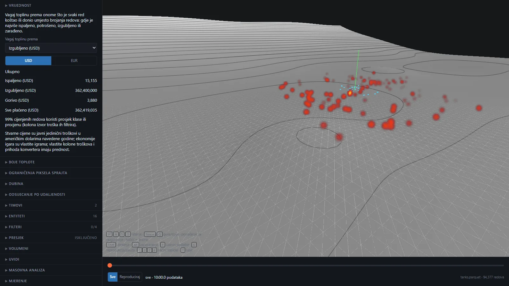

# Ponderisanje vrijednosti

Svaki hitac, municija, izgubljeno vozilo i litar goriva ima cijenu. Preglednik izračunava koliko je svaki red koštao ili zaradio i može po tome vagati toplotu, pa karta pokazuje **gdje je novac otišao**, a ne gdje su redovi.

## Kako se koristi {#how-to-use-it}

1. Učitajte podatke sa događajima (hici, ubistva, smrti) i imenima vozila ili oružja.
2. Otvorite **Vrijednost** u bočnoj traci Toplote.
3. Izaberite **Vagaj toplinu prema**, na primjer *Izgubljeno (USD)*. Toplota sada zbraja cijenu svakog reda umjesto 1.
4. Pročitajte **Ukupno**: zbir svake kolone vrijednosti za ono što se prikazuje (primjenjuju se filteri i vremenski prozor).
5. Gdje su cijene stvarni novac, pojavljuje se prekidač **USD / EUR**.

Izaberite prazan prvi unos u meniju da ponovo brojite redove.

## Šta se može vagati {#what-can-be-weighed}

Kolone vrijednosti se dodaju pri učitavanju, po jednu za svaku vrstu i valutu:

| Vrsta | Redovi na koje se odnosi | Kako se određuje cijena |
|---|---|---|
| **Ispaljeno** | hici i lansiranja | oružje, inače prosjek za vrstu municije |
| **Potrošeno** | kupovina, pojavljivanje | kolone novca iz igre (na primjer meni za kupovinu u pucačini) |
| **Izgubljeno** | smrti, uništenja | sopstveno vozilo, inače prosjek njegove klase |
| **Uništen** | ubistva | ciljno vozilo |
| **Nanesena šteta** | pogoci | udio vrijednosti cilja |
| **Gorivo** | pozicije | potrošeno gorivo, iz kolone goriva ili procijenjeno iz klase i vremena |
| **Sve plaćeno** | | ispaljeno + potrošeno + izgubljeno + gorivo |
| **Zarađeno** | nagrade | sopstvene kolone nagrada igre (`earn_…`) |
| **Neto** | | zarađeno minus plaćeno; crta se kao toplota sa predznakom (pozitivna rampa gdje je više zarađeno, negativna gdje je više plaćeno) |

Imena kolona su `cost_<vrsta>_<valuta>`, `earn_<valuta>` i `net_<valuta>`. Konverter koji poznaje sopstvenu valutu igre (na primjer konverter replaya koji piše u kreditima iz igre) ima prednost nad ugrađenim tabelama cijena.

## Tabele cijena {#the-price-tables}

| Tabela | Valuta |
|---|---|
| Stvarna vojska: rakete, bombe, meci, kontramjere, avioni, helikopteri, kopnena vozila, brodovi, gorivo | USD (EUR = USD × 0,92, fiksni `EUR_PER_USD` u [`cost.ts`](https://github.com/Holdi601/3DHeat/blob/main/src/data/cost.ts); nije kurs uživo) |
| Kupovni meniji pucačina i nagrade za ubistva | krediti igre |
| Igre sa tenkovima i brodovima | krediti igre |
| Strateške igre (više resursa) | po jedna kolona za svaki resurs plus jedna zbirna |
| Ratne igre | bodovi |

Igra se prepoznaje iz imena u podacima. Cijene u stvarnom svijetu dolaze iz javnih izvora (budžetskih dokumenata, enciklopedija) ili su označene kao procjene; nisu usklađene sa inflacijom. Generisana lista tabela je na [Tabele vrijednosti](ref-value-tables.md).

## Procjene {#estimates}

Dodatna kolona kategorije **Izvor cijene** kaže kako je svaki red određen: `table`, `class average`, `estimate` ili `none`. Odjeljak Vrijednost pokazuje koji udio redova sa cijenom su prosjeci ili procjene. Da zadržite samo tačno određene cijene, odštiklirajte *estimate* i *class average* pod **Izvor cijene** u [Filterima](filters.md).

## Gdje se vrijednost još pokazuje {#where-else-value-shows}

- [Uvidi](insights.md): nalazi *Skupo tlo* i *Zarađujuće tlo*.
- [Raščlanjivanje](breakdown.md): Zarađeno, Izgubljeno i Neto novac po timu, igraču ili oružju.
- [Zapremine](volumes.md): kolone vrijednosti u statistici i poređenju.
