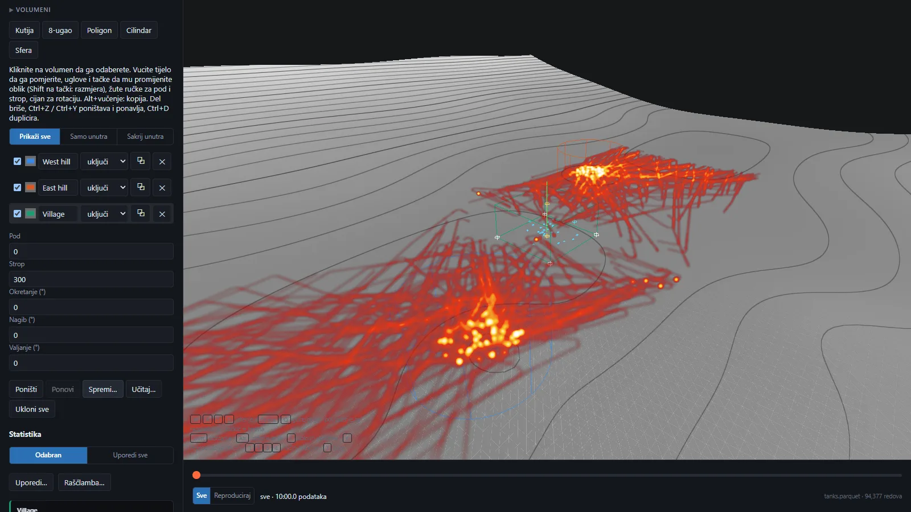
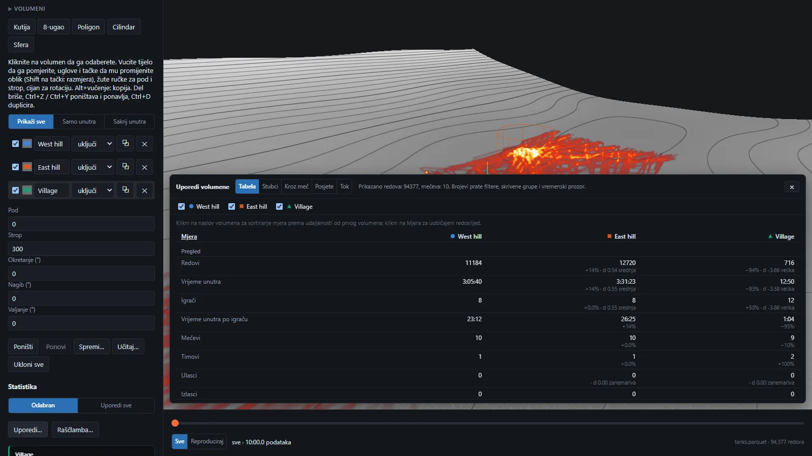
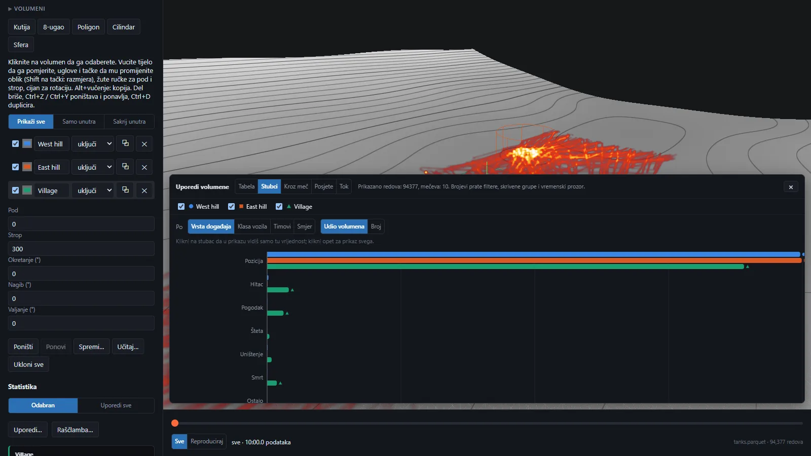

# Zapremine i poređenje

**Zapremina** je nevidljiva kutija (ili cilindar, ili sfera) koju crtate oko nekog mjesta, da postavite pitanje: šta se ovdje dogodilo? Koristite je da brojite ubistva na mostu, da uporedite dva brda ili da prikažete samo aktivnost u jednoj oblasti.

```
 pogled odozgo            Nacrtate oblik ->  prikazivač broji
 +------------+           šta je unutra:
 |   ( A )    |            redovi, igrači, ubistva, vrijeme ...
 |        [B] |           Uporedi A s B, jedno uz drugo.
 +------------+
```



Zapremine mjere šta se dešava unutar njih, filtriraju prikaz na njih, izvoze svoje redove i mogu se porediti jedna uz drugu. Vidi i [rječnik pojmova](glossary.md) za red, osobu i meč.

## Nacrtajte zapreminu {#draw-a-volume}

1. Otvorite **Zapremine** u bočnoj traci.
2. Izaberite alat i crtajte u 3D prikazu ili na 2D mapi. Pod i plafon počinju od podataka ispod. Esc otkazuje.
3. Kliknite zapreminu da je izaberete; pojavi se njena **Statistika**.

| Alat | Kako se crta |
|---|---|
| **Kutija** | Prevucite pravougaonik (Shift: kvadrat). Klik postavlja podrazumijevanu kutiju. |
| **n-ugao** | Prevucite od centra (Shift ga čini pravilnim). *Uglovi* postavljaju n, od 3 do 64 (podrazumijevano 8, pa dugme glasi **8-ugao**). |
| **Poligon** | Kliknite uglove; zatvorite dvostrukim klikom, Enterom ili klikom na prvi ugao. Backspace uklanja posljednji ugao. |
| **Cilindar** | Prevucite poluprečnik. |
| **Sfera** | Prevucite poluprečnik; oslanja se na tlo. |

## Uređivanje {#edit}

- Kliknite zapreminu da je izaberete. Prevucite njeno tijelo da je pomjerite, uglove da je preoblikujete (Shift na uglu skalira).
- **Žuti** kvadratići postavljaju pod i plafon, **cijan** kvadratić je okreće.
- Alt+prevlačenje kopira, Del briše, Ctrl+Z / Ctrl+Y poništava i ponavlja, Ctrl+D duplicira. **Ukloni sve** briše svaku zapreminu.
- Tačne vrijednosti: Pod, Plafon, Okret / Nagib / Valjanje (kutije), Poluprečnik (sfere, cilindri).

Svaki red zapremine ima polje za prikaz, boju, naziv, **uključi** ili **isključi**, dupliranje i brisanje. Zapremine se čuvaju u pregledniku za svaki skup podataka, a **Spremi…** / **Učitaj…** pišu i čitaju datoteku `volumes.json`.

## Filtriranje prikaza {#filter-the-view}

| Filter | Efekat |
|---|---|
| **Prikaži sve** (podrazumijevano) | Zapremine samo mjere. |
| **Samo unutra** | Toplota, reprodukcija i [analiza pogodaka](hit-analysis.md) crtaju samo ono što je unutar uključenih zapremina i van isključenih. |
| **Sakrij unutra** | Suprotno. |

GPU filter prima najviše 8 zapremina s 64 tačke obrisa ukupno; „!” označava zapreminu iza te granice. Statistika i izvoz je i dalje broje.

## Statistika {#statistics}

Oblast **Statistika** prati filtere, vremenski prozor i sakrivene grupe. *Izabrano* prikazuje izabranu zapreminu, *Uporedi sve* stavlja svaku zapreminu jednu uz drugu. Prikazuje:

- **Redova unutra (prikazanih)** i **Redova unutra (svi podaci)**, **Igrači**, **Timovi**, **Mečevi**, **Vrijeme unutra**, **Ulasci / izlasci**, **Vrh toplote**, **Prosječna toplota**, **Volumen / osnova** i histogram **Kada**;
- po koloni: kategorije s **Liftom** (udio unutra podijeljen s udjelom u svim prikazanim podacima), a brojevi s opsegom, medijanom i 5. do 95. percentilom.

**Statistika kao CSV / JSON** ih čuva. **Izvezi podatke unutra** upisuje redove unutra kao CSV ili Parquet (*Samo prikazani redovi* uključeno podrazumijevano), jednu zapreminu ili sve, s kolonom koja kaže kojoj zapremini pripada svaki red.

## Poredite zapremine {#compare-volumes}

Kada ima dvije ili više vidljivih zapremina, pritisnite **Uporedi...**.

1. Nacrtajte tri zapremine, na primjer Zapadno brdo, Istočno brdo i Selo.
2. Pritisnite **Uporedi...** pod Statistikom.
3. U **Tabeli** pročitajte razliku svake vrijednosti od prve zapremine.
4. Prebacite na **Stubce** da vidite udjele kao stubce.



| Prikaz | Prikazuje |
|---|---|
| **Tabela** | Redovi, vrijeme unutra, igrači, mečevi, timovi, ulasci, izlasci, posjete, dužina posjete, ubistva, smrti, ubistva po smrti, ubistva po minuti, vrijeme po igraču, kolone vrijednosti; grupisano po događajima, klasi vozila, igraču ili AI-ju, timu i smjeru. Svaka vrijednost prikazuje razliku od prve zapremine i veličinu efekta (zanemarljiv, mali, srednji, veliki). Kliknite naslov zapremine da sortirate po udaljenosti od prve. |
| **Stubci** | Brojevi ili udjeli po događaju, klasi, učesniku, timu ili smjeru. Kliknite stubac da filtrirate prikaz na njega. |
| **Kroz meč** | Jedan grafikon po zapremini kroz minute meča: prisustvo, redovi ili ubistva. Kliknite da skočite tamo. |
| **Posjete** | Box i violin dijagrami koliko dugo traju posjete (logaritamska skala). |
| **Tok** | Gdje tragovi idu nakon što napuste svaku zapreminu: matrica prelaza ili trake toka. |



## Savjeti {#tips}

- Počnite od nalaza: u [Uvidima](insights.md), **Zapremina ovdje** dodaje cilindar oko mjesta nalaza.
- **Raščlamba...** otvara [Raščlambu](breakdown.md) za izabranu zapreminu: ko i šta najbolje radi unutra.
- [Usmjerena toplota](directional-heat.md) može da iscrta smjerove unutar izabrane zapremine.
- [Kartica Vozila](hit-analysis.md#restrict-to-an-area) koristi iste zapremine kao svoj filter područja.
