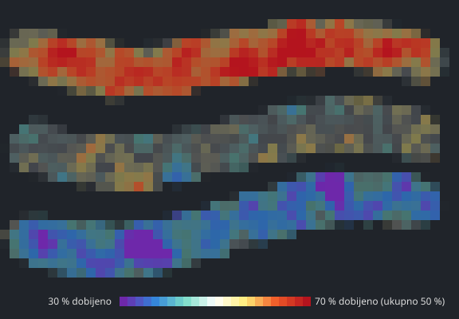

# Procenat pobjeda: koliko često mjesto, put ili potez pobjeđuje

Gdje igrač stoji, kojim putem ide, kuda baca granate i druga pomagala - i koliko često njegova strana zatim dobije rundu. **Mapa procenta pobjeda** boji svako mjesto prema udjelu redova na njemu koji pripadaju rundama koje je strana reda dobila, u odnosu na udio u svemu prikazanom: toplo gdje je veći, hladno gdje je manji, ništa gdje je isti.

*Slika prikazuje izmišljene podatke: tri puta na praznom nivou, 68 %, 50 % i 33 % njihovih redova u dobijenim rundama.*

Potrebni su podaci koji govore ko je pobijedio: [kolone ishoda](data-formats.md#outcome-columns) (`won`, `matchWon`, `roundEndReason`). Pišu ih konverteri za CS2 i War Thunder, a konverter za Tacview za kampanje DCS servera ([DCS serveri](tacview-acmi.md#dcs-servers-who-won-and-how-each-sortie-ended)); može ih imati bilo koja datoteka.

## Isprobajte {#try-it}

1. Učitajte mečeve s kolonom ishoda i pritisnite `2` (**Razlika**).
2. U **Podjela razlike** pritisnite **Procenat pobjeda po rundi** (ili **Procenat pobjeda po meču**). Dobijene runde stavlja na **+**, izgubljene na **−** i prebacuje panel na **Udio +**.
3. Čitajte boje. Panel navodi ukupni udio: *Ukupno je 52,0 % od 1.200.000 redova na +.*
4. Suzite pomoću [filtera](filters.md): jedna strana (T ili CT), jedna vrsta događaja (*Pozicija* za mjesta gdje su ljudi stajali, *Hitac* ili *Ispaljivanje (raketa, projektil, bomba)* za mjesta odakle su pucali ili bacali), jedna kupovina, jedna mapa.

Mjesto koje je toplo s redovima *Pozicija* je mjesto čiji su držaoci rundu uglavnom dobili. S redovima *Uništenje* to je mjesto gdje su ubistva koja su se tamo desila vodila do dobijenih rundi.

## Postavke {#the-settings}

| Postavka | Šta radi | Zadano |
|---|---|---|
| **Razlika** / **Udio +** | sama razlika ili udio strane + među redovima obje strane | Razlika |
| **Puna boja pri** | koliko iznad ili ispod ukupnog udjela se mjesto prikazuje punom bojom, u procentnim poenima | ± 20 poena |
| **Najmanje redova za bojenje mjesta** | mjesto s manje redova nije obojeno; postepeno se pojavljuje od polovine te vrijednosti | 12 |
| **Privlačenje ukupnom udjelu (redovi)** | svako mjesto počinje s ovoliko redova na ukupnom udjelu, pa mjesto s 3 reda, sva dobijena, nije prikazano kao 100 % | 12 |

Sve tri djeluju na gotovu sliku: njihovo pomjeranje nikada ne pokreće skupljanje ispočetka.

Udio može biti bilo koje podjele, ne samo pobjeda: *Udio +* s podjelom po strani pokazuje gdje su Ts bili veći dio prisustva, a s podjelom po datotekama dvije mape gdje redovi jedne datoteke nadmašuju redove druge.

## Redovi, ne runde {#rows-not-rounds}

Mapa broji redove. Igrač koji dvadeset sekundi stoji na jednom mjestu dodaje red pri svakom uzorku, sve iz jedne runde, pa su dokaz na mjestu redovi blizu njega, a ne runde. Zato su najmanji broj i privlačenje u redovima i zato su veći od onoga što daje jedna runda.

Za same runde:

- **[Raščlamba](breakdown.md)** na mjestu, pogledu ili volumenu: *Pobjede %* broji rundu svakog igrača jednom, s istim privlačenjem prema ukupnom udjelu mjesta (4 runde).
- Statistika **[Volumena](volumes.md)**: *Procenat pobjeda* - runde s igračem unutar volumena, svaka jednom, s privlačenjem prema udjelu u svemu prikazanom, uz brojeve.

## Filteri ishoda {#outcome-filters}

Panel [Filteri](filters.md) navodi kolone ishoda odmah nakon vlastitih kolona prikazivača: **Ishod runde** i **Ishod meča** (*Bilo koji*, *Pobjeda*, *Poraz*) te **Kako je runda završila** (Eliminacija, Bomba je eksplodirala, Bomba je deaktivirana, Vrijeme je isteklo, Predaja, Neriješeno, Cilj, Zadržane zone, Izgubljeni bodovi, Izgubljena sva vozila), na jeziku prikazivača.

## Za programere {#for-developers}

Prolaz toplote zapisuje tri zbira u četverokanalni cilj koji koristi toplota timova: toplotu `R = Σ|v|`, toplotu strane + `P` i `S = Σ v²/w`, gdje je `w` težina prolaza (težina uzorkovanja puta pojačanje okvira). Slaganje čita udio `P/R` (prosjek ponderisan jezgrom) i broj redova na kojima počiva, `n = R²/S` (Kishova efektivna veličina uzorka), privlači udio prema ukupnom, `p = (n·P/R + m·r0)/(n + m)`, i boji `p - r0` preko raspona na rampama razlike.

`n` poništava svaki faktor zajednički redovima u pikselu - pojačanje okvira, težinu uzorkovanja, težinu površine odsječenog spritea - pa je slika ista pri svakom zumu i gustini uzorkovanja, a okviri svakog k-tog reda spajaju se u cjelinu bez skokova boja. Ukupni udio dolazi iz brojeva strana na CPU-u, tačno na desetinu procenta; ništa se ne čita nazad s GPU-a. Računanje i njegove provjere: [`render/rateMap.ts`](https://github.com/Holdi601/3DHeat/blob/main/src/render/rateMap.ts) i njegov test.

Košta koliko i toplota timova: četverokanalni cilj učetverostručuje propusnost miješanja u prolazu toplote, samo dok je uključen *Udio +*.
