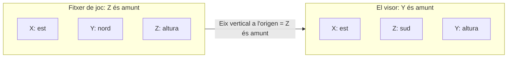

# Eixos, unitats i temps

Els jocs i els mapes no coincideixen en quina direcció és amunt, quant mesura una unitat, ni com s'escriu el temps. Aquesta pàgina mostra els tres ajustos que fan que les dades es mantinguin dretes, tinguin l'escala correcta i es reprodueixin de la manera adequada.

Si el teu mapa està dret com un mur en lloc d'estar estirat com un terra, canvia **Eix vertical a l'origen**.

Amb un **Eix vertical a l'origen** equivocat el mapa queda dret com un mur; amb el correcte queda estirat com un terra.

## El món on dibuixa el visor {#the-world-the-viewer-draws-in}

El món del visor és **Y amunt**: X i Z són el pla del terra, Y és l'altura. La majoria de motors de joc són **Z amunt**: per a ells X i Y són el terra i Z és l'altura. Alguns motors també estan emmirallats (d'esquerres). El mapatge diu com convertir els eixos del fitxer en els del visor. (Tècnicament el visor és de dretes, la convenció de three.js.)

### Eix vertical {#up-axis}

**Eix vertical a l'origen** a la [Correspondència de columnes](column-mapping.md):

| Ajust | Fitxer (x, y, z) es converteix en món (X, Y, Z) |
|---|---|
| *Z és amunt (la majoria de motors de joc)* - el per defecte | (x, **z**, **y**): la Z del fitxer es converteix en l'altura i la Y del fitxer en la Z del món |
| *Y és amunt (convenció gràfica)* | (x, y, z) sense canvis |

Per a dades amb Z amunt, els tres vectors es reetiqueten en lloc de copiar-se ([`remapAxesInPlace`](https://github.com/Holdi601/3DHeat/blob/main/src/data/ingest.ts)), cosa que estalvia centenars de megabytes en càrregues grans. L'endevinació es fa a partir de la mostra: qualsevol de les columnes Y i Z que tingui la dispersió més petita és la que va amunt.

### Girs {#flips}

**Girar X**, **Girar Y**, **Girar Z** neguen l'eix *del fitxer* d'aquell nom, abans del reetiquetatge - així que amb Z amunt, *Girar Y* nega el que acaba com a Z del món. Un gir canvia les dades carregades: les coordenades que mostren la [regla](measure.md), el tall i la posició de la càmera són les giradres.

Per dibuixar un món emmirallat del dret **sense** canviar les dades, usa en canvi **Càmera i escena → Inverteix l'eix del món** ([Càmera](camera.md#invert-world-axis)). És la millor opció per als jocs el món dels quals és d'esquerres, perquè cada coordenada que mostren les eines es manté la del joc.

### Escala d'unitats {#unit-scale}

**Escala d'unitats** multiplica cada posició. *1 (m)* posa 1, *0,01 (cm→m)* posa 0,01 (les unitats d'Unreal Engine són centímetres, així que usa 0,01; les unitats del motor Source són polzades, així que usa 0,0254; cap de les dues són metres), i la caixa accepta qualsevol valor. Un 0 escrit o un valor que no és un número es substitueix per 1.

El visor etiqueta les distàncies en metres (radi dels sprites, límits de retall, la regla, la velocitat de vol), cosa que només és certa quan la unitat del món escalada és un metre. Res no es trenca quan no ho és; les etiquetes simplement diuen "m" per a la unitat que sigui.

## Temps {#time}

### Unitats de temps {#time-units}

Regla general: valors com 17000000000 (deu dígits o més) són una marca de temps Unix; valors com 0, 0,25, 0,5 són segons des de l'inici.

| Unitat de temps (etiqueta del menú) | Es llegeix com | Hora de rellotge que es mostra |
|---|---|---|
| *Segons (relatius)* | valor × 1 s | no |
| *Mil·lisegons (relatius)* | valor × 0,001 s | no |
| *Microsegons (relatius)* | valor × 10^-6 s | no |
| *Nanosegons (relatius)* | valor × 10^-9 s | no |
| *Marca de temps Unix (s)* | segons des del 1970-01-01 UTC | sí |
| *Marca de temps Unix (ms)* | mil·lisegons des del 1970-01-01 UTC | sí |
| *Cadena de data ISO-8601* | text com `2026-03-14T18:02:11.250Z`, analitzat amb el `Date.parse` del navegador | sí |

Amb una unitat absoluta (les tres últimes), el conjunt de dades conserva l'instant de rellotge de la fila més antiga, i la línia de temps mostra l'hora UTC actual (`HH:MM:SSZ`) al costat del capçal de reproducció.

**Les columnes `TIMESTAMP` i `DATE` de Parquet** es descodifiquen en instants reals, així que el seu ajust d'unitat s'ignora i el panell ho diu. Una columna `DATE` és un dia sencer: totes les files d'un dia comparteixen un instant i la reproducció salta d'un dia en un dia, cosa que el panell avisa.

**Les cadenes ISO-8601 funcionen igual en CSV que en Parquet.** Una columna de temps de text amb la unitat ISO s'analitza una vegada per cada cadena diferent; si cap no s'analitza, la càrrega falla amb *No hi ha marques de temps ISO-8601 analitzables a la columna de temps mapejada.* - i el mapatge ja es nega a començar quan cap dels valors de la mostra s'analitza. Una columna `TIMESTAMP` de Parquet es llegeix com a marca de temps sigui quina sigui la unitat, i una columna numèrica de Parquet amb la unitat ISO es llegeix com a mil·lisegons Unix. Una columna de temps de text amb una unitat numèrica es rebutja abans de carregar: cada valor es llegiria com a NaN.

### Com s'emmagatzema el temps {#how-time-is-stored}

Mentre els fitxers es fusionen, els temps són segons de 64 bits, així que una època absoluta conserva el seu detall de sub-segon. Quan tots els fitxers són dins, el temps més antic de tota la selecció es converteix en 0 i cada fila guarda segons de 32 bits des d'aquest punt. Un float de 32 bits té 24 bits de mantissa: els intervals de fins a uns dia i mig es resolen amb millor de 1/100 s, els de mig any fins a un segon aproximadament. Una fila el temps de la qual falta o no és un número es posa a 0, l'inici.

Les files després s'ordenen per temps, cosa que fa barata la línia de temps: una finestra de temps es troba amb dues cerques binàries (mira [Mostreig i pressupostos](sampling-and-budgets.md)).

### Temps transcorregut versus hora de rellotge {#elapsed-time-versus-wall-clock}

Una columna de temps com `match_time` o `round_time` compta des de l'inici de cada partida. Triar-la posa cada partida en un eix compartit - bo per comparar què passa al minut 3 de cada partida - i el panell ho assenyala. Una columna d'hora de rellotge mostra les partides en l'ordre en què van passar de veritat, superposades on es van superposar.

## Direcció de la mirada {#look-direction}

La direcció de la mirada només la fa servir la [repetició de caixes](box-replay.md) (els raigs de cada caixa). S'emmagatzema com dos angles, guinyada i capcineig, en radians.

- Les **columnes de guinyada / capcineig** es llegeixen tal com són, convertides des de graus quan s'escull *Graus*. No s'ajusten per a l'eix vertical ni pels girs.
- Les **columnes de vector de direcció** passen pel mateix reetiquetatge i girs que les posicions, i després esdevenen guinyada = atan2(x, -z) i capcineig = atan2(y, √(x² + z²)) en eixos del món, de manera que el raig també apunta cap on mira la caixa en un món emmirallat d'origen.

Si les columnes de guinyada/capcineig surten apuntant en la direcció equivocada després d'un gir, d'un vector de direcció o d'angles ajustats, la solució és aquesta.
