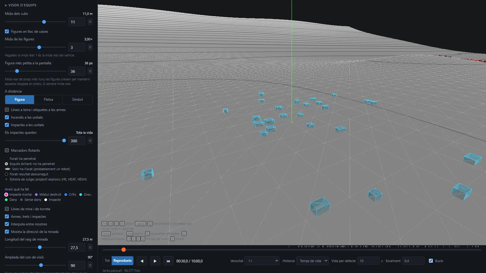

# Figures superposades (repetició de caixes)

Una petita pel·lícula: una figura per a cada persona, que es mou a mesura que passa el temps, amb un rastre darrere. 

El mode es diu **Figures superposades** a la barra de modes. Aquesta pàgina s'anomenava abans "repetició de caixes", perquè abans que existissin les figures cada persona era una caixa; "repetició amb figures" i "repetició de caixes" volen dir el mateix. **Figures superposades** no té tecla numèrica: tria'l a la barra de modes. Dibuixa una figura (o caixa) per cada [persona](glossary.md), que es mou al llarg de la [línia de temps](timeline.md), amb raigs de mirada i rastres opcionals. És reproducció i no densitat: *qui era on, i quan*. Necessita una columna de persona; sense columna de temps, cada mostra es dibuixa de cop.

## Com s'usa {#how-to-use-it}

1. Carrega dades amb una columna de persona i una columna de temps.
2. Tria **Figures superposades** a la barra de modes.
3. Posa la línia de temps en **Reprodueix** i prem reproduir (`K`).
4. Obre **Visor d'equips** per canviar la **Longitud del rastre**, la mida de les figures o els raigs de mirada.

En aquest mode no es dibuixa calor, i el pressupost adaptatiu de sprites està inactiu.

Per defecte cada persona es dibuixa com la figura del que és, en lloc d'una caixa - mira [Figures](figures.md) per saber quina figura rep una unitat, i [Repetició de partida](match-replay.md) per a les etiquetes, la càmera de seguiment, la mesura entre dues unitats i la llista d'esdeveniments.

## El panell Visor d'equips {#the-team-viewer-panel}

Es mostra en lloc dels panells de calor en aquest mode.

| Control | Per defecte | Rang (roda) | Significat |
|---|---|---|---|
| **Figures en lloc de caixes** | activat | | Cada persona com la figura del que és: un soldat a peu, el tanc o l'avió que diguin les dades. Allò que les dades no diuen res sobre es manté com una caixa. |
| **Mida de les figures** | 1× | | 1× és la mida real. |
| **Figura més petita a la pantalla** | 36 px | 0 = sempre la mida real | La mida real de prop; les figures més lluny es fan més grans per mantenir aquests píxels de llargada. |
| **Armes, trets i impactes** | activat | | Armes en vol amb fum, traçadors, impactes, cops i morts. Els traçadors deduïts d'un impacte es dibuixen en discontinu. |
| **Mida dels cubs** | mida de l'entitat, o extensió / 500, en carregar | 0,05-200 m, logarítmic (5000) | Longitud de l'aresta de cada caixa. Mira [mida de l'entitat](sessions-persons-groups.md#entity-size). |
| **Interpola entre mostres** | activat | | Entre dues mostres de la mateixa persona en la mateixa sessió, col·loca la caixa proporcionalment entre elles. Mai a través d'un límit de sessió. |
| **Mostra la direcció de la mirada** | activat | | Un raig des de cada caixa al llarg de la direcció de mirada de la persona (necessita [columnes de mirada](axes-units-and-time.md#look-direction)). |
| **Longitud del raig de mirada** | mida de l'entitat × 4, o extensió / 200, en carregar | 0,5-500 m, logarítmic (20.000) | Es mostra mentre la direcció de mirada està activada. |
| **Longitud del rastre** | 8 s | 0-300 s (86.400); 0 = apagat | Segons d'historial dibuixats darrere de cada persona. |
| **Dibuixa totes les mostres en brut** | apagat | | Una caixa per cada mostra emmagatzemada a la finestra en lloc d'una caixa interpolada per persona. Es submostreja per mantenir-se interactiu. |

Els avisos del panell expliquen que la interpolació i els rastres només uneixen mostres dins d'una sola sessió i, quan la càrrega té [noms compartits](sessions-persons-groups.md#names-worn-by-several-things-at-once), quants noms es dibuixen com a mostres úniques.

## La sessió que es reprodueix {#the-session-being-played}

Amb una columna de sessió, el selector **Sessió** a la part de dalt de la barra lateral ([Sessions](sessions-persons-groups.md#the-session-picker)) decideix quina partida es reprodueix. Quan es carrega es tria la més activa. Només les files d'aquella sessió es converteixen en caixes i rastres, i la línia de temps s'executa sobre l'extensió d'aquella sessió en lloc de tot el conjunt de dades. *Totes les sessions* reprodueix totes les sessions alhora, sense unir mai mostres entre sessions.

## Què es dibuixa i quan {#what-is-drawn-when}

Des de [`TrackCursor`](https://github.com/Holdi601/3DHeat/blob/main/src/data/tracks.ts):

**Caixes en directe** (mode Reprodueix, mostres en brut desactivades). Per a cada persona visible, la seva última mostra en o abans del capçal de reproducció:

- Si la persona té una mostra següent, és en la mateixa sessió, i el nom no és compartit, la caixa es col·loca entre les dues mostres en proporció al temps, amb la guinyada interpolada pel camí més curt i el capcineig linealment (quan *Interpola* està activat).
- Si no, la caixa es queda a l'última mostra durant la **Vida per defecte** de la línia de temps (per defecte 10 s) i després s'elimina, perquè els jugadors eliminats no s'hi quedin.

**El mode Tot** ignora el capçal de reproducció i dibuixa cada mostra de l'interval com a caixa.

**Les mostres en brut** dibuixen una caixa per cada mostra emmagatzemada a la finestra: l'*Extensió* amb l'historial *Finestra*, i en cas contrari tot fins al capçal de reproducció. Com a màxim 65.536 caixes; amb més mostres, es dibuixa una de cada *k*.

**Rastres** (quan la longitud del rastre és superior a 0 i les mostres en brut no es dibuixen): una línia entre cada parell de mostres consecutives d'una persona dins dels últims *segons de longitud del rastre* fins al capçal de reproducció, que s'esvaeix de l'opacitat del 80% fins a transparent amb l'edat. Un rastre s'atura en un canvi de sessió i no es dibuixa per als noms compartits. Com a màxim 131.072 vèrtexs; amb més, les files s'ommeten uniformement.

**Qui és visible:** una persona s'amaga quan el seu grup no està marcat a la [llista d'equips](teams-list.md) (el seu grup és el de la seva primera fila), quan un filtre de grup l'exclou, o quan el panell [Entitats](entities.md) té una selecció que no els inclou. Els [filtres](filters.md) de columna no s'apliquen a les caixes.

## Colors {#colours}

Una família de tons per grup i un to per membre, perquè un cop d'ull digui en quin bàndol és algú ([`teamMemberColor`](https://github.com/Holdi601/3DHeat/blob/main/src/render/colors.ts)). Els tons de grup es van repetint en una llista fixa de deu - blau, vermell, verd, ambre, violeta, cian, magenta, llima, taronja, indi - i els membres d'un grup es reparteixen entre una lluminositat del 42-76% i una saturació del 90-65%.

## Notes {#notes}

- La superposició de figures reconstrueix les seves figures només quan canvia alguna cosa; un fotograma inactiu redibuixa les últimes.
- La línia *Cubs* de la [superposició d'estadístiques](performance-and-stats.md) compta les caixes a la pantalla.
- La superposició de figures es dibuixa a la mateixa escena que el nivell, de manera que la [profunditat de camp](camera.md#depth-of-field) desenfoca les caixes però mai la calor.
