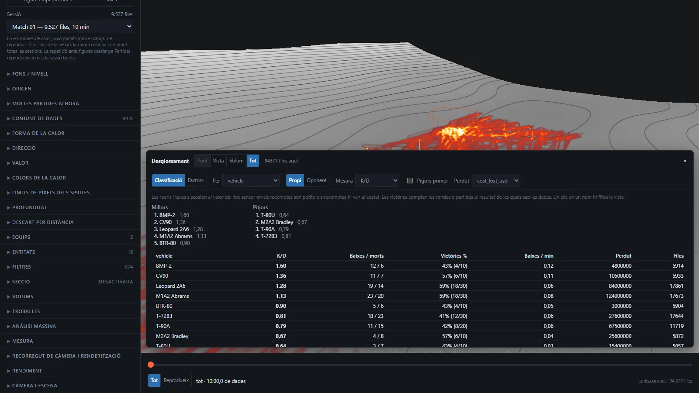
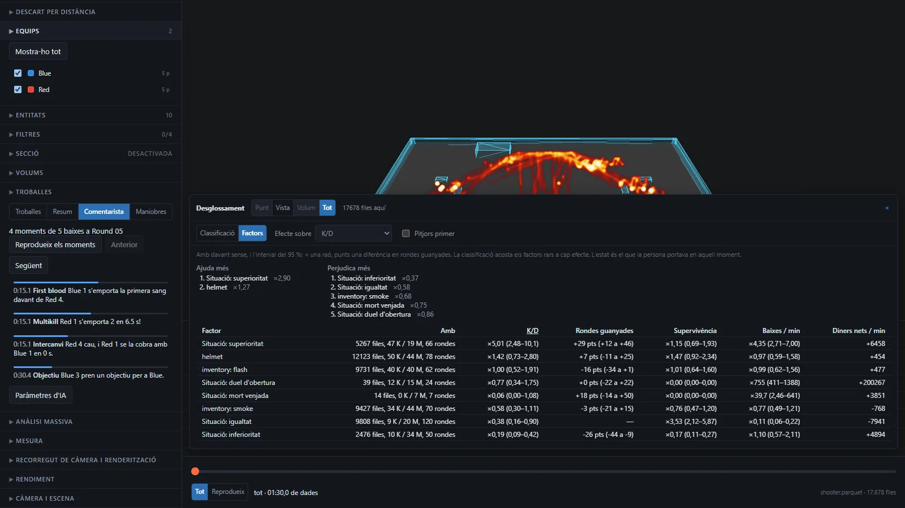

# Desglossament: qui i què va millor on

El **Desglossament** respon a una pregunta: en aquest lloc, quin vehicle, jugador o arma va millor? Fes-lo servir per trobar el tanc que guanya al pont, o per veure si portar casc ajuda de debò.

Ordena el que passa en un lloc (un punt escollit, la vista, un volum o tot el que es mostra) per qualsevol categoria, i mesura cada factor d'estat amb i sense.

## Prova-ho {#try-it}

1. Carrega una partida amb morts i baixes, i obre **Volums**.
2. Dibuixa un volum al voltant del lloc que t'interessa i selecciona'l.
3. Prem **Desglossament...** sota Estadístiques.
4. A **Per**, tria *Vehicle*, i tria la mesura *K/D* (morts per mort).
5. Llegeix la llista, el millor primer. Prem **Pitjors primer** per girar-la. Fes clic en un nom per filtrar la vista a aquell; torna a fer clic per deixar-ho anar.

## Obrir-lo {#open-it}

| Des de | Regió amb la qual comença |
|---|---|
| **Desglossament...** a [Volums](volumes.md) (Estadístiques) | el volum seleccionat |
| **Desglossament aquí** a la targeta de selecció, després de fer clic en un punt | una esfera al voltant d'aquell punt (**Radi**, per defecte 3% de la mida de les dades) |
| el panell de divisió de la **Diferència** | la vista |

La capçalera canvia la regió: **Punt**, **Vista** (el que va veure la càmera en el darrer recompte; **Torna a comptar** després de moure's), **Volum** (en tries un) o **Tot**. Compta en segon pla; la línia d'estat diu quantes files hi ha a la regió.

## Classificació {#ranking}

Tria per què ordenar i una mesura:

| Mesura | Què és |
|---|---|
| A, B | files a cada costat del mapa de diferència, dividides com les divideix la calor |
| A / B, A - B, A / (A + B) | les dues capes una contra l'altra |
| K/D | morts contra baixes |
| % de victòries | rondes (o partides) guanyades, quan les dades diuen qui va guanyar |
| Morts / min | morts per minut presents (buits entre les mostres de moviment) |
| Guanyat, Perdut, Diners nets | sumes de les columnes `earn_*` i `cost_*`; un selector tria la moneda |

Morts, baixes, presència, victòries i diners compten cada fila que la vista mostra en el lloc, a qualsevol costat de la divisió o a cap.

Les raons i les taxes s'atrauen cap al valor de tot el lloc quan els recomptes són petits, de manera que 2 morts en 1 vida no encapçalen la llista. Els recomptes es mostren al costat.

Pots classificar per grups, jugadors i partides, qualsevol columna de categoria (un vehicle, una arma, un bàndol, un tipus de compra, un agent o un kit), qualsevol columna numèrica en rangs (blindatge, el valor d'un equipament), la **classe** d'una columna d'arma (rifle, franctirador, SMG, pistola...) i quantes peces d'**utilitat** conté una columna de llista com `inventory`.

**Propi** classifica pel valor de la pròpia fila. **Oponent** classifica pel valor de l'altra part: l'arma de la víctima en una mort, la de l'assassí en una baixa (necessita una columna `other` / `victim` que els anomeni).

## Estat en el moment {#state-at-the-time}

El valor d'una fila és el seu propi, tret que la fila no en registri cap (una fila d'esdeveniment sense equip) o que sigui una mort (on la columna d'arma pot anomenar l'arma de l'assassí); aleshores és el que la mateixa persona portava per última vegada abans en la partida.

## Factors: amb contra sense {#factors-with-against-without}

Canvia de **Classificació** a **Factors**, tria **Efecte sobre**, i llegeix *Ajuda més* i *Perjudica més*:

L'efecte de cada factor sobre K/D, rondes guanyades, supervivència (minuts per mort), baixes per minut i diners nets per minut, amb un interval del 95%: les raons com a x, les rondes guanyades com a diferència de punts. La classificació atrau cada estimació cap a cap efecte segons la seva pròpia incertesa, de manera que un factor poc freqüent necessita un efecte clar per classificar alt; l'interval que es mostra és el no atret.

Les dades amb rondes afegeixen les **situacions** de combat proper ([Combat proper i rondes](close-quarters.md)), calculades una vegada per conjunt de dades: *cegat* (la `state_flashed` de la fila, o un flaix enemic a menys de 15 m en els darrers 3 s), *mort intercanviada*, *duel d'obertura*, i *home a més*, *números parells* o *home a menys* (jugadors vius al costat de la fila contra l'enemic). Una mort compta en la situació en què estava la seva víctima just abans.

Com a màxim 256 factors es mesuren en una sola passada.

## Per a desenvolupadors {#for-developers}

### Atreure mostres petites {#pulling-small-samples}

El valor de classificació és `(n + m*r0) / (d + m)`: `n` i `d` són els recomptes, `r0` la raó de tot el lloc i `m` el pes d'aquesta prioritat prèvia.

### Per als autors de convertidors: com anomenar les columnes de factors {#for-converter-authors-naming-factor-columns}

Un convertidor afegeix un factor anomenant-ne la columna:

| Columna | Factor |
|---|---|
| `state_<name>` número | actiu mentre no sigui zero (`state_scoped`, `state_suppressor`) |
| `state_<name>` categoria | un factor per valor (`state_ammo` = AP, HE...) |
| `active_<name>` | el mateix, per a alguna cosa activada o usada fa poc: una habilitat, un ultimate, un aparell, un bonus (`active_ult`, `active_stim`) |
| columna de llista (`inventory`, `loadout`, `perks`, `abilities`, `attachments`, `modules`, `buffs`, `debuffs`, `upgrades`, o un nom `state_`/`active_` que acaba en `s`) | un factor per element d'un valor `a\|b\|c` |
| indicadors d'equipament ja habituals (`helmet`, `defuser`, `armor`, `scoped`, `airborne`, `duck`, `flashed`...) | actiu mentre no sigui zero |
| `ammoType`, `shellType`, `ammoName` | la munició disparada per última vegada |

Resultats: una columna `won` de 0/1 (el bàndol de la fila va guanyar la ronda o la partida) i una columna `round`. Diners: `earn_<currency>` i `cost_<kind>_<currency>`; un ingrés només per tipus (`earn_round_cs2`, les recompenses exactes de ronda d'un convertidor) substitueix només l'ingrés del model de cost d'aquell tipus (`round` també cobreix plantades i desactivacions), i el model encara valora la resta.

El mapatge carrega aquestes columnes per si mateix, al costat de la llista pròpia del fitxer: totes les columnes `state_*`, `active_*`, `won`, `round` i de llista, excepte les que les estadístiques d'un fitxer Parquet mostren que tenen un sol valor en tot el conjunt (cada columna carregada són 4 bytes per fila).
