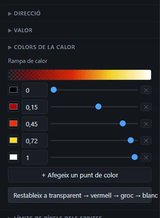

# Color i exposició

Aquests controls decideixen quina quantitat de calor rep quin color. El **Punt de saturació** és la quantitat de calor que compta com a blanc incandescent.

## Solucions ràpides {#quick-fixes}

- Tot és blanc: puja el **Punt de saturació**, o prem **Exposició automàtica a partir del camp**.
- No es veu res: baixa el **Punt de saturació**, o prem **Exposició automàtica a partir del camp**.
- Només es veuen uns quants punts aïllats: apuja la **Calor mínima**.

Cada control d'aquesta pàgina actua quan la calor es converteix en color, de manera que en arrossegar-ne qualsevol es redibuixa a l'instant i **mai no reinicia l'acumulació**.

## Punt de saturació {#saturation-point}

**Punt de saturació** (secció Forma de la calor): la calor acumulada que correspon a la part alta de la rampa de color (amb la resposta *Lineal*; mira més avall les altres). Control logarítmic de 0,1 a 4000; el mànec arriba fins a 10.000.000, perquè la calor acumulada creix amb el nombre de files. Per defecte és 24; a cada càrrega, primer hi ha una **estimació analítica** i després un **mesurament** a partir de la imatge.

Encertar-lo és la diferència entre un mapa de calor i una pantalla en blanc (o blanca), i no es pot deduir de manera fiable: la telemetria s'agrupa tant - un naixement, una porta, un coll d'ampolla - que la relació entre la densitat màxima i la mitjana varia en un ordre de magnitud entre conjunts de dades i entre angles de càmera.

## Exposició automàtica {#auto-exposure}

**Exposició automàtica a partir del camp** mesura el camp que el shader ha produït de veritat. Ignora els píxels buits, agafa el percentil 98 dels il·luminats i el col·loca al 85% del camí cap al punt de saturació, de manera que la part alta de la rampa es reserva per als pics reals.

El panell llavors mostra *mesurat X% del fotograma; percentil 98 R col·locat a prop de la part alta de la rampa*. Amb la resposta *Saturant*, un valor al 85% del punt de saturació cau a uns 57% de la rampa en lloc de 85%.

També s'executa **automàticament**:

- 8 fotogrames renderitzats després que es carregui un conjunt de dades;
- 8 fotogrames després que canviïn els [filtres](filters.md) (filtrar cada posició fins a cent esdeveniments canvia la densitat en ordres de magnitud);
- 8 fotogrames després de passar de la calor puntual a la [calor en línies](line-heat.md), o de canviar quines rutes dibuixa la calor en línies, perquè una línia deixa molta menys calor per mostra que un sprite.

Quan no hi ha res il·luminat, l'execució automàtica deixa la saturació com està; el botó torna a l'estimació analítica i diu *res il·luminat per mesurar - s'ha usat l'estimació analítica*.

### Segueix la vista {#follow-the-view}

**Segueix la vista** (secció Forma de la calor, activat per defecte) torna a mesurar cada vegada que la càmera s'atura, de manera que una regió on entres fa servir tota la rampa de color en lloc de l'escala mesurada per a tot el mapa. Els canvis petits s'ignoren i l'escala llisca en lloc de saltar. Funciona en els quatre modes de calor, no en la superposició de figures.

Desmarca-la per bloquejar l'escala i comparar llocs en una mateixa escala. Arrossegar el **Punt de saturació** a mà també la bloqueja.

## Resposta a la densitat {#density-response}

**Resposta a la densitat** - com *k* (calor / saturació) es correspon amb la rampa:

| Resposta | Fórmula | Ús |
|---|---|---|
| **Saturant** (per defecte) | t = 1 - e^(-k) | S'acosta asimptòticament a la part alta de la rampa, com ho fan els sprites translúcids apilats. Res no es retalla a blanc pla, cosa que la fa la opció segura per a dades que no coneixes. |
| **Lineal** | t = k | L'única correspondència en què el mateix color vol dir el mateix recompte. Fes-la servir per comparar dos conjunts de dades o dues finestres de temps. |
| **Logarítmica** | t = log₂(1 + 7k) / 3 | Comprimeix una cua llarga, de manera que un punt calent extrem deixa d'aplanar tota la resta cap a la part baixa de la rampa. Aixeca les zones disperses. |

## Calor mínima {#minimum-heat}

**Calor mínima** (desactivada per defecte, de 0 a 100%): cada píxel que porti alguna calor s'eleva com a mínim a aquest punt de la rampa. Apuja-la, i redueix el radi dels sprites, per veure *on ha passat alguna cosa alguna vegada*: els punts de dades individuals es veuen clarament en lloc de quedar just per sobre del transparent. Deixa-la desactivada quan judiquis la densitat, perquè per disseny aplana la part baixa de la rampa. El llindar (k > 0,0001) manté buits els píxels que són realment buits.

## L'editor de la rampa {#the-ramp-editor}

A la secció **Colors de la calor**. La seva etiqueta diu per a què serveix la rampa: *Rampa de calor* a Calor i Línies, *Positiva (equips additius)* a Diferència, *Rampa d'opacitat (el color ve del grup)* a [Calor per equips](team-heat.md), on només s'usa el seu alfa.



La barra de dalt mostra la vista prèvia de la rampa. Sota, una fila per punt:

| Part | Significat |
|---|---|
| Mostra de color | El color del punt (el selector de color del navegador). |
| Número | La posició del punt al llarg de la rampa, de 0 a 1 (0 = sense calor). |
| Control lliscant | L'opacitat del punt, de 0 a 100%. |
| ✕ | Elimina el punt; desactivat quan només n'hi queden dos. |

**+ Afegeix un punt de color** afegeix un punt a mig camí entre els dos últims, amb el color i l'opacitat de l'últim punt. **Restableix a transparent → vermell → groc → blanc** recupera el valor per defecte.

Els punts es poden donar en qualsevol ordre; s'ordenen quan es construeix la rampa. L'**alfa** és el que barreja la calor amb l'escena, i per això l'extrem zero de la rampa per defecte és completament transparent.

### Les rampes per defecte {#the-default-ramps}

| Posició | Positiva (Calor, Línies, Diferència +) | Negativa (Diferència −) |
|---|---|---|
| 0,00 | negre, alfa 0 | negre, alfa 0 |
| 0,15 | rgb(180, 0, 0), alfa 0,55 | rgb(0, 170, 60), alfa 0,55 |
| 0,45 | rgb(255, 40, 0), alfa 0,85 | rgb(0, 190, 200), alfa 0,85 |
| 0,72 | rgb(255, 220, 40), alfa 0,95 | rgb(40, 80, 255), alfa 0,95 |
| 1,00 | blanc, alfa 1 | rgb(170, 60, 255), alfa 1 |

## Mentre la càmera es mou {#while-the-camera-moves}

Quan la càmera es mou, l'acumulació es reinicia a cada fotograma. Amb **Dibuixa totes les files a cada fotograma** activat (per defecte) cada fotograma en moviment continua sent exacte; amb ell desactivat, un fotograma en moviment mostra una estimació per mostreig - agrupacions més brillants i ponderades per pes - que convergeix cap a la imatge real més suau quan t'aturis. Això és normal; mira [Acumulació](accumulation.md).

## Per a desenvolupadors {#for-developers}

### La passada de composició {#the-composite-pass}

Després d'acumular la calor, el valor de cada píxel es converteix en color en una sola passada de composició ([`COMPOSITE_FS`](https://github.com/Holdi601/3DHeat/blob/main/src/render/webgl2/shaders.ts)). Els passos són:

```
k = |heat| / saturation point
t = response(k)                         clamped to 0..1
if minimum heat > 0 and k > 0.0001:  t = minimum + (1 - minimum) × t
colour, alpha = ramp(t)                  (the negative ramp when heat < 0, Difference only)
pixel = mix(scene, colour, alpha)
```

### L'estimació analítica {#the-analytic-estimate}

**L'estimació analítica** ([`estimateSaturation`](https://github.com/Holdi601/3DHeat/blob/main/src/data/calibrate.ts)) suposa que les files es reparteixen per la petjada X-Z de les dades: calor mitjana = files × (π r² / àrea de la petjada) × 1/3 × intensitat del centre (1/3 és la mitjana sobre el disc d'una rampa lineal), multiplicat per una relació assumida entre densitat màxima i mitjana de 25, limitat a 0,1-1.000.000. Només ha d'estar dins d'un ordre de magnitud.

### Mesurament {#metering}

[`exposure.ts`](https://github.com/Holdi601/3DHeat/blob/main/src/render/exposure.ts):

1. el destí de calor es llegeix de nou de la GPU, submostrejat a un màxim de 40.000 valors;
2. els píxels buits (calor ≤ 0,0001) es descarten - la major part d'un camp de calor és buit, i fer-ne la mitjana subexposaria tot, com un exposímetre apuntat a un fons negre;
3. el percentil 98 dels píxels il·luminats és la referència;
4. el punt de saturació passa a ser referència / 0,85, de manera que la referència queda al 85% del camí cap al punt de saturació i la part alta de la rampa es reserva per als pics reals.

### La taula de colors {#the-colour-table}

La rampa es fon en una taula RGBA de 256 × 2 (la rampa positiva a la primera fila, la negativa a la segona) ([`buildColorLut`](https://github.com/Holdi601/3DHeat/blob/main/src/render/colors.ts)). Els colors s'interpolen en llum lineal i es guarden en sRGB; l'opacitat s'interpola linealment.
