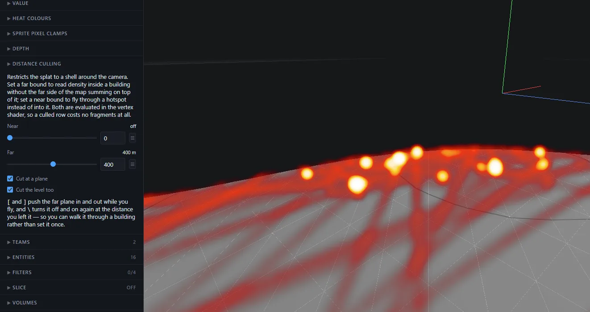

# Profunditat i retall

La profunditat fa que els turons i els murs amaguin la calor que hi ha darrere, com un mur de veritat amaga una persona. El retall per distància només deixa la calor entre una distància propera i una de llunyana de la càmera.




Sense profunditat, un mapa de calor sobre un [nivell](levels.md) en 3D és una superposició plana: tot el que contenen les dades brilla a través de cada mur amb força total, les pistes de profunditat que dona el nivell es cancel·len, i un punt calent dins d'un edifici es veu igual que un de sobre la seva teulada. La secció **Profunditat** fa que el nivell amagui el que hi ha darrere; el **Retall per distància** restringeix la calor a una capa o una llosa al voltant de la càmera; el [Tall](slice.md) talla una llosa del món. Els tres s'apliquen als modes de calor i canvien quines files hi contribueixen, de manera que canviar-los reinicia l'acumulació.

## Profunditat {#depth}

Els dos controls necessiten un [nivell](levels.md) - una imatge de mapa o un model 3D. Sense nivell carregat no hi ha res darrere del que amagar-se, i no fan res. Tots dos estan desactivats mentre [Aplana sobre el pla del terra](sprite-shape.md#flatten-onto-ground-plane) estigui activat.

### Amaga darrere del terreny {#hide-behind-terrain}

**Amaga darrere del terreny** (activat per defecte): un punt de dades el superfície més propera cap a la càmera de la qual és el *terra* (no una estructura) s'elimina del tot, no s'atenua.

El terreny i els murs són opacs de maneres diferents. Mires *a través* d'un mur a propòsit, per veure en quin pis anava el trànsit; mai no vols mirar a través d'un turó, perquè darrere n'hi ha la cara oposada del mapa - que en un mapa de quilòmetres és la major part de les dades, i se suma a l'horitzó en una franja més brillant que qualsevol cosa de primer pla. Un sol atenuador no pot servir per a les dues coses, així que el terreny rep un límit de tall i els murs conserven l'atenuador de sota.

### Amagat darrere de la geometria {#hidden-behind-geometry}

**Amagat darrere de la geometria** (per defecte 0,8): com de forta és la supressió d'un punt de dades que queda darrere de la geometria del nivell. El valor es llegeix *es veu a través* a 0, *N% més fosc* entremig (la posició del control lliscant, no l'atenuació mesurada), *amagat del tot* a 1.

Cada mur o terra entre un punt i la càmera l'enfosqueix més: un mur deixa uns quants per cent amb el valor per defecte, i cada superfície addicional en redueix la meitat fins a quatre superfícies. A 1 no es dibuixa res darrere de la geometria, i és la configuració més barata.

Mira també [Aspecte del nivell](level-appearance.md).

## Retall per distància {#distance-culling}

El **Retall per distància** (tancat per defecte) restringeix la calor a les files entre un límit proper i un de llunyà des de la càmera. Posa un límit llunyà per llegir la densitat dins d'un edifici sense que la part llunyana del mapa se sumi a sobre; posa un límit proper per volar *a través* d'un punt calent en lloc de cap a dins.

| Control | Per defecte | Rang (roda) | Significat |
|---|---|---|---|
| **Proper** | apagat | 0,5-5000 m, logarítmic, el 5% inferior de la pista = apagat (200.000) | Les files més properes que això s'ometen. |
| **Llunyà** | apagat | 1-200.000 m, logarítmic, el mínim = apagat (10.000.000) | Les files més llunyanes que això s'ometen. |
| **Talla en un pla** | activat | | Mesura els límits sobre l'eix de la vista en lloc de des de l'ull, de manera que el tall és un pla paral·lel a la pantalla i no una esfera al teu voltant. La vora d'una esfera s'allunya en corba per tot el marc i llisca cada vegada que girs; un pla es queda on l'hagis posat. |
| **Talla també el nivell** | activat | | Talla el terra, les estructures i l'aigua als mateixos límits. Amb el nivell deixat sencer, el tall elimina els punts de dades i deixa l'edifici dret davant d'ells; amb tots dos tallats, és una secció pel mapa i els punts queden contra les seves parets i sòls. Aquest només torna a dibuixar; no reinicia l'acumulació. |

### Teclat {#keyboard}

El límit llunyà és un control que es recorre - el fas passar per un edifici i mires en quin pis apareix el trànsit - per això és al teclat mentre vola ([`App.tsx`](https://github.com/Holdi601/3DHeat/blob/main/src/App.tsx)):

| Tecla | Efecte |
|---|---|
| `]` | Empeny el límit llunyà cap a fora per un factor d'1,12 (Shift: 1,35) |
| `[` | El treu cap a dins pel mateix factor |
| `\` | Apaga el límit llunyà, o l'encén de nou a la distància on era (6000 la primera vegada) |

Els passos són geomètrics perquè el rang útil abraça quatre ordres de magnitud, des d'una habitació fins a un mapa. El teclat manté el límit llunyà entre 100 i 400.000. Les tecles no fan res mentre una caixa de text o un menú tingui el focus.

## Per a desenvolupadors {#for-developers}

### Amaga darrere del terreny {#hide-behind-terrain}

Les estructures es dibuixen en una textura de profunditat pròpia. Un fragment que està darrere de la profunditat de l'escena però *no* darrere de la profunditat de les estructures és darrere del terra, i es descarta. Costa una passada de profunditat sobre les estructures, que s'omet quan l'interruptor està apagat.

### Amagat darrere de la geometria {#hidden-behind-geometry}

Es compta **per superfície**. Una única comparació de profunditat només pot dir "hi ha alguna cosa davant", així que un punt darrere d'un mur i un punt quatre habitacions endins d'un edifici s'enfosquirien igual i l'interior es llegiria com una sola taca tènue. En lloc d'això, la geometria de l'estructura es **pela per profunditat** en fins a 3 capes més ([`HEAT_DEPTH_LAYERS`](https://github.com/Holdi601/3DHeat/blob/main/src/render/types.ts)); cada fragment compta quantes superfícies hi ha davant seu (la profunditat pròpia de l'escena més les capes pelades: fins a quatre), i l'atenuació es compon:

```
strength      = 1 - (1 - slider)²                  (slider 1 → 1)
visibility    = (1 - strength) × 0.5 ^ (surfaces - 1)
visibility    = max(visibility, 0.006)             (no floor at slider 1)
```

| Control lliscant | 1 superfície | 2 | 3 | 4 |
|---|---|---|---|---|
| 0,5 | 25% | 12,5% | 6,25% | 3,1% |
| 0,8 (per defecte) | 4% | 2% | 1% | 0,6% (mínim) |
| 1,0 | no es dibuixa | no es dibuixa | no es dibuixa | no es dibuixa |

Per què dos factors: el control lliscant està calibrat perquè un mur deixi uns quants per cent - l'aspecte que es llegeix com "darrere d'alguna cosa" - i uns quants per cent compostos no serien res al tercer mur; si es redueix a la meitat per cada superfície addicional, es mantenen quatre passos distingibles. Per què al quadrat: el lineal deixava un camp saturat encara saturat darrere d'un mur; una quarta potència l'esborrava a 0,8. Per què un mínim: amagar la calor ocluïda del tot fa que una habitació plena de trànsit amagat sembli una habitació buida, sense res que suggereixi d'anar a buscar el [Tall](slice.md). Només un control lliscant fixat a 1 l'amaga del tot - i és la configuració més barata, perquè els punts ocluïts es descarten.

Com ([`engine.ts`](https://github.com/Holdi601/3DHeat/blob/main/src/render/engine.ts), els shaders de calor puntual): la comparació es fa per fragment, contra la textura de profunditat de l'escena, en **profunditat de finestra** i no en distància del món. Una lectura de la textura de profunditat a l'etapa de vèrtexs dona "lluny" a tot arreu en alguns controladors (entre ells el rasteritzador per programari d'ANGLE), i linealitzar les dues profunditats en metres perd la separació per precisió amb un rang proper/llunyà ampli. El biaix és un radi de sprite convertit en unitats de finestra més uns quants bits de menys pes, de manera que un punt de dades que descansa sobre una superfície no s'ombreja a si mateix.

Les estructures es dibuixen translúcides, però es dibuixen dins la profunditat que llegeix l'oclusió; un nivell les estructures del qual no arribessin a la textura de profunditat només s'ocluiria contra el terreny.

### Retall per distància {#distance-culling}

Els dos límits s'avaluen al shader de vèrtexs, de manera que una fila retallada costa un vèrtex i cap fragment.
