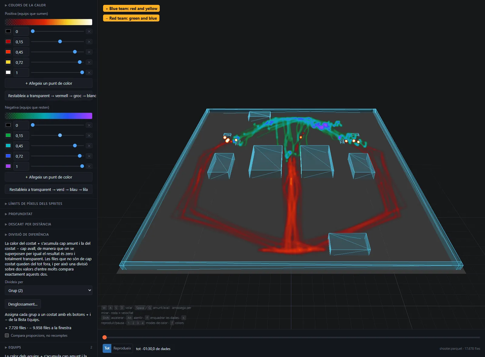

# Diferència

Vermell on l'equip A n'hi havia més, verd-blau on n'hi havia l'equip B, i res on eren iguals.

**Diferència** (tecla 2) és calor amb signe. Les files d'una població sumen calor; les d'una altra en resten. On les dues se superposen de manera igual, el resultat és zero i del tot transparent; on n'hi domina una, es mostra en els colors d'aquell bàndol -per defecte càlids (transparent → vermell → groc → blanc) per al bàndol **+** i freds (transparent → verd → blau → lila) per al bàndol **−**.

## Com s'usa {#how-to-use-it}

1. Premeu `2` (o trieu **Diferència** a la barra de mode).
2. Obriu **Divisió de diferència** a la barra lateral.
3. Trieu per què **Divideix per**: normalment *Grups*.
4. Poseu un grup (o valor) a **+** i un altre a **−**.
5. Llegiu els colors: el càlid vol dir el bàndol +, el fred vol dir el bàndol −. El panell avisa si un bàndol no té files (vegeu [Missatges que podeu veure](#messages-you-may-see)).

*Quines* dues poblacions són tota la qüestió, de manera que la divisió pot ser qualsevol columna
guardada, no només grups. Les files que cauen a **cap** dels dos bàndols **queden fora**, no
es compten com a zero: això és el que fa que una divisió sobre dos dels molts valors compari
exactament aquests dos, i es combina amb els [filtres](filters.md) -filtreu fins a un sol mapa i
després dividiu-ho per versió.

El mode necessita dos bàndols: una columna de grup amb almenys dos grups, o una divisió sobre una
columna guardada per filtrar. Amb dades de menys de dos grups, una càrrega comença amb una divisió
per columna -primer la columna *Source file* d'una càrrega de diversos fitxers, si no la primera
columna de categoria amb dos valors, si no la primera columna numèrica amb un rang- de manera que
*compara dues càrregues* funciona amb dades sense cap grup. Només les dades sense cap de les dues
coses deixen el mode no disponible; també ho fa una divisió per columna que no deixa res en un dels bàndols.

## El panell Divisió de diferència {#the-difference-split-panel}

Es mostra en el mode Diferència, sota els panells de calor.

**Divideix per** ofereix:

| Opció | Es mostra com | Regla de divisió |
|---|---|---|
| Grups | *Grup (N)* (quan hi ha una columna de grup) | Cada grup a +, − o a cap, fixat a la [Llista d'equips](teams-list.md) |
| Una columna de categoria | *columna (N valors)* | Valors a +, − o a cap |
| Una columna numèrica | *columna (numèrica)* | Un rang de valors per a cada bàndol |
| El fitxer d'origen | *Source file - compara dues càrregues* (quan s'han carregat diversos fitxers) | Fitxers a +, − o a cap |

Només s'ofereixen les columnes guardades amb *Conserva per filtrar* en el moment de carregar.

### Compara proporcions, no recomptes {#compare-shares-not-counts}

**Compara proporcions, no recomptes** (per defecte desactivat) pondera cada bàndol per un entre el seu
propi nombre de files, de manera que un bàndol amb cinc vegades més files no guanya només pels nombres.
El color mostra aleshores on cada bàndol és proporcionalment més comú que l'altre. Useu-ho quan els dos
bàndols tenen quantitats de dades molt diferents, per exemple dues sessions de durada diferent.

### Missatges que podeu veure {#messages-you-may-see}

El panell avisa quan la imatge no és una diferència real:

| Missatge | Significat |
|---|---|
| *N + / M −* (o *N + / M − / K sense usar*) | Quants valors hi ha a cada bàndol (i a cap). |
| Cap fila de la finestra és al bàndol **+** | Només es dibuixa el bàndol **−**. Moveu la finestra de la línia de temps o canvieu la divisió. |
| Cap fila de la finestra és al bàndol **−** | Només es dibuixa el bàndol **+**. |
| Cap valor és a cap dels bàndols | La diferència no dibuixa res. Poseu almenys un valor a **+** o a **−**. |
| *columna* no es pot dividir d'aquesta manera | La columna triada no encaixa amb la divisió. Torneu a triar la columna. |
| La columna de divisió no va cabre a la memòria de la GPU per a N de M blocs | Aquelles files no es dibuixen. Augmenteu el pressupost de la GPU a Rendiment → Pressupostos de recursos, o carregueu menys files. |

### Per grup {#by-group}

El panell només remet a la [Llista d'equips](teams-list.md), on cada grup té un botó **+** i un
**−**. En cada càrrega la primera meitat dels grups (arrodonida cap amunt) es posa a +, la resta a −;
**Reparteix a parts iguals** a la Llista d'equips ho torna a fer. Un grup a cap dels bàndols, o amagat
amb la seva casella, no hi aporta res.

### Per valors de categoria {#by-category-values}

| Part | Significat |
|---|---|
| `a + / b − / c sense usar` | Quants valors hi ha a cada bàndol i a cap. |
| **Esborra** | Posa cada valor a cap bàndol. |
| Llista de valors | Cada valor amb un botó **+** i un **−** (feu clic de nou al botó actiu per treure'l d'aquell bàndol). Un valor buit es llista com a *(falta)*. |
| Nota de límit | Només es llisten els primers 200 valors: *Es mostren els primers 200 de N valors. Una columna tan ampla va millor si primer la reduïu amb un filtre, o la dividiu per rang si els seus valors estan ordenats.* |

Triar la columna posa el seu primer valor a + i el segon a −. Quan cap dels bàndols té cap valor, la
divisió torna als grups en lloc de mostrar un marc buit. *Source file* funciona de la mateixa manera,
un valor per fitxer: així es comparen dues exportacions, dues execucions de prova o dues versions.

### Per rang {#by-range}

| Part | Significat |
|---|---|
| Indicació | El mínim i el màxim de la columna. |
| **Interval positiu (+)**, **de** / **a** | Les files amb un valor en aquest rang, inclòs als dos extrems, sumen. |
| **Interval negatiu (−)**, **de** / **a** | Les files en aquest rang resten. |
| **Divideix pel punt mitjà** | Posa + a [mínim, mig] i − a [mig, màxim] -també el que fa triar la columna. |

Un valor a tots dos rangs compta com a +. Els rangs no han de cobrir la columna; els valors a cap dels
dos queden fora. *Els primers dos minuts contra els darrers dos* és una divisió per rang sobre una columna semblant al temps.

## Colors {#colours}

La secció **Colors de la calor** mostra dos editors de rampa en aquest mode: **Positiva (equips que sumen)**
i **Negativa (equips que resten)**, cadascun amb el seu propi botó de restabliment (*Restableix a
transparent → vermell → groc → blanc*, *Restableix a transparent → verd → blau → lila*). El compost pren el
valor absolut del calor net a través del [punt de saturació i la resposta](colour-and-exposure.md), i
tria la rampa negativa on el net és inferior a zero. Vegeu [Color i exposició](colour-and-exposure.md#the-ramp-editor).

Useu la resposta de densitat *Lineal* quan importa la mida de la diferència: és l'única resposta on el
mateix color vol dir el mateix recompte.

## Per als desenvolupadors {#for-developers}

Cada fila rep un signe de +1, -1 o 0 al vertex shader ([`POINT_HEAT_VS`](https://github.com/Holdi601/3DHeat/blob/main/src/render/webgl2/shaders.ts)); un 0 rebutja la fila abans que es dibuixi cap fragment.

- Per grup, el signe ve d'una taula de grups de 4.096 entrades indexada per l'id de grup de la fila (l'id de grup viatja al quart canal del texel de posició de la fila).
- Per categoria, el signe ve d'una segona taula de 4.096 entrades, omplerta per cada valor de categoria, i el valor de la fila es llegeix de la textura de filtre de la columna; un valor més enllà del final de la taula es rebutja als dos backends.
- Per rang, el valor de la fila es compara amb els dos rangs.

Canviar la divisió reinicia l'acumulació.

**Els grups amagats es mantenen amagats amb cada divisió.** Amb una divisió per columna, la taula de grups ja no porta signes; té 1 per a un grup mostrat i 0 per a un d'amagat ([`frameSignTables`](https://github.com/Holdi601/3DHeat/blob/main/src/render/filterTables.ts)), i les dues taules arriben al shader juntes -dues files d'una mateixa textura de signes a WebGL2, dues meitats d'un mateix buffer d'emmagatzematge a WebGPU. Una fila només es dibuixa quan el seu grup es mostra *i* el seu valor de columna és en un bàndol. Així, un grup desmarcat a la [Llista d'equips](teams-list.md), o deixat fora pel focus de bàndol de la pestanya Partida, no hi aporta res, sigui quina sigui la manera com es divideix la diferència.
