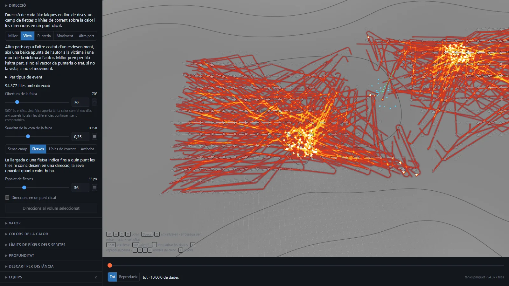

# Calor direccional

La calor simple diu **on** passen les coses. La calor direccional diu també **en quina direcció**: cap a on mirava la gent, on apuntava, cap a on es movia, o on era l'altra part d'un combat.

Un sprite normal és un disc complet (360 graus). Amb una **Obertura de la falca** de 70 graus el mateix sprite es converteix en una falca estreta que apunta cap a on mirava la fila, i afegeix la mateixa calor total.

## Com s'usa {#how-to-use-it}

1. Carrega dades amb una direcció (mira [Què dona una direcció a una fila](#what-gives-a-row-a-direction)).
2. Tria **Calor**, **Diferència** o **Calor per equips** a la barra de modes.
3. Obre la secció **Direcció** a la barra lateral.
4. Tria una **font** (quina direcció usar), i després activa el dibuix:
   - baixa l'**Obertura de la falca** per sota de 360° per dibuixar cada fila com una falca que apunta cap a la seva direcció en lloc d'un disc;
   - tria un **Camp** per dibuixar fletxes o línies de corrent sobre la calor;
   - marca **Direccions en un punt clicat** i fes clic sobre la calor per obtenir un gràfic polar d'aquell punt.

La línia d'estat diu quantes files tenen una direcció de la font escollida.

## Ajustos {#settings}

| Ajust | Per defecte | Què fa |
|---|---|---|
| Font: **Millors**, **Vista**, **Punteria**, **Moviment**, **Altra part** | Millors | Quina direcció rep cada fila. *Millors* pren, per fila, l'altra part; si no, la punteria; si no, la vista; si no, el moviment. |
| **Per tipus d'esdeveniment** | com més amunt | Una font diferent per a cada tipus d'esdeveniment, per exemple *Altra part* per a les morts i *Vista* per a les posicions. Es mostra quan les dades tenen una columna d'esdeveniments amb com a màxim 40 valors. |
| **Obertura de la falca** | 360° | 360° és el disc normal (apagat). Més petit és una falca més estreta. Una falca afegeix tanta calor com el seu disc, de manera que els totals i les diferències segueixen sent comparables. |
| **Suavitat de la vora de la falca** | 0,35 | 0 és una falca de vora nítida, 1 un ventall suau. |
| **Camp**: Sense camp, Fletxes, Línies de corrent, Les dues | Sense camp | Fletxes: la longitud d'una fletxa és quant estan d'acord les files d'allà en una sola direcció, i la seva opacitat, quanta calor hi ha. Les fletxes només es mostren on hi ha calor. |
| **Espaiat de fletxes** | 28 px | Distància entre fletxes a la pantalla. |
| **Anima les línies de corrent** | activat | Les línies de corrent flueixen mentre està activat. |
| **Direccions en un punt clicat** | apagat | Fes clic a la calor per veure les direccions allà (més avall). |
| **Direccions al volum seleccionat** | | El mateix gràfic per a tot el que hi ha dins del [volum](volumes.md) seleccionat. |

## El gràfic polar en un punt {#the-polar-chart-at-a-spot}

Amb **Direccions en un punt clicat** activat, fes clic a la calor. Les files properes a aquest punt (a menys de 1,5 radis de sprite) es reuneixen en una rosa de 24 sectors de 15°:

- pètals **taronja**: direccions de sortida (cap on apunten les files);
- pètals **blaus**: direccions d'entrada (d'on venen);
- l'**àrea** d'un pètal creix amb el seu recompte; una fletxa mostra la direcció principal;
- les línies sota del gràfic donen el rumb principal, quant d'acord estan les files (R, de 0 a 1), la dispersió en graus i el nombre de files.

El 0° és amunt al gràfic, que és el món −Z (nord per a les gravacions de Tacview). El punt també es marca a la vista 3D amb una fletxa i un anell.

## Què dona una direcció a una fila {#what-gives-a-row-a-direction}

| Font | Necessita a les dades |
|---|---|
| Vista | una columna de guinyada (mapejada com a direcció de mirada): `yaw`, `heading`, `azimuth`, `view_yaw`, `rot_z` |
| Punteria | parells de números com `aim_x`/`aim_y`, `shot_x`/`shot_y`, `fire_x`/`fire_y`, `hit_dir_x`/`hit_dir_y` (un `…_z` opcional) |
| Moviment | res més: el pas des de la mostra anterior de la mateixa persona (com a molt 10 s abans, mateixa sessió) |
| Altra part | una columna que anomena l'altre bàndol d'un esdeveniment (`other`, `victim`, `target`, `killer`, `attacker`, `shooter`, `other_player` ...) els valors de la qual són noms de persones; una baixa apunta de l'assassí a la víctima, una mort de la víctima a l'assassí |

## Consells {#tips}

- Les falques necessiten una certa mida a la pantalla; per sota d'uns quants píxels es tornen a dibuixar com a discs.
- Fes servir *Altra part* a les files de morts per veure **des d'on** es van guanyar els combats, i *Vista* a les files de posició per veure **on mira la gent**.
- Amb **Diferència**, les falques dels dos costats apunten en les seves pròpies direccions, de manera que les línies de tir disputades destaquen.
