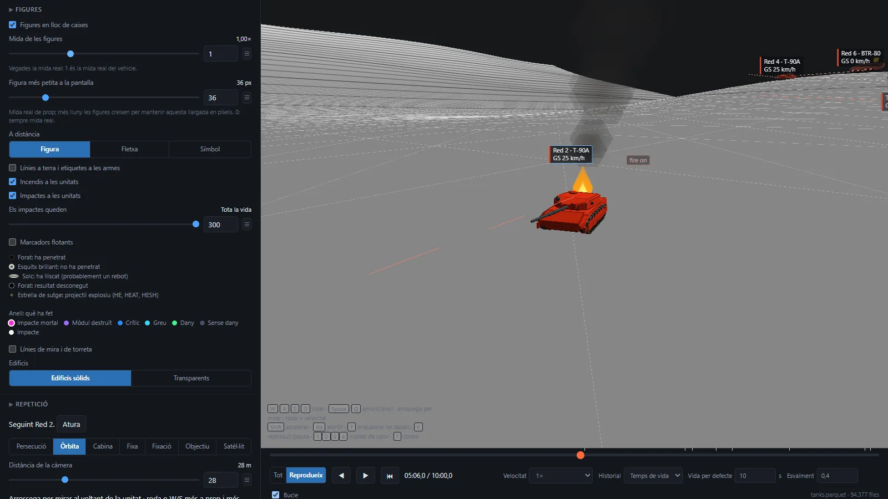

# Figures

Una **figura** és un petit model 3D de què és realment una unitat: un tanc, un reactor, un vaixell, un soldat. La [repetició](match-replay.md) dibuixa cada unitat com la seva figura a la mida real, en lloc d'una caixa simple.

Hi ha unes 2.000 vehicles, avions, vaixells, armes i soldats amb nom, tots construïts pel mateix visor.

## Què hi ha al catàleg {#what-is-in-the-catalogue}

| Àmbit | Exemples |
|---|---|
| Persones | soldat de peu, ajagut, a terra; franctirador, antitanc, metge, tripulació |
| Terra | tancs, vehicles de combat d'infanteria, defensa antiaèria, artilleria, camions i cotxes, trens i tramvies |
| Aire | caces, avions d'atac, bombarders, transports, helicòpters, des de biplans fins a reactors moderns |
| Mar | vaixells de guerra per classe, portaavions, submarins, embarcacions, mercants |
| Armes | míssils, coets, bombes, torpedes, bengales i xafarranyes |
| Marcadors | fum, flaix i granades d'incendi, bombes col·locades, banderes, punts d'aparició, punts de pas |

## Com es fan les figures {#how-the-figures-are-made}

- **Construïdes a partir de dimensions publicades.** La majoria de figures les fa el propi constructor de figures del visor amb xifres públiques: longitud, amplada, alçada, rodes, torre i canó, ales i cua. Després la seva forma s'ajusta amb fotografies públiques, dibuixos i dimensions publicades. No s'usa cap model de cap joc.
- **Models lliures.** Algunes figures usen models 3D lliures (CC0 o CC BY) quan són més fidels, de vegades combinats amb el casc construït. Els autors de les obres CC BY es citen a [Crèdits de les figures](figure-credits.md); les obres CC0 no necessiten crèdit i no s'hi llisten.
- Cada figura té una versió completa, una de simplificada i una de llunyana (nivells de detall, LOD), de manera que se'n poden dibuixar milers alhora.

## Quina figura té cada unitat {#which-figure-a-unit-gets}

El visor mira les pròpies columnes de les dades:

1. **Noms**: les columnes que es diuen *Name*, *Vehicle*, *Unit*, *Unit type*, *Model*, *Aircraft*, *Plane*, *Tank*, *Ship*, *Craft*, *Loadout*, *Kit* o *Figure* es comparen amb el catàleg: exactament, a través d'uns 4.000 àlies (identificadors d'unitat de diversos jocs), pel començament conegut més llarg (`F-16C_50` és el F-16C), o pel nom de figura més curt que comença amb ell.
2. Un nom la figura del qual no encaixa amb el **tipus** de la unitat no s'usa (un camió que es diu *Typhoon* no és el caça).
3. **Tipus**: les columnes que es diuen *Type*, *Class*, *Kind*, *Category*, *Icon*, *Role* o *Domain* donen una figura de classe: etiquetes de Tacview (`Air+FixedWing`, `Ground+Heavy+Armor+Vehicle+Tank`, `Sea+Watercraft+Warship`, `Weapon+Missile`), icones de mapa, o paraules simples (tank, helicopter, infantry).
4. Les dades sense cap de les dues són dades de persones: tothom és un soldat.

Així que la manera més fàcil d'obtenir les figures correctes és una columna `vehicle` amb els noms reals, o una columna `type` amb etiquetes de Tacview.

**La meva unitat es veu com una caixa o com un soldat.** Afegeix una columna `vehicle` amb el nom real, o una columna `type` amb una etiqueta de Tacview. Passa el ratolí per la unitat per veure quin nom s'ha trobat. Les dades que tenen aquestes columnes però no diuen res d'una unitat deixen aquesta com a caixa; les dades sense cap de les dues es dibuixen com a soldats.

## Ajustos {#settings}

La secció **Figures** de la barra lateral de la repetició fixa la mida, la mida mínima a la pantalla, en què es converteixen les unitats llunyanes (figura, fletxa, símbol), i els efectes que es dibuixen a sobre. Vegeu [Repetició de partida](match-replay.md#figures). Fum, foc i altres efectes temporitzats: [Figures a la superposició de figures](figure-replay.md).

## Un paquet local de figures opcional {#an-optional-local-figure-pack}

Pots guardar un paquet opcional de figures propi a la teva màquina. Les seves figures ocupen el lloc de les figures del catàleg amb els mateixos noms. Mai no forma part del repositori ni d'una versió publicada; sense cap, res no canvia.
