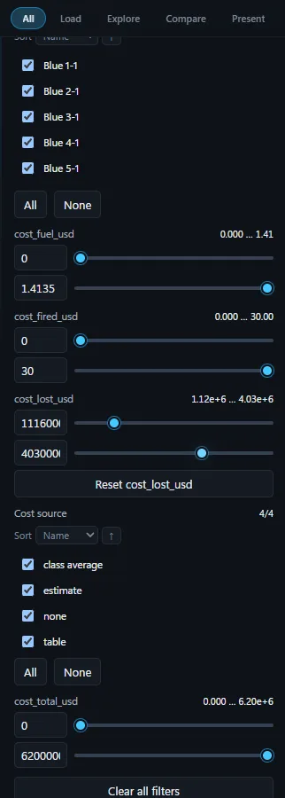

# Filtres

Els **Filtres** amaguen les files que no t'interessen, com una classe de vehicle o un tipus d'esdeveniment, i la imatge s'actualitza de seguida. El panell llista les columnes retingudes en carregar sota *Mantén per filtrar* ([Assignació de columnes](column-mapping.md)), més *Fitxer d'origen* quan s'han carregat diversos fitxers.

## Prova-ho {#try-it}

1. Carrega un conjunt de dades i obre **Filtres** a la barra lateral.
2. A **Classe de vehicle**, desmarca *Tank*. La imatge canvia de seguida.
3. Prem **Esborra tots els filtres** per desfer-ho.

Les primeres files són les columnes pròpies del visor (més avall). Les files següents vénen del teu fitxer.

## Columnes que afegeix el visor {#columns-the-viewer-adds}

En carregar, el visor calcula quatre columnes pròpies i les llista **primer**, amb noms i valors en el teu idioma, perquè el mateix filtre funcioni per a cada joc i font de dades:

| Columna | Valors | Calculat a partir de |
|---|---|---|
| **Tipus d'esdeveniment** | 23 tipus: Posició, Tret, Llançament (míssil, coet, bomba), Impacte, Errada (l'arma ha acabat lluny de qualsevol objectiu), Explosió, Dany, Baixa, Mort, Destruït, Accident, Ejecció / salt amb paracaigudes, Aparició, Desaparició, Enlairament, Aterratge, Contacte amb el terra, Aturada, Rearmament / repostatge, Captura / objectiu, Esquer, Missatge, Altre | una columna anomenada `event`, `events`, `event_type` o `event_name`; les paraules de cada joc (`shot`, `burst`, `fired`, `struck`, `flare`, `plant` ...) es tradueixen a aquests tipus. La taula completa: [Tipus i classes d'esdeveniments](ref-event-types.md). |
| **Jugador o IA** | Jugador, IA | una columna `ai`, `is_ai`, `bot` o `actor`; si no, `is_player` / `human`; si no, un identificador de compte (`user_id`, `steam_id`; buit o 0 és IA); per a gravacions de Tacview, si l'objecte té pilot |
| **Classe de vehicle** | 17 classes: Caça, Avió d'atac, Bombarder, Altra aeronau, Helicòpter, Tanc, Vehicle blindat, Defensa antiaèria, Artilleria, Camió / cotxe, Vaixell, Submarí, Infanteria, Arma, Esquer, Estructura, Altre | el nom del vehicle o de la unitat (comparat amb el [catàleg de figures](figures.md)) i les columnes de tipus |
| **Classe de l'objectiu** | les mateixes classes | el vehicle de l'altra part (`other_vehicle`, `target_vehicle`, `victim_type` ...) |

Només s'enumeren els tipus que apareixen. Les columnes de valor (`cost_*`, `earn_*`, `net_*` i *Font del cost*, vegeu [Ponderació de valors](value-weighting.md)) es poden filtrar com qualsevol columna numèrica: per exemple, desmarca *estimació* a *Font del cost* per quedar-te només amb les files amb preu.

Una llista de categories amb més de 12 valors té un quadre de cerca (*Cerca entre n valors*) i un botó **Només aquests** que permet exactament els valors que coincideixen.

Quines columnes es poden filtrar es decideix en carregar, perquè cal llegir-les llavors. Sense cap columna retinguda, el panell ho diu i indica *Mantén per filtrar*.

## Columnes numèriques (interval) {#numeric-columns-range}

| Part | Significat |
|---|---|
| Nom, i `mín ... màx` | La columna, i l'interval actual (tot el rang de la columna mentre no hi ha cap filtre). |
| Primera fila: caixa de número i lliscador | El límit inferior. Si arrossegues el lliscador per sobre del límit superior, aquest l'empeny amb ell. |
| Segona fila: caixa de número i lliscador | El límit superior. Si arrossegues per sota del límit inferior, també l'empeny. |
| **Reinicia *columna*** | Treu aquest filtre. |

Els lliscadors cobreixen el mínim i el màxim de la columna en 1.000 passos; les caixes de número accepten qualsevol valor. Una fila passa quan el seu valor és dins de l'interval, amb els dos extrems inclosos. Els valors grans es mostren en forma exponencial (`1,23e6`).

## Columnes de categoria {#category-columns}

| Part | Significat |
|---|---|
| Nom, i `permesos/total` | La columna, i quants dels seus valors estan permesos. |
| Llista de valors | Una casella per valor; un valor buit es mostra com *(buit)*. |
| **Tot** / **Cap** | Permet tots els valors / cap valor. |

Permetre tots els valors treu el filtre.

## Regles {#rules}

- **Quatre filtres alhora.** La capçalera mostra `actius/4`. Un cinquè filtre no s'aplica, i el panell ho diu. Una selecció a [Entitats](entities.md) (o el focus de jugador de la pestanya Partida) també fa servir un dels quatre. Un filtre que cobreix tota la columna no n'usa cap.
- **Una columna de categoria té com a màxim 4.096 valors**; una de més ampla no es retè en carregar.
- **Els filtres es combinen amb I**, i amb la visibilitat dels equips, la divisió de diferència, la finestra temporal, la retallada per distància i la [llesca](slice.md).
- **Canviar un filtre reinicia l'acumulació i torna a mesurar l'exposició uns fotogrames després**, perquè filtrar pot canviar molt la densitat ([Color i exposició](colour-and-exposure.md#auto-exposure)).
- **Esborra tots els filtres** treu tots els filtres de columna. La visibilitat dels equips i les seleccions de jugadors fetes en un altre lloc es mantenen.
- Els filtres de columna canvien els modes de calor. No canvien les figures de la [repetició amb figures](box-replay.md), que segueixen la visibilitat dels equips i la selecció d'Entitats. La selecció d'Entitats canvia les dues coses.
- A la [calor de línia](line-heat.md) un filtre es prova sobre la fila on acaba cada segment.
- En cada conjunt de dades nou, es treuen tots els filtres.

## Per a desenvolupadors {#for-developers}

**Slots.** Cada filtre actiu ocupa un dels quatre slots de la GPU ([`MAX_FILTER_SLOTS`](https://github.com/Holdi601/3DHeat/blob/main/src/render/types.ts)), una textura de 4 bytes per fila. Els slots es reparteixen als filtres segons l'ordre en què es van canviar per última vegada ([`filterSlots`](https://github.com/Holdi601/3DHeat/blob/main/src/render/filterTables.ts), compartit pel shader i pels dos panells). A partir del quart, un error diu *Només s'apliquen els 4 primers filtres. Treu-ne un: la resta s'ignoren, no es combinen en silenci*, i els noms dels filtres sobrants es llegeixen *columna (no aplicat)*. Els filtres s'executen fila a fila al vertex shader, així que canviar un llindar no necessita tornar a analitzar ni a pujar res.

**Filtres que el panell no mostra.** Existeixen dos tipus més a l'estat de l'aplicació ([`FilterSpec`](https://github.com/Holdi601/3DHeat/blob/main/src/state/types.ts)):

- un filtre de **grups**, establert per la pestanya Partida quan centra un bàndol. Amaga els altres grups en tots els modes, inclosa una [diferència](difference.md) dividida per una columna.
- un filtre de **persones**, establert pel panell [Entitats](entities.md) i per la pestanya Partida quan centra un jugador. Restringeix la repetició amb figures i els modes de calor. A la calor és un filtre de categoria sobre els ids de persona i ocupa un dels quatre slots. La seva màscara conté 65.536 ids ([`FILTER_MASK_CAPACITY`](https://github.com/Holdi601/3DHeat/blob/main/src/render/types.ts)); una persona més enllà d'això no es dibuixa a la calor mentre el filtre està actiu, encara que estigui seleccionada. La repetició amb figures encara les mostra.
