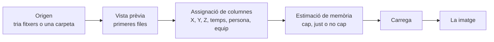

# Carregar dades

Abans que 3DHeat pugui dibuixar res necessita una taula: cada fila diu on era una cosa i, si ho tens, quan i qui era. Aquesta secció mostra com un fitxer es converteix en una imatge. Encara no tens dades? Prova les [dades de demostració](demo-data.md).

**Fes-ho ara:**

1. A la barra lateral del Mapa de calor obre **Origen** i prem **Fitxers…** (o deixa caure un fitxer o una carpeta a la zona de deixar anar).
2. Mira **Assignació de columnes**: les caselles normalment ja són plenes.
3. Comprova que **Estimació de memòria** diu *cap*.
4. Prem **Carrega**.

Tot el que mostra la pestanya Mapa de calor surt d'un sol **conjunt de dades**: una taula de files, cadascuna amb una posició i, opcionalment, un temps, una persona, un grup, una sessió, una direcció de mirada i qualsevol nombre de columnes extra guardades per filtrar. Aquesta secció explica com es fa un conjunt de dades.

## El camí dels fitxers a la imatge {#the-path-from-files-to-picture}

1. **Selecciona fitxers** al panell **Origen** -un fitxer, diversos, un arbre de carpetes, o arrossegant-los. S'accepten Parquet, CSV, Tacview, traces de GPS i més; la llista completa és a [Formats de dades](data-formats.md#files). Vegeu [Carregar fitxers](loading-files.md).
2. **Vista prèvia.** S'obre el primer fitxer de la selecció: els noms de les seves columnes, les seves primeres 50 files, quines columnes semblen numèriques, i (Parquet) el tipus lògic de cada columna i les instruccions de lectura pròpies del fitxer, l'entrada del peu `heat3d`.
3. **Assignació automàtica.** Les columnes s'assignen a rols -X, Y, Z, temps, persona, sessió, grup, direcció de mirada- i algunes es guarden per filtrar. Cada suposició es mostra al panell **Assignació de columnes** i es pot canviar. Vegeu [Assignació de columnes](column-mapping.md) i [Eixos, unitats i temps](axes-units-and-time.md).
4. **Recompte.** Es llegeix el nombre de files de cada fitxer (exacte a partir dels peus de Parquet, estimat per a CSV), així que el panell pot dir abans de carregar res quanta memòria necessita la càrrega i si hi cap. Si no hi cap, proposa carregar una de cada *N* files. Vegeu [Memòria i pressupostos](memory-and-budgets.md).
5. **Carrega.** Un treballador en segon pla analitza només les columnes assignades de cada fitxer -diversos fitxers alhora, fins al pressupost de [fils d'anàlisi](memory-and-budgets.md#parser-threads)- i els fusiona, en l'ordre de la selecció, en un sol conjunt de dades: un diccionari compartit de persones, grups i sessions per a tots els fitxers, un origen de temps comú, totes les files ordenades pel temps. Vegeu [Sessions, persones i grups](sessions-persons-groups.md).
6. **Pujada.** El fil principal anuncia «Pujant N files a la GPU» durant un fotograma, i després empaqueta les files a la memòria de la GPU dins del pressupost de la GPU. Vegeu [Residència de la memòria de la GPU](gpu-memory.md).
7. **Primera imatge.** La càmera enquadra les dades, el radi de l'sprite i la saturació es fixen a partir de l'extensió de les dades i del nombre de files, i després de 8 fotogrames renderitzats la saturació es mesura a partir de la mateixa imatge ([Color i exposició](colour-and-exposure.md)).

## Requisits, comprovats abans de carregar {#requirements-checked-before-a-load}

| Necessitat | Què passa sense ella |
|---|---|
| **Com a mínim dos de X / Y / Z** | La càrrega es refusa. Amb exactament dos, el tercer eix és 0 i les dades es dibuixen com un pla pla a l'escena 3D -que és el que vol un mapa de calor vist des de dalt. |
| Una columna de temps | Opcional. Sense ella, la línia de temps queda desactivada, la vista es queda en el mode **Tot** i la barra lateral ho diu. |
| Una columna de persona | Opcional. Cal per a la [superposició de figures](box-replay.md) (una figura per persona), la [calor de línia](line-heat.md) (el recorregut de cada persona), la interpolació, les estelles i l'historial de **Temps de vida**. |
| Una columna de grup | Opcional. Cal per a la [calor per equips](team-heat.md) i per al mode de [diferència](difference.md) (com a mínim dos grups). |

Un mode que les dades carregades no poden admetre apareix en gris a la barra de modes; si el poses a sobre, diu per què.

## Sense les teves pròpies dades {#without-your-own-data}

El panell **Conjunt de dades** (sota **Origen**) té un [generador sintètic](synthetic-generator.md) que produeix un conjunt de dades amb forma de battle royale de la mida que vulguis, útil per provar el visor i per veure què pot aguantar una màquina.

## Pàgines d'aquesta secció {#pages-in-this-section}

- [Carregar fitxers](loading-files.md) - selectors, carpetes, arrossegar i deixar anar, fusió de diversos fitxers, la regla del fitxer de moviment, el progrés i la cancel·lació
- [Assignació de columnes](column-mapping.md) - cada camp del panell d'assignació, com la detecció automàtica fa les suposicions, les pistes `heat3d`
- [Eixos, unitats i temps](axes-units-and-time.md) - eix vertical, inversions, escala d'unitats, unitats de temps, direcció de mirada
- [Sessions, persones i grups](sessions-persons-groups.md) - què fa cadascun, els límits, els noms compartits, la mida de les entitats, el panell Conjunt de dades
- [Generador sintètic](synthetic-generator.md)
- [Memòria i pressupostos](memory-and-budgets.md) - el model de petjada, la comprovació d'ajust, la reducció de files, el límit d'ordenació, els pressupostos de recursos
