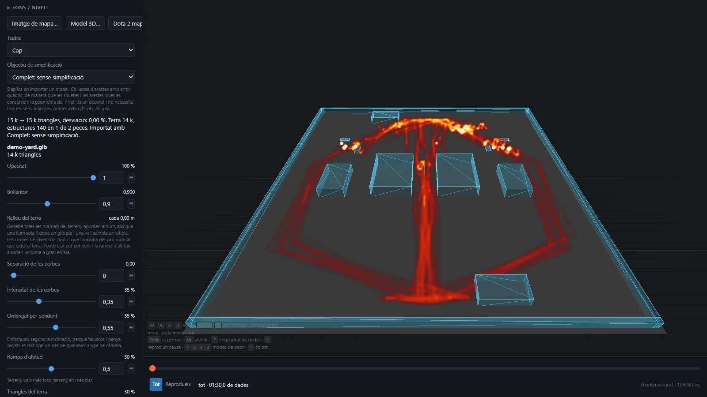
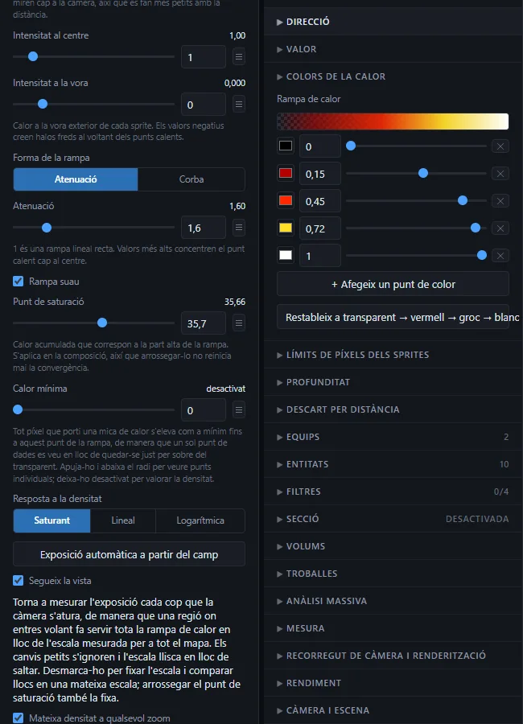

# Calor

La calor pinta els llocs on han passat moltes coses: vermell on ha passat una mica, blanc incandescent on n'ha passat molta. Respon a "on passa això, i quant".

La **Calor** (tecla 1) és el mode per defecte. Cada [fila](glossary.md) visible aporta un [sprite](glossary.md) rodó que mira la càmera; els sprites que se superposen se sumen en un buffer de coma flotant; la suma es mapa a través d'una rampa de color - per defecte transparent → vermell → groc → blanc - i es dibuixa sobre l'escena.

La imatge mostra la calor d'una ronda de tirador en un nivell amb edificis: els punts calents són a les habitacions i a les escales, no només al terra.

## Com s'usa {#how-to-use-it}

1. Carrega dades i prem `1` (o tria **Calor** a la barra de modes).
2. Si tot és blanc o en blanc, prem **Exposició automàtica a partir del camp** a la secció **Forma de la calor**.
3. Canvia el **Radi dels sprites** fins que els punts veïns es fonguin en franges: més petit mostra punts individuals, més gran mostra àrees.
4. Obre **Colors de la calor** per canviar els colors, o **Profunditat** per deixar que els turons i els murs amaguin la calor que hi ha darrere.

Els mateixos panells donen forma a la [Diferència](difference.md), a la [Calor per equips](team-heat.md) i a la [Calor en línies](line-heat.md); es diferencien en el que s'hi suma (amb signe, amb color, o al llarg de línies), no en la manera.

## Els panells i els seus valors per defecte {#the-panels-and-their-defaults}

Cada control s'explica a la seva pàgina; la columna Detalls enllaça a ella. Els controls lliscants tenen una caixa per escriure al costat i un mànec d'arrossegar (la petita nansa de la dreta: arrossega amunt o avall, més lluny és més ràpid, Shift per al fi); quan el recorregut d'un control lliscant acaba abans d'un límit real, el mànec pot passar-lo fins al *sostre de roda* indicat aquí. Els valors marcats com *en carregar* es recalculen per a cada conjunt de dades nou.

### Forma de la calor (oberta) {#heat-shape-open}

| Control | Per defecte | Rang (sostre de roda) | Detalls |
|---|---|---|---|
| **Radi dels sprites** | 6 m; en carregar extensió / 120 | 0,05-2000 m, logarítmic (50.000) | [Forma de l'sprite](sprite-shape.md#sprite-radius) |
| **Intensitat al centre** | 1 | 0-10 (1000) | [Forma de l'sprite](sprite-shape.md#centre-and-edge-intensity) |
| **Intensitat a la vora** | 0 | -2-10 (1000) | [Forma de l'sprite](sprite-shape.md#centre-and-edge-intensity) |
| **Forma de la rampa** | *Atenuació* | *Atenuació* / *Corba* | [Forma de l'sprite](sprite-shape.md#ramp-shape-falloff-or-curve) |
| **Atenuació** (només Atenuació) | 1,6 | 0,1-8 (64) | [Forma de l'sprite](sprite-shape.md#falloff) |
| **Rampa suau** (només Atenuació) | activat | | [Forma de l'sprite](sprite-shape.md#falloff) |
| Editor de corbes (només Corba) | preajust *Suau* | | [Forma de l'sprite](sprite-shape.md#the-curve-editor) |
| **Punt de saturació** | 24; en carregar una estimació, i després mesurat | 0,1-4000, logarítmic (10.000.000) | [Color i exposició](colour-and-exposure.md#saturation-point) |
| **Calor mínima** | desactivada (0) | 0-100% | [Color i exposició](colour-and-exposure.md#minimum-heat) |
| **Resposta a la densitat** | *Saturant* | *Saturant* / *Lineal* / *Logarítmica* | [Color i exposició](colour-and-exposure.md#density-response) |
| **Exposició automàtica a partir del camp** | | botó | [Color i exposició](colour-and-exposure.md#auto-exposure) |
| **Segueix la vista** | activat | | Torna a mesurar l'exposició cada vegada que la càmera s'atura, de manera que una regió on entres usa tota la rampa de color. Els canvis petits s'ignoren i l'escala llisca. Desmarca-la, o arrossega el **Punt de saturació**, per bloquejar l'escala i comparar llocs en una mateixa escala. [Color i exposició](colour-and-exposure.md#follow-the-view) |
| **Mateixa densitat a qualsevol zoom** | activat | | Un color vol dir el mateix nombre de files per àrea de terra, per molt a prop que estiguis. Un sprite que els límits de píxels engrandeixen (de lluny) o encongeixen (de prop) manté la calor que sumaria la seva mida real, de manera que una imatge exposada des de lluny no s'esvaeix quan hi voles. Desactivat, un sprite limitat suma tot el seu pes amb la seva mida limitada. [Forma de l'sprite](sprite-shape.md#pixel-clamps) |
| **Aplana sobre el pla del terra** | desactivat | | [Forma de l'sprite](sprite-shape.md#flatten-onto-ground-plane) |

### Colors de la calor (tancada) {#heat-colours-closed}

| Control | Per defecte | Detalls |
|---|---|---|
| Mostres de grup i **Separació de colors** (només Calor per equips) | 1,4 | [Calor per equips](team-heat.md) |
| Editor de **Rampa de calor** (*Positiva (equips additius)* a Diferència, *Rampa d'opacitat* a Calor per equips) | transparent → vermell → groc → blanc | [Color i exposició](colour-and-exposure.md#the-ramp-editor) |
| **Restableix a transparent → vermell → groc → blanc** | | |
| Rampa **Negativa (equips que resten)** (només Diferència) | transparent → verd → blau → porpra | [Diferència](difference.md#colours) |

### Límits de píxels dels sprites (tancada) {#sprite-pixel-clamps-closed}

| Control | Per defecte | Rang (sostre de roda) | Detalls |
|---|---|---|---|
| **Radi mínim en píxels** | 1 px | 0-16 (512) | [Forma de l'sprite](sprite-shape.md#pixel-clamps) |
| **Radi màxim en píxels** | 96 px | 2-1024, logarítmic (8192) | [Forma de l'sprite](sprite-shape.md#pixel-clamps) |

### Profunditat (oberta) {#depth-open}

| Control | Per defecte | Detalls |
|---|---|---|
| **Amaga darrere del terreny** | activat | [Profunditat i retall](depth-and-culling.md#hide-behind-terrain) |
| **Amagat darrere de la geometria** | 0,8 (*80% més fosc*) | [Profunditat i retall](depth-and-culling.md#hidden-behind-geometry) |

### Retall per distància (tancada) {#distance-culling-closed}

| Control | Per defecte | Rang (sostre de roda) | Detalls |
|---|---|---|---|
| **Proper** | apagat (0) | 0,5-5000 m, logarítmic, mínim de la pista = apagat (200.000) | [Profunditat i retall](depth-and-culling.md#distance-culling) |
| **Llunyà** | apagat (0) | 1-200.000 m, logarítmic, mínim = apagat (10.000.000) | [Profunditat i retall](depth-and-culling.md#distance-culling) |
| **Talla en un pla** | activat | | [Profunditat i retall](depth-and-culling.md#distance-culling) |
| **Talla també el nivell** | activat | | [Profunditat i retall](depth-and-culling.md#distance-culling) |

Tecles: `[` i `]` empenyen el límit llunyà cap a dins i cap a fora, `\` l'activa o desactiva ([Profunditat i retall](depth-and-culling.md#keyboard)).

### Direcció i Valor {#direction-and-value}

Hi ha dues seccions més sota de Forma de la calor. **Direcció** dibuixa cada fila com una falca i afegeix fletxes: mira [Calor direccional](directional-heat.md). **Valor** pondera la calor segons el que cada fila va costar o guanyar: mira [Ponderació de valors](value-weighting.md).

## Què es desa {#what-is-saved}

Els ajustos de calor d'aquí dalt no es guarden entre sessions: en recarregar la pàgina es recuperen els valors per defecte. Dues coses es guarden al navegador: la darrera velocitat de reproducció (`heat3d.speed`, mira [Línia de temps](timeline.md)) i els ajustos de les figures llunyanes de la [superposició de figures](box-replay.md) (estil de símbol, mida, marques d'impacte i així successivament). També ho són l'idioma, els [eixos del món invertits](camera.md#invert-world-axis), els noms de cotxe recordats de la pestanya de carreres i la [biblioteca de nivells](level-library.md). La llista completa és a [Ajustos guardats](ref-settings-storage.md).
