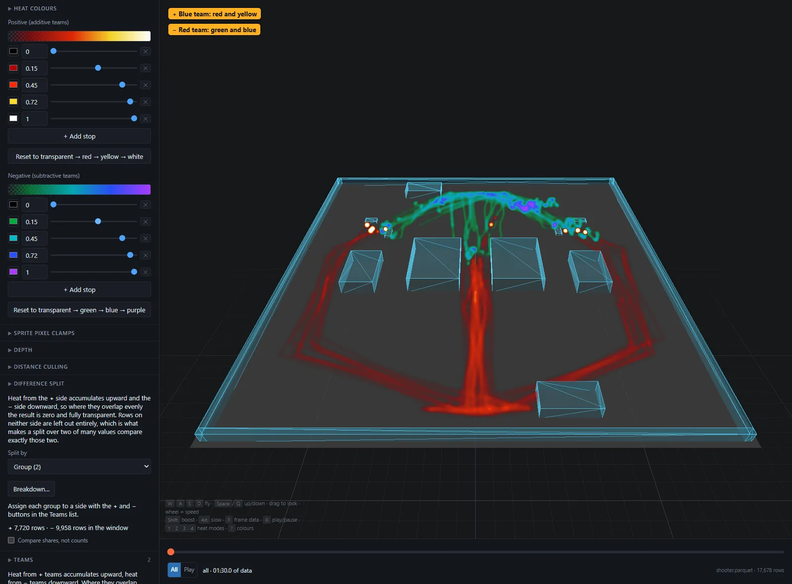

# 3DHeat

3DHeat mostra on han passat les coses en un joc -on han anat, on han lluitat i on han caigut els jugadors- com a colors lluminosos pels quals pots volar, o com a petites figures 3D que repeteixen la partida.

Carrega posicions -CSV, Parquet, gravacions de Tacview, repeticions convertides, un sol fitxer, una carpeta o milers de partides- i mira-les com a **mapa de calor pel qual pots volar**, com a **figures que repeteixen la partida**, com a línies al llarg dels recorreguts que va fer la gent, o com una població contra una altra. Troba sol el que destaca, i funciona del tot al navegador: no es puja res a cap lloc.


**Ets nou aquí?** Crea les [dades de demostració](demo-data.md) i segueix els seus set passos. Totes les imatges d'aquest lloc s'han fet amb elles.

## Què fa {#what-it-does}

| | |
|---|---|
|  | **[Modes de calor](heat-modes.md)** - calor, [diferència](difference.md) (vermell on un bàndol n'ha tingut més, blau-verd on n'ha tingut més l'altre), [calor per equips](team-heat.md), [calor de línia](line-heat.md); [calor direccional](directional-heat.md) amb sectors, camps de fletxes i gràfics polars; calor [ponderada pel valor](value-weighting.md): què costen les armes, els vehicles i el combustible. |
|  | **[Repetició de partida](match-replay.md)** - cada unitat com la [figura](figures.md) del que és, símbols NATO o russos a distància, míssils i traçadors, marques d'impacte, restes, incendis, torretes, objectius, càmeres a l'estil de Tacview i pantalla tàctica; [moltes partides alhora](many-matches.md). |
|  | **[Troballes](insights.md)** - posicions fortes, terreny mortal, trampes d'aparició, colls d'ampolla i jugadors destacats, trobats i ordenats amb les proves; un resum escrit, opcionalment fet per una IA que tries; un comentarista per a una partida; la [lent del coneixement](knowledge.md). |
|  | **[Volums](volumes.md)** - dibuixa caixes, prismes, cilindres i esferes, filtra fins a ells, compta el que passa a dins, exporta-ho i compara llocs un al costat de l'altre; [desglossament](breakdown.md) de qui i què funciona millor en un lloc. |
|  | **[Filtres](filters.md)** - per tipus d'esdeveniment, jugador o IA, classe de vehicle, valor, qualsevol columna, a la targeta gràfica amb qualsevol mida de dades. |
|  | **[Nivells](levels.md)** - imatges de mapa, nivells 3D fets amb les [eines de dades](#related-repositories), simplificació, el [fons del món](world-backdrop.md) amb terreny real per a dades de vol. |

També: la pestanya [Anàlisi de curses](race-analysis.md) per a voltes de jocs de curses, la pestanya [Partida](match-analysis.md) per als resums de Counter-Strike 2, la [Pissarra tàctica](tactics-board.md) per a plans sobre un nivell, la [anàlisi d'impactes](hit-analysis.md) per vehicle, l'[anàlisi massiva](mass-analysis.md) de milers de partides, les [trajectòries de càmera i el vídeo](camera-path-and-video.md), [40 idiomes](languages.md) i [unitats mètriques o imperials](settings.md).

## Les pestanyes {#the-tabs}

Les pestanyes són a la part superior de la barra lateral, sota el nom, les unitats i el menú d'idioma.

| Pestanya | Per a què serveix |
|---|---|
| **Mapa de calor** | Qualsevol taula de posicions: els modes de calor, la superposició de figures, els filtres, els volums, les troballes, els nivells, la mesura i el vídeo. |
| **Anàlisi de curses** | Dues o més voltes del mateix circuit: on es perd temps, per què, i què canviar. |
| **Partida** | La repetició amb figures d'una partida, i els resums de partides de Counter-Strike 2. |
| **Tàctica** | Plans sobre un nivell: figures, recorreguts, armes llançades, àrees i notes en passos que es reprodueixen. |
| **Vehicles** | On ha estat tocada cada unitat, per qui i amb què. |

## Instal·lació i execució {#install-and-run}

### Windows, la manera fàcil {#windows-the-easy-way}

L'arrel del repositori té tres fitxers per lots.

| Fitxer | Què fa |
|---|---|
| `start.bat` | Inicia el visor. Troba Node.js encara que no sigui a `PATH` (busca a `%ProgramFiles%\nodejs`, `%ProgramFiles(x86)%\nodejs` i `%LOCALAPPDATA%\Programs\nodejs`), i si Node.js no hi és, ofereix instal·lar la versió LTS amb `winget install -e --id OpenJS.NodeJS.LTS`. En la primera execució pregunta abans de baixar les dependències (uns 300 MB dins de `node_modules\` a la carpeta, res de sistema). Es nega a iniciar-se quan ja hi ha alguna cosa escoltant el port 5273, i t'indica `restart.bat`. Quan la carpeta és un checkout de git sense canvis locals i hi ha una versió més nova, pregunta si vols actualitzar (Y/N; sense resposta en 60 s es queda aquesta versió; vegeu [Actualitzacions](updates.md)). Després executa el servidor de desenvolupament a `http://127.0.0.1:5273/` i obre el navegador. **La finestra és el servidor**: deixa-la oberta, tanca-la o prem Ctrl+C per aturar-lo. |
| `restart.bat` | Executa `stop.bat quiet` i després `start.bat`. Només cal després de canviar `vite.config.ts`, afegir una dependència, o quan el servidor s'ha encallat -els canvis al codi font es recarreguen en calent-. |
| `stop.bat` | Atura el que escolti al port 5273, pel número de procés que troba amb `netstat`, mai pel nom d'imatge, així que els altres processos de Node.js de la màquina no es toquen. Espera uns dos segons que el socket s'alliberi. Amb l'argument `quiet` no es para al final. |

### Manualment (qualsevol SO) {#by-hand-any-os}


```bash
git clone --recursive https://github.com/Holdi601/3DHeat.git
cd 3DHeat
npm install
npm run dev      # http://127.0.0.1:5273
```

La carpeta `exporters/` conté les eines de dades separades com a submòduls de git, cadascuna el seu propi repositori; després d'un clonat normal executa `git submodule update --init`. El visor en si no les necessita per funcionar. `exporters/ext/` conté els convertidors opcionals (repeticions de War Thunder, World of Tanks, World of Warships i Squad; mapes de DCS i IL-2), separats perquè un problema amb un d'ells no afecti res més.

No ve amb cap dada de joc: els nivells, els mapes i les gravacions es fan a la teva pròpia màquina amb les eines, a partir de jocs que tens.

### Scripts de npm {#npm-scripts}

| Script | Què executa |
|---|---|
| `npm run dev` | El servidor de desenvolupament de Vite al port 5273, lligat a `127.0.0.1`. |
| `npm run build` | Comprovació de tipus (`tsc --noEmit`) i un paquet de producció a `dist/`. |
| `npm run preview` | Serveix el paquet de producció. |
| `npm run typecheck` | Només la comprovació de tipus. |
| `npm test` / `npm run test:watch` | Proves unitàries i d'integració (vitest). |
| `npm run smoke` | Fa anar l'aplicació real en un Chromium sense cap, i comprova que el canvas té píxels amb color de dades; les captures van a `tools/.smoke/`. Espera que el servidor de desenvolupament estigui en marxa. |
| `npm run smoke:f16` | La mateixa suite amb `?heat=f16`, forçant el camí d'acumulació en mitja precisió (vegeu [Acumulació en mitja precisió](half-float-accumulation.md)). |
| `npm run bench` | Prova de rendiment de la càrrega, escriu `tools/.smoke/ingest-bench.json`. |
| `npm run test:heavy` | Proves que necessiten fitxers de dades reals i grans; se salten soles quan els fitxers no hi són. |
| `npm run inspect -- <file.parquet>` | Mostra l'esquema d'un fitxer Parquet i algunes files (`tools/inspect-parquet.mjs`). |

### Què afegeix el servidor de desenvolupament {#what-the-dev-server-adds}

El visor és una pàgina web estàtica, però el servidor de desenvolupament (vegeu `vite.config.ts`) afegeix dues rutes locals que un desplegament estàtic de `dist/` no té:

- `/__host/memory` informa de la RAM instal·lada i lliure de la màquina i, quan ho pot llegir, de la memòria de la targeta gràfica (amb `nvidia-smi`, o a Windows des de l'entrada del registre de l'adaptador de pantalla). Això permet que els [pressupostos de memòria](memory-and-budgets.md) usin xifres reals en lloc de les estimacions limitades del navegador.
- `/__heat3d/update` comprova si el checkout va enrere i pot fer-lo avançar ([Actualitzacions](updates.md)).

El servidor només es lliga a `127.0.0.1`, així que cap de les dues rutes és accessible des de la xarxa. Obre'l com a `http://127.0.0.1:5273`: `localhost` pot resoldre's a l'adreça de loopback IPv6 `::1`, on no escolta ningú. No envia capçaleres d'aïllament entre orígens (COOP/COEP): res del visor usa `SharedArrayBuffer`, i els treballadors passen les seves dades per transferència, que no en necessita.

## Requisits del navegador i de la GPU {#browser-and-gpu-requirements}

- **Un navegador amb WebGPU o WebGL2.** Primer es prova WebGPU (Chrome i Edge el tenen); sense ell s'usa el motor WebGL2. WebGL2 ha d'oferir `EXT_color_buffer_float` (renderitzar a textures de coma flotant), si no el visor mostra «No es pot inicialitzar el renderitzador». Vegeu [Els dos motors](backends.md). El visor es desenvolupa i es prova a Chromium; els altres navegadors no estan verificats.
- **Acceleració per maquinari activada.** Quan el navegador dibuixa a la CPU (SwiftShader, llvmpipe, el Microsoft Basic Render Driver i similars), un bàner vermell a la part superior de la barra lateral ho diu i explica com arreglar-ho. Vegeu [Detecció de renderitzat per programari](software-rendering.md).
- **Una GPU dedicada ajuda, però no és obligatòria.** Els dos motors demanen l'adaptador d'alt rendiment. La quantitat de dades que es poden tenir a la GPU és un pressupost que pots veure i canviar ([Memòria i pressupostos](memory-and-budgets.md)).
- **Les funcions opcionals** usen més APIs del navegador: el renderitzat de vídeo necessita `VideoEncoder` de WebCodecs amb VP9 o VP8 ([Trajectòria de càmera i vídeo](camera-path-and-video.md)); la simplificació de malla dels nivells necessita WebAssembly; arrossegar carpetes usa l'API de File i Directory Entries; la biblioteca de nivells usa IndexedDB; els gamepads usen l'API de Gamepad.

## Mapa de la documentació {#documentation-map}

**Començar**: [Dades de demostració](demo-data.md) · [Carregar dades](getting-data-in.md) ([carregar fitxers](loading-files.md), [assignació de columnes](column-mapping.md), [eixos, unitats i temps](axes-units-and-time.md), [sessions, persones i grups](sessions-persons-groups.md), [Tacview](tacview-acmi.md), [convertidors](converters.md), [.3dheat](container.md), [memòria i pressupostos](memory-and-budgets.md))

**Veure**: [Modes de calor](heat-modes.md) ([calor](heat.md), [forma de l'sprite](sprite-shape.md), [color i exposició](colour-and-exposure.md), [profunditat i retallada](depth-and-culling.md), [diferència](difference.md), [calor per equips](team-heat.md), [calor de línia](line-heat.md), [repetició de caixes](box-replay.md), [calor direccional](directional-heat.md), [ponderació de valors](value-weighting.md)) · [Línia de temps](timeline.md) · [Nivells](levels.md) ([imatges de mapa](map-images.md), [nivells 3D](model-levels.md), [aspecte](level-appearance.md), [biblioteca](level-library.md), [fons del món](world-backdrop.md), [les seves fonts](world-backdrop-sources.md)) · [Càmera](camera.md) ([gamepad](gamepad.md), [tecles](keyboard-reference.md)) · [Trajectòria de càmera i vídeo](camera-path-and-video.md)

**Analitzar**: [Filtres i eines](filters-and-tools.md) ([filtres](filters.md), [equips](teams-list.md), [entitats](entities.md), [llesca](slice.md), [mesurar](measure.md), [volums](volumes.md), [desglossament](breakdown.md)) · [Troballes](insights.md) ([lent del coneixement](knowledge.md)) · [Anàlisi massiva](mass-analysis.md)

**Repetició**: [Repetició de partida](match-replay.md) · [Moltes partides alhora](many-matches.md) · [Figures](figures.md) ([a la superposició de figures](figure-replay.md), [crèdits](figure-credits.md)) · [Paritat amb Tacview](tacview-parity.md) · [Anàlisi d'impactes](hit-analysis.md)

**Altres pestanyes**: [Anàlisi de curses](race-analysis.md) ([el mètode](race-analytics.md), [altres jocs](other-games.md)) · [Anàlisi de partides](match-analysis.md) · [Pissarra tàctica](tactics-board.md) ([velocitats](tactics-speeds.md))

**El visor**: [Glossari](glossary.md) · [Configuració, unitats i tecles](settings.md) · [Idiomes](languages.md) · [Actualitzacions](updates.md) · [Detalls interns del renderitzat](rendering-internals.md) ([motors](backends.md), [acumulació](accumulation.md), [mostreig i pressupostos](sampling-and-budgets.md), [mitja precisió](half-float-accumulation.md), [memòria de la GPU](gpu-memory.md), [renderitzat per programari](software-rendering.md), [rendiment i estadístiques](performance-and-stats.md)) · [Formats de dades](data-formats.md) · [Referència](reference.md) · [Manteniment de la documentació](maintaining.md)

## Repositoris relacionats {#related-repositories}

El visor llegeix dades; aquestes eines les fan. Cadascuna és el seu propi repositori públic (MIT) amb la seva pròpia documentació. Cap d'elles no porta dades de joc: els nivells, els mapes i les gravacions es fan a la teva màquina, a partir de jocs que tens.

| Repositori | Què fa | Per a què serveix |
|---|---|---|
| [3DHeat-GameFiles](https://github.com/Holdi601/3DHeat-GameFiles) | Llegeix circuits i nivells dels arxius que els jocs incorporen (Forza Horizon, BeamNG, Assetto Corsa Rally; lectors d'Unreal, Unity, Frostbite i Source 2) en glTF | un nivell 3D sota el teu calor o la teva repetició |
| [3DHeat-GameCapture](https://github.com/Holdi601/3DHeat-GameCapture) | Grava la telemetria de voltes de les interfícies que publiquen els jocs de curses, i reconstrueix nivells a partir de vídeo de joc | voltes per a l'Anàlisi de curses; un nivell quan no es poden llegir fitxers |
| [3DHeat-UnrealExporter](https://github.com/Holdi601/3DHeat-UnrealExporter) | Connector de l'editor d'Unreal que exporta un nivell com un sol fitxer glTF | nivells dels teus propis projectes d'Unreal |
| [3DHeat-CS2](https://github.com/Holdi601/3DHeat-CS2) | Demos de Counter-Strike 2 en taules de mapa de calor i resums de partides, mapes de CS2 en geometria | calor de CS2, repeticions i la pestanya Partida |
| [3DHeat-Watcher](https://github.com/Holdi601/3DHeat-Watcher) | Registra la teva partida en segon pla a partir del que publiquen els jocs: telemetria, integracions d'estat de joc, registres i repeticions | les teves pròpies estadístiques sense fer res a mà |
| [3DHeat-Ext-WarThunder](https://github.com/Holdi601/3DHeat-Ext-WarThunder) | Repeticions de War Thunder (`.wrpl`) en taules: trajectòries aèries i terrestres, trets, impactes, morts, torretes, objectius | repeticions de War Thunder, marques d'impacte i troballes |
| [3DHeat-Ext-WoT](https://github.com/Holdi601/3DHeat-Ext-WoT) | Repeticions de World of Tanks en taules: la posició de cada vehicle, morts i eliminacions | calor i repeticions de World of Tanks |
| [3DHeat-Ext-WoWs](https://github.com/Holdi601/3DHeat-Ext-WoWs) | Repeticions de World of Warships en taules: la posició de cada vaixell i els enfonsaments | calor i repeticions de World of Warships |
| [3DHeat-Ext-Squad](https://github.com/Holdi601/3DHeat-Ext-Squad) | Demos de servidors de Squad en taules: la posició, l'equip i l'esquadra de cada jugador | calor i repeticions de Squad |
| [3DHeat-Ext-DCS](https://github.com/Holdi601/3DHeat-Ext-DCS) | Terrenys de DCS World de la teva pròpia instal·lació a nivells: terreny, carreteres, pobles, aeròdroms, camps i aigua | DCS i gravacions de Tacview sobre el seu terreny real |
| [3DHeat-Ext-IL2](https://github.com/Holdi601/3DHeat-Ext-IL2) | Mapes de IL-2 Great Battles a nivells | gravacions d'IL-2 sobre el seu mapa |

## Mapa del codi font, en resum {#source-layout-briefly}

| Carpeta | Contingut |
|---|---|
| [`src/data/`](https://github.com/Holdi601/3DHeat/tree/main/src/data) | Selecció de fitxers, càrrega de CSV i Parquet, assignació automàtica, validació, model de memòria, constructor de conjunts de dades, anàlisi de models, classificació, simplificació, biblioteca de nivells |
| [`src/render/`](https://github.com/Holdi601/3DHeat/tree/main/src/render) | El bucle de fotogrames (`engine.ts`), mostreig, els dos motors, càmera, gamepad, mesura, trajectòria de càmera, gravació de vídeo |
| [`src/state/`](https://github.com/Holdi601/3DHeat/tree/main/src/state) | L'estat de l'aplicació (`store.ts`) amb cada valor per defecte, els tipus del domini (`types.ts`), la corba de l'sprite |
| [`src/ui/`](https://github.com/Holdi601/3DHeat/tree/main/src/ui) | Els panells de la barra lateral, la línia de temps, les superposicions |
| [`src/race/`](https://github.com/Holdi601/3DHeat/tree/main/src/race), [`src/match/`](https://github.com/Holdi601/3DHeat/tree/main/src/match) | Les pestanyes Anàlisi de curses i Partida |
| [`src/i18n/`](https://github.com/Holdi601/3DHeat/tree/main/src/i18n) | Traduccions |
| [`src/insights/`](https://github.com/Holdi601/3DHeat/tree/main/src/insights) | Troballes: detectors, resum, comentarista, proveïdors d'IA, la lent del coneixement |
| [`src/mass/`](https://github.com/Holdi601/3DHeat/tree/main/src/mass) | Anàlisi massiva de moltes partides |
| [`src/volumes/`](https://github.com/Holdi601/3DHeat/tree/main/src/volumes) | Volums, les seves estadístiques, exportació i comparació |
| [`src/breakdown/`](https://github.com/Holdi601/3DHeat/tree/main/src/breakdown) | Desglossament i factors |
| [`src/overlay/`](https://github.com/Holdi601/3DHeat/tree/main/src/overlay) | La superposició de moltes partides |
| [`src/figures/`](https://github.com/Holdi601/3DHeat/tree/main/src/figures) | El catàleg de figures i el seu constructor |
| [`src/vehicle/`](https://github.com/Holdi601/3DHeat/tree/main/src/vehicle) | Anàlisi d'impactes (pestanya Vehicles) |
| [`src/tactics/`](https://github.com/Holdi601/3DHeat/tree/main/src/tactics) | La pissarra tàctica |
| [`src/world/`](https://github.com/Holdi601/3DHeat/tree/main/src/world) | El fons del món |
| [`src/units/`](https://github.com/Holdi601/3DHeat/tree/main/src/units) | Unitats de mesura |
